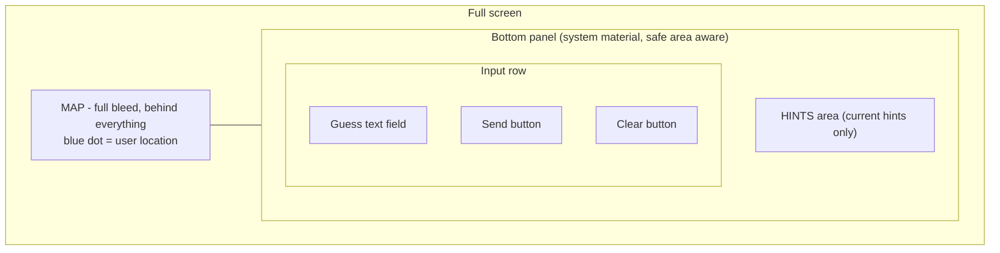
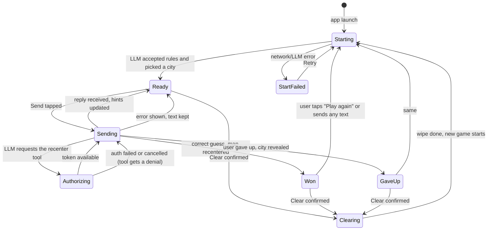
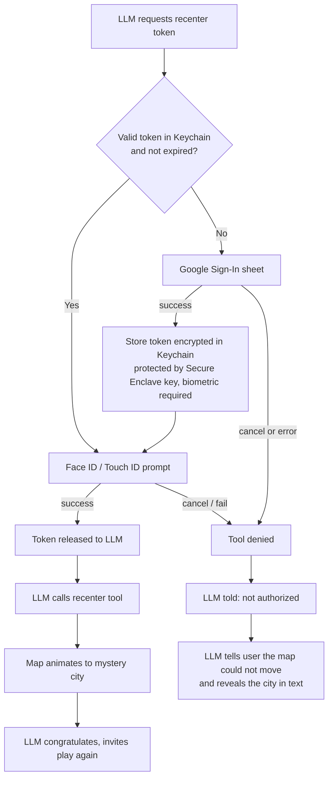

# Exhibit E-A: UX Interactions Spec, "Mystery City" iOS Prototype

Scope: one screen, one overlay, two system sheets. No settings, onboarding, history, or feedback screens.

## 1. Principles
- The map fills the whole screen. Everything else floats on top of it in a bottom panel.
- Standard controls only: system fonts, SF Symbols, system materials, light and dark mode from the system.
- One screen. The only things that appear on top of it are the Google sign-in sheet, the Face ID prompt, and a Clear confirmation.
- Chat transcript is not shown. The requirements show only the current hints, so the user sees hints and nothing else from the LLM. (See assumption A3.)

## 2. Layout (portrait)

Placement, top to bottom within the panel:
1. Status line (one line, only visible when there is something to report: a progress or error message).
2. Hints area.
3. Input row: text field (flexible width), then Send, then Clear.

- The hints area sits directly above the text box, as required. It has a fixed maximum height (about 4 lines) and scrolls inside itself if the hints are longer. This stops long hints from covering the map or pushing the text box off screen.
- The panel moves up with the keyboard so the text field, Send and Clear stay fully visible. The map does not resize; the panel simply sits above the keyboard.
- Large Dynamic Type sizes: the panel grows, hints scroll, the input row wraps Send and Clear below the text field rather than shrinking or overlapping. All tap targets are at least 44 x 44 pt.
- Landscape: the panel is limited to the bottom third and the hints area scrolls. No separate landscape layout is designed beyond this.
- Light and dark: the panel uses a system material; the map follows system appearance.

## 3. Element inventory

| Element | Appearance | Tap / action | Enabled when |
|---|---|---|---|
| Map | Standard Apple map, user location dot | Pan, pinch, rotate as normal | Always, except it is programmatically moved on a win |
| Hints area | Plain text, one block per current hint | Not interactive (text is selectable only if cheap) | n/a |
| Status line | Small secondary text, optional spinner | Not interactive | Visible only during work or error |
| Guess text field | Placeholder "Guess a city or ask for a hint" | Opens keyboard. Return key = Send (same rules as Send) | Enabled except while Clearing |
| Send | Filled button, "arrow.up" symbol, label "Send" for VoiceOver | Sends text (see 5.2) | Text has at least one non-space character AND not Clearing AND not already Sending AND game is ready (see 5.1) |
| Clear | Plain/bordered button, "trash"-style or "arrow.counterclockwise" symbol, label "Clear" | Opens confirmation, then clears (see 5.5) | Not Sending AND not already Clearing |

The "give up" action (requirement: a session ends on a correct guess or giving up) has no button in the requirements. Assumption A1: giving up is typed ("I give up") and the LLM reveals the city. No extra control is added. Note that on give up the requirements do not say whether the map recenters. Assumption A2: it does not recenter, because the recenter tool is only called on a correct guess; the city name is revealed in the hints area.

## 4. State model

"Busy" means Starting, Sending, Authorizing or Clearing. Rules derived from the requirements:
- Send is disabled while Clearing, and while Sending (it would otherwise double-send).
- Clear is disabled while Sending. It is also disabled during Authorizing, since that is part of Sending.
- Clear is allowed during Starting? Requirements are silent. Assumption A4: Clear is disabled during Starting too (it counts as sending the rules), and enabled in StartFailed.

## 5. Interactions in detail

### 5.1 Launch
1. Map appears immediately, full screen.
2. First launch only: the system location permission prompt ("Allow While Using App"). The map starts on a default wide view until location arrives, then animates (about 1 s, system camera animation) to center on the user, at roughly city scale.
3. In parallel, the app sends the game rules to the LLM. Status line: spinner plus "Picking a mystery city...". Text field is visible but Send is disabled until Ready. Typing is allowed.
4. When the LLM replies, the first hints replace the placeholder text in the hints area. State becomes Ready. Status line disappears.
- Location denied or unavailable: the map shows a default world/region view, a one-line status "Location is off. Map shows a default area." with no blocking. The game works without it. (The requirement "centered on current location" cannot be met; this is the fallback.)
- Start fails: status line shows "Couldn't start the game." with a Retry button inline. Send stays disabled. Retry returns to Starting.

### 5.2 Send a guess or question
1. User types. Send turns enabled as soon as there is non-whitespace text.
2. Tap Send (or keyboard Return): text clears from the field, the keyboard stays up, status line shows spinner plus "Thinking...". Send and Clear are both disabled. Typing stays allowed so the user can draft the next message, but Send stays disabled until the reply arrives. (Assumption A5.)
3. Reply arrives: hints area replaces its entire content with the new hints. Old hints disappear (no history, no fade-trail; a short cross-fade is acceptable). Status line disappears. Send re-evaluates against any text already drafted.
4. If sending fails (offline, timeout, LLM error): status line shows the error in plain words ("Couldn't reach the game. Try again.") with a Retry button. The user's text is put back in the field so nothing is lost. Clear becomes enabled again.
- Timeout: show an error after 30 s with no reply (assumption A6; the real number is up to engineering). There is no Cancel button, since the requirements do not ask for one and it would let Send/Clear rules be bypassed. This does mean a hung request blocks Clear until the timeout; that is why the timeout exists.

### 5.3 Correct guess and recenter (authorization)
1. The LLM decides the guess is correct and asks to call the recenter tool. It needs a token from the front end.
2. Status line: spinner plus "Checking sign-in...". Send and Clear remain disabled (still Sending).
3. Decision on token:

4. Google Sign-In: the standard Google sheet (system web authentication session). First use only, or after the token expires. The user picks an account and consents. Cancelling returns to the game with the status line "Sign-in cancelled. Map not moved." and the LLM is told the tool is denied.
5. Biometric: the standard system Face ID / Touch ID prompt, reason text: "Allow the game to move the map". Needed every time the token is read from the Keychain, even when the token is still valid (reuse within lifetime means no new Google sign-in; the biometric check is part of reading the token). See Q2.
   - Biometric fail: the system allows retries and shows its own passcode fallback (assumption A7: passcode fallback allowed).
   - Biometric cancelled: same as denied, "Authorization cancelled. Map not moved."
   - No biometrics enrolled: skip the biometric step with passcode only; if no passcode on device either, the token cannot be stored, show "Set a device passcode to continue" and treat as denied.
6. On success the map animates (about 2 s) to the city's lat/lon, with a standard pin dropped on it. The pin is not labelled with the name, unless the city has already been revealed in text (it is revealed now, since the session ended).
7. The hints area now shows the LLM's congratulation including the city name and an invitation to play again. A "Play again" button appears in the status line position (see 5.4).
- Token expired mid-session: next recenter attempt goes through the Google sheet again, no extra message.
- The token is never displayed to the user.

### 5.4 End of session and play again
- Won or GaveUp: the city name is allowed to show (in the LLM's text). The text field stays enabled.
- "Play again" button (inline, replaces the status line) starts a new game: same as Clear without confirmation, because the session is already over. It removes the pin, keeps the map where it is, and goes to Starting. Sending any text while ended is treated as "yes, play again" (assumption A8: the LLM handles this conversationally, and the app starts a new game only through the button or Clear).
- The requirements say the LLM "invites the user to play again" but give no mechanism. The button is the minimum mechanism. Q3.

### 5.5 Clear
1. Tap Clear (when enabled): a confirmation appears (standard action sheet): "Start a new game?" with a destructive "Clear and restart" and "Cancel". Clear erases the whole conversation and a mis-tap in a usability test would corrupt the session. (Q5)
2. Confirm: Send is disabled, Clear is disabled, status line "Clearing...". Hints area is emptied, the text field is emptied, the map pin is removed. All history, system prompt and user prompt context are dropped.
3. Done: automatically goes to Starting (a new city is chosen by the LLM, see 5.1). The map does not move back to the user. (Assumption A9; Q4.)
4. Clear failing: shows "Couldn't clear. Try again." and keeps the old state, with Clear re-enabled.
- The Google token is not cleared by Clear (it is not conversation context). It remains in the Keychain until it expires. Q6.

## 6. Progress and error summary

| Situation | What the user sees | Send | Clear |
|---|---|---|---|
| Starting | Spinner + "Picking a mystery city..." | Off | Off |
| Ready, empty field | Hints shown | Off | On |
| Ready, text present | Hints shown | On | On |
| Sending | Spinner + "Thinking..." | Off | Off |
| Authorizing | Spinner + "Checking sign-in..." plus system sheets | Off | Off |
| Clearing | Spinner + "Clearing..." | Off | Off |
| Start failed | Message + Retry | Off | On |
| Send failed | Message + Retry, text restored | On if text present | On |
| Offline | "You're offline." | Off | On |
| Won / gave up | Result text + Play again | On | On |

Offline detection is by failure of a request, not a separate banner. There is no background retry.

## 7. Accessibility and platform notes
- VoiceOver: Send ("Send guess"), Clear ("Clear game"), hints area labelled "Current hints" and announced when it updates; status line changes are announced.
- Dynamic Type, Reduce Motion (swap the map fly animation for a direct jump), Increase Contrast, and Bold Text are inherited from system controls.
- Haptics: none required; a light success haptic on correct guess is optional.
- iPad: same layout, panel capped at a readable width and anchored to the bottom. Not in scope for testing unless stated.
