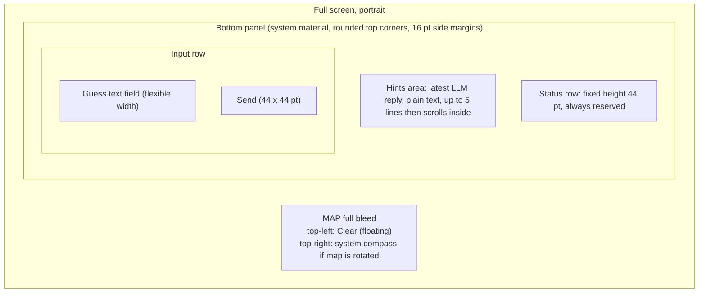
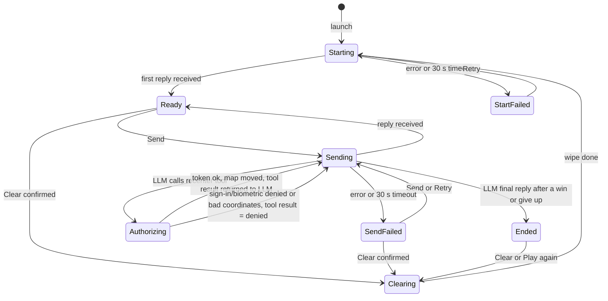
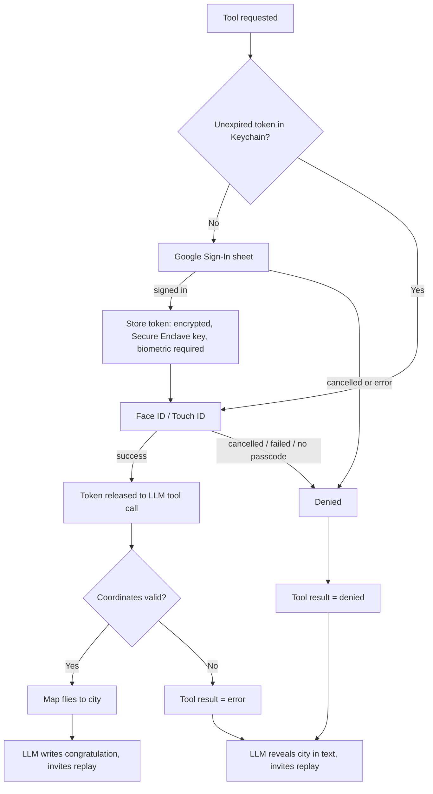

# Exhibit E-A v2: UX Interactions Spec, "Mystery City" iOS Prototype

Scope: iPhone only, portrait only, one screen. Overlays: the Clear confirmation, the location permission prompt, the Google sign-in sheet, and the Face ID prompt. No settings, onboarding, history or feedback screens.

Fixed by the product owner (not re-opened here): give-up is a typed phrase; biometric check on every token read; Google sign-in is not repeated within the token lifetime; Clear asks for confirmation, leaves the map where it is, and keeps the Google token; if sign-in or biometrics fail on a win, the LLM reveals the city in text and the map does not move; all LLM replies appear in the hints area; sign-in happens just in time at the win; real iPhone; Google test-mode OAuth client.

## 1. Principles
- The map fills the whole screen. One bottom panel and one small floating button sit on top of it.
- Standard controls, system fonts, SF Symbols, system materials, light and dark from the system.
- One rule for text: the hints area shows the full text of the latest LLM reply and nothing else (hints, congratulation, city reveal). App messages (progress, errors, buttons) go in the status row, never in the hints area.
- Portrait lock removes the landscape-plus-keyboard problem entirely. A usability test on a phone does not need landscape.

## 2. Layout

Top to bottom inside the panel: hints area, status row, input row. The hints area is above the text box as required.

- Status row is always reserved (44 pt), so nothing jumps when messages appear or go. Cost: about 44 pt less map. When empty it is blank. It holds, left to right: a spinner or message text, then an optional inline button (Retry or Play again) with a full 44 pt tap target.
- Clear is a floating capsule button at the top-left under the status bar, on a system material so it reads over any map. It is deliberately far from Send to prevent mis-taps and to keep the panel small. It does not overlap the compass, the user-location button, or the panel. Label "Clear" with the "arrow.counterclockwise" symbol (text plus icon, so it is not just an icon).
- The system map controls: only the compass is shown, and only while the map is rotated. No other map buttons. Location dot is the standard blue dot.
- With the keyboard up, the panel rides above the keyboard; all three panel rows stay fully visible; the hints area shrinks to 3 lines then scrolls. The map does not resize.
- Dynamic Type: text grows; at the largest sizes the hints area scrolls rather than the panel growing past about 45 percent of screen height. The input row stays one row; the field shrinks before Send does. All tap targets are at least 44 x 44 pt.
- Panel margin: 16 pt on all sides, 8 pt between rows. Hints text uses the Body style; status row uses Footnote; field uses Body.

## 3. Element inventory

| Element | What it is | Tap / action | Enabled when |
|---|---|---|---|
| Map | Standard map | Pan, zoom, rotate. Tapping the map dismisses the keyboard (typed draft is kept) | Always. The app moves it only at launch and on a win |
| Hints area | Plain text, latest LLM reply | Scrolls if long. Not otherwise interactive | n/a |
| Status row | Spinner/message + optional button | Retry or Play again, see sections 5 and 6 | Button visible only in the states listed |
| Guess text field | Single field, Return key labelled Send | Return does the same as tapping Send, and obeys the same rules | Editable in Ready, Sending, Authorizing, SendFailed. Disabled in Starting, StartFailed, Clearing, Ended |
| Send | Filled round button, arrow.up | Sends the text | Field has at least one non-space character AND state is Ready or SendFailed |
| Clear | Floating capsule, top-left | In Ready or SendFailed: opens confirmation. In Ended: restarts at once, no confirmation | State is Ready, SendFailed or Ended. Disabled in Starting, StartFailed, Sending, Authorizing, Clearing |

Disabled controls use the standard dimmed look (no custom styling). Field placeholder: "Guess a city, ask for a hint, or type 'give up'" in Ready; shorter placeholders in other states (see section 6).

Give-up discoverability: the placeholder says it, and the rules the app sends to the LLM require the first hint to remind the player they can type "give up". Which phrases count as giving up is decided by the LLM, not the app.

## 4. State model

Notes on the diagram:
- "Ended" is one state with three outcomes: Won with map moved, Won without map move (denied auth or bad coordinates), Gave up. The difference is only in the text the LLM writes and whether the map moved. The app does not need three screens.
- A denied or failed authorization does not stop the conversation: the app returns "denied" to the LLM as the tool result, and the LLM then reveals the city in text and invites a new game. Sending (with spinner) continues during that last call.
- Sessions end only when the LLM's final reply arrives. If the app cannot tell a session ended (for example the LLM forgot to call the tool), it stays in Ready and the user can keep typing. The prototype does not parse the text for a win.
- Sending includes the whole round trip: reply, tool call, tool result, and the follow-up reply. Send and Clear stay disabled until the final reply arrives or an error stops it.

## 5. Interactions

### 5.1 Launch
1. Map appears at once on a zoomed-out world view.
2. Game start begins immediately and in parallel with location. Status row: spinner and "Picking a mystery city...". The hints area shows muted text "Waiting for the first hint". Field is disabled with placeholder "Starting..."; Send and Clear disabled.
3. On the first launch, the iOS location permission prompt ("Allow While Using App") appears over the screen. The status row keeps spinning behind it so it does not look like a hang. The game start does not wait for the answer.
4. When location arrives, the map flies to the user's position at about 5 km across (neighbourhood to city scale). If it arrives after the first reply, the move still happens, unless the user has already touched the map.
5. First reply arrives: hints area shows it, status row clears, field enabled with the Ready placeholder, state is Ready.
- Location denied or unavailable: the map stays on the world view and the status row shows once, "Location is off. Map shows the whole world." It clears after 5 s or on the first send, whichever is first. The game still works.
- Start error or 30 s with no reply: status row shows "Couldn't start the game." and a Retry button (44 pt). Clear is disabled here because Retry already does the same job (resend rules to a fresh conversation). Field and Send stay disabled.

### 5.2 What a hint is
A hint is simply the whole latest LLM reply, shown as plain text (no formatting). The app does not count or split hints. The rules sent to the LLM ask it to reply in at most 3 short sentences. A new reply replaces the old one entirely (short cross-fade; with Reduce Motion, instant). Before the first reply the placeholder text above is shown.

### 5.3 Send
1. Enabled once the field has non-space text and the state is Ready or SendFailed.
2. Tap Send or Return: the field clears, the keyboard stays up, and the user's message is echoed in the status row as a spinner plus "Sent: <text>" (one line, cut off with an ellipsis if long). This is the only echo. The hints area is not touched except that the current text is dimmed to show it is stale.
3. Send and Clear are disabled. The field stays editable so the user can draft the next message, but Send remains disabled until the reply arrives.
4. Reply arrives: hints area is replaced and un-dimmed, status row clears, Send re-evaluates against any draft.
5. Error or 30 s timeout: the text is not returned to the field. The status row shows "Couldn't reach the game." and a Retry button; the failed message is kept internally. State is SendFailed: Clear is enabled; Send is enabled if the field (a draft the user typed meanwhile) has text, and sending that draft discards the pending failed message (the status row clears). Retry resends the failed message exactly as it was and leaves any draft alone. Offline is the same state with the text "You're offline."
6. Double-counting: the app keeps the conversation history itself and only adds a user message and its reply to history after a successful reply. A failed or lost send therefore leaves no trace, and Retry cannot count a guess twice. (Assumes a stateless LLM API.)
7. The 30 s timeout applies to each individual LLM request (including Starting and the follow-up request after a tool call). It does not run while a Google or Face ID sheet is on screen, because those are not LLM requests.

### 5.4 Win, authorization, and map move
1. The LLM judges the guess correct and requests the recenter tool. The app needs the token first.
2. Status row changes to a spinner plus "Correct! Signing in to move the map". This one line is the only warning before the Google sheet; no extra confirmation tap is added.
3. Token path:

4. Google sheet: standard system web-authentication sheet, test-mode client. Only shown when no unexpired token exists.
5. Biometric prompt: standard system prompt, shown on every token read (including right after a fresh sign-in; this is a second prompt back to back on the first win, which testers may find odd, and is a consequence of the fixed decision). Reason text: "Unlock your saved sign-in to move the map to the mystery city." Failed attempts use the system retry. The system passcode fallback is allowed. If the device has no passcode set, storing the token is impossible: treat as denied.
6. Denial: all denial causes (Google cancel/error, Face ID cancel/fail, no passcode, bad coordinates) show one message in the status row, "Map not moved." and the app returns "denied" to the LLM. The LLM then names the city in text, which appears in the hints area.
7. Success: the LLM provides lat/lon as arguments. The app checks latitude is -90 to 90 and longitude -180 to 180. If not, it counts as denial (message "Map not moved."). If valid, the map flies to the city over about 2 s. The camera is framed at about 25 km across, with the city centered in the visible map area above the panel (the camera adds bottom inset equal to the panel height so the pin is not hidden). A standard pin is dropped; no label. With Reduce Motion the move is an instant jump.
8. If the follow-up LLM request fails after the map has moved or been denied, the status row shows "Couldn't get the final message." with Retry, which resends that last request (not the guess). Clear is disabled until it succeeds. (Prototype simplification; timeout errors are rare.)
9. Token is never displayed. When it expires, the next win shows the Google sheet again.
10. After a win, the app does not offer a retry of the map move.

### 5.5 Give up
The user types a give-up phrase and taps Send, like any message. The LLM reveals the city in text. The map does not move (the requirement ties the tool call to a correct guess). State goes to Ended.

### 5.6 Ended and Play again
- The hints area shows the LLM's closing text. The status row shows a Play again button (44 pt). The field is disabled with placeholder "Tap Play again to start a new game", and Send is disabled. This avoids the question of what typed text means after the game.
- Play again and Clear (top-left) do the same thing here, with no confirmation, since nothing is lost: pin removed, history, system and user prompts wiped, then Starting. The map stays where it is.

### 5.7 Clear mid-game
1. Enabled in Ready and SendFailed. Tap opens a standard confirmation dialog (bottom action sheet on iPhone): title "Start a new game?", message "This ends the current game and forgets the conversation.", destructive button "Clear", Cancel.
2. Confirm: keyboard dismisses, the field is emptied and disabled, Send and Clear are disabled, status row spinner plus "Clearing...", the hints area is emptied, pin removed (if any). All history, system prompt and user prompt context are removed. The map and the Google token stay as they are.
3. When done, the app moves directly to Starting (5.1 steps 2 and 5), so the user never sees an empty idle game. The spinner is shown regardless so the rule "Send is disabled while clearing" is visible and testable.
4. If clearing somehow fails, status row shows "Couldn't clear. Try again." with Retry; Clear stays disabled and Retry is the only action.

## 6. Progress, error and enable summary

| State | Hints area | Status row | Field | Send | Clear |
|---|---|---|---|---|---|
| Starting | "Waiting for the first hint" | Spinner, "Picking a mystery city..." | Disabled | Off | Off |
| StartFailed | Last text if any | "Couldn't start the game." + Retry | Disabled | Off | Off |
| Ready | Latest reply | Blank | Editable | On if text | On |
| Sending | Latest reply, dimmed | Spinner, "Sent: ..." | Editable | Off | Off |
| Authorizing | Dimmed | Spinner, "Correct! Signing in to move the map" | Editable | Off | Off |
| SendFailed | Latest reply | "Couldn't reach the game." / "You're offline." + Retry | Editable | On if draft text | On |
| Clearing | Empty | Spinner, "Clearing..." | Disabled | Off | Off |
| Ended | Closing text | Play again button, or "Map not moved." beside it | Disabled | Off | On |

## 7. Accessibility and platform notes
- VoiceOver labels: Send "Send", Clear "Clear, start over", hints area "Hints", status row announces changes, Play again and Retry are normal buttons. Hints updates are announced.
- Reduce Motion replaces all map flights with jumps; Increase Contrast and Bold Text come from system controls.
- Real iPhone is required for the biometric and Secure Enclave path; the simulator cannot test it.
