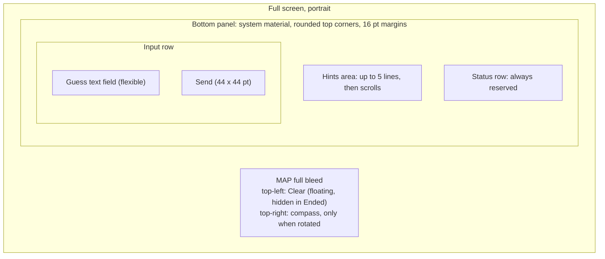
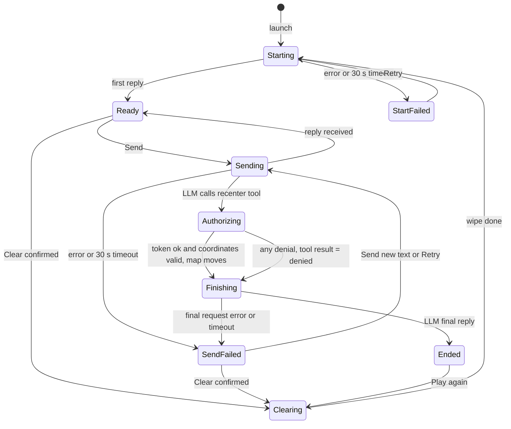
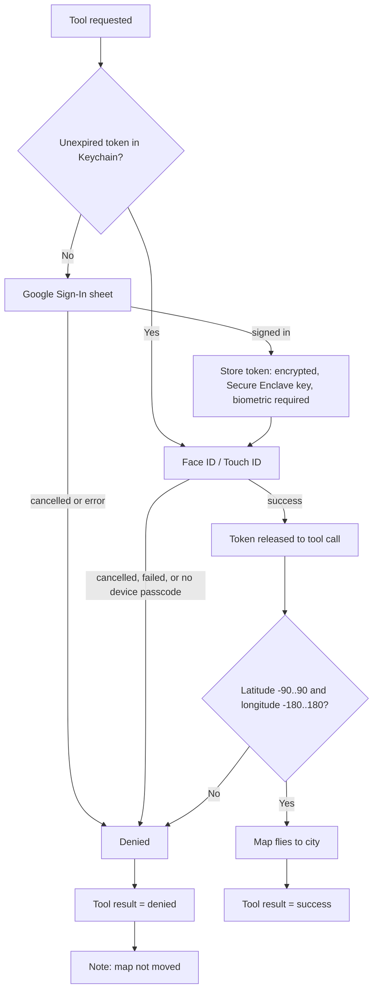

# Exhibit E-A v3: UX Interactions Spec, "Mystery City" iOS Prototype

Scope: iPhone only, portrait only, one screen. Overlays: Clear confirmation, location permission prompt, Google sign-in sheet, Face ID prompt. No settings, onboarding, history, or feedback screens.

Fixed decisions (not re-opened): give-up is a typed phrase, no button. Biometric check on every token read; Google sign-in not repeated within token lifetime. Clear uses a confirmation sheet, the map stays put, the Google token is kept. If sign-in or biometrics fail on a win, the LLM reveals the city in text and the map does not move. All LLM replies appear in the hints area. Sign-in happens just in time at the win. Real iPhone, Google test-mode OAuth client. Ended = field disabled plus Play again. Clear floats top-left. Status row is always reserved.

## 1. Principles
- The map fills the screen. One bottom panel and one small floating button sit on it.
- Standard controls, system fonts, SF Symbols, system materials, light and dark from the system.
- The hints area shows the full text of the latest LLM reply of the current game, nothing else. App messages (progress, errors, buttons) live only in the status row.
- One name per action everywhere: "Clear" (floating button, confirmation, VoiceOver) and "Play again" (end-of-game button).
- Portrait lock removes landscape-plus-keyboard problems.

## 2. Layout

- Order inside the panel: hints area, status row, input row. Hints are directly above the text box.
- Status row height: one fixed height per Dynamic Type size, equal to two lines of Footnote text but never less than 44 pt. It does not change height between messages, so nothing jumps. Cost at default size: about 44 pt of map.
- Clear: floating capsule, top-left under the status bar, on a system material, icon arrow.counterclockwise plus the word "Clear". Does not overlap the compass, location dot control, or panel.
- Keyboard up: panel rides above the keyboard; hints area drops to 3 lines then scrolls; map does not resize. Tapping the map dismisses the keyboard and keeps the draft.
- Large Dynamic Type: text grows; the hints area scrolls; the panel is capped at about 45 percent of screen height. The input row stays one row; the field narrows before Send does. All tap targets at least 44 x 44 pt.
- Spacing: 8 pt between rows. Hints in Body, status row in Footnote, field in Body.

## 3. Status row rules (one message plus one optional button)

The row shows one message and at most one button. If several candidates exist at once, only the highest-priority one shows:
1. Error with Retry ("Couldn't start the game.", "Couldn't reach the game.", "You're offline.", "Couldn't get the final message.", "Couldn't clear.")
2. Progress with spinner (Starting, Sent echo, Authorizing, Finishing up, Clearing)
3. Outcome note, Ended only: "Map not moved." beside Play again
4. Location-off notice: "Location is off. Map shows the whole world." Lowest priority. Appears only when nothing else would show, so it is deferred during Starting and shown once the state is Ready; it disappears after 5 s or on the first Send.

Layout rule: spinner and message on the left, button on the right. The message wraps to a maximum of two lines and then ends in an ellipsis; it takes the width left over. The button never shrinks below 44 pt tall and keeps its single-line label. The Sent echo shows the user's text cut to fit its two lines.

## 4. Element inventory

| Element | What it is | Tap / action | Enabled when |
|---|---|---|---|
| Map | Standard map | Pan, zoom, rotate. Tap dismisses keyboard | Always. App moves it only for the launch fly-to and a win |
| Hints area | Plain text, latest LLM reply | Scrolls; nothing else | n/a |
| Status row | Message plus optional button | Retry or Play again | Button only in states listed in section 7 |
| Guess text field | One field, Return key labelled Send | See Return rule below | Editable in Ready, Sending, Authorizing, Finishing, SendFailed. Disabled in Starting, StartFailed, Clearing, Ended |
| Send | Round filled button, arrow.up | Sends the text | Field has non-space text AND state is Ready or normal SendFailed (not the final-request failure, see 6.4) |
| Clear | Floating capsule top-left | Opens confirmation (see 6.7) | Ready, SendFailed. Disabled (dimmed) in Starting, StartFailed, Sending, Authorizing, Finishing, Clearing. Hidden in Ended |

Return key rule: when Send is enabled, Return does exactly what Send does. When Send is disabled but the field is editable (empty or blank text, Sending, Authorizing, Finishing, final-request SendFailed), Return does nothing: the keyboard stays, the text stays. When the field is disabled there is no keyboard to press it on.

Give-up discoverability: the Ready placeholder says it, and the rules sent to the LLM require its first reply to remind the player they can type "give up". The LLM decides what phrasing counts.

## 5. State model

"Finishing" is the follow-up request after the tool result (it behaves like Sending for enable rules). "Ended" has three outcomes (win with map moved, win with map not moved, gave up). Give-up goes Sending to Ended directly when the LLM's reply ends the game without a recenter tool call; the app learns this only through an "end game" signal from the LLM. If the app has no signal, the give-up reveal appears as an ordinary Ready reply, and Play again is not shown; see 6.5.

## 6. Interactions

### 6.1 Launch
1. Map appears at once on a zoomed-out world view.
2. Game start begins immediately, in parallel with location. Status row: spinner, "Picking a mystery city...". Hints area: muted "Waiting for the first hint". Field disabled, placeholder "Starting...". Send and Clear dimmed.
3. First launch: the iOS location prompt appears. The spinner keeps running behind it; the game start does not wait for the answer. The 30 s timer runs during the prompt (it measures the LLM request only, and the request is independent of the prompt).
4. Location arrives: the map flies to the user at about 5 km across, once per app launch only. The fly-to is cancelled if the user touched the map first. "Touched" means a pan, pinch or rotate gesture began; a plain tap does not count. After a fly-to or a cancellation it never repeats, including when a second game starts, a win moves the map, or location updates later.
5. First reply: hints area shows it, status row clears (or shows the location notice if location is off, per priority), field enabled with the Ready placeholder, Ready.
6. Location denied: map stays on the world view; the notice shows per section 3 priority. The game still works.
7. Start error or 30 s: StartFailed (see 7). Retry resends the rules to a fresh conversation. Clear is dimmed here because Retry does the same job.

### 6.2 What a hint is
The whole latest LLM reply as plain text. The rules sent to the LLM ask for at most 3 short sentences. A new reply replaces the old one entirely (short cross-fade; instant with Reduce Motion). If the current game has no reply yet, the hints area shows a muted line chosen by state (table in section 7), so Starting, StartFailed and Clearing follow one rule.

### 6.3 Send
1. Tap Send, or Return when Send is enabled. The field clears; keyboard stays. The status row shows the echo: spinner, "Sent: <text>". Hints text dims to mark it stale. Send and Clear dim. Field stays editable for drafting; placeholder "Type your next message".
2. Reply arrives: hints replaced and un-dimmed; status row clears; Send re-evaluates against any draft.
3. Error or 30 s with no reply: SendFailed. Status row shows the error with a Retry button. Offline versus unreachable is decided only by the type of error the system returns (not-connected or connection-lost errors show "You're offline."; every other error and the timeout show "Couldn't reach the game."). There is no separate network monitor and no pre-check before sending.
4. Retry resends the failed message exactly as it was; a draft typed meanwhile is left alone. If the user sends the draft instead, the failed message is dropped and the status row clears. Clear stays enabled. Placeholder: "Type a new message, or tap Retry".
5. History is held by the app and extended only after a successful reply, so a failed or lost send leaves no trace and Retry cannot count a guess twice (assumes a stateless LLM API).
6. Timer: 30 s per LLM request (including Starting and Finishing). It runs while the request is in flight, keeps running behind the location alert, and is paused only while the Google or Face ID sheet is on screen.

### 6.4 Win, authorization, map move
1. The LLM calls the recenter tool. Status row: spinner, "Correct! Getting access to move the map". This one message is used for the whole Authorizing state, whichever sheet appears (Google plus Face ID, or Face ID only), so it is accurate on both paths.
2. Token path:

3. Biometric prompt reason text: "Unlock your saved sign-in to move the map to the mystery city." Passcode fallback allowed. On a first win this means Google then Face ID back to back (consequence of the fixed rule). No device passcode: the token cannot be stored; treated as denied.
4. Success: the map flies over about 2 s (instant with Reduce Motion) to about 25 km across, with the city centered in the visible map above the panel (camera bottom inset equals the panel height). A standard pin with no label is dropped. The status row switches to Finishing.
5. Denial (any cause): one message path. The app returns "denied" to the LLM, the map does not move, and the status row switches to Finishing. When the game reaches Ended, the status row shows "Map not moved." beside Play again.
6. Finishing: status row spinner, "Finishing up...". Send and Clear dimmed, field editable but Send off. The LLM's final reply replaces the hints area (congratulation, or the city reveal when the map did not move) and the state becomes Ended.
7. Finishing fails (error or 30 s): SendFailed variant. Status row "Couldn't get the final message." plus Retry, which resends only that final request. Send is dimmed even with a draft (a new message would break the unfinished tool exchange). Clear is enabled and is the escape.
8. Stuck win: if the LLM never calls the tool (or the user thinks it should have), the app has no way to know. The only guaranteed escape is Clear with its confirmation. The user can also keep chatting in Ready and nudge the LLM, but the spec does not promise that works.
9. Token never shown. Expiry means the next win shows the Google sheet again.

### 6.5 Give up and Ended
The user types a give-up phrase and sends it. The LLM reveals the city in text; the map does not move. The app learns the game ended only through an "end game" signal from the LLM (open question Q1). State becomes Ended: hints area shows the closing text; field disabled with placeholder "Tap Play again to start a new game"; Send dimmed; floating Clear hidden. The status row shows the Play again button (plus "Map not moved." after a denied win; nothing after a give-up).

### 6.6 Play again
Primary and only way to start a new game from Ended. It wipes history and context and removes the pin, with no confirmation (nothing is lost), then goes to Clearing and Starting. The map stays where it is; the launch fly-to does not repeat.

### 6.7 Clear (mid-game)
1. Floating "Clear" button. Enabled only in Ready and SendFailed. Hidden in Ended, where Play again replaces it.
2. Tap opens the standard confirmation dialog (action sheet): title "Clear this game?", message "This forgets the conversation and starts a new game.", destructive button "Clear", and Cancel. VoiceOver reads the floating button as "Clear, start over".
3. Confirm: keyboard dismisses; field empties and disables; Send and Clear dim; hints area shows the muted "Waiting for the first hint"; status row spinner, "Clearing..."; all history, system and user prompts are wiped; pin removed. The map and the Google token stay.
4. Then it moves straight to Starting (the spinner text changes to "Picking a mystery city...").
5. Clear failure is not expected for a local wipe. If it happens: status row "Couldn't clear." plus Retry; Retry is the only action.

## 7. State table

| State | Hints area | Status row | Field | Placeholder | Send | Clear |
|---|---|---|---|---|---|---|
| Starting | Muted "Waiting for the first hint" | Spinner, "Picking a mystery city..." | Disabled | "Starting..." | Off | Off |
| StartFailed | Muted "No game running" | "Couldn't start the game." + Retry | Disabled | "Can't start right now" | Off | Off |
| Ready | Latest reply | Blank (or location notice) | Editable | "Guess a city, ask for a hint, or type 'give up'" | On if text | On |
| Sending | Latest reply, dimmed | Spinner, "Sent: <text>" | Editable | "Type your next message" | Off | Off |
| Authorizing | Latest reply, dimmed | Spinner, "Correct! Getting access to move the map" | Editable | "Type your next message" | Off | Off |
| Finishing | Latest reply, dimmed | Spinner, "Finishing up..." | Editable | "Type your next message" | Off | Off |
| SendFailed | Latest reply | "Couldn't reach the game." / "You're offline." + Retry | Editable | "Type a new message, or tap Retry" | On if text | On |
| SendFailed (final request) | Latest reply | "Couldn't get the final message." + Retry | Editable | "Type a new message, or tap Retry" | Off | On |
| Clearing | Muted "Waiting for the first hint" | Spinner, "Clearing..." | Disabled | "Clearing..." | Off | Off |
| Ended | Closing text | Play again (plus "Map not moved." if applicable) | Disabled | "Tap Play again to start a new game" | Off | Hidden |

Placeholders show only when the field is empty; typed drafts always display normally. "Off" and "Dimmed" use the standard disabled look.

## 8. Accessibility and platform
- VoiceOver: Send "Send"; Clear "Clear, start over"; Play again "Play again"; hints area "Hints"; status row changes are announced; hints replacements are announced.
- Reduce Motion: all map flights become jumps. Bold Text and Increase Contrast are inherited from system controls.
- A real iPhone with a device passcode is required for the Secure Enclave and biometric path.
