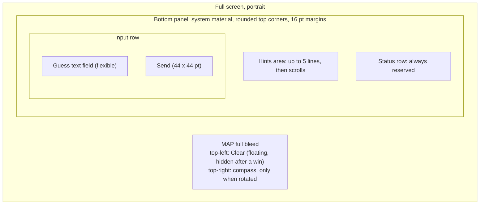
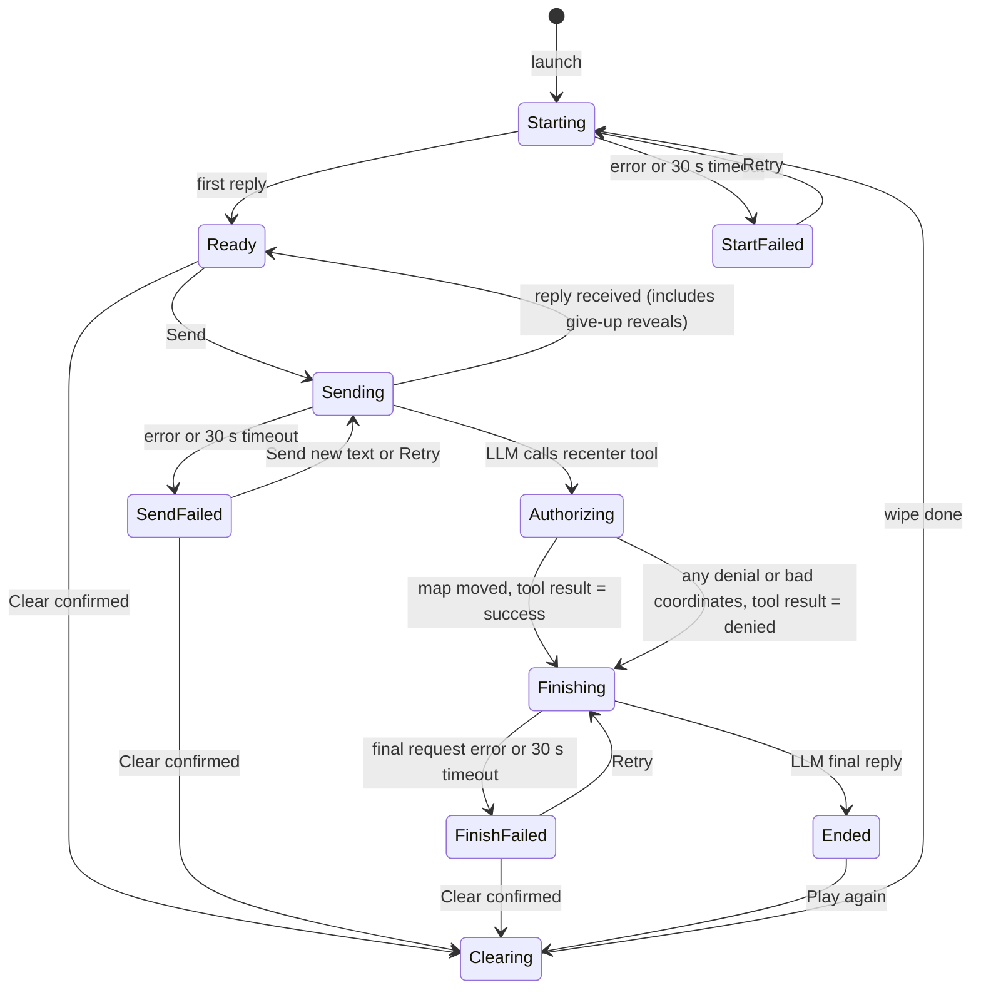
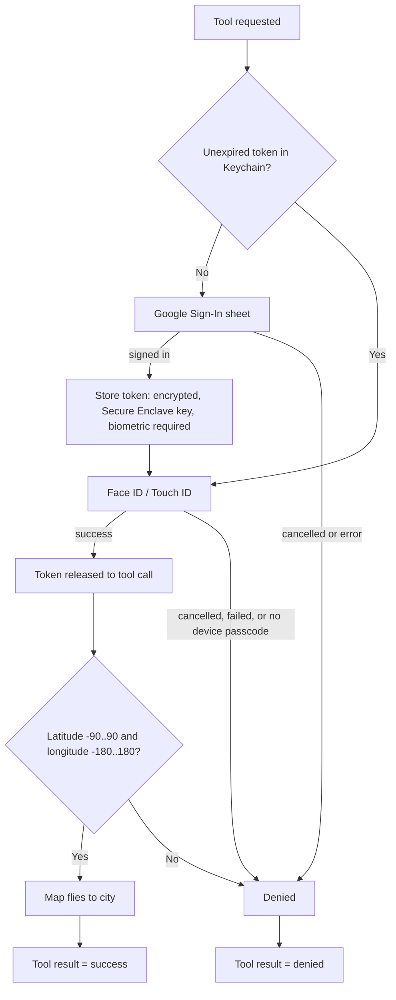

# Exhibit E-A v5: UX Interactions Spec, "Mystery City" iOS Prototype

Scope: iPhone only, portrait only, one screen. Overlays: Clear confirmation, location permission prompt, Google sign-in sheet, Face ID prompt. No settings, onboarding, history, or feedback screens.

Fixed decisions (not re-opened): give-up is a typed phrase, no button. There is no "end game" tool. The recenter tool is the only game-state signal the app receives, so the app detects wins only (map moved, or denied) and cannot detect a give-up. Biometric check on every token read; Google sign-in not repeated within token lifetime. Clear uses a confirmation sheet, the map stays put, the Google token is kept. If sign-in or biometrics fail on a win, the LLM reveals the city in text and the map does not move. All LLM replies appear in the hints area, and new replies overwrite old ones. Sign-in happens just in time at the win. Real iPhone, Google test-mode OAuth client. After a win (Ended): field disabled plus Play again. Clear floats top-left. Status row is always reserved.

## 1. Principles
- The map fills the screen. One bottom panel and one small floating button sit on it.
- Standard controls, system fonts, SF Symbols, system materials, light and dark from the system.
- The hints area shows the full text of the latest LLM reply of the current game, nothing else. App messages (progress, errors, buttons) live only in the status row.
- Names: "Clear" (floating button, confirmation, VoiceOver) and "Play again" (win-only button).
- Two ways a game restarts: Play again after a win; Clear for everything else, including after a give-up. The app cannot tell a give-up from an ongoing game, so a gave-up game looks like Ready and Clear is its only restart path.
- Portrait lock removes landscape-plus-keyboard problems.

## 2. Layout

- Order inside the panel: hints area, status row, input row. Hints are directly above the text box.
- Status row height (standard text sizes): fixed, equal to two lines of Subheadline text, never less than 44 pt. At default size this is 44 pt. The row never changes height between messages.
- Clear: floating capsule top-left under the status bar, on a system material, icon arrow.counterclockwise plus the word "Clear". Does not overlap the compass or the panel.
- Keyboard up: panel rides above the keyboard; hints area drops to 3 lines then scrolls; map does not resize. Tapping the map dismisses the keyboard and keeps the draft.
- Standard Dynamic Type sizes: the panel is capped at about 45 percent of screen height; the hints area scrolls inside it. The input row stays one row; the field narrows before Send does. All tap targets at least 44 x 44 pt.
- Accessibility text sizes (the system "larger accessibility sizes" settings): one rule so errors and buttons stay legible. The status row is allowed to grow, to a fixed height per size (not per message): the message block shows up to four lines at full width and any button moves to its own full-width line beneath it (still 44 pt or taller). The panel cap rises from 45 to 60 percent of screen height. Space comes first from the hints area, which shrinks (never below two lines, then it scrolls). The input row keeps its single row. The map still shows above the panel.
- Spacing: 8 pt between rows. Hints and field in Body.

## 3. Status row rules (one message block plus one optional button)

The row shows one message block and at most one button. If several candidates exist at once, only the highest-priority one shows:
1. Errors with Retry (all error messages below).
2. Win outcome (Ended only): Play again, plus "Map not moved." when the map did not move.
3. Progress with spinner (Starting, Sent echo, Authorizing step, Finishing, Clearing).
4. Location-off notice: "Location is off. Map shows the whole world." Lowest priority; shown only when nothing else would show, so in practice once the state is Ready. It disappears after 5 s or on the first Send.

Visual weight:
- Buttons (Retry, Play again): prominent filled style, Body size, at least 44 pt tall, single-line label, right side of the row (own line at accessibility sizes). They never shrink.
- Errors: Subheadline semibold, primary label color, with an exclamationmark.triangle symbol.
- Win outcome note: Subheadline, primary color.
- Progress messages and the location notice: Footnote, secondary color, with a spinner for progress.

Wrapping: the message block takes the space left of the button and wraps to at most two lines at standard sizes (four at accessibility sizes), then ends in an ellipsis. For error rows the block has two parts: line 1 the error, line 2 optional detail.

Sent echo: "Sent: <text>" wraps over the available lines, so up to two lines of the user's text are visible before it is cut. It cannot show unlimited text because the row has a fixed height and only current hints may show; the echo exists to confirm what was sent.

## 4. Element inventory

| Element | What it is | Tap / action | Enabled when |
|---|---|---|---|
| Map | Standard map | Pan, zoom, rotate. Tap dismisses keyboard | Always. App moves it only for the launch fly-to and a win |
| Hints area | Plain text, latest LLM reply | Scrolls; nothing else | n/a |
| Status row | Message plus optional button | Retry or Play again | Button only in states listed in section 8 |
| Guess text field | One field, Return key labelled Send | See Return rule | Editable in Ready, Sending, SendFailed. Disabled (dimmed, no keyboard) in Starting, StartFailed, Authorizing, Finishing, FinishFailed, Clearing, Ended |
| Send | Round filled button, arrow.up | Sends the text | Field has non-space text AND state is Ready or SendFailed |
| Clear | Floating capsule top-left | Opens confirmation | Ready, SendFailed, FinishFailed. Dimmed in Starting, StartFailed, Sending, Authorizing, Finishing, Clearing. Hidden in Ended |

Return key rule (field editable):
- Send enabled: Return does exactly what Send does.
- Ready or SendFailed with empty or blank text: Return dismisses the keyboard (so the user gets feedback and can see the map). The blank text is kept.
- Sending: Return does nothing (Send is visibly dimmed and a spinner is showing).
In all other states the field is disabled, so Return cannot be pressed. A draft typed during Sending is preserved through Authorizing and Finishing (shown dimmed) and is cleared when a new game starts.

Give-up discoverability: the Ready placeholder is short ("Guess, hint, or give up") so it never truncates. Because a placeholder vanishes once typing starts, the main reminder is the LLM's first reply, which the game rules ask to mention giving up. If the first reply omits it, the app shows nothing extra.

## 5. State model

- "Finishing" is the follow-up request after the tool result.
- "Ended" exists only after a win (map moved, or denied). A give-up never reaches Ended: the LLM's reveal arrives as an ordinary reply and the app stays in Ready.
- A game that was given up behaves exactly like Ready. The user can keep chatting; to start a new game they tap Clear.

## 6. Interactions

### 6.1 Launch
1. Map appears at once on a zoomed-out world view.
2. Game start begins immediately. Status row: spinner, "Picking a mystery city...". Hints area: muted "Waiting for the first hint". Field disabled, placeholder "Starting...". Send and Clear dimmed.
3. Location request, so the permission prompt cannot eat the 30 s timer: if location permission was decided in an earlier launch, location is requested immediately. If permission has never been asked (first launch), the request is delayed until the state leaves Starting (Ready or StartFailed). The iOS prompt then appears on top of the first hint.
4. Fly-to: the map moves to the user at city scale, once per app launch. It is skipped if the user began a pan, pinch or rotate gesture on the map before the fix arrived (a plain tap does not count). It never repeats, including at the start of a second game.
5. First reply: hints area shows it, status row clears (or shows the location notice), field enabled with the Ready placeholder, state Ready.
6. Location denied: map stays on the world view; the notice appears per section 3 priority. The game still works.
7. Start error or 30 s: StartFailed. Status row: error "Couldn't start the game." plus Retry. Retry resends the game rules to a fresh conversation. Clear is dimmed (Retry does the same job).

### 6.2 What a hint is
The whole latest LLM reply as plain text. A new reply replaces the old one entirely (short cross-fade; instant with Reduce Motion). If the current game has no reply, the hints area shows a muted line chosen by state (section 8).

### 6.3 Send
1. Tap Send (or Return with Send enabled). The field clears; keyboard stays. Status row: spinner, "Sent: <text>". Hints text dims. Send and Clear dim. Field stays editable for drafting, placeholder "Type your next message".
2. Reply arrives: hints replaced and un-dimmed; status row clears; Send re-evaluates against any draft. A give-up reveal is just an ordinary reply; the state is Ready.
3. Error or 30 s timeout: SendFailed. The failed message is shown, so Retry's effect is visible. Status row error block: line 1 "Couldn't reach the game." (or "You're offline."), line 2 "Not sent: <text>" in secondary color, one line, cut with an ellipsis. Button: Retry. Offline versus unreachable is decided only by the system's error type (not-connected and connection-lost errors mean offline; everything else, including the timeout, means unreachable). No reachability monitor and no pre-check.
4. Retry resends the failed message exactly as it was; the status row goes back to the "Sent: ..." echo. A draft typed meanwhile is untouched. If the user sends the draft instead, the failed message is dropped. Clear stays enabled. Placeholder "Type a new message, or tap Retry".
5. A failed or lost send leaves no trace in the conversation, so Retry cannot double-count a guess (assumes a stateless LLM API).
6. The 30 s timer applies to each LLM request (Starting, Sending, Finishing). It runs while the request is in flight and is paused only while the Google or Face ID sheet is on screen.

### 6.4 Win and authorization
1. The LLM calls the recenter tool. This is the app's only win signal. State: Authorizing; the field becomes disabled and the keyboard dismisses.
2. The status row says what is happening and what cancelling costs, in one short clause, accurate on both paths:
   - No unexpired token (first win, or token expired): "Correct! Sign in with Google to move the map. Cancel to skip it." Then after sign-in: "Confirm it's you to move the map. Cancel to skip it."
   - Token already stored: "Correct! Confirm it's you to move the map. Cancel to skip it."
   These fit the two-line progress block at standard sizes and the four-line block at accessibility sizes. Honest limitation: the Google sheet covers most of the screen, so the status clause is mostly seen before the sheet appears; the Face ID prompt is small and leaves the status row visible. The same clause is also in the Face ID reason text (item 4) so the warning is on screen exactly when the choice is made. The Google sheet itself cannot carry custom text.
3. Token path:

4. Biometric reason text (the system prompt): "Confirm it's you to move the map to the mystery city. Cancel skips the map move." True right after sign-in and when the token was already stored. Passcode fallback allowed. On a first win the user sees Google then Face ID back to back (consequence of the fixed rule). No device passcode: the token cannot be stored; treated as denied.
5. Success: the map flies about 2 s (instant with Reduce Motion) to a city-scale view with the city centered in the visible map above the panel. The camera inset equals the panel height at flight time. The keyboard is down at that moment (the field is disabled since Authorizing began), so the panel is at its resting height. Choice: the app does not recompute the framing afterwards; the pin only has to be visible when the flight ends. If the tester later changes text size or the panel changes height, they can pan the map. A standard unlabeled pin is dropped.
6. Denial (any cause, including cancel): the map does not move and the app returns "denied" to the LLM. The LLM reveals the city in text.
7. Finishing: status row spinner, "Finishing up...". Field stays disabled; Send and Clear dimmed. The LLM's final reply replaces the hints area, and the state becomes Ended.
8. Finishing fails: FinishFailed. Status row error block: line 1 "Correct! Couldn't load the final message.", line 2 "Map not moved." only if the map did not move. Button: Retry, which resends only the final request. Field and Send disabled. Clear enabled, as the escape, with its confirmation. Placeholder "Tap Retry to finish".
9. Token is never shown. When it expires, the next win shows the Google sheet again.

### 6.5 Ended (win only)
- Hints area: the LLM's closing text (congratulation, or the city reveal when the map did not move).
- Status row: Play again button (prominent). If the map did not move, the message block says "Map not moved." (Subheadline, primary). After a successful move, no message.
- Field disabled, placeholder "Tap Play again to start a new game". Send dimmed. Floating Clear hidden, so there is one restart control.
- Play again does not ask for confirmation. Honest consequence: one tap discards the LLM's closing text and removes the pin, wipes history and context, and starts a new game. This is accepted because the game is already won, so there is no live game to protect, the tester has just seen the result, and the button is the only active control on the screen, so the intent is unambiguous. Clear asks for confirmation because it can destroy a game in progress or the answer to an unresolved game. The map stays where it is; the launch fly-to does not repeat.

### 6.6 Give-up (no special state)
The user types a give-up phrase and sends it as any message. The LLM reveals the city in text, which appears as the latest reply. The map does not move. The state is Ready, with no Play again button because the app cannot detect the give-up. The restart path is the floating Clear button.

### 6.7 Clear
1. Floating "Clear". Enabled in Ready, SendFailed, FinishFailed. Hidden in Ended.
2. Tap opens the standard confirmation dialog (action sheet). Title "Clear this game?", message "This forgets the conversation, including the current game's answer, and starts a new game.", destructive button "Clear", and Cancel. The wording is true for a game in progress and for a given-up game. VoiceOver reads the floating button as "Clear, start over".
3. Confirm: keyboard dismisses; field empties and disables; Send and Clear dim; hints area shows muted "Waiting for the first hint"; status row spinner, "Clearing..."; all history, system and user prompts are wiped; pin removed. The map and Google token stay.
4. Then straight to Starting; the spinner text changes to "Picking a mystery city...".
5. If clearing somehow fails: error "Couldn't clear." plus Retry; Retry is the only action.

## 7. Timers and rules recap
- Timer: 30 s per request; paused during Google/Face ID sheets; cannot overlap the location prompt.
- Send is never enabled while any request is in flight.

## 8. State table

| State | Hints area | Status row | Field | Placeholder | Send | Clear |
|---|---|---|---|---|---|---|
| Starting | Muted "Waiting for the first hint" | Spinner, "Picking a mystery city..." | Disabled | "Starting..." | Off | Off |
| StartFailed | Muted "No game running" | Error "Couldn't start the game." + Retry | Disabled | "Can't start right now" | Off | Off |
| Ready (includes after give-up) | Latest reply | Blank (or location notice) | Editable | "Guess, hint, or give up" | On if text | On |
| Sending | Latest reply, dimmed | Spinner, "Sent: <text>" | Editable | "Type your next message" | Off | Off |
| Authorizing | Latest reply, dimmed | Spinner, step message with "Cancel to skip it." (6.4 item 2) | Disabled | "Please wait..." | Off | Off |
| Finishing | Latest reply, dimmed | Spinner, "Finishing up..." | Disabled | "Please wait..." | Off | Off |
| SendFailed | Latest reply | Error "Couldn't reach the game." / "You're offline." + "Not sent: <text>" + Retry | Editable | "Type a new message, or tap Retry" | On if text | On |
| FinishFailed | Latest reply | Error "Correct! Couldn't load the final message." (+ "Map not moved." if denied) + Retry | Disabled | "Tap Retry to finish" | Off | On |
| Clearing | Muted "Waiting for the first hint" | Spinner, "Clearing..." | Disabled | "Clearing..." | Off | Off |
| Ended (win only) | Closing text | Play again (+ "Map not moved." if denied) | Disabled | "Tap Play again to start a new game" | Off | Hidden |

Placeholders show only when the field is empty. Off or dimmed uses the standard disabled look.

## 9. Accessibility and platform
- VoiceOver: Send "Send"; Clear "Clear, start over"; Play again "Play again"; hints area "Hints"; status row changes and hints replacements are announced.
- Reduce Motion: map flights become jumps. Bold Text and Increase Contrast come from system controls.
- A real iPhone with a device passcode is required for the Secure Enclave and biometric path.
