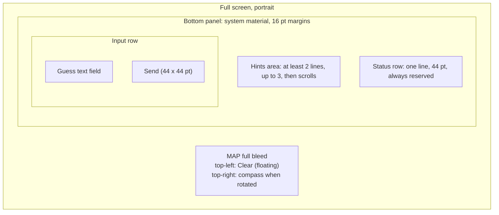
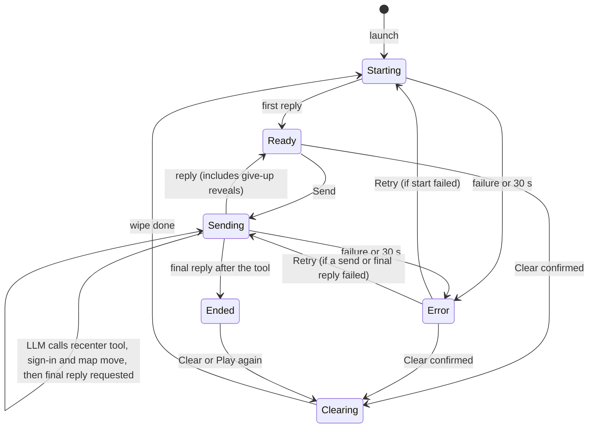
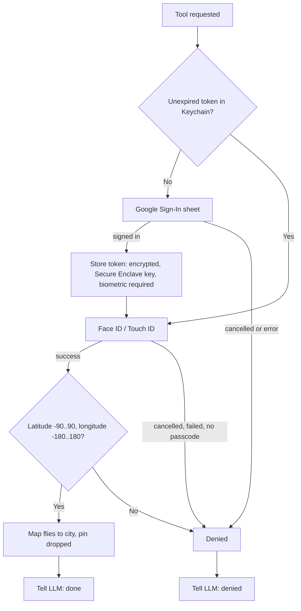

# Exhibit E-A v6: UX Interactions Spec, "Mystery City" iOS Prototype

Scope: iPhone only, portrait only, one screen, real device. Overlays: Clear confirmation, location prompt, Google sign-in sheet, Face ID prompt. Nothing else.

Fixed by the product owner: give-up is a typed phrase, no button. No end-game tool, so the app detects wins only (through the recenter tool) and cannot detect a give-up. Biometric check on every token read; Google sign-in not repeated within the token lifetime. Clear confirms and leaves the map where it is. On auth failure the LLM reveals the city in text and the map does not move. After a win the field is disabled and a Play again button shows. Clear floats top-left. The status row is reserved.

## 1. Principles
- The map fills the screen. One compact bottom panel and one floating button sit on it. Target: the panel is at most about one third of the screen height at default text size.
- System fonts, system controls, system materials, light and dark from the system. Dynamic Type, Reduce Motion and VoiceOver come from the system defaults. No special large-text layout.
- App messages (progress, errors, buttons) live only in the status row. The text field has one placeholder.
- The hints area shows the full latest LLM reply and nothing else. A new reply replaces the old one.

## 2. Layout

- Order in the panel: hints, status row, input row. Hints sit directly above the text box. The hints area is at least two lines tall so the panel does not jump when the first reply arrives.
- The status row is one line and 44 pt high (the minimum tap size for its buttons). It holds one message on the left and at most one button on the right.
- Clear is a floating button, top-left under the status bar, on a system material, with the arrow.counterclockwise symbol and the word "Clear". It does not overlap the compass, the panel, or anything else, and stays visible in every state.
- When the keyboard is up the panel sits above it; the map does not resize. Tapping the map dismisses the keyboard.
- Label choice: the visible label stays "Clear", because that is the control the requirements name. The confirmation title says what happens ("Start a new game?") and VoiceOver reads "Clear, starts a new game".

## 3. Elements and what they do

| Element | Tap / action | Enabled when |
|---|---|---|
| Map | Pan, zoom, rotate; tap dismisses keyboard | Always. The app moves it at launch and on a win |
| Hints area | Scrolls only | n/a |
| Status row message | Not interactive | n/a |
| Retry / Play again button | Retry repeats the last request unchanged. Play again starts a new game with no confirmation (see 5.4) | Only in Error / Ended |
| Guess text field | Placeholder "Guess, hint, or give up". Return does what Send does when Send is enabled, otherwise nothing special | Disabled only in Ended |
| Send | Sends the text; field clears | Field has non-space text AND state is Ready or Error |
| Clear | See 5.5 | Ready, Error, Ended. Disabled while Starting, Sending, Clearing |

Send is disabled whenever any request is running or the game is clearing, which covers both the "Send disabled while clearing" and "Clear disabled while sending" rules.

## 4. States

- "Sending" covers the whole round trip, including the sign-in and map move and the follow-up request, so there is one busy state. The status message tells which part is running.
- "Ended" happens only after the recenter tool was called (map moved, or denied). A give-up never reaches Ended: the reveal is just an ordinary reply and the game stays in Ready.
- One generic Error with one Retry. Retry repeats exactly the request that failed (the start, the guess, or the final reply after a win). The app keeps the failed guess internally; it does not show it again. If the user sends something else instead, the held guess is dropped.
- One timeout: 30 s waiting for an LLM reply. Sign-in and Face ID happen between requests, so no request is waiting and no pause logic is needed. First launch note: the location prompt can pop over the first request, and a slow tap can cause a false start failure. Retry fixes it; this is accepted.

## 5. Interactions

### 5.1 Launch
1. Map appears on a default zoomed-out view and requests location.
2. The app sends the game rules; the LLM picks the city (the app never picks). Status row: spinner, "Picking a mystery city...". Hints area is empty. Send and Clear are disabled.
3. When a location fix arrives, the map moves to the user once. If location is denied it stays on the default view; there is no notice and the game still works.
4. First reply appears in the hints area; status row clears; state Ready.
5. Failure or 30 s: Error (see 5.3).

### 5.2 Send
1. Tap Send (or Return). The field clears, the keyboard stays, and the status row shows a spinner with "Thinking...". The old hints dim. That is the only confirmation that the message went out: no echo of the text.
2. Reply arrives: it replaces the hints area, the dimming ends, the status row clears. The state is Ready, even if the reply is a give-up reveal. Restart after a give-up is Clear.
3. Failure or 30 s: Error.

### 5.3 Error
- Status row: "Couldn't reach the game." and a Retry button. This one message is used for start, guess and final-reply failures alike. Hints stay as they were. Clear is enabled (an escape if Retry keeps failing). Send is enabled when the field has text.
- Retry runs the failed request again with the status row back to its spinner.

### 5.4 Win
1. The LLM calls the recenter tool (the app's only win signal). Status row: spinner, "Correct! Moving the map...". The keyboard dismisses.
2. Token check:

3. The Face ID prompt reason text is the only cancel warning: "Confirm it's you to move the map. Cancel skips the move." Passcode fallback is allowed. On a first win the user sees Google then Face ID back to back (consequence of the fixed rule). The status row carries no cancel clause.
4. Success: the map flies to the city (about 2 s; a jump with Reduce Motion) at city scale, framed so the pin sits in the visible map above the panel. The framing is calculated when the flight starts, with the keyboard down. It is not recalculated later. A standard unlabeled pin is dropped.
5. Denial for any reason, including cancel: the map does not move and the LLM is told. The LLM then reveals the city in text.
6. Status row: "Thinking..." while the final reply is fetched; if that fails, Error with Retry (resends only the final request).
7. Ended: the hints area shows the LLM's closing text. The field is disabled (one placeholder, shown dimmed). The status row shows a Play again button, with "Map not moved." beside it if the map did not move.
8. Play again wipes the conversation and removes the pin, with no confirmation, then starts a new game. This is the same as Clear in Ended. Both skip the confirmation because the app knows the game is over. The map stays where it is and the launch move does not repeat. Honest consequence: one tap discards the closing text and the pin.

### 5.5 Clear
1. Enabled in Ready, Error, Ended. In Ended it acts as Play again (no confirmation). In Ready or Error the app cannot tell if the game is finished (for example after a give-up), so it asks first.
2. Confirmation (standard action sheet): title "Start a new game?", message "This forgets the conversation, including the answer to the current game.", destructive button "Clear", and Cancel. The wording is true for an in-progress game and for one that was given up.
3. Confirmed: Send and Clear disabled, spinner "Clearing...", hints area emptied, pin removed, and all history, system and user prompts dropped. The app relies on the existing /llmclear endpoint and adds no other endpoint. A local wipe cannot fail, so there is no failure path. Then the app moves straight to Starting. The map and the Google token stay.
4. Stuck win: if the LLM never calls the tool, the app cannot know a win happened; the guaranteed escape is Clear.

## 6. State table

| State | Hints area | Status row | Field | Send | Clear |
|---|---|---|---|---|---|
| Starting | Empty | Spinner, "Picking a mystery city..." | Editable | Off | Off |
| Ready | Latest reply | Blank | Editable | On if text | On |
| Sending | Latest reply, dimmed | Spinner, "Thinking..." or "Correct! Moving the map..." | Editable | Off | Off |
| Error | Latest reply | "Couldn't reach the game." + Retry | Editable | On if text | On |
| Ended | Closing text | Play again (+ "Map not moved." if denied) | Disabled | Off | On |
| Clearing | Empty | Spinner, "Clearing..." | Editable | Off | Off |

The whole app uses six status strings plus the two buttons and the one placeholder. A draft typed while busy simply stays in the field; there is no draft handling beyond that.
