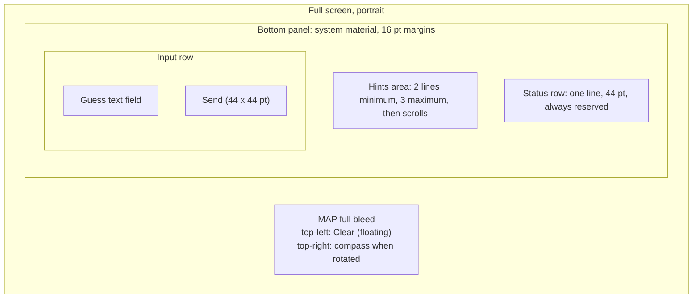
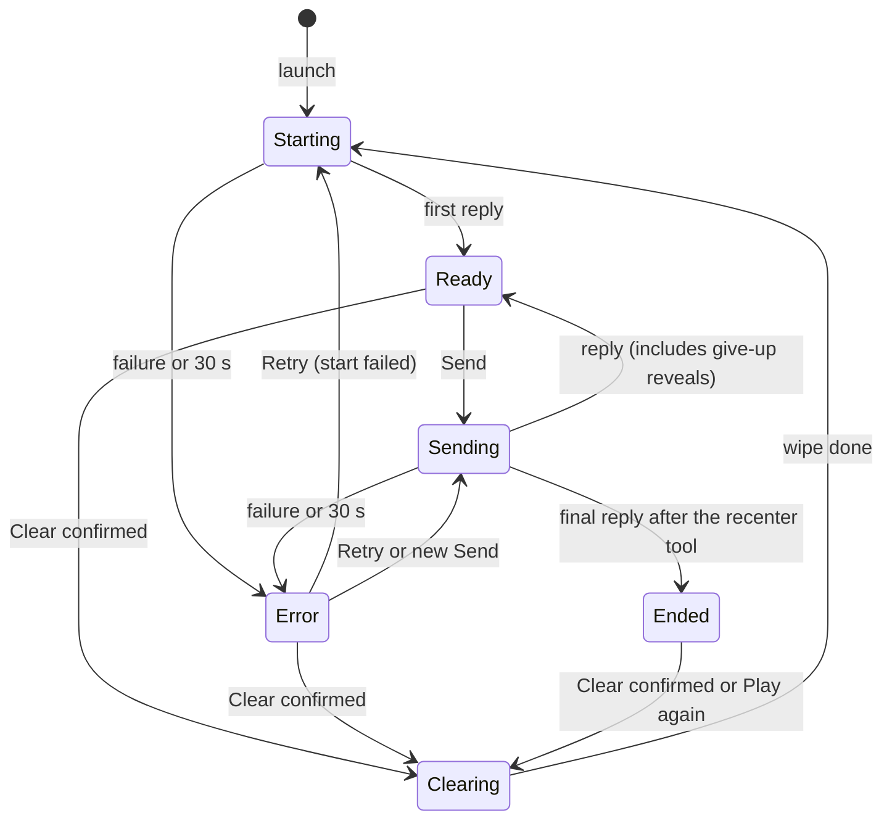
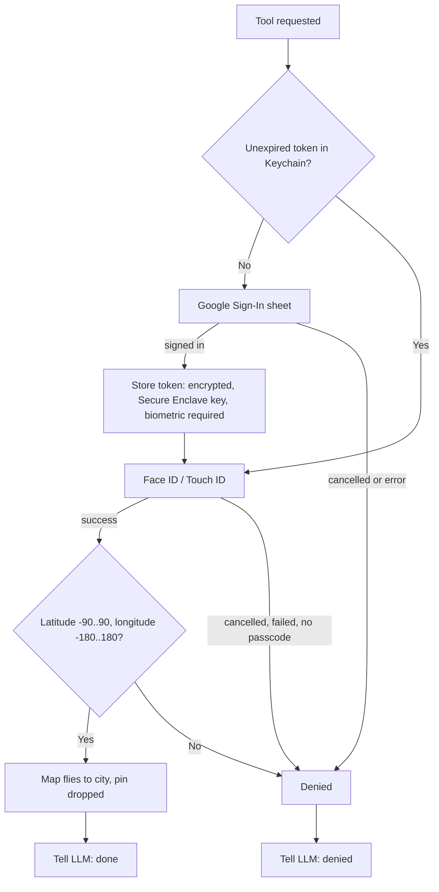

# Exhibit E-A v7: UX Interactions Spec, "Mystery City" iOS Prototype

Scope: iPhone only, portrait only, one screen, real device. Overlays: the Clear confirmation (action sheet), the location permission prompt, the Google sign-in sheet, and the Face ID prompt.

## 0. Decisions (fixed)
- Give-up is a typed phrase, no button. There is no end-game tool: the app detects wins only through the recenter tool and cannot detect a give-up.
- (a) On denial of sign-in or biometrics, the LLM reveals the city in text and the map does not move.
- (b) The map starts on a default zoomed-out view and moves to the user when a location fix arrives, so it is not centered on the user in the very first frame. If location is denied it stays on the default view.
- (c) A give-up ends the session only in the LLM's text, not in the app. The app stays in Ready; the restart path is Clear.
- Biometric check on every token read; Google sign-in is not repeated within the token lifetime.
- Passcode fallback is allowed: a deliberate relaxation of "biometric only", because it is the system default when biometrics fail and it keeps testers from being locked out.
- After a win: field disabled, Play again button shown, floating Clear still visible. Label stays "Clear".
- Clear floats top-left. The status row is reserved. A possible false start error on first launch (location prompt over the first request) is accepted; Retry fixes it.

## 1. Principles
- The map fills the screen. One compact bottom panel and one floating button sit on it. Target at default text size and no keyboard: panel at most about one third of the screen height.
- System fonts, controls, materials, light and dark. Dynamic Type, Reduce Motion and VoiceOver come from the system.
- App messages (progress, errors, buttons) live in the status row. The only other text the user sees is the system dialogs' own text: the Face ID reason and the Clear confirmation. The text field has one placeholder.
- The hints area shows the full latest LLM reply and nothing else. A new reply replaces the old one.

## 2. Layout

- Order in the panel: hints, status row, input row. Hints sit directly above the text box. The two-line minimum stops the panel from jumping when the first reply arrives.
- Status row: one line, 44 pt (the tap-size minimum for its button), one message on the left and at most one button on the right.
- Clear: floating button top-left under the status bar, on a system material, arrow.counterclockwise plus the word "Clear". It never overlaps the compass or the panel and is visible in every state.
- Keyboard up: the panel sits directly above the keyboard and the map does not resize. The panel may exceed one third of the screen only because of the keyboard. On the smallest supported iPhone, the hints (max 3 lines), status row, and input row must all be fully visible above the keyboard with Clear still visible at the top; verify this on that device.
- Large text sizes: the system's own scaling applies. The hints area gives up space first (it scrolls); the status row and input row stay in full view. No special layout is designed; verify no overlap on the target device at the largest size testers use.
- Tapping the map dismisses the keyboard.

## 3. Elements

| Element | Tap / action | Enabled when |
|---|---|---|
| Map | Pan, zoom, rotate; tap dismisses keyboard | Always. The app moves it at launch (once) and on a win |
| Hints area | Scrolls only | n/a |
| Status row | Message; one button (Retry or Play again) | Button only in Error and Ended |
| Retry | Repeats the last failed request | Error |
| Play again | Wipes the conversation and starts a new game, no confirmation | Ended |
| Guess text field | Placeholder "Guess, hint, or give up". Return does what Send does when Send is enabled | Disabled only in Ended |
| Send | Sends the text and clears the field | Field has non-space text AND state is Ready or Error |
| Clear | Opens the confirmation (see 5.5), in every state where it is enabled | Ready, Error, Ended. Disabled in Starting, Sending, Clearing |

Send is disabled whenever a request is running or the game is clearing; Clear is disabled while a request runs. That covers both required mutual-disable rules. In Starting, Clear is disabled but the 30 s timeout is the escape (it leads to Error, where Clear is enabled).

## 4. States

- "Sending" covers the whole round trip: the guess, the tool call with sign-in and map move, and the follow-up request. One busy state; the status message tells which part runs.
- "Ended" occurs only after the recenter tool was called (map moved or denied).
- Error has one message and one Retry. Retry repeats the last failed request. If the user sends new text instead, the new text is simply sent.
- One timer: 30 s waiting for an LLM reply. Sign-in and Face ID happen between requests, so no request is waiting during them.

## 5. Interactions

### 5.1 Launch
1. Default zoomed-out map; location is requested. When a fix arrives the map moves to the user once. If location is denied it stays put, silently.
2. The app sends the game rules; the LLM picks the city (the app never does). Status row: spinner, "Picking a mystery city...". Hints area empty. Send and Clear disabled.
3. First reply fills the hints area; status row clears; state Ready.
4. Failure or 30 s: Error.

### 5.2 Send
1. Tap Send or Return. The field clears, the keyboard stays, the status row shows a spinner and "Thinking...". That is the only sign the message went out; there is no echo and no dimming of the hints.
2. Reply replaces the hints area; status row clears; state Ready, including after a give-up reveal.
3. Failure or 30 s: Error.

### 5.3 Error
Status row: "Couldn't reach the game." and a Retry button. Hints stay as they were. Clear is enabled. Send is enabled when the field has text.

### 5.4 Win
1. The LLM calls the recenter tool (the app's only win signal). Status row: spinner, "Correct! Moving the map...". The keyboard dismisses.
2. Token check:

3. Face ID prompt reason text: "Confirm it's you to move the map. Cancel skips the move." Passcode fallback allowed (section 0). On a first win the user sees Google then Face ID back to back.
4. Success: the map flies to the city at city scale (about 2 s; a jump with Reduce Motion), framed so the pin sits in the visible map above the panel. Framing is calculated when the flight starts, with the keyboard down, and not recalculated later. A standard unlabeled pin is dropped.
5. Denial for any reason, including cancel: the map does not move and the LLM is told. The LLM's reveal text explains this; the app adds no message of its own.
6. While the final reply is fetched the status row shows "Thinking...". If it fails: Error, and Retry resends only the final request.
7. Ended: the hints area shows the LLM's closing text. The field is disabled. The status row is just the Play again button.
8. Play again wipes the conversation, removes the pin, and starts a new game, with no confirmation. It discards the closing text and the pin; that is accepted because the game is over. The map stays where it is and the launch move does not repeat.

### 5.5 Clear
- Clear always opens the confirmation, in every state where it is enabled, including Ended. One rule for one button; Play again is the separate quick path when the game is over.
- Confirmation (action sheet): title "Start a new game?", message "This forgets the conversation, including the answer to the current game.", destructive button "Clear", and Cancel. The wording is true for a game in progress, a given-up game, or a won one. VoiceOver reads the floating button as "Clear, starts a new game".
- Confirmed: Send and Clear disabled, spinner "Clearing...", hints area emptied, pin removed, all history, system and user prompts dropped. This uses the existing /llmclear endpoint and no other new endpoint. A local wipe cannot fail, so there is no failure path. Then straight to Starting. The map and the Google token stay.
- Stuck win or give-up: the app cannot detect either as a failure; Clear is the escape.

## 6. State table

| State | Hints area | Status row | Field | Send | Clear |
|---|---|---|---|---|---|
| Starting | Empty | Spinner, "Picking a mystery city..." | Editable | Off | Off |
| Ready | Latest reply | Blank | Editable | On if text | On |
| Sending | Latest reply | Spinner, "Thinking..." or "Correct! Moving the map..." | Editable | Off | Off |
| Error | Latest reply | "Couldn't reach the game." + Retry | Editable | On if text | On |
| Ended | Closing text | Play again | Disabled | Off | On |
| Clearing | Empty | Spinner, "Clearing..." | Editable | Off | Off |

Strings in the app: four status messages, two button labels, one placeholder, one Face ID reason, one confirmation.
