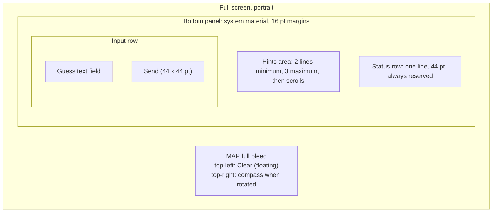
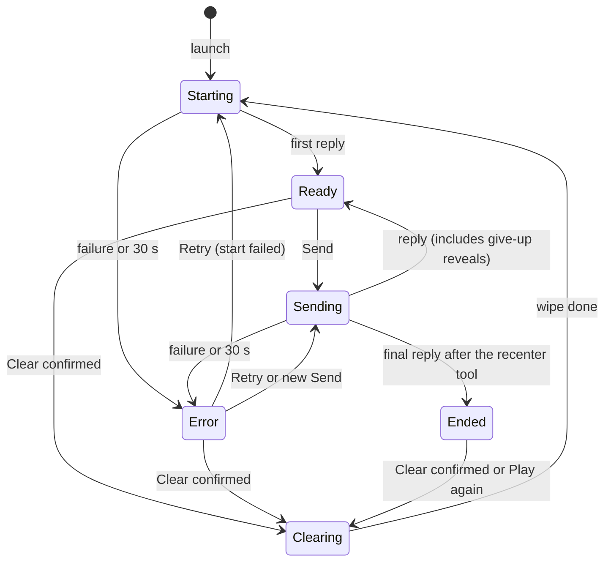
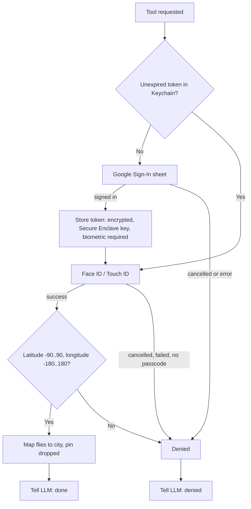
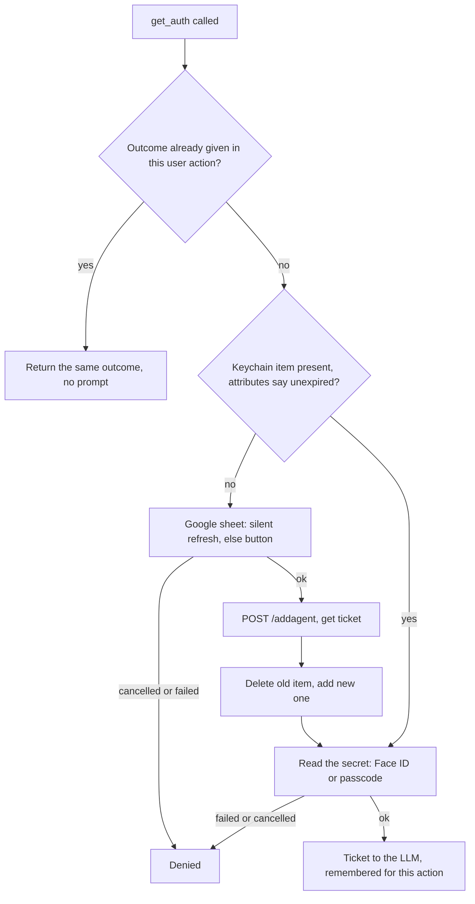
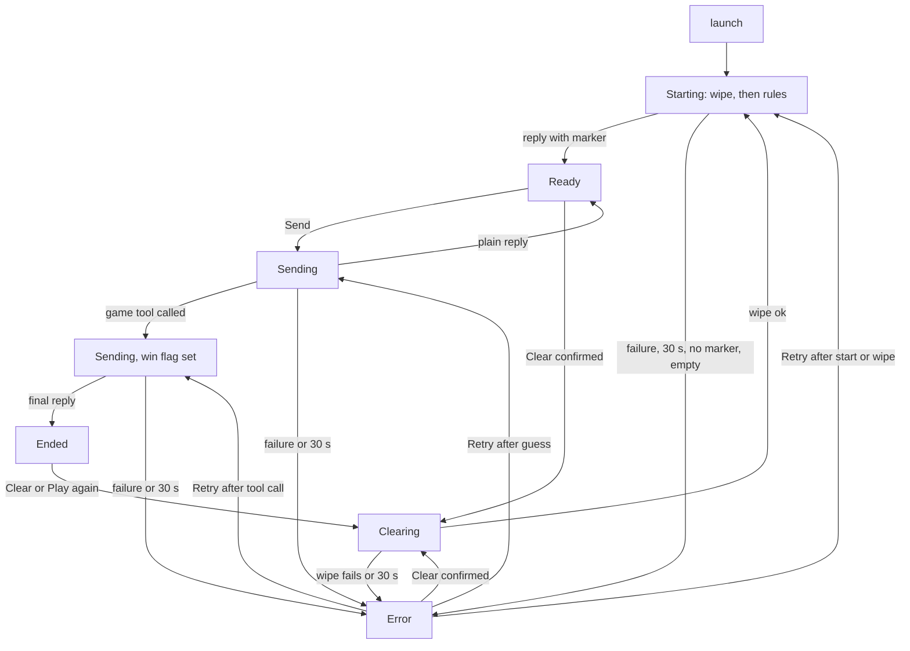
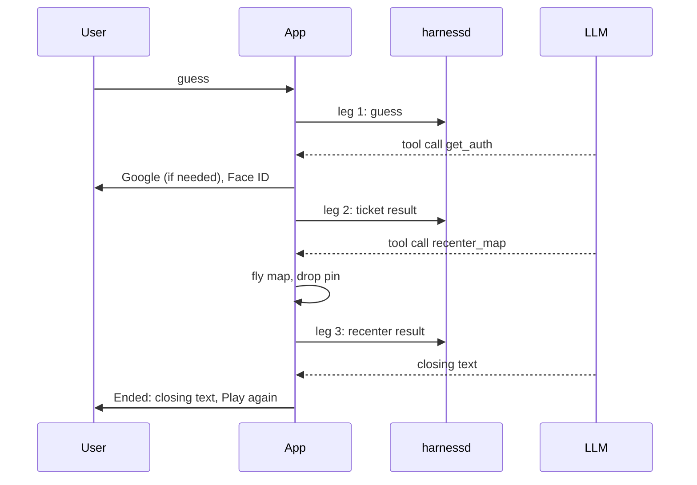

# Section 1: HW2 LLM Exhibits

All sessions used medium reasoning effort and the standard no-code, challenge-my-assumptions prompt. Each Goldfish was a fresh, isolated session that received only the documents listed for its role. Names: G-A is the Goldfish 1 critique, G-B the Goldfish 2 critique, G-C the Goldfish 3 critique. Every round and prompt is saved in the repository under hw2/rounds.

## Audit table

Each row summarizes all the criticisms from ALL versions and rounds of one Goldfish, and only that Goldfish. Goldfish 1 and Goldfish 2 audited E-A; Goldfish 3 audited E-B. Verbatim critiques are in "Full exhibits" below (G-A = Goldfish 1, G-B = Goldfish 2, G-C = Goldfish 3).

| Exhibit Name | Key Criticisms Identified | Adjustment Made | Final Outcome |
|---|---|---|---|
| E-A, Goldfish 1 (UI/UX critic; 5 rounds on drafts v1 to v5) | **Round 1:** contradictions (end-of-game state described two ways; offline vs send-failed rows), unpicked Clear icon, "hint" undefined, no echo of the user's message, layout jumping when the status line appears, Clear beside Send, surprise Google sheet after a win. **Round 2:** no priority among status messages, timer unclear under the location prompt, map behavior on game 2, missing placeholders, undefined Return key, "Signing in" wording wrong for Face ID only, Clear vs Play again duplication. **Round 3:** give-up signal depended on an undecided end-game tool, missing retry arrow, invisible failed message, timer false-firing behind the location prompt, vague sign-in copy, small Retry and Play again buttons. **Round 4:** gaps judged mostly technical (tool schema, token purpose), plus no warning that cancelling sign-in skips the map move, inconsistent data loss on Play again, large-text clipping, pin framing. **Round 5:** mostly accepted owner decisions restated (give-up looks like Ready, two prompts on first win, no cancel, no confirm on Play again); one real defect (Clearing failure path). | Each round produced a full revision with the Elephant: state table, status-row rules, retry semantics, honest wording, owner decisions recorded; technical-design items deferred to E-B; the dead Clearing failure path carried into the next revision. | Review closed after round 5; E-A v5 passed to Goldfish 2. |
| E-A, Goldfish 2 (quality auditor; 3 rounds on drafts v5 to v7) | **Round 1:** panel about 40% of the screen against "map-dominant"; 10 states and about 30 strings against "minimal chrome"; unrequested machinery (three Retry variants, timer pausing, location notice, echo of sent text, per-state placeholders, status priority, large-text rules); HIG issues (a "Clear" that means "new game", blank reserved row, disabled field as status channel, inconsistent confirmation). **Round 2:** hidden "held guess" logic, "Map not moved." message, dimming of old hints, inconsistent Clear confirmation, overstated claims ("nothing else" overlays), passcode fallback relaxing "biometric check". **Round 3:** only minor points (string count, status row wrapping, owner decisions restated, Play again vs Clear). | Round 1: rewrote to about half the length (six states, one Error with one Retry, one-third panel target). Round 2: removed held guess, extra message and dimming; Clear always confirms; decisions section added. Round 3: string count fixed; status row wraps at large text. | Final E-A (v7 plus two small edits) submitted. |
| E-B, Goldfish 3 (senior engineer critic; 2 rounds on drafts v2 and v3) | **Round 1:** Secure Enclave wording; 180 s ticket cap vs "reuse within lifetime"; where expiry is stored (checking it might trigger Face ID); unverified claims (idempotent resend, tool schemas per app, Clear removing them); dangling tool call after a timeout; no mapping onto tutorial file and type names; four Retry behaviors too heavy. **Round 2:** ticket-copy loop (a mangled copy gets 401, the retry returns the same ticket), memo scope across Retry, contradictory "Correct!" status rules, call-order confusion in the replayed history, unsupported failure-rate number, replay of plain-guess Retry sharing the orphan limit, suggestion to replace resume-by-turn-ID with Clear. | Round 1: new "Verified facts" section checked against the code, mapping table to tutorial files, Retry reduced to three behaviors, attribute-only expiry check, wipe-before-start. Round 2: fixes applied to the final E-B (Retry counts as the same action; clearer 401 and repeat-ticket wording; one status-text rule; three more accepted risks; number removed). Clear-instead-of-resume not adopted. | Final E-B submitted. |

# One-page summaries (chronological)

## One-page summary of E-A (UX spec)

**What it is.** A one-screen iPhone prototype: a full-bleed map, a compact bottom panel (hints, one status row, a guess field with Send), and a floating Clear button at top-left. Nothing else is on screen except four system overlays: the Clear confirmation, the location prompt, the Google sign-in sheet and the Face ID prompt.

**How it behaves.** On launch the map starts on a default view and moves to the user once a location fix arrives. The app sends the game rules and the LLM silently picks the city. The panel shows only the latest LLM reply; a new reply replaces the old one. Send is enabled only with text and only when idle. While Sending or Clearing, the other control is off. Six states cover everything: Starting, Ready, Sending, Error, Ended, Clearing. A single status row shows a spinner message, one error with one Retry button, or the Play again button.

**Winning.** When the LLM calls the recenter tool the app asks for sign-in (Google, only if no unexpired token) and Face ID, then flies the map to the city and drops a pin. If either is cancelled the map does not move and the LLM reveals the city in text. After a win the field is disabled and Play again appears.

**Decisions fixed by the owner.** Giving up is a typed phrase; there is no end-game tool, so the app cannot detect a give-up and the restart is Clear. Biometrics on every token read. Clear always confirms. The status row stays reserved so nothing jumps.

**How it changed.** Seven drafts. The first was loose and had contradictions; the middle drafts added a full state table and many error cases; the auditor round then cut it to about half its length and six states, to fit the "map-dominant, minimal chrome" preference.

## One-page summary: Exhibit G-A: UI/UX Critic Summary (Goldfish 1, Principal Native Mobile UI/UX Developer)

Goldfish 1 saw only the UX spec (E-A), never the design requirements, and was asked per state for purpose, main control, visual ranking and confusing items, plus whether the spec could be built without questions. Five fresh sessions reviewed five successive drafts (v1 to v5).

**Round 1 (v1).** Verdict: not buildable. Found contradictions (the end-of-game state described two ways; offline and send-failed rows disagreeing), an unpicked Clear icon, no definition of what a hint is, no echo of the user's message, a layout that jumps when the status line appears, Clear placed beside Send, and a surprise Google sheet right after a winning guess.

**Round 2 (v2).** About 85% buildable. Remaining: which status message wins when several apply, whether the 30 s timer pauses under the location prompt, whether the fly-to repeats in game 2, missing placeholders, an unspecified Return key, "Signing in" copy wrong when only Face ID appears, and Clear versus Play again duplication.

**Round 3 (v3).** Found that the give-up signal depended on an undecided "end game" tool, a missing retry arrow for the final request, an invisible failed message, a timer that could false-fire behind the location prompt, vague sign-in copy, and small, hard-to-notice Retry and Play again buttons. The product owner then decided against an end_game tool, so give-up became undetectable and Clear its only restart.

**Round 4 (v4).** Reviewer said the UI was unusually complete; the gaps it listed were mostly technical-design matters (tool schema, token purpose, system prompt), which were deferred to Exhibit E-B. In-scope fixes: a warning that cancelling skips the map move, consistent handling of discarded closing text, large-text fallback, pin framing, and clearer Clear confirmation wording.

**Round 5 (v5).** Remaining findings largely restated accepted product decisions (a given-up game looks like Ready; two back-to-back prompts on a first win; no cancel for a slow request; Play again without confirmation) or were polish. One genuine defect was carried forward: the Clearing failure path cannot occur for a local wipe and should be removed. Review closed here; v5 passed to Goldfish 2.

**Net effect.** E-A grew from a loose layout sketch into a complete state table with fixed layout rules, one status row with a priority order, per-state placeholders, retry semantics that cannot double-count a guess, and an honest list of accepted trade-offs.

## One-page summary: Exhibit G-B: Product Quality Auditor Summary (Goldfish 2)

Goldfish 2 saw the latest UX spec (E-A), the design requirements and the aesthetic preferences, and listed requirement coverage, contradictions with the preferences or Apple HIG, and unrequested features. Three fresh sessions audited E-A v5, v6 and v7.

**Round 1 (v5): substantive.** Core requirements were covered, but the spec contradicted the owner's "map-dominant, minimal chrome" preferences: the panel took about 40% of the screen, with 10 states, about 30 strings and an accessibility-size layout. It also flagged much unrequested machinery (three Retry variants, timer pausing, a location notice, an echo of sent text, per-state placeholders, a four-level status priority) and nonstandard HIG choices (a "Clear" capsule that really means "new game", a permanently blank row, a disabled field as the status channel). Result: v6, roughly half the length, one Error with one Retry, a one-third panel target, no large-text rules.

**Round 2 (v6): substantive but smaller.** Remaining: held-guess logic behind Retry, a "Map not moved." message, dimming of old hints, an inconsistent skip-confirmation rule for Clear, overly strong claims ("app messages live only in the status row", "nothing else" overlays), and a passcode fallback that quietly relaxes "biometric check". Result: v7, six states, five status strings, Clear always confirming, owner decisions listed in one section, relaxations stated explicitly.

**Round 3 (v7): minor.** All required elements are covered. What remains traces to owner decisions (first frame not centered on the user; a give-up ends only in the LLM's text; the passcode fallback; Play again beside Clear) or to polish. Final fixes: the string count (five, not four) and a rule that the status row wraps at larger text sizes while its button stays in view. The dangling-tool-call case after a failed final request goes to the technical design.

## One-page summary of E-B (technical design: what will be built)

**The deliverable.** The Mystery City game, built by extending the existing llmHITL iPhone app. The Python back end (harnessd) is not changed: no new endpoint, no new data format, no database change. The only back-end call the app adds to its flow is the existing /llmclear.

**What the user will see (from E-A).** A full-screen map; a compact bottom panel with the latest LLM clue above a guess box with a Send button; a floating Clear button. A correct guess moves the map to the mystery city after Google sign-in and Face ID.

**What will be built, piece by piece (all in the existing tutorial files and type names).**
- **AgentApp.swift, `AppViewModel`:** a small game state machine (Starting, Ready, Sending, Error, Ended, Clearing) that holds the latest reply, a "game tool was called" flag, a retry record, the map camera and the pin. `sendTurn` and `resetGame` keep their names and roles.
- **ContentView.swift:** replaced by the map, the clue area, the guess box with `SubmitButton`, and `ClearButton` with a confirmation dialog.
- **Rein.swift:** `llmTools` now returns an explicit outcome instead of writing an error string, takes an optional resume (turn ID plus tool results) and applies a 30 s limit; `llmClear` gets the same limit. The stream reader and the secret-marker stripper are reused unchanged.
- **Toolbox.swift and tools/:** `get_auth` kept (Face ID read of the stored ticket, one read per user action); a new `recenter_map` tool (ticket, latitude, longitude) that checks the ticket and the coordinates, moves the map and drops a pin; schema file `recenter_map.json` beside `get_auth.json`.
- **Ticket.swift:** reads the Keychain ticket with Face ID, checks expiry without a prompt, saves by delete-then-add, no alert strings. **SigninView.swift:** always restores the Google sign-in (not the stale in-memory token) and shows no text.
- **Info.plist:** portrait only, location text reworded.

**How the game works (the flows).**
1. *Start.* Wipe the old conversation (/llmclear), then send the game rules plus "Begin". The LLM picks the city and begins its first reply with a hidden `[SECRET: city]` marker; the server stores and replays it, so the city stays fixed and secret; the app strips the marker before display.
2. *Guess.* The app sends the text; the reply replaces the clue. A give-up is only text; Clear restarts.
3. *Win.* The LLM calls `get_auth` (sign-in and Face ID, returns a ticket), then `recenter_map` with the ticket and coordinates, then writes the closing text: three requests. A denial at `get_auth` leaves the map still, the LLM reveals the city in text, and the game still ends.
4. *Errors.* Every call has a 30 s limit; one Retry resends, restarts or resumes depending on where the failure happened; Clear is the escape.

**Departures from E-A.** Fourteen, tabulated in E-B section 8, mainly: two tools instead of one, game end on any game tool call, a timer and error path for Clear, and Send disabled after certain errors.

**Limits accepted.** The secret is enforced by prompt only; the marker and the ticket sit in plain text in the harness database; the ticket lives at most 180 s; one tester at a time per back end.

## One-page summary: Exhibit G-C: Senior Engineer Critic Summary (Goldfish 3)

Goldfish 3 saw the technical design (E-B), the design requirements and constraints, and the final UX spec (E-A). It judged coverage, missed assumptions and edge cases, over-engineering, and constraint violations, with the goal of a prototype that is a Minimal Reproducible Example. Two fresh sessions reviewed E-B v2 and v3.

**Round 1 (v2): substantive but narrow.** It asked for decisions or checks on: whether the tutorial's Keychain item satisfies "Secure Enclave" (the owner accepted it); the 180 s ticket cap against "reuse within the token's lifetime"; where the expiry date lives (if inside the protected item, even checking it would trigger Face ID); unverified claims that resending tool results is idempotent and that tool schemas are stored per app and removed by Clear; the dangling tool call left by a timeout; and the missing mapping onto tutorial file and type names. It also called four distinct Retry behaviors the first thing to simplify. Result: v3 added a "Verified facts" section checked against the code, an attribute-only expiry check, a mapping table, Retry reduced to three behaviors, and wipe-before-start to cope with a reused bundle ID.

**Round 2 (v3): mostly minor.** No API, endpoint, or schema violations and no unexplained contradictions with E-A beyond one wording clash on how long "Correct!" shows. Two small substantive items: a mangled copy of the ticket could loop (the 401 told the model to call get_auth, which returns the same ticket), and a Retry after a tool call had to count as the same user action so the memo survives and no second Face ID appears. Further notes: within-turn call order makes the replay look like parallel calls, a "one percent" orphan estimate had no basis, and a plain-guess Retry shares the orphan limit. Fixes were applied to the final E-B without another full revision. The reviewer's suggestion to replace resume-by-turn-ID with Clear-and-restart was not adopted, because E-A promises that Retry resends only the final request.

**Net effect.** E-B grew from a first sketch that asserted facts into a design that states what was verified in the code, what is accepted as a limit, and every place it departs from E-A.

# Full exhibits (chronological)

## Exhibit E-A (final): UX Interactions Spec, "Mystery City" iOS Prototype

Scope: iPhone only, portrait only, one screen, real device. Overlays: the Clear confirmation (action sheet), the location permission prompt, the Google sign-in sheet, and the Face ID prompt.

## 0. Decisions (fixed)
- Give-up is a typed phrase, no button. There is no end-game tool: the app detects wins only through the recenter tool and cannot detect a give-up.
- (a) On denial of sign-in or biometrics, the LLM reveals the city in text and the map does not move.
- (b) The map starts on a default zoomed-out view and moves to the user when a location fix arrives, so it is not centered on the user in the very first frame. If location is denied it stays on the default view.
- (c) A give-up ends the session only in the LLM's text, not in the app. The app stays in Ready; the restart path is Clear.
- Biometric check on every token read; Google sign-in is not repeated within the token lifetime.
- Passcode fallback is allowed: a deliberate relaxation of "biometric only", because it is the system default when biometrics fail and it keeps testers from being locked out.
- After a win: field disabled, Play again button shown, floating Clear still visible. Label stays "Clear".
- Clear floats top-left. The status row is reserved. A possible false start error on first launch (location prompt over the first request) is accepted; Retry fixes it.

## 1. Principles
- The map fills the screen. One compact bottom panel and one floating button sit on it. Target at default text size and no keyboard: panel at most about one third of the screen height.
- System fonts, controls, materials, light and dark. Dynamic Type, Reduce Motion and VoiceOver come from the system.
- App messages (progress, errors, buttons) live in the status row. The only other text the user sees is the system dialogs' own text: the Face ID reason and the Clear confirmation. The text field has one placeholder.
- The hints area shows the full latest LLM reply and nothing else. A new reply replaces the old one.

## 2. Layout

- Order in the panel: hints, status row, input row. Hints sit directly above the text box. The two-line minimum stops the panel from jumping when the first reply arrives.
- Status row: 44 pt tall at default text size (the tap-size minimum for its button), one message on the left and at most one button on the right. At larger text sizes the message wraps to a second line and the row grows to fit; the Retry or Play again button never truncates or leaves view.
- Clear: floating button top-left under the status bar, on a system material, arrow.counterclockwise plus the word "Clear". It never overlaps the compass or the panel and is visible in every state.
- Keyboard up: the panel sits directly above the keyboard and the map does not resize. The panel may exceed one third of the screen only because of the keyboard. On the smallest supported iPhone, the hints (max 3 lines), status row, and input row must all be fully visible above the keyboard with Clear still visible at the top; verify this on that device.
- Large text sizes: the system's own scaling applies. The hints area gives up space first (it scrolls); the status row and input row stay in full view. No special layout is designed; verify no overlap on the target device at the largest size testers use.
- Tapping the map dismisses the keyboard.

## 3. Elements

| Element | Tap / action | Enabled when |
|---|---|---|
| Map | Pan, zoom, rotate; tap dismisses keyboard | Always. The app moves it at launch (once) and on a win |
| Hints area | Scrolls only | n/a |
| Status row | Message; one button (Retry or Play again) | Button only in Error and Ended |
| Retry | Repeats the last failed request | Error |
| Play again | Wipes the conversation and starts a new game, no confirmation | Ended |
| Guess text field | Placeholder "Guess, hint, or give up". Return does what Send does when Send is enabled | Disabled only in Ended |
| Send | Sends the text and clears the field | Field has non-space text AND state is Ready or Error |
| Clear | Opens the confirmation (see 5.5), in every state where it is enabled | Ready, Error, Ended. Disabled in Starting, Sending, Clearing |

Send is disabled whenever a request is running or the game is clearing; Clear is disabled while a request runs. That covers both required mutual-disable rules. In Starting, Clear is disabled but the 30 s timeout is the escape (it leads to Error, where Clear is enabled).

## 4. States

- "Sending" covers the whole round trip: the guess, the tool call with sign-in and map move, and the follow-up request. One busy state; the status message tells which part runs.
- "Ended" occurs only after the recenter tool was called (map moved or denied).
- Error has one message and one Retry. Retry repeats the last failed request. If the user sends new text instead, the new text is simply sent.
- One timer: 30 s waiting for an LLM reply. Sign-in and Face ID happen between requests, so no request is waiting during them.

## 5. Interactions

### 5.1 Launch
1. Default zoomed-out map; location is requested. When a fix arrives the map moves to the user once. If location is denied it stays put, silently.
2. The app sends the game rules; the LLM picks the city (the app never does). Status row: spinner, "Picking a mystery city...". Hints area empty. Send and Clear disabled.
3. First reply fills the hints area; status row clears; state Ready.
4. Failure or 30 s: Error.

### 5.2 Send
1. Tap Send or Return. The field clears, the keyboard stays, the status row shows a spinner and "Thinking...". That is the only sign the message went out; there is no echo and no dimming of the hints.
2. Reply replaces the hints area; status row clears; state Ready, including after a give-up reveal.
3. Failure or 30 s: Error.

### 5.3 Error
Status row: "Couldn't reach the game." and a Retry button. Hints stay as they were. Clear is enabled. Send is enabled when the field has text.

### 5.4 Win
1. The LLM calls the recenter tool (the app's only win signal). Status row: spinner, "Correct! Moving the map...". The keyboard dismisses.
2. Token check:

3. Face ID prompt reason text: "Confirm it's you to move the map. Cancel skips the move." Passcode fallback allowed (section 0). On a first win the user sees Google then Face ID back to back.
4. Success: the map flies to the city at city scale (about 2 s; a jump with Reduce Motion), framed so the pin sits in the visible map above the panel. Framing is calculated when the flight starts, with the keyboard down, and not recalculated later. A standard unlabeled pin is dropped.
5. Denial for any reason, including cancel: the map does not move and the LLM is told. The LLM's reveal text explains this; the app adds no message of its own.
6. While the final reply is fetched the status row shows "Thinking...". If it fails: Error, and Retry resends only the final request.
7. Ended: the hints area shows the LLM's closing text. The field is disabled. The status row is just the Play again button.
8. Play again wipes the conversation, removes the pin, and starts a new game, with no confirmation. It discards the closing text and the pin; that is accepted because the game is over. The map stays where it is and the launch move does not repeat.

### 5.5 Clear
- Clear always opens the confirmation, in every state where it is enabled, including Ended. One rule for one button; Play again is the separate quick path when the game is over.
- Confirmation (action sheet): title "Start a new game?", message "This forgets the conversation, including the answer to the current game.", destructive button "Clear", and Cancel. The wording is true for a game in progress, a given-up game, or a won one. VoiceOver reads the floating button as "Clear, starts a new game".
- Confirmed: Send and Clear disabled, spinner "Clearing...", hints area emptied, pin removed, all history, system and user prompts dropped. This uses the existing /llmclear endpoint and no other new endpoint. A local wipe cannot fail, so there is no failure path. Then straight to Starting. The map and the Google token stay.
- Stuck win or give-up: the app cannot detect either as a failure; Clear is the escape.

## 6. State table

| State | Hints area | Status row | Field | Send | Clear |
|---|---|---|---|---|---|
| Starting | Empty | Spinner, "Picking a mystery city..." | Editable | Off | Off |
| Ready | Latest reply | Blank | Editable | On if text | On |
| Sending | Latest reply | Spinner, "Thinking..." or "Correct! Moving the map..." | Editable | Off | Off |
| Error | Latest reply | "Couldn't reach the game." + Retry | Editable | On if text | On |
| Ended | Closing text | Play again | Disabled | Off | On |
| Clearing | Empty | Spinner, "Clearing..." | Editable | Off | Off |

Strings in the app: five status messages, two button labels, one placeholder, one Face ID reason, one confirmation.

## Full Exhibit G-A: Goldfish 1 critiques, verbatim (5 rounds)

### Goldfish 1, round 1: verbatim output (critique of E-A v1)

REVIEW OF E-A_v1.md (Mystery City iOS prototype UX spec)

Overall verdict: NOT sufficient to build without questions. The single-screen layout is clear. But the spec has one hard contradiction (the Won/GaveUp states), several undefined behaviors (Play again, Retry, Clear confirm), and it never says what the hints look like. A builder would need roughly 10 answers before starting.

Note: the spec has one screen, one overlay (the Clear confirmation, as an action sheet), and two system sheets (Google sign-in, Face ID). Also treated as distinct states here: the status line variants and the end-of-game state.

==================================================
1. MAIN SCREEN (map + bottom panel), Ready state
==================================================
Purpose: A full-screen map with a bottom panel where the player reads the current hints and types guesses or questions. The map is the backdrop and the payoff, since it only moves when the player wins.

Most obvious interactive element: the Send button (filled, arrow.up), or the text field.
- Tap on Send: sends the text, clears the field, shows "Thinking...", disables Send and Clear until the reply arrives, then replaces the hints.
- Ambiguity: low for Send. But the keyboard stays up during Sending and the user can keep typing. Tapping the map or dismissing the keyboard is not specified.
- Ambiguity about the Clear icon: it is "trash-style OR arrow.counterclockwise". The spec does not pick one. Trash suggests permanent deletion. Counterclockwise suggests undo. This is a real build question.

Top three visual elements, ranked by what the spec implies:
1. Map (full bleed).
2. Hints block (the only LLM content shown).
3. Input row.
Does this match the purpose? Partly. The core task is read hints, then type. The hints should be the visual focus, but the spec gives them only "plain text" in a panel capped at about 4 lines, so the map visually dominates. The map is idle until a win, so it is mostly decoration for most of the session. In practice the user's eye goes to the input row and hints, and the spec never states typography or hierarchy for the hints.

Confusing, ambiguous, or badly placed items:
- The Principles section says "Everything else floats on top of it in a bottom panel", while the layout puts the status line above the hints. A status line that appears and disappears will push the hints up and down, which makes the layout jump on every send. The spec does not reserve space for it.
- Clear sits right next to Send in the same row, at the same size (44 pt). A mis-tap is the very reason for the confirmation sheet. Placing a destructive control beside the primary one is a design smell the spec patches with a dialog instead of moving it.
- Hints area: "one block per current hint" is never defined. How many hints are there? What does a hint look like? Where does the player's own guess appear? The transcript is hidden, so after Send the user's own message vanishes (the field clears) and there is no echo. The user cannot see what they asked while waiting, and cannot see whether the new hints answer their question.

==================================================
2. STARTING state (launch / new game)
==================================================
Purpose: The app asks the LLM to pick a secret city while the user waits. The first hints appear when it is ready.

Most obvious interactive element: the text field (Send is disabled).
- Tap on the field: opens the keyboard. Typing is allowed but nothing can be sent. Not ambiguous, but pointless for the user.

Top three visual elements:
1. Map (and the location permission prompt on first launch).
2. Status line with spinner "Picking a mystery city...".
3. Empty/placeholder hints area.
Does this match? Roughly. But the spec says the first hints "replace the placeholder text" in the hints area, and the placeholder text is never specified.

Confusing items:
- Location permission prompt and the game start run in parallel. The system prompt will cover the panel and the user may think the app is stuck.
- The text field placeholder says "Guess a city or ask for a hint" while Send is disabled and nothing has been revealed. It invites input that cannot be used.
- Clear is disabled in Starting (A4). If the start hangs, the user cannot clear, and only the (unspecified) timeout helps. The 30 s timeout is described only for Send, not for Starting.

==================================================
3. START FAILED state
==================================================
Purpose: Tells the user the game could not begin and offers a retry.

Most obvious interactive element: the inline Retry button in the status line. Tap returns to Starting. Not ambiguous.

Top three visual elements:
1. Status line error message with Retry.
2. Map.
3. Input row (disabled Send).
Does this match? Yes, but the error is a small secondary-text line ("Small secondary text"). An error that blocks the whole game is shown in the least prominent style in the panel.

Confusing items:
- Status line is "small secondary text", yet it carries the Retry button. Is the button 44 pt tall? The spec says all targets are 44 pt, but a small inline button in a one-line status row conflicts with that.
- The hints area is empty here and nothing says what is shown in it (blank gap?).
- Clear is enabled here and does a full wipe and restart. That duplicates Retry and confuses which one to tap.

==================================================
4. SENDING / THINKING state
==================================================
Purpose: Shows that the LLM is working on the reply, and locks Send and Clear.

Most obvious interactive element: none really; the text field remains active for drafting.
- Tap on the field: lets the user type the next message. Send stays off. This is a surprising rule (A5): the user can type but not send.

Top three visual elements:
1. Status line spinner "Thinking...".
2. The old hints (still showing).
3. Disabled buttons.
Does this match? Mostly. But old hints stay on screen until the reply, so the user may re-read stale hints and think nothing happened.

Confusing items:
- No Cancel for up to 30 s. A slow LLM call (with tool calls, sign-in, and Face ID) plausibly takes longer than 30 s, especially if the user is in the middle of Google sign-in. The spec does not say whether the timer pauses while the system sheets are up. If it does not pause, a slow sign-in causes a false timeout.
- The user's sent message disappears from the field and is not shown anywhere. They cannot confirm what was sent.
- Return key = Send, but the Return key stays active while Send is disabled. What does Return do while Sending? Presumably nothing, but it is not stated (the table says "same rules as Send", which implies ignoring it).

==================================================
5. SEND FAILED / OFFLINE state
==================================================
Purpose: Tells the user the request did not go through, and restores their text so it can be re-sent.

Most obvious interactive element: the inline Retry button.
- Tap on Retry: ambiguous. Does it resend the restored text automatically, or just clear the error so the user taps Send? The spec never says. Also, if the user typed a draft while waiting (A5), the restored text collides with the draft. Which wins, or are they concatenated?

Top three visual elements:
1. Status line error.
2. The text field with the restored text.
3. Hints (old).
Does this match? Yes.

Confusing items:
- Summary table says "Offline: You're offline." with no Retry and Send Off. But 5.2 says offline is detected only by a failed request, which is the Send-failed case with Retry and Send On. These two rows contradict each other.
- Send is "On if text present" in Send failed, but Offline says "Off". It is the same event and the two rows disagree.
- The game could have changed server-side before the failure (the LLM may have processed the message and the reply was lost). A retry could double-count a guess. Not addressed.

==================================================
6. AUTHORIZING state (status "Checking sign-in...")
==================================================
Purpose: After a correct guess, the app gets permission to move the map by checking a token, which may mean signing in with Google and/or Face ID.

Most obvious interactive element: none on the panel (everything is disabled); control passes to the system sheets.
- The user's only action is on the system sheets.

Top three visual elements:
1. System sheet (Google or Face ID).
2. Status line "Checking sign-in...".
3. Map.
Does this match? Yes.

Confusing items:
- The user has just typed a correct guess and gets "Checking sign-in..." with no sign that they won. A surprise Google login right after a winning guess, with no explanation, is the biggest usability risk in the flow. The spec gives no pre-sheet explanation.
- Face ID is required every time even when the Google token is valid (see 5.3 point 5 and Q2). Every win triggers a biometric prompt, which is heavy for a map move. The flowchart is also inconsistent: the diamond asks "valid token in Keychain" and routes Yes to Face ID, which matches, but "No biometrics enrolled" says to skip biometrics and use passcode only, which is itself a biometric-framework fallback, not "skip".
- The Face ID reason text "Allow the game to move the map" reads like it is about the map, not about account access. Fine, but a Google sign-in sheet shows nothing about what the game is.

==================================================
7. GOOGLE SIGN-IN SHEET (system overlay)
==================================================
Purpose: Gets a Google token the first time (or after expiry).

Most obvious interactive element: the account picker/consent buttons in the Google sheet (not controlled by the app).
- Tap on Cancel: returns to the game, status "Sign-in cancelled. Map not moved.", and the LLM is told the tool is denied. The LLM then reveals the city in text.

Top three visual elements: Google account list, consent text, Cancel/close. Matches, since it is a system sheet.

Confusing items:
- A cancel here ends the game as a win with no map move; "Won" state vs. GaveUp is not stated for the denied case. The state diagram goes Authorizing to Sending to Won, but does a denied path still reach Won? The diagram only shows "Won: correct guess, map recentered".
- The user cannot retry the map move after denying. Is there a way to try again? Not stated.
- "Cancelled" message vs. what the LLM then says may conflict (two messages: a status line and an LLM text).

==================================================
8. FACE ID / TOUCH ID PROMPT (system overlay)
==================================================
Purpose: Confirms it is the user before the stored token is used.

Most obvious interactive element: Cancel (and Use Passcode).
- Tap on Cancel: treated as denied, "Authorization cancelled. Map not moved."

Confusing items:
- Same win-with-no-map-move ending as above, not captured in the state model.
- Two distinct messages ("Sign-in cancelled" vs. "Authorization cancelled") are shown for similar things.
- "No passcode on device" shows "Set a device passcode to continue" then treats as denied. That text says "continue", but nothing continues.

==================================================
9. WON / GAVE UP state
==================================================
Purpose: Tells the user the answer and invites them to play again. The map flies to the city and drops a pin on a win.

Most obvious interactive element: the "Play again" button in the status line position.
- Tap: removes the pin, keeps the map where it is, goes to Starting. Not ambiguous in outcome, but see below.

Top three visual elements:
1. Map animation and pin (on a win only).
2. Hints area with the congratulation and city name.
3. Play again button.
Does this match? Partly. The win payoff is the map flight, but the hints panel covers the bottom part of the map where the city may land. The spec never says to offset the camera so the pin is not hidden behind the panel. This matters because the panel takes about a third of the screen.

Confusing items:
- Direct contradiction: 5.4 says "Sending any text while ended is treated as 'yes, play again'" but then says "the app starts a new game only through the button or Clear". Which is it? The state diagram says Won to Starting on "sends any text". Both cannot be true.
- Won and GaveUp: Send is "On", and typing a message sends it to the old LLM conversation, but the state diagram says it goes to Starting. Does the typed text get sent as the first message of the new game or discarded?
- Give up has no button (A1). A user who wants to quit must know to type "I give up". Nothing in the UI tells them. The placeholder text only says "Guess a city or ask for a hint". For a usability test this is a discoverability trap.
- A2: no recenter on give up, so the user's map stays on their own location. The pin text says the pin is dropped on a win only, so on give up there is no visual reveal at all. Fine, but flat.

==================================================
10. CLEAR CONFIRMATION (action sheet overlay)
==================================================
Purpose: Asks the user to confirm before wiping the session.

Most obvious interactive element: the red "Clear and restart" button.
- Tap: starts Clearing, empties hints, field and pin, then restarts at Starting. Not ambiguous.

Top three visual elements:
1. Destructive "Clear and restart".
2. Title "Start a new game?".
3. Cancel.
Matches.

Confusing items:
- On iPad, an action sheet becomes a popover anchored to the button. Spec says iPad is out of scope but says "same layout", so a builder must guess.
- Play again is described as "same as Clear without confirmation". But Clear fails with an error message while Play again has no failure path described.
- Clearing a Won game makes the confirmation arguably unnecessary, yet it is still shown for Clear from Won/GaveUp. Inconsistent with the stated reason (a mis-tap corrupts the session) because the session is already over.

==================================================
11. CLEARING state
==================================================
Purpose: Brief busy state while the conversation and pin are wiped, then a new game starts.

Most obvious interactive element: none (everything disabled).

Confusing items:
- The text field is "enabled except while Clearing", so it goes disabled and dismisses the keyboard (or does it?). Not stated.
- If Clear is only local (drop history), why would it need a failure state "Couldn't clear"? Unclear what can fail.
- Q4: map not moving back, but the old pin is gone and the user may be far from where they were.

==================================================
OVERALL: CAN IT BE BUILT WITHOUT QUESTIONS?
==================================================
No. Gaps and questions:

Contradictions to resolve
- Won/GaveUp: does typing text start a new game, or only the button/Clear? (5.4 contradicts itself and the state diagram.)
- Offline row vs. Send-failed row in the summary table.
- Clear icon: trash or counterclockwise?
- Authorizing: denied/cancelled path ends in Won? The state diagram has no arrow for it.
- Clear during Starting is disabled, but the Starting row in 5.1 lists no timeout, so a hung start locks the game forever except via Retry (which only exists after a failure).

Missing definitions
- What a hint is: count, formatting, how the first reply looks, what the "placeholder text" in the hints area is before the first reply.
- Whether the user's own message should be echoed anywhere.
- What Retry does after a send failure (resend automatically vs. restore only), and how it merges with a draft typed meanwhile.
- Whether the 30 s timeout pauses during Google/Face ID sheets, and whether it applies to Starting.
- Map camera framing on a win: offset so the pin is visible above the panel; default "city scale" and "default wide view" zoom values; default region when location is off.
- How the app discovers the city's lat/lon (tool arguments?) and what happens if the LLM returns bad coordinates.
- Panel visual details: corner radius, margins, padding, hint font size, spacing between status line and hints, and whether the panel collapses when the keyboard is up in landscape (bottom third minus keyboard leaves almost no room).
- How a user finds out they can type "I give up".
- Whether the map is interactive while the panel is open (tap on map to dismiss keyboard?).

Questions for the author
- Is Face ID on every win intended? It adds a prompt to the single most emotional moment of the game.
- Should there be a one-line explanation before the Google sheet ("Sign in to let the game move the map")?
- Is the sequence "sign-in → Face ID" clear enough for a test participant, or will they think they did something wrong?
- Should Clear be moved away from Send to cut mis-taps rather than relying on the confirmation?
- Should the hints area stay visible with a pending indicator rather than showing stale hints during Thinking?

Minor
- Spec says "one screen, one overlay, two system sheets", but the Face ID and Google sheets are part of one flow that can chain, and the status line states are effectively sub-screens. Count is fine, but a builder will need a per-state UI list; this spec offers it only as a table.
- Section 1 principle "user sees hints and nothing else from the LLM" conflicts with the congratulation text and the error "the LLM tells user the map could not move" being shown in the hints area. Those are not hints.

### Goldfish 1, round 2: verbatim output (critique of E-A v2)

REVIEW OF E-A v2 (Mystery City iOS prototype), per screen/state. The app is one screen; "screens" below are the overlays plus the distinct states that change what the user sees.

A. MAIN SCREEN, READY (idle game)
1. Purpose: Player reads the latest LLM reply (a hint) and types a guess, a hint request, or "give up". The map is the backdrop and is only moved by the app.
2. Obvious interactive element: the guess field plus Send. Tap Send: clears the field, keeps the keyboard up, shows "Sent: <text>" in the status row, goes to Sending. Not ambiguous. Tapping the map dismisses the keyboard (fine). Clear (top-left) opens a confirmation sheet; clear.
3. Top three visuals: (1) the full-bleed map, (2) the hints panel text, (3) the input row. Mismatch: the map is the biggest thing but is only decoration until the win, and it shows the user's own neighbourhood, which is not the answer. The hints text should dominate; at 5 lines of Body text in a rounded panel it likely does, but the map's visual weight competes with it.
4. Confusing items:
 - The blank 44 pt status row sits between the hints and the input, so there is a dead gap on most of the screen's life.
 - The map shows the user's own location while the game is about guessing another city; testers may think the map is a hint or a clue.
 - "Give up" is only discoverable via a long placeholder that will truncate in a narrow field at Dynamic Type sizes; the spec also relies on the LLM to mention it in the first hint, which the app cannot guarantee.

B. STARTING (launch)
1. Purpose: Shows that the game is loading while location is fetched in parallel. Everything is locked.
2. Obvious element: none is usable. Disabled field, Send, Clear. The map is touchable. No ambiguity, but nothing to do for up to 30 s.
3. Top three: (1) map, (2) spinner and "Picking a mystery city..." (3) muted "Waiting for the first hint". Order is fine.
4. Confusing items:
 - Map flies to the user's position while the user is waiting; spec says it is skipped if the user touched the map, but "touched" is not defined (a pan, a tap, any touch?).
 - The location-permission alert appears over a spinning screen; if the user is slow, the 30 s timeout may fire in StartFailed while the alert is still up. Is the timer paused? Not stated (it is only paused for Google/Face ID sheets).
 - The "Location is off" message shares the one status row with the "Picking a mystery city..." spinner. Which wins? Section 5.1 says it shows "once" but the row holds one message.

C. STARTFAILED
1. Purpose: Tells the user the game could not start and offers a retry.
2. Obvious element: Retry (44 pt). Tap returns to Starting with a fresh conversation. Not ambiguous.
3. Top three: (1) map, (2) "Couldn't start the game." (3) Retry. The Retry button should arguably outrank the map; it is small inside a footnote-sized row.
4. Confusing items:
 - Hints area shows "Last text if any", which is odd after a fresh failure; probably the placeholder or empty.
 - Clear is disabled, so Retry is the only escape; fine, but there is no distinction between a network failure and a bad API key, so a tester cannot tell why.
 - Footnote text for the only error message is small for such a blocking state.

D. SENDING
1. Purpose: Waits for the LLM, with the guess echoed so the user knows what was sent.
2. Obvious element: field is still editable (for drafting). Typing does nothing visible except enabling nothing, since Send stays off. Tap on Send does nothing (disabled). Mildly ambiguous: an editable field with a disabled Send.
3. Top three: (1) dimmed stale hints text, (2) spinner plus "Sent: ..." (3) map. The dimmed hint becomes the heaviest area while being deliberately de-emphasized; the status row is the real focus and is small. Mismatch.
4. Confusing items:
 - The only echo of the user's message is one truncated line in a footnote-sized row; long guesses vanish, and after the reply the echo is gone. The user never sees the conversation, only the latest reply, so they cannot review earlier hints.
 - Return key behaviour: field says it "obeys the same rules" but the Return key labelled Send does nothing here; no feedback specified.
 - The field is cleared on send, but if the send fails the text is not restored; the user must retype or press Retry.

E. AUTHORIZING (win in progress)
1. Purpose: Warns that a Google sign-in and/or Face ID prompt is coming so the map can move.
2. Obvious element: none; field is editable but Send is off. The next thing the user sees is a system sheet, which is the real interaction.
3. Top three: (1) dimmed hints, (2) "Correct! Signing in to move the map" (3) the system sheet that follows. The win celebration is a small footnote line; the emotional payoff is weak.
4. Confusing items:
 - "Signing in" is wrong when the token exists and only Face ID appears.
 - The message appears and the sheet appears almost simultaneously; the user cannot read the warning, which the spec calls "the only warning".
 - The hints area is dimmed as stale, but the user has just won and the text still shows the previous hint. Reading it implies the game is not finished.

F. GOOGLE SIGN-IN SHEET (overlay)
1. Purpose: Gets a Google token the first time (or after expiry).
2. Obvious element: the Google account entry; cancel dismisses the sheet. Cancel leads to Denied, which is clear in the spec but not to the user: they may think they can retry.
3. Top three: it is the system sheet: (1) account fields, (2) Google branding, (3) cancel. Matches its purpose.
4. Confusing items:
 - Test-mode OAuth client shows an "unverified app" warning in Google's flow; testers may balk. Not mentioned.
 - Nothing says why the user must sign in to Google to see a city on a map; the one-line warning is vague.
 - Cancelling is irreversible for that game (no map move, no retry), with no warning that cancel forfeits the map move.

G. FACE ID / TOUCH ID PROMPT (overlay)
1. Purpose: Releases the stored token.
2. Obvious element: the biometric itself or Cancel. Cancel = denied.
3. Top three: reason string, Face ID glyph, Cancel. Fine.
4. Confusing items:
 - On the first win the user sees Google sign-in, then immediately Face ID; the spec admits this is odd.
 - Reason text says "saved sign-in", but on the first win the user just signed in and nothing was "saved" from their view.
 - Passcode fallback is allowed but denied on no passcode with message "Map not moved." which does not say why.

H. ENDED (won or gave up)
1. Purpose: Shows the closing text from the LLM and lets the player start over.
2. Obvious element: Play again in the status row. Tap restarts with no confirmation. Clear (top-left) does the same; two buttons, same effect, in different places.
3. Top three: (1) map (now moved, with pin, on a win) (2) closing text in hints (3) Play again. On a win, the map is the payoff, so correct; on a loss or denial the map did not move and the hints text should lead, which it does not.
4. Confusing items:
 - "Map not moved." beside Play again: the spec says "or ... beside it", so two messages in a single 44 pt row with a button could clip at large text sizes.
 - Clear is labelled "Clear" but acts as "Play again" here; the label and VoiceOver name ("Clear, start over") do not match the behaviour in mid-game vs ended states.
 - The pin, if any, stays visible until restart, but the next game starts on the map where it is, so the first location fly-to may be skipped (unspecified: does Starting re-center on the user?). 

I. CLEAR CONFIRMATION (action sheet)
1. Purpose: Prevents accidental loss of the game.
2. Obvious element: the destructive "Clear" button. Tap goes to Clearing then Starting. Cancel returns. Not ambiguous.
3. Top three: title, destructive button, Cancel. Fine.
4. Confusing items:
 - The sheet's button is called "Clear" while the screen's button is also "Clear"; the title says "Start a new game?" so the labels are inconsistent. "Start new game" would match.
 - Message says "forgets the conversation" but does not say the Google token is kept, which a tester may care about.
 - Clear is far from the thumb (top-left) and the sheet appears at the bottom; fine but it means a big thumb travel.

J. CLEARING and SENDFAILED (brief states)
- Clearing: purpose is to wipe state; hints blank, spinner "Clearing...". It flashes by almost instantly (a local wipe), so a spinner that exists only to be "testable" is a flicker; no minimum display time is given.
- SendFailed: purpose is to offer Retry. Obvious element is Retry; tap resends the failed message. The spec lets the user type a different draft and press Send, which silently discards the failed message. Confusing: two ways to continue, one silent loss; Retry vs. Send ordering is not visually cued.

OVERALL: IS THE SPEC SUFFICIENT TO BUILD WITHOUT QUESTIONS?
Mostly yes for layout and state flow, but not fully. It is strong on state tables and timing; it leaves these gaps:
- Colors, spacing beyond margins, the panel's corner radius, dim amount for stale text, and pin style are unspecified; fine for a prototype, builder will choose.
- Real gaps (would stop a builder):
 - Where does the Starting flow re-center for game 2? "Map stays where it is" vs. location fly-to on Starting: does 5.1 step 4 repeat on restart?
 - What counts as "user touched the map" (cancels the fly-to)?
 - 30 s timeout during the location permission alert: running or paused?
 - Status row can have two messages at once (location off plus start spinner, "Map not moved." plus Play again, echo plus a pending message). Priority order is undefined.
 - The status row echo and error text at large Dynamic Type: one line with ellipsis, but "Couldn't reach the game." plus Retry may not fit; no wrapping rule.
 - "Hints area: Last text if any" in StartFailed and the Clearing "Empty" state: conflicts with the placeholder text rule (empty vs. "Waiting for the first hint").
 - Ready + Return key when Send is disabled (empty/space-only field): behaviour not stated beyond "same rules".
 - Authorizing: spec lists the field as editable but the earlier text implies Send is off; what happens to Return? Also, the Authorizing->Sending transition label says the tool result is returned; the user-visible status line during that follow-up call is not specified (does "Sent: ..." come back?).
 - How is a "win" known? The LLM calls a recenter tool; the tool schema (name, arguments) and the system prompt are not specified here (maybe elsewhere), and the app has no fallback if the LLM never calls it, so a tester can win but stay in Ready forever. The spec acknowledges this but offers no way out except Clear.
 - Keyboard behaviour: tapping the map dismisses the keyboard, but there is no way to bring the keyboard back other than tapping the field; fine. Not blocking.
 - Pin: "dropped, no label"; what happens to a second game's pin (removed on Clear, fine).
 - Ended with Clear enabled: the spec says Clear in Ended restarts "at once", but Play again also exists; which one should be primary is unstated.
 - Offline detection: how does the app know "offline" vs. "couldn't reach"? Not defined (use system reachability? based on error code?).
- Contradictions to resolve:
 - Section 3 says Send is enabled only in Ready/SendFailed, while the field is editable in Sending/Authorizing; the placeholder text for those states ("shorter placeholders in other states (see section 6)") is promised but section 6 never lists the placeholders.
 - Section 2 says the panel is capped near 45 percent of screen height, while the keyboard-up case says hints shrink to 3 lines; at largest Dynamic Type with keyboard up, the three rows may exceed the visible area above the keyboard. The compass "top-right if rotated" could clash with a status bar and the floating Clear on small phones; the spec claims no overlap without a stated safe-area rule.
 - Section 5.4 step 7 says the camera is framed at 25 km across, yet a country-sized or tiny city answer may fit poorly; fine for prototype.
 - Section 1 says all app messages go in the status row, but the Ended state needs "Map not moved." and a button in the same row.

SUBSTANTIVE VS NITPICK
- Substantive (ask before building): status-row message priority and overflow; pause rules for the 30 s timer during the location alert; map behaviour on game 2 restart and the "touched" definition; missing placeholders for non-Ready states; how a stuck win (LLM never calls the tool) is escaped; Return-key behaviour in disabled-Send states; misleading "Signing in" copy when only Face ID appears; Clear/Play again duplicate and naming mismatch; hints area contents in StartFailed/Clearing.
- Nitpicks or out of scope: colours, radii, animation timings, the Google "unverified app" warning, Clearing flicker, cross-fade details, test-mode client note, VoiceOver wording, Reduce Motion details.
Verdict: the spec is about 85 percent buildable as-is; the substantive items are a short list of state-edge decisions, not structural problems.

### Goldfish 1, round 3: verbatim output (critique of E-A v3)

REVIEW OF E-A_v3 (read only that file; nothing written)

The spec is one screen with a map, a bottom panel and a floating Clear button. Plus four overlays and ten states. Below, each part gets its purpose, main control, top three visuals, and problems.

## A. Per-screen / per-state review

### 1. Main screen (map + panel + floating Clear)
1. Purpose: a map-based guessing game where the player chats with an LLM to identify a mystery city. On a win the map flies to the city.
2. Obvious control: the text field with the Send button. Tap Send and the text goes to the LLM with no ambiguity. The one unclear transition is Return. It acts as Send only if Send is enabled and otherwise does nothing, so the user gets no feedback (see issues).
3. Top three visuals: (1) the map, which is full bleed; (2) the hints area, which holds the clues; (3) the input row. The panel is much smaller than the map, so the map dominates. But the game's real content is the hints, and the map does nothing useful until a win. The hierarchy is "map first" while the purpose is "hints first." Hints at Body size and up to 5 lines is a reasonable fix. The match is partial.
4. Issues:
 - Clear (top-left) sits far from the thumb and the panel, and is far from the other controls. Its position is arbitrary but acceptable.
 - The map is non-functional for play until a win, yet the player may pan it and fly-to may be cancelled by accident.
 - Which element is "the answer"? Nothing says how to win. The only instruction is a placeholder that disappears once typing starts, plus the LLM's first reply.

### 2. Starting (launch)
1. Purpose: waits for the LLM's first clue while the map shows the world. The user can do nothing except look.
2. Obvious control: none. Everything is disabled, and Clear is dimmed. The map is the only active thing, so the user will likely pan it. No ambiguity, but no affordance either.
3. Top three: (1) map; (2) status row spinner "Picking a mystery city..."; (3) muted "Waiting for the first hint". Matches the purpose.
4. Issues:
 - The location fly-to can happen during Starting and cancel/fight with user touch. Well specified, but the map moving while the user waits is a surprise.
 - The iOS location prompt appears on top while the 30 s timer runs. The user can spend more than 30 s reading the prompt and trigger a false StartFailed.
 - Dimmed Clear with no explanation.

### 3. StartFailed
1. Purpose: tells the user the game could not start and offers Retry.
2. Obvious control: Retry in the status row. It resends and returns to Starting. Clear transition. The "Retry" label is not given an explicit position other than "right".
3. Top three: (1) status row error and Retry; (2) the map; (3) muted "No game running". Matches, though the map is visually bigger than the error. The error is only a Footnote-sized line in a panel; it is easy to miss.
4. Issues:
 - Error text is Footnote size, the smallest on the screen, yet it carries the only action.
 - Why is the user not told what the problem is (no key, offline)? The message is generic.
 - Three different muted texts across Starting, StartFailed, Clearing.

### 4. Ready
1. Purpose: the user guesses cities or asks for hints. The latest LLM reply is shown above the input.
2. Obvious control: Send. Sends the text, field clears, keyboard stays, state goes to Sending. Unambiguous.
3. Top three: (1) hints area; (2) text field; (3) map. Good match, since the user's attention should be on the hint and the input.
4. Issues:
 - Placeholder "Guess a city, ask for a hint, or type 'give up'" is long and will be truncated on a narrow phone and at large Dynamic Type. The give-up phrase is the one thing that must be seen.
 - Only the latest reply shows. The user cannot re-read earlier hints (their own prior guesses and the answers vanish). For a guessing game that is a real memory burden.
 - The location notice shows here and vanishes after 5 s, which the user can easily miss.

### 5. Sending
1. Purpose: waiting for the LLM's reply. The user's message is echoed.
2. Obvious control: none except the field, which is editable for drafting. Nothing happens on Return. Send is dimmed.
3. Top three: (1) status row echo "Sent: <text>"; (2) dimmed hints; (3) the field. Matches. 
4. Issues:
 - The user's sent text vanishes from the field and survives only as a truncated echo in a Footnote line. If the user cannot see their own guess in full, they cannot tell which guess the answer refers to.
 - No Cancel for a request that may take 30 s. Clear is disabled too, so the user is stuck.
 - Return silently does nothing.

### 6. Authorizing (win)
1. Purpose: tells the player they guessed right while the app gets permission to move the map.
2. Obvious control: none in the panel. The user acts in the system sheets (Google, Face ID).
3. Top three: (1) the system sheet; (2) status "Correct! Getting access to move the map"; (3) dimmed hints. Matches.
4. Issues:
 - First win means Google sign-in then Face ID back to back. The spec admits this. The user was told "Correct!" and then is asked for a Google account with no reason given.
 - The Face ID reason text mentions "saved sign-in", but the user just signed in, which is odd.
 - "Getting access" is vague jargon for a user who does not know a token is involved. 

### 7. Finishing
1. Purpose: waiting for the final congratulation or reveal text.
2. Obvious control: none. The field is editable but Send is off.
3. Top three: (1) status "Finishing up..."; (2) the map (which has just moved, or not); (3) dimmed hints. Mostly matches, but the map flight is the payoff and happens at the same time as the sheet dismissal.
4. Issues:
 - The map flight starts here, with the panel and "Finishing up" competing.
 - Editable field with Send disabled invites typing that goes nowhere.
 - The user sees the old hint (dimmed) for the whole time, not the congratulation.

### 8. SendFailed (normal)
1. Purpose: tells the user the last message did not go and lets them retry or send something else.
2. Obvious control: Retry. It resends the same message. Clear.
3. Top three: (1) status error + Retry; (2) hints; (3) field. Matches.
4. Issues:
 - The failed message is not shown anywhere. The user does not know what Retry will send because the echo has gone and the field is empty or holds a different draft.
 - Draft handling: Send sends the draft and drops the failed message silently.
 - The placeholder "Type a new message, or tap Retry" only appears with an empty field.

### 9. SendFailed (final request)
1. Purpose: the win already happened but the closing message failed.
2. Obvious control: Retry. Clear and unambiguous.
3. Top three: same as above. Matches.
4. Issues:
 - Field is editable and Return does nothing, with Send off and no explanation why. Not communicated.
 - "Couldn't get the final message." does not tell the user they won.
 - Clear is the escape but wipes a won game.

### 10. Ended
1. Purpose: the game is over (win, win without map move, or give up). The user can start again.
2. Obvious control: Play again, in the status row. It wipes everything with no confirmation, goes to Clearing then Starting. Clear to the user.
3. Top three: (1) hints closing text; (2) map; (3) Play again button in a Footnote-height row. The key action (Play again) is the third and smallest; it should rank higher. Mismatch.
4. Issues:
 - Play again is a small button in the status row at the far right, not a prominent button.
 - The give-up path depends on an unresolved question (Q1) about an "end game" signal. If no signal, Ended never appears.
 - A disabled field plus placeholder is the only other cue.

### 11. Clearing
1. Purpose: briefly wipes state before restarting.
2. Obvious control: none.
3. Top three: spinner "Clearing...", muted hint, the map. Matches.
4. Issues: it flashes by (local wipe) and then "Starting"; two spinner states in a row is flicker. "Couldn't clear" error path is speculative.

### 12. Clear confirmation sheet
1. Purpose: confirms the user wants to throw away the current game.
2. Obvious control: destructive "Clear" button. Starts Clearing. Cancel returns. Clear.
3. Top three: title, destructive button, Cancel. Matches (standard).
4. Issues:
 - Action sheet on iPhone is fine; but "Clear" appears as button, title word and floating label. The word "Clear" also reads as "clear the text field." The spec says one name per action is a virtue; it is, but the name itself is weak. "New game" would be clearer, and Play again is a different name for the same effect.
 - The message is accurate but does not mention that the answer city is lost.

### 13. Location permission prompt (system)
1. Purpose: asks to use location to fly the map to the user.
2. Obvious control: system Allow/Don't Allow. Allow triggers fly-to; deny shows the notice.
3. Matches (system).
4. Issues: why would a mystery-city game need your location? There is no purpose string given. The map flying to the user also gives away nothing, but it is pointless for the game and adds a permission prompt before the first clue. The 30 s timer runs under it.

### 14. Google sign-in sheet (system)
1. Purpose: gets a token so the tool can move the map.
2. Obvious control: the Google account choice; Cancel leads to Denied.
3. Matches (system).
4. Issues: user is signing in after having won, to see an animation. The value to the user is low and the cost high. Cancel is a silent denial.

### 15. Face ID prompt (system)
1. Purpose: unlock the stored token.
2. Obvious control: Face ID / passcode fallback. Cancel leads to Denied.
3. Matches (system).
4. Issues: same as above; on first win it comes right after Google.

## B. Is the spec sufficient to build without questions?
Mostly, for layout and the state table. No, there are real gaps:

- Q1 is open: how the app learns the game ended on give-up ("end game" signal). The whole Ended path for give-up depends on it. Without the signal Play again never shows. The spec says "open question Q1" but nothing else defines the signal (tool call? special text?).
- No definition of the recenter tool's inputs (city name? coordinates?) or the LLM's rules/system prompt text. The app builder needs to know the format of coordinates and the "end game" tool.
- No conversation history display. Only the latest reply is shown; confirm that is really intended.
- Where does the failed message text live for Retry (kept in memory, not displayed)? Not shown anywhere.
- Hints area while Sending: "latest reply of the current game" but at Ready after a failed Starting, etc. Fine, but what shows after Retry from SendFailed while sending? (State table says Sending shows dimmed latest reply; Retry from SendFailed goes to Sending. OK.)
- Retry in the Finishing-failed case: returns to Finishing, but the state diagram only shows Finishing to SendFailed. SendFailed to Finishing is missing. The diagram lists "SendFailed --> Sending: Send new text or Retry" only, so a final-request retry has no arrow.
- Authorizing and Finishing are labelled "Editable" for the field, but Return and Send do nothing, yet the field editing during Authorizing while system sheets are up is moot.
- Timer: "paused only while the Google or Face ID sheet is on screen" but the 30 s limit per request applies to the LLM; there are two LLM requests around the tool call. Clear when the timer covers Authorizing is undefined (is there a timeout on Authorizing itself if a sheet is never answered? No: paused indefinitely, with Clear disabled. The user can be stuck only by their own choice, fine).
- Placeholder text during SendFailed final request says "Type a new message" but Send is off.
- Hints when Ready after a successful location: what if the LLM reply is longer than 5 lines (scroll)? Defined. What about the first reply taller than the capped panel? Defined at 45 percent.
- Pin and fly-to camera: "about 25 km across" for every city, including small or huge ones; fine for a prototype.
- Whether the keyboard auto-opens at Ready: not stated.
- Return key "Send" label while Send is disabled: the key looks active but does nothing.
- Fixed decision conflict: "Biometric check on every token read; Google sign-in not repeated within token lifetime," plus "Sign-in happens just in time at the win." Consistent, but token lifetime length is not given.
- Whether the Google sheet needs scopes at all. The token is "never shown" and used for what? Its purpose in the game is not stated; the user (and builder) cannot tell what the token unlocks.
- The "denied" flow when coordinates are out of range: map not moved, the LLM reveals the city. OK.
- Dim vs hidden Clear: Hidden in Ended, dimmed otherwise. Fine.

## C. Classification of all issues

SUBSTANTIVE (would change the build or the test result)
1. Open question Q1: no defined "end game" signal; give-up path may never reach Ended or Play again. Blocks building a core path.
2. No state arrow for retrying the final request (SendFailed to Finishing missing from the diagram).
3. Recenter tool and end-game tool formats (arguments, names) and the LLM rules text are not specified.
4. Only the latest reply is visible, so players cannot review earlier clues or their own guesses; the user's sent text is lost after a truncated echo. This hurts the actual game.
5. Failed message is not displayed, so Retry's effect is invisible.
6. 30 s timer runs behind the location prompt and can produce a false StartFailed on first launch.
7. First win forces Google sign-in then Face ID with a vague "Getting access" message and no explanation of why; likely to confuse and abort in a usability test, and the Face ID reason text ("saved sign-in") is inaccurate right after signing in.
8. Play again is ranked third and Footnote-sized; the sole way forward is easy to miss. Same for the Retry button and error text living in a Footnote row.
9. Return key that does nothing when Send is off, with no feedback (including the long editable-but-dead field during Authorizing/Finishing).
10. The give-up hint lives only in a long placeholder that is truncated or hidden once typing starts.

NITPICK / OUT OF SCOPE
- "Clear" naming versus "New game" (wording preference).
- Two fast spinner states in Clearing then Starting (flicker).
- Dimmed Clear with no explanation.
- Action sheet message not mentioning loss of the answer.
- Location fly-to relevance and permission purpose string (product choice, fixed decision).
- Why location at all; keyboard auto-open at Ready; 25 km zoom for all cities; token lifetime length; Clearing error path.
- Muted-text wording variety across states.
- Compass/location dot overlap with Clear (already addressed in the spec).
- Dynamic Type edge cases and 45 percent cap.

### Goldfish 1, round 4: verbatim output (critique of E-A v4)

### Critique of Exhibit E-A v4, "Mystery City" iOS prototype

Source read: only E-A_v4.md. I treat it as one screen with several states and four system overlays. The spec's own "Ready" and "Sending" states count as states of that one screen, so I group them.

## A. Per-screen and per-state review

### A1. Main screen, Starting (launch and after Clear)
1. **Purpose:** Show the map while the app asks the LLM to pick a city. The user waits.
2. **Obvious interactive element:** The map (pan, zoom, rotate). Everything else is dimmed. Tapping the map does nothing special, except that it dismisses a keyboard that isn't there. This is not ambiguous.
3. **Visual ranking:** (1) The map, (2) the status row spinner and text, (3) the hints placeholder. This matches a waiting screen. But the map is the dominant element on a screen where the user can do almost nothing, which is mildly odd.
4. **Confusing items:**
   - The hints area says "Waiting for the first hint" while the status row says "Picking a mystery city...". Two messages say nearly the same thing, and one of them is a fake "hint" slot.
   - A disabled field with the placeholder "Starting..." and a dimmed Clear button tell the user nothing about how long this takes. 30 s is a long time.
   - Spec 3.1's priority list mentions "Starting" as progress, but no text is defined for the location notice here. This is minor.

### A2. Main screen, Ready (including "after give-up")
1. **Purpose:** The core play state. The user reads a hint and types a guess.
2. **Obvious interactive element:** The text field. Tapping it raises the keyboard, and the panel rides above it. Send is the other candidate and is disabled until there is non-space text. The resulting transition (Ready to Sending) is clear.
3. **Visual ranking:** (1) The map (full bleed), (2) the hints text (Body, top of the panel), (3) the Send button (filled circle). For a hint-guessing game the hint should win. The order is roughly right, but the map's size makes it the loudest element while the hint is the actual content. A hint capped at 5 lines (3 with the keyboard up) is small relative to the map.
4. **Confusing items:**
   - A gave-up game is identical to Ready. The user sees a reveal in the hints area, with nothing marking the game as over, and the only restart is the small floating Clear. This is the biggest UX problem in the spec (see section C).
   - The placeholder "Guess, hint, or give up" is the only built-in clue to the give-up phrase. The spec never says what phrase counts as giving up, so the user doesn't know what to type.
   - The Clear button sits top-left and the Send button is bottom-right, far apart. A user whose game is over has to find a small control in a different part of the screen.

### A3. Sending
1. **Purpose:** Show that the guess has gone out and a reply is pending.
2. **Obvious interactive element:** The field. It stays editable so the user can draft the next message, but Send is dimmed and Return does nothing. A tap on the field raises the keyboard. This is not ambiguous, but it is odd: the field is editable while Send is dead.
3. **Visual ranking:** (1) The spinner and "Sent: <text>" echo, (2) the dimmed hints, (3) the map. This matches the purpose. The hints are dimmed, so the status row takes over as the focus.
4. **Confusing items:**
   - The keyboard stays up and the field clears, but the user's guess disappears from the text field and shows only in a small footnote-size echo that is cut at two lines. A long message cannot be seen in full.
   - The old hint stays on screen (dimmed) as though still current. Users may think it is the answer to their new guess.
   - Return does nothing, with no feedback beyond a dimmed Send. A user who taps Return repeatedly sees nothing happen.

### A4. SendFailed
1. **Purpose:** Tell the user the send failed and let them retry or send something else.
2. **Obvious interactive element:** The Retry button, filled and on the right of the status row. A tap resends the identical message and moves to Sending. This is clear.
3. **Visual ranking:** (1) The Retry button (prominent fill), (2) the error text (semibold with a warning symbol), (3) the hints text. This matches the purpose.
4. **Confusing items:**
   - The error block holds the error line, a "Not sent: <text>" line, and a Retry button in a row fixed at two lines. A long error or a large Dynamic Type size will clip it.
   - The field is still editable and Send is live. A user who types a new message silently drops the failed one. The spec says this but nothing on screen warns the user.
   - "Couldn't reach the game." is vague. The user can't tell whether the LLM is down or their network is.

### A5. Authorizing (win in progress)
1. **Purpose:** Tell the user they won and that the app needs sign-in or biometric confirmation before moving the map.
2. **Obvious interactive element:** None in the app. The field is disabled, and the system sheet (Google or Face ID) takes over. The transition is system-driven and clear.
3. **Visual ranking:** (1) The system sheet (Google, then Face ID), (2) the "Correct! ..." status message, (3) the dimmed hints. This matches the purpose, but the status row is hidden behind the sheet most of the time.
4. **Confusing items:**
   - The user is told "Correct!" and then immediately asked to sign in to Google just to move a map. The reason for the sign-in is not explained on screen, and a bare Google prompt looks like a login wall.
   - Back-to-back Google and Face ID prompts on the first win feel like a double login.
   - The spec says the LLM's tool call is the only win signal, so "Correct!" in the status row appears before the user has seen any hint text confirming a win. The hints area still shows the dimmed previous reply, which does not say anything about a win.

### A6. Finishing
1. **Purpose:** Wait for the LLM's closing message after the map has moved (or not).
2. **Obvious interactive element:** None. The map is moving or already moved, and the user can pan it. This is not ambiguous.
3. **Visual ranking:** (1) The map flight, (2) the "Finishing up..." spinner, (3) the dimmed hints. This matches the purpose.
4. **Confusing items:**
   - The user sees "Finishing up..." with no hint of what is being finished. It is a vague word for a game they have just won.
   - The map flight (2 s) and the final reply arriving may overlap, with the hints changing under the map's motion.
   - The panel covers the bottom of the map. The pin is centered in the visible part, which depends on the panel height. If the panel resizes (keyboard, larger text), the pin is no longer centered. The spec fixes the inset only at flight time.

### A7. FinishFailed
1. **Purpose:** Tell the user they won but the final message did not load, and let them retry.
2. **Obvious interactive element:** Retry (filled, right). A tap resends the final request and returns to Finishing. Clear is also active and is a competing exit. The Retry transition is clear.
3. **Visual ranking:** (1) Retry, (2) the "Correct! Couldn't load the final message." error, (3) the map. This matches the purpose.
4. **Confusing items:**
   - The error text is long: "Correct! Couldn't load the final message." plus a second line "Map not moved." The row is two lines tall, and it clips at larger text sizes.
   - Clear is enabled here, and the Clear dialog says "This forgets the conversation". Choosing it discards a win. The dialog does not say so.
   - "Map not moved." is a second line that appears without a clear referent, since the user has not been told the map was supposed to move.

### A8. Ended (win)
1. **Purpose:** Show the closing text and let the user start a new game.
2. **Obvious interactive element:** Play again (filled, right of the status row). A tap wipes the game and goes to Clearing then Starting, with no confirmation. This is clear.
3. **Visual ranking:** (1) The map with the pin, (2) the closing text in the hints area, (3) Play again. For an end screen, Play again should arguably outrank the map, but the pin on the map is a legitimate reward. The order is acceptable.
4. **Confusing items:**
   - The disabled field with the placeholder "Tap Play again to start a new game" duplicates the button's job in the most prominent place on the keyboard side of the panel.
   - "Map not moved." in the status row, with no explanation of why, may read as a bug.
   - Play again wipes the pin and the conversation with no confirmation, so an accidental tap loses the closing text and the pin the user may still want to look at. The spec says "nothing to lose", which is wrong: the user loses the city reveal.

### A9. Clearing
1. **Purpose:** Wipe the game and restart.
2. **Obvious interactive element:** None. All controls are dimmed. This is not ambiguous.
3. **Visual ranking:** (1) The spinner and "Clearing..." text, (2) the muted hints placeholder, (4) the map. This matches the purpose.
4. **Confusing items:**
   - It is a near-instant local wipe, yet it gets its own state, spinner and error ("Couldn't clear.") The spec itself says "somehow fails". This is state bloat for something that cannot really fail.
   - The text flips from "Clearing..." to "Picking a mystery city..." almost immediately, so the user will see a flicker.

### A10. StartFailed
1. **Purpose:** Tell the user the game could not start and offer a retry.
2. **Obvious interactive element:** Retry. A tap resends the game rules and goes back to Starting. This is clear.
3. **Visual ranking:** (1) Retry, (2) the error text, (3) the map. This matches the purpose.
4. **Confusing items:**
   - Clear is dimmed, but Retry does the same job. Fine, but a stuck user has only one control.
   - There is no cause given ("Couldn't start the game." covers offline, bad key, server down).
   - Still no way to differentiate offline from LLM down, unlike SendFailed.

### A11. Clear confirmation sheet (overlay)
1. **Purpose:** Confirm before discarding the game.
2. **Obvious interactive element:** The destructive "Clear" button. A tap starts Clearing. This is clear.
3. **Visual ranking:** (1) The destructive Clear action, (2) the title "Clear this game?", (3) Cancel. This matches the purpose.
4. **Confusing items:**
   - The title and the destructive button share the word "Clear", with the floating button using it too. This is fine, but there is no hint that the Google token stays.
   - The sheet appears over a possibly-open keyboard. The spec does not say whether the keyboard dismisses before the sheet shows.
   - On a gave-up game, the message "forgets the conversation" does not tell the user the city is lost.

### A12. Location permission prompt (overlay)
1. **Purpose:** Ask for location access so the map can fly to the user.
2. **Obvious interactive element:** The system "Allow While Using App" button. A tap grants location, and the map flies when the fix arrives. This is standard.
3. **Visual ranking:** System-controlled. The prompt is first, the first hint behind it second, the map third. The order is acceptable.
4. **Confusing items:**
   - The prompt appears on top of the first hint on first launch, which hides the content the user is waiting for.
   - The spec does not give the usage-description string for the prompt, and iOS requires one.
   - The map stays on the world view until the tester answers, and then flies a long distance with no explanation.

### A13. Google sign-in sheet (overlay)
1. **Purpose:** Get a Google token before the map moves.
2. **Obvious interactive element:** Google's own sign-in controls. Cancelling or failing means denial. The user cannot tell that cancelling costs them the map move.
3. **Visual ranking:** System-controlled.
4. **Confusing items:**
   - Nothing on screen warns the user that cancelling means the map will not move.
   - The user has just been told "Correct!" and now sees an account chooser with no connection to a map.
   - No scope or purpose text is specified for the OAuth consent.

### A14. Face ID prompt (overlay)
1. **Purpose:** Gate the token read.
2. **Obvious interactive element:** Face ID / Touch ID / passcode fallback. A failure or cancel means denial. This is standard.
3. **Visual ranking:** System-controlled.
4. **Confusing items:**
   - The prompt text, "Confirm it's you to move the map to the mystery city.", reveals that the city is about to be shown, which is fine, but the user cannot know a denial costs them the move.
   - A single failed scan can be a denial, depending on how the LAContext is evaluated. The spec does not say whether the user gets retries.
   - If Face ID is not enrolled but a passcode exists, the behavior is unclear, though "passcode fallback allowed" mostly covers it.

## B. Is the spec sufficient to build the app without questions?

**No, but it is close for the UI itself.** The layout, states, texts and transitions are unusually complete. The gaps are about the game contract and a few build details.

**Gaps and questions:**
- What is the give-up phrase? The spec says it is typed, but not which text, and whether the app or the LLM interprets it.
- Which LLM, endpoint, and API key handling? How are the game rules (system prompt) worded? What are the recenter tool's name and argument schema (latitude, longitude, anything else)?
- How does the LLM know a user is the same person as the Google sign-in? What does the Google token do at all? The spec never says what the token is used for besides gating the tool call. Is it sent anywhere? If not, why sign in?
- What does "unexpired" mean for the token, and how long is the lifetime?
- "Token released to tool call": is the tool call made with the token, or does the app use it locally? Is anything transmitted?
- What happens to a user's draft text on Clear or Play again? (Draft cleared when a new game starts, per 4, but Clear says "field empties".) Consistent, but confirm.
- What happens if the app is backgrounded or killed mid-game? Is the game lost on relaunch? The spec says launch always starts a new game, but never states it.
- What if the LLM calls the recenter tool during Starting (first reply)? The state diagram has no arrow.
- What if the LLM returns an empty reply, or a reply plus a tool call at once?
- Hints scroll: does it auto-scroll to the top of the new reply? Does the user's scroll position reset?
- Dim/disable rule for Sending: the field stays editable, but what happens to a draft typed in Sending when the reply arrives with Send "re-evaluating"? Presumably it enables. Confirm.
- Retry in SendFailed with a draft already typed: does Send (new text) and Retry coexist visually? Yes, but which wins on Return? The spec says Return does what Send does, so it sends the draft. Fine.
- Pin: which coordinates, any title, and does it get removed on Clear only?
- The map's initial region ("zoomed-out world view") needs coordinates and span.
- Dark mode and the map style: standard or satellite?
- Status row height formula "two lines of Subheadline, never less than 44 pt" vs Retry as a Body-size button with 44 pt minimum: confirm the button fits when the row is exactly 44 pt and the error is two lines.
- The Clear capsule "does not overlap the compass or panel": what happens on small phones (SE) with the compass at top-right and a long Clear label at large Dynamic Type?
- Network permission/ATS, and what counts as "offline" beyond the two named error codes.

## C. Remaining issues, classified

**Substantive:**
1. **Give-up is invisible to the app and the user.** A gave-up game looks like Ready, and the only restart is a small floating Clear that the user must discover. The spec acknowledges this and defers it to the LLM's wording, which the app cannot control. A usability test will likely show testers stuck here. This is a deliberate choice, but it is the highest-risk UX decision in the document.
2. **Google sign-in has no stated purpose.** Nothing in the spec says what the token is for. If it only gates a map move, then the first win shows two security prompts for a cosmetic action, and the "Correct!" status gives the user no reason for it. If it is a study variable, the spec should say so.
3. **Denial costs the user the reward with no warning.** Cancelling Google or Face ID silently means "map not moved". Neither prompt tells the user.
4. **Win detection depends solely on the LLM calling the tool.** If it forgets, the user has won and nothing happens ("Stuck win", item 9). The spec accepts this, but a tester will read it as a broken app.
5. **Missing tool and game contract.** The tool schema, system prompt, give-up phrase and model are not in this document. A builder cannot finish without them.
6. **Missing state arrow:** a tool call during Starting, or a tool call combined with a normal reply, is undefined.
7. **Play again claims "nothing to lose", but it discards the closing text and the pin** with no confirmation, while Clear in a given-up game asks for one. The inconsistency is deliberate but the justification is wrong.
8. **Status row overload.** One fixed two-line row has to carry errors with a second detail line, a button, echoes of user text, and Dynamic Type growth. Clipping at large sizes is likely. The spec's own rule (button never shrinks, block wraps to two lines then ellipsis) can truncate the "Correct!" win error to near nothing at accessibility sizes.
9. **Pin and camera centering relies on the panel height at flight time only.** It will be off after the keyboard or a text size change.

**Nitpick or out of scope for a prototype:**
- The Clearing state and its failure message (a local wipe cannot really fail).
- The "Couldn't clear." error.
- Cross-fade timing, Reduce Motion details, and VoiceOver strings.
- The duplicate messaging in Starting (hints placeholder plus status row).
- The "Finishing up..." wording.
- The 5 s auto-hide of the location notice.
- Offline versus unreachable error wording.
- Device-passcode requirement and Secure Enclave details.
- Clear and Retry both dimmed in StartFailed.
- The keyboard-dismiss order relative to the confirmation sheet.
- Small-phone layout of Clear versus compass.

**Verdict:** The critique is **not yet mostly nitpicks**. Items 1 to 6 are real design or contract gaps that would stop a builder or distort a usability test. Items 7 to 9 are moderate. The long tail of wording, animation and error-state polish is nitpick territory, and that tail is where the spec has spent most of its length. The UI itself is well specified. The game contract and the purpose of sign-in are not.

### Goldfish 1, round 5: verbatim output (critique of E-A v5)

REVIEW OF E-A v5 (build-from-spec critique, native iOS view)

Scope note: states and overlays are reviewed one by one. States that share a layout (Ready/Sending/SendFailed, Finishing/FinishFailed) are grouped where the analysis is identical.

PER-SCREEN / STATE ANALYSIS

1. Main screen, Starting (launch)
- Purpose: The map shows while the app silently starts a game. The user waits for the first hint.
- Obvious interactive element: the map. Pan/zoom works, but nothing else is live. Field, Send and Clear are all dimmed. Nothing in this state has an ambiguous transition. Time-to-Ready is the only "transition", and it is automatic.
- Top 3 visuals: (1) the map, (2) the spinner plus "Picking a mystery city..." in the status row, (3) the muted hints placeholder. The order matches the purpose, but the map dominates while the user's real task is to wait for the text.
- Confusing items: (a) The user can't tell that the map is not the game. Nothing says "a city is hidden, you will guess". The first reply is the only explanation. (b) The fly-to to the user's location may happen while they read, and nothing explains it. (c) The status row is footnote-sized and secondary-colored, so the only "something is happening" signal is the weakest text on screen.

2. StartFailed
- Purpose: The game couldn't start. The user can only retry.
- Obvious element: Retry. It resends the rules to a fresh conversation and goes back to Starting. Clear. Unambiguous.
- Top 3: (1) the Retry button (prominent), (2) the error line, (3) the map. The map ranks third because the panel has no hint text, which fits.
- Confusing items: (a) Clear is dimmed here but visible, so the user sees a greyed button with no reason. (b) Error text says "Couldn't start the game." with no cause and no offline wording, unlike SendFailed's offline/unreachable split. Inconsistent. (c) The first-launch location prompt is delayed until the state leaves Starting, so on a failed start the permission prompt appears over an error screen with nothing to guess yet.

3. Ready (also after a give-up)
- Purpose: The user reads the latest hint and types a guess, a question or "give up".
- Obvious element: the text field. Tapping it opens the keyboard, and the panel rides above it. Send is the other candidate. It is enabled only with non-blank text, and with a blank field the Return key dismisses the keyboard. Not ambiguous.
- Top 3: (1) hints text (Body, large), (2) the text field with Send, (3) the map. Matches purpose. Clear is a floating button of the same visual weight as the map controls, so it is a risk to rank it above the content.
- Confusing items: (a) A given-up game looks identical to an active game. After the LLM reveals the city, the user sees "Guess, hint, or give up" again and has no cue that the game is over. The spec accepts this, but it is the most likely test confusion. The user keeps chatting with a finished game, and the only exit is the Clear button, whose label ("Clear") doesn't say "new game". (b) The give-up reminder depends entirely on the LLM's first reply. The placeholder vanishes when typing starts. If the LLM omits it, a first-time user may never learn the give-up phrase. The spec says "the app shows nothing extra", so a cheap fix is ignored. (c) The location-off notice disappears after 5 s or on first Send, but it occupies a reserved row. A tester might miss it and wonder why the map stays on the world view.

4. Sending
- Purpose: The message is in flight. The user can still draft the next message.
- Obvious element: the field, still editable with the keyboard up. Typing is the only action. Send is dimmed. Return does nothing. No ambiguous transition.
- Top 3: (1) the dimmed hints, (2) the status echo "Sent: <text>" with spinner, (3) the field. The dimmed old hint is the biggest thing on screen but is "stale", so the visual weight is on the wrong thing for a few seconds. The spec accepts it.
- Confusing items: (a) The field clears on send, but the user's own text then lives only in the footnote status echo (secondary color, cut at two lines). A long guess is not visible in full. The spec says the echo is only a confirmation, which is fine. (b) The user can type a draft during the wait, then Send is still dimmed, and Return does nothing silently (spec: "visibly dimmed and a spinner"). Silent no-op on Return is fine in a prototype. (c) A reply could take up to 30 s with no way to cancel. Clear is dimmed too, so the user is locked out for 30 s on a slow network.

5. SendFailed
- Purpose: The send failed, and the user can retry the same message or send something new.
- Obvious element: Retry (prominent, in the status row). It resends exactly the failed text and goes back to the "Sent:" echo. Unambiguous. Sending a new draft instead silently drops the failed message, which is explained only in the spec, not on screen.
- Top 3: (1) Retry button, (2) the error line (semibold, with triangle symbol), (3) the hints. Matches.
- Confusing items: (a) The dropped message is not recoverable once the user sends something else, and nothing warns them. (b) "Not sent: <text>" is cut to one line, so a long guess can't be verified. (c) Both Retry and Send are live and look similar, and the placeholder ("Type a new message, or tap Retry") is the only guidance, hidden once typing begins.

6. Authorizing (win in progress)
- Purpose: The LLM said the guess is right. The app must sign the user in and verify their identity before it moves the map.
- Obvious element: none in the main screen. Everything is disabled, and the system sheet (Google or Face ID) is the real interaction. A tap on the sheet's Cancel skips the map move. The "Cancel to skip it" clause is the only warning.
- Top 3: (1) the system sheet when it appears (full cover for Google), (2) the status line, (3) the dimmed hint. The status line is read before the sheet appears, then hidden behind it, as the spec admits. This is the weakest screen in the app.
- Confusing items: (a) The first win forces Google sign-in then Face ID back to back, with two different dialogs for what the user sees as "I won, show me the city". Users will cancel one by reflex, and the app treats a cancel as a denial. (b) The word "Correct!" appears in the status row before the hint (the LLM reply that said so) is visible. The hint is dimmed. A user may read "Correct!" with the hint not visibly confirming it. (c) Why a game would ask for Google sign-in at all is never explained to the tester. The text says "to move the map", which makes it sound optional, so a tester may cancel as the "safe" choice and miss the demo of the main feature.

7. Finishing / FinishFailed
- Purpose: The app returns the tool result and waits for the closing reply. If that fails, the user retries only that step.
- Obvious element: in Finishing, none (all dimmed). In FinishFailed, Retry. Unambiguous. Clear is live as the escape.
- Top 3: (1) status row (spinner or error plus Retry), (2) the map, which has just flown to the city, (3) the dimmed hint.
- Confusing items: (a) In FinishFailed the error begins "Correct!" and then "Couldn't load the final message." Two tones in one line. (b) Clear is live here with a confirmation that says the game's answer will be forgotten, but the user has just won, and the pin is visible. The message mismatches. (c) The hint shown is the old "Correct"-type reply while the closing text is missing, so the hints area is stale.

8. Ended (win)
- Purpose: The game is won. The user reads the closing text and taps Play again.
- Obvious element: Play again. It starts a new game with no confirmation, wipes the pin and the closing text, and goes through Clearing to Starting. Not ambiguous, and the spec argues the case well.
- Top 3: (1) hints (closing text), (2) Play again, (3) map with pin. The map with the pin is the win's reward and should arguably rank higher, but the panel covers up to 45 percent of it (the camera inset handles that).
- Confusing items: (a) "Map not moved." is a negative note in the status row with no reason (sign-in cancel, Face ID fail, bad coordinates, no passcode). The tester can't tell a bug from a deliberate cancel. (b) With the field disabled and no Clear button, the user can't ask follow-up questions or copy the closing text, which is fine, but the placeholder is the only instruction. (c) Play again is a one-tap destructive action next to the closing text the user might still be reading. Accepted in the spec, but one mis-tap loses the city name in the denied case, which is the only place the answer is written.

9. Clear confirmation sheet
- Purpose: Confirm a restart that destroys the current game.
- Obvious element: the destructive "Clear" button. It starts Clearing, then Starting. The Cancel button returns. Unambiguous.
- Top 3: (1) the title, (2) the destructive button, (3) the message. Matches.
- Confusing items: (a) The floating button and the sheet's destructive button are both called "Clear", while the user's intent is "new game". (b) The message says it "forgets ... the current game's answer", so a tester who has not given up will be warned correctly, but one who has will be confused about what was lost. (c) Reading the sheet doesn't say the map pin stays/leaves. The spec removes the pin on Clear but never tells the user.

10. Clearing
- Purpose: Wipe the conversation, then start a new game.
- Obvious element: none. Everything is disabled. The only possible interaction is a failure's Retry.
- Top 3: (1) status row spinner, (2) muted placeholder in the hints area, (3) map. Matches.
- Confusing items: (a) The spinner text changes from "Clearing..." to "Picking a mystery city..." in one step with no visible boundary, which is fine. (b) Clearing has an error path ("Couldn't clear." plus Retry) that is not in the state diagram or the state table and has no placeholder/hints definition. (c) Clearing has no 30 s timer defined.

11. Location permission prompt (overlay)
- Purpose: The system asks for location so the map can zoom to the user.
- Obvious element: Allow While Using / Don't Allow (system). Allow triggers a fly-to if the fix arrives before a gesture. Deny shows the location-off notice. Mildly ambiguous: the fly-to can happen under the user's eyes while they read the first hint.
- Top 3: all system-controlled.
- Confusing items: (a) The prompt appears on top of the first hint, per the spec, so the first hint is partly hidden while the user is deciding. (b) The prompt has no purpose string content in the spec. (c) After deny, the notice shows for 5 s only, and only if nothing else is showing.

12. Google sign-in sheet (overlay)
- Purpose: Get a token so the app can release it to the tool call.
- Obvious element: Google account choice or Cancel. Cancel means Denied (map not moved). Sign-in success leads straight to the Face ID prompt. The spec admits no custom text is possible.
- Confusing items: (a) A tester on a test-mode OAuth client must be on the allowed test-user list, or the sheet shows an error. The spec doesn't say what the app shows then (it is treated as Denied, but the user sees a Google error). (b) The warning appears only before the sheet. (c) The sheet is a second hop that has nothing to do with the user's goal.

13. Face ID prompt (overlay)
- Purpose: Confirm the user is present before the token is used.
- Obvious element: Face ID auto-scan; the Cancel button skips the map move. Passcode fallback is allowed. Cancel and failure are the same outcome (denied). Slightly ambiguous: the reason text says "Cancel skips the map move", which is fine.
- Confusing items: (a) The sheet is small, and the status row is visible behind it, so the two messages are redundant. (b) Failing Face ID twice looks the same as cancelling; the user who just mis-scanned loses the map move with no retry. (c) Simulator or devices without Face ID are not covered.

14. Clear button (floating) and compass, as always-present overlays
- Purpose: Clear is the only restart path except after a win.
- Obvious element: Clear itself; it opens the confirmation. Unambiguous.
- Confusing items: (a) The label "Clear" is misleading as a restart; a tester may expect it to clear the text field. The VoiceOver name "Clear, start over" is better than the visible one. (b) It is dimmed in Sending, Authorizing, Starting, which makes it look broken for up to 30 s. (c) Top-left placement beside the status bar is fine, but it is the only way out of a given-up game, and it looks like a map control.

OVERALL: IS THE SPEC SUFFICIENT TO BUILD WITHOUT QUESTIONS?
Mostly, yes for layout, state table and text strings. The status row rules, state table and per-state placeholders are exceptionally complete. A competent builder would still have to ask the questions below.

Gaps and questions (short bullets)
- Give-up has no on-screen cue. How would the tester know the game is over? Is "Clear" the right label, or "New game"?
- Clearing failure: no state, no hints text, no placeholder, no timer. Which state does Retry return to?
- Typing a new message in SendFailed drops the failed one silently. Is that really intended with no warning?
- No wording defined for why the map didn't move (cancel, Face ID fail, no passcode, bad coordinates). One generic "Map not moved." is the only text.
- Google sign-in for a test user not on the list, or no network during sign-in: what does the user see, and is the 30 s timer paused or running? Timer pause applies "while the sheet is on screen", but what about a sheet that never returns?
- Hints area: "up to 5 lines, then scrolls" while the panel cap is 45 percent. Can a long reply be scrolled to the end, and does the area reset to the top on each new reply? Not stated.
- Where exactly does the compass go, relative to the Clear button, on small phones (SE-size)? "Does not overlap" is stated but not shown.
- The hints area has no way to copy text or see an older hint. Fine for a prototype, but the user cannot refer back to a previous clue, which is the main game loop. Is that a deliberate test condition?
- After a win with a moved map, is the pin tappable or labeled? "Standard unlabeled pin" leaves the city name only in the hint text.
- Which iPhone sizes are in scope? Keyboard-up hints at 3 lines on the smallest screen can leave very little map.
- The "Cancel to skip it" clause is the only place the user learns the map move is optional; there is no way to retry the sign-in in the same game after cancelling.
- The first-launch location prompt appears over the first hint; the spec accepts it, but a tester may deny it by reflex and then see a world-view map for the whole session.
- Fly-to is skipped if the user gestures first, but "plain tap does not count" and the keyboard-dismiss tap leave the case of a pan during the Starting spinner undecided in practice (works, but untested).

CLASSIFICATION OF REMAINING ISSUES

Substantive
- Given-up game looks like an active game, and the only exit is a button labeled "Clear" with no on-screen cue. This is the biggest usability risk in the whole test.
- The give-up hint depends on an LLM reply with no app fallback.
- Win flow: two back-to-back system dialogs on the first win, where cancelling one by reflex loses the map move, and the only warning text is hidden behind the Google sheet.
- "Map not moved." gives no reason, so a tester can't tell a bug from their own cancel.
- Clearing failure path is missing from the state diagram, state table, and timer rules.
- Silent loss of the failed message when a new one is sent from SendFailed.
- Play again discards the closing text, which is the only place the city name appears when the map did not move. One mis-tap loses the answer.
- Clear in FinishFailed warns about forgetting "the answer" right after a win; the message doesn't fit.
- Up to a 30 s lockout (Clear and Send both dimmed during Sending) with no cancel.

Nitpick / out of scope
- Placeholder wording differences, the 5 s location notice duration, fonts for the notice.
- Clear dimmed versus hidden styling in StartFailed.
- Error wording inconsistency between start and send ("offline" split only on send).
- VoiceOver label differing from the visible label.
- Pin being unlabeled; compass placement on small phones; screen-size coverage.
- Accessibility-size rules (already thorough for a prototype).
- Copy-text or hint history absence.
- Face ID simulator coverage; Google test-user list errors (setup concerns, not UX).

VERDICT: Not mostly nitpicks yet. The layout, text and state rules are strong and the nitpick list is long, but about nine substantive issues remain, concentrated in three areas: how a user restarts after a give-up, the win/authorization flow's clarity, and the Play again/Clear data-loss edges. Fixing those would turn the critique into mostly nitpicks.

## Full Exhibit G-B: Goldfish 2 critiques, verbatim (3 rounds)

### Goldfish 2, round 1: verbatim output (critique of E-A v5)

AUDIT OF E-A v5 (inputs: E-A_v5.md, requirements.md, preferences.md only)

1. COVERAGE
- Screen 1, map centered on user location: FULL. 6.1 items 3, 4, 6 (fly-to once per launch, skipped if user gestures first, denied leaves world view). Caveat: the requirement says "on launch, centered on user." Skipping the fly-to after a gesture, or on denial, is a deliberate softening, not a violation.
- Screen 2, hints above text box, overwrite, only current shown: FULL. Sections 1, 2 (hints directly above text box), 6.2. Weak spot: the hints area keeps showing the last reply while the status row shows a new "Sent:" echo. Hints are dimmed rather than cleared, so for a moment the old hint is shown beside a new question. Acceptable, but "only current hints show" is stretched.
- Screen 3, text box + Send enabled only with content, shows work in progress: FULL. Section 4 (Send enabled rule), 6.3 item 1 (spinner plus "Sent: <text>"). Send is also disabled outside Ready and SendFailed, which is stricter than required and fine.
- Screen 4, Clear wipes history, context and prompts: FULL. 6.7 item 3. Clear disabled while sending and Send disabled while clearing: FULL (sections 4 and 8; Clearing row has Send off, Starting/Sending have Clear off).
- Game rule 1, app sends rules, LLM picks city, city hidden until end, session ends on correct guess or give-up: PARTLY. Start flow is covered (6.1), and city hiding is implicit. But E-A states the app cannot detect a give-up (sections 1, 5, 6.6). So "session ends when the user ... gives up" is not modeled: after a give-up the app stays in Ready and the revealed game remains live. This is a deliberate, disclosed gap; it forces Clear as the only restart path.
- Game rule 2, tool recenters map, LLM invites play again: PARTLY. Recenter and the LLM's closing reply are covered (6.4 items 5, 7; 6.5). The spec adds a Play again button, so "invites to play again" is satisfied twice. But on denial the map does NOT move, so the rule "on a correct guess the tool recenters the map" is not met in the denial path (disclosed, driven by rule 3).
- Game rule 3, token from Google OAuth, limited lifetime, reuse within lifetime, Keychain encrypted, Secure Enclave, biometric: FULL on paper. 6.4 item 3 flowchart and item 4. Gaps: "the LLM must obtain the token from the front end" is only implied by the tool-call flow; nothing says what the tool call carries. Token lifetime value is never stated (uses "unexpired").
- Constraints: no new endpoints beyond /llmclear: NOT ADDRESSED. The spec never mentions /llmclear or the harness, though Clear depends on it. Not a violation, but unverified. "Couldn't clear." error (6.7 item 5) implies a failure path for that endpoint.
- Constraint, exclude enterprise hardening and extras: see section 3 below (mostly respected, with hardening creep).
- Constraint, HIG: PARTLY. See section 2.

2. CONTRADICTIONS
- Preferences, "Map-dominant / fills as much of the screen as possible": the panel is allowed up to 45 percent of screen height at standard sizes and 60 percent at accessibility sizes (section 2). A 45 percent panel is not map-dominant. The always-reserved 44 pt status row (even when empty, and two lines of Subheadline high) plus up to 5 hint lines wastes map area. This is a real tension, not cosmetic.
- Preferences, "Minimal chrome: few controls, no decorative elements": the spec adds Play again, Retry (three variants), a cancel-to-skip clause, a location notice, a compass, an unlabeled pin, placeholders that change in 9 states, and a confirmation sheet. That is not "few controls." The state table has 10 states for a one-screen prototype.
- Preferences, "no extra screens": the spec lists 4 overlays (Clear confirmation, location prompt, Google sheet, Face ID). Two are system-mandated by requirements; the Clear confirmation sheet is the only self-chosen one.
- HIG, Clear as a floating capsule with text on the map: HIG places destructive/edit actions in toolbars or navigation bars; a floating capsule overlapping the map is nonstandard, and "Clear" is also used for a "start new game" action (HIG prefers a label that describes the effect, e.g. "New game"). The spec itself concedes Clear is the restart path after a give-up, so the label misdescribes its purpose.
- HIG, destructive confirmation: HIG says action sheets should be used for destructive choices that need confirmation; this is followed. But the same spec drops confirmation for Play again, which also discards a game result; inconsistent but defended.
- HIG, status row: a permanently reserved empty 44 pt area is blank chrome. HIG advises against reserving empty space with no content.
- HIG, disabled state used as the main feedback: the field is disabled (dimmed, no keyboard) in 7 of 10 states. Disabled fields with changing placeholders as the status channel are poor, since HIG advises not relying on dimmed text for essential information (low contrast).
- HIG, hint area plain text with "muted" lines: muted secondary text is low contrast; Increase Contrast support is claimed in 9 but not specified.
- Requirements, "every required element fully visible, non-overlapping": Clear is hidden in Ended (6.5). The requirement lists Clear as a screen element; hiding it is defensible but is a departure. Also the panel cap and the scroll in the hints area mean hint text can be partly hidden (scrolls), arguably fine.
- Requirements, "Tapping Send ... shows that work is in progress": the spec obeys this, but the Send button itself shows no spinner; progress is shown in the status row. Acceptable.
- Internal contradiction: section 1 says "App messages live only in the status row," yet placeholder text in the field (e.g. "Tap Retry to finish", "Please wait...") carries app messages too.
- Internal contradiction: Retry "resends the failed message exactly" while "Clear stays enabled" and placeholder says "Type a new message, or tap Retry", implying the user may send a different message; the spec says the failed message is then dropped. Fine, but the state diagram says SendFailed -> Sending via "Send new text or Retry", so the failed message is silently lost, with no indication.
- Internal: Section 5 diagram has no edge for a give-up, and Ready -> Ready on reply is not shown (Sending -> Ready covers it).

3. UNREQUESTED FEATURES (justified or cut)
- Play again button and Ended state: requirements say the LLM "invites the user to play again" in text. A button is a new control. Justified only because give-up cannot be detected; otherwise CUT. A weaker alternative: let the user tap Clear. The Ended state also adds Hidden-Clear and a disabled field. Recommend CUT, rely on Clear plus the LLM's invitation. This removes one state, one button, one placeholder, and one exception.
- StartFailed / SendFailed / FinishFailed / Clearing-failed states with Retry: Retry buttons are error handling not asked for. The requirement implies work in progress and a result, not recovery flows. Keep a single generic retry at most. Mostly CUT; "Couldn't clear." with Retry is hardening, CUT. The offline-versus-unreachable message split (6.3 item 3) is CUT: one message is enough.
- 30 s timeouts on every request, paused during sign-in: hardening, not required. Reasonable to keep one timeout so the prototype does not hang during testing, but the pause-and-resume logic and location-prompt avoidance (6.1 item 3) is overbuilt. CUT the pause logic.
- Delayed location request on first launch to avoid the prompt eating the timer (6.1 item 3): exists only because of the timer. CUT with the timer.
- Location-off notice with 5 s auto-dismiss and the lowest priority in the priority list: extra message, extra timer. CUT; the world view is self-explanatory.
- "Sent: <text>" echo with two-line wrapping: requirement only asks to show progress. A spinner suffices. CUT the echo, or keep as a minor nicety; it also drives the "Not sent: <text>" mirror line. Recommend CUT.
- Status row priority rules (4 levels), two-part error blocks, visual-weight rules: elaborate for a single line of status. Simplify.
- Accessibility-size layout rules (status row growth, panel cap rising to 60 percent, four-line blocks): enterprise-level polish. The prototype is for usability testing; Dynamic Type support should be via system defaults. CUT the special rules (and note the 60 percent panel further eats the map).
- Hints area cross-fade, Reduce Motion variants, Bold Text, VoiceOver naming: HIG-level basics; keep VoiceOver labels and Reduce Motion because HIG expects them, but the bespoke cross-fade can be cut.
- Draft preservation across Sending/Authorizing/Finishing and "tap map to dismiss keyboard, keep draft": extras; tapping the map to dismiss the keyboard is a reasonable HIG convention, the draft preservation machinery is not required. Minor cut.
- Return-key rule with three behaviors: extra. Simplify to Return = Send when enabled.
- Compass and standard pin: standard MapKit, free; justified. "Pin removed on Clear" is fine. Pin is a small unrequested element but helps show the win, justified.
- Clear confirmation sheet: not required; Clear is a one-tap action in requirements. Justified on HIG grounds (destructive) but adds a state; reasonable to keep.
- Placeholder text varying by state (9 variants) and muted hint lines per state: decorative state messaging, mostly CUT; keep one placeholder.
- FinishFailed state: "Correct! Couldn't load the final message." is a bespoke message; pure hardening, CUT.
- "Clearing" state as separate state with its own spinner and strings: justified by the requirement that Send be disabled while clearing; keep but fold the text.
- Honest-limitation text and the biometric reason string duplicating the status clause "Cancel to skip it": the dual messaging (status row plus Face ID reason) is extra; keep the Face ID reason only.
- Randomly: "no device passcode treated as denied" and the coordinate-range validation (latitude -90..90, longitude -180..180) are hardening; the validation guards against a bad LLM output, which is reasonable but not requested. Marginal.
- Device-specific requirements: "Real iPhone, Google test-mode OAuth client" and "iPhone only, portrait only": reasonable scoping, since Secure Enclave is unavailable in the simulator; justified.
- Google sign-in "just in time at the win" sequence plus a first-win double prompt (Google then Face ID): required by the rules; not extra.

4. OTHER DISCREPANCIES
- Give-up is the largest mismatch: the requirements define the session end as correct guess or give-up and imply a restart; E-A says the app cannot detect give-up and invents "Clear as the restart path" with a typed phrase and no button. The spec calls this fixed and "not re-opened," but it leaves the Game rule 1 end condition unimplemented and the wording of the Clear confirmation must cover both cases.
- Game rule 2 vs. denial path: if the user cancels Face ID, the map never moves and the LLM reveals the city in text. The requirement says the tool recenters on a correct guess; the spec reinterprets cancel as "skip the win's map move," and even says "Cancel to skip it" in the status row. This invites testers to cancel and defeats the point of the authorization gate in a usability test (the user is told the safe, easy option).
- Requirement says token is "obtained from the front end by the LLM"; the spec has the app prompt in the middle of a tool call and returns "denied" to the LLM. Reasonable, but the token is "released to tool call" while "token is never shown": nothing says it is passed to the tool as an argument or an HTTP header, which is where the requirement's "tool call requires a token" would be verified. Unspecified.
- Requirement 1, "centered on the user's current location": the spec's map first shows the world view and then flies; there is a visible first frame that is not centered. Minor.
- "No new back-end endpoints" vs. "wipe done" step: Clear wiping system and user prompts depends on /llmclear existing and covering that; not confirmed.
- The spec says "Send is never enabled while any request is in flight" (section 7), but section 6.3 says the field remains editable during Sending and a draft is kept; consistent, but Send enabled rule in section 4 says "state is Ready or SendFailed," so SendFailed with an in-flight retry is not an issue. OK.
- Section 2 caps: "panel capped at about 45 percent" but the hints area is "up to 5 lines" in Body plus 44 pt status plus input row plus margins; at default size that is likely about 300+ pt, nearly 40 percent of an iPhone screen. So the cap is hardly a cap, and the map-dominant preference is in practice not met at default sizes.
- Spec size and complexity: 10 states, about 30 strings, a 4-level priority system and accessibility-size rules for a prototype whose core requirement list is 4 UI elements and 3 rules. This is the spec's biggest overall weakness relative to "prototype" and "minimal chrome."

VERDICT: Substantive. The core requirements are covered, but the spec contradicts map-dominant and minimal-chrome preferences, leaves the give-up end condition and the map-recenter-on-win rule only partly met, and carries a large amount of unrequested error, timer and accessibility-layout machinery that should be cut.

### Goldfish 2, round 2: verbatim output (critique of E-A v6)

AUDIT OF E-A v6

1. COVERAGE (requirements.md vs E-A)
- Screen 1, map centered on current location: PARTLY. 5.1 step 3 moves the map once when a fix arrives. But the map first shows a "default zoomed-out view" and only moves later, so it is not centered at launch. If location is denied it stays on the default with no notice (accepted, but it fails the requirement in that case). Also, after Clear/Play again the map stays put (5.4.8, 5.5.3), which is fine.
- Screen 2, hints above the text box, new overwrite old: FULL (sec 1, sec 2 order, 5.2.2).
- Screen 3, Send enabled only when there is something to send, shows work in progress: FULL (sec 3 table, 5.2.1 spinner and "Thinking..."). Enabled only in Ready/Error with non-space text, which is stricter than the requirement but consistent with it.
- Screen 4, Clear wipes history and prompts; Send disabled while clearing, Clear disabled while sending: FULL (sec 3 note, 5.5.3, sec 6). Clear is also disabled in Starting, which is stricter than asked but harmless.
- Game rule 1, rules sent on start, LLM picks city, city hidden until end: PARTLY. 5.1 covers picking and hiding. But "a session ends on a correct guess or give-up" is only half handled: sec 4 says give-up never reaches Ended and the game stays Ready. So the session does not formally end on give-up; the user just types again, or taps Clear.
- Game rule 2, recenter tool on correct guess, then invite to play again: PARTLY. 5.4 covers the tool and the Play again button. But the "invite" is a fixed button, not the LLM's invitation, and on denial the map does not move (see section 4 below for the conflict).
- Game rule 3, token from Google Sign-In, limited lifetime, reused, Keychain, Secure Enclave, biometric: FULL on paper (5.4 flowchart). Weak spots: the flowchart never says what happens when a stored token is expired AND the user cancels sign-in (goes to Denied, fine), and "limited lifetime" is not given a value or source.
- Constraint, no new endpoints, only /llmclear: FULL (5.5.3).
- Constraint, every required element fully visible, non-overlapping: PARTLY. The claim is made (sec 2) but not backed. See contradictions on keyboard and panel size.
- Constraint, exclude hardening/extras: PARTLY. See section 3.
- Constraint, Apple HIG: PARTLY. See section 2.

2. CONTRADICTIONS
- Preferences say map-dominant and few controls, yet the panel reserves a permanent 44 pt status row plus a 2-line minimum hints area plus input row. That is a large fixed block (target "about one third" of the screen). A permanently reserved, usually empty row works against map-dominant. Justified only to avoid layout jump; a usability prototype could instead show the row only when needed.
- Keyboard: "the panel sits above it; the map does not resize". With the keyboard up on a small iPhone, a one-third panel plus keyboard (about 40%) leaves little map and risks the floating Clear and status bar crowding. Also the win framing is computed with the keyboard down (5.4.4), but the keyboard is dismissed at win start (5.4.1) so this is okay; however "framed so the pin is above the panel" is never re-checked if the user rotates or text size grows. Dynamic Type is "system defaults" with "no special large-text layout" yet the panel is claimed to stay at most one third: at large text sizes that cannot be guaranteed, so the "fully visible, non-overlapping" requirement is untested.
- HIG: "Clear" as the visible label for an action that starts a new game is called out by the spec itself as unclear and patched with a VoiceOver label and a confirm title. HIG says labels should say what the control does. The requirement names the Clear button, so keeping it is defensible, but a user sees "Clear" and may expect to clear the text box.
- HIG: the Clear confirmation is called a "standard action sheet" with a destructive "Clear" button. On iPhone this is a confirmation dialog; fine. But Clear in Ended and Play again skip confirmation while Clear in Ready asks. Same visible button, different behavior depending on state: inconsistent and hard to predict. Spec acknowledges it.
- HIG: one tiny line of text ("Map not moved.") plus a button share the 44 pt status row; error text, spinner, and button all squeezed in one line risks truncation at larger text sizes.
- HIG/Preferences: the text field is disabled in Ended and the placeholder says "Guess, hint, or give up" even though the field is dead. Dimmed placeholder is fine, but inviting "give up" with a typed phrase is not discoverable (no button, and the hint is only in a placeholder that vanishes once typing begins).
- Requirement 3 says Send "shows that work is in progress". The spec disables Send but also replaces the whole status with a spinner; fine. However "Return does what Send does" is an extra behavior (see 3).
- Compass "when rotated" top-right and Clear top-left: standard, no conflict.
- Contradiction inside the spec: sec 3 table says the field is "Editable" in Clearing and Starting, yet Send is off; 5.2.1 says "keyboard stays" after sending. Meanwhile 5.4.1 dismisses the keyboard but the field stays editable in Sending, so the user can type during the win flow while Face ID/sign-in sheets appear. Minor.

3. UNREQUESTED FEATURES (justified or cut)
- Error state, Retry button, "Couldn't reach the game.", 30 s timeout: borderline. A network failure will occur in a real test, so some failure message is justified; but Retry keeping a hidden held guess, dropping it if the user sends something else, and distinguishing start/guess/final-reply retries is more machinery than a prototype needs. Cut to: show the message, let the user resend or Clear. Cut the held-guess logic.
- 30 s timeout: justified only if the LLM calls can hang; otherwise cut (a spinner that never ends is worse for a test, so keep, but as a single simple timer).
- Ended state with disabled field, Play again button, "Map not moved." text: the requirement only says "invites the user to play again". Play again is a reasonable reading. Disabling the field is an extra; "Map not moved." is an extra message. Cut "Map not moved." (the LLM already reveals the city in text). Play again duplicates Clear in Ended; keep one control (Clear) or keep Play again but do not also keep Clear enabled with different behavior.
- Skip-confirmation logic on Clear/Play again in Ended: extra branch. Cut: always confirm, or never confirm.
- Dimming old hints while sending: extra visual state; cut (spinner alone is enough).
- Return key = Send: standard text field behavior, justified, trivial.
- Tap map to dismiss keyboard: justified (HIG-standard), small.
- Compass: system default MapKit control; fine.
- Pin drop on win: not requested (requirement says recenter only). Small, helpful for the test; justified but flagged as an extra.
- Fly animation about 2 s with Reduce Motion fallback, plus framing "so the pin sits above the panel": the panel-aware framing is extra polish; requirement says layout polish is not graded. Cut or simplify to plain recenter.
- Longitude/latitude range check: reasonable guard, small; justified (LLM could return garbage and the map would break).
- Six status strings, floating-material Clear button, VoiceOver "Clear, starts a new game", two-line minimum hints with scroll after three lines: polish beyond need; keep scroll (long LLM text must be visible), the rest can be trimmed.
- Location denied/first-launch false-timeout note and "Starting" disabled Clear: acceptable notes, but the false failure on first launch is a known flaw left in on purpose; for a usability test this will hit every new tester. Should be fixed (delay the first request until the location prompt resolves) rather than accepted.
- Passcode fallback allowed for biometric: weakens "guarded by a biometric check". System default, but contradicts the requirement's literal wording; either state it as a deliberate relaxation or remove.

4. OTHER DISCREPANCIES
- The requirement says the recenter tool is called on a correct guess. The spec says the app can ONLY detect a win through that tool and cannot detect give-up. So if the LLM forgets to call the tool, the session never ends and the user is stuck until Clear (spec admits this in 5.5.4). The requirement's "session ends on correct guess or give-up" has no app-level implementation.
- Denial: requirement says on a correct guess the map recenters. The spec lets denial (cancelled Face ID, cancelled Google) end the game with the map not moving and the LLM then revealing the city. That is a behavior beyond the requirement and reveals the city without a successful win flow; acceptable but it should be stated as a decision.
- "Face ID on every token read" and "sign-in not repeated within lifetime" are fixed by the owner; the first win therefore shows Google then Face ID back to back. Fine, but the Secure Enclave and Keychain storage details in the flowchart (encrypted token, enclave key) are implementation notes inside a UX spec.
- Launch: Clear is disabled in Starting. If the first request hangs for 30 s the user cannot do anything but wait; no escape except the timeout.
- "Hints area shows the full latest LLM reply and nothing else" vs the Ended state showing "closing text" in the same area: consistent, but the closing text may itself contain the invitation to play again, which duplicates the Play again button.
- Section 1 says "app messages live only in the status row", but the Face ID reason string and the confirmation dialog also carry app messages; the claim is too strong.
- Spec header says "one screen"; it also lists four overlays, plus an action sheet. The "nothing else" claim is inaccurate (the action sheet is a fifth overlay).

VERDICT: Substantive. The spec covers the required elements but leaves the center-on-launch requirement and session-end logic partial, has a permanent panel that works against the map-dominant preference, and adds a lot of unrequested state machinery (retry, held guess, dimming, conditional confirmation, "Map not moved.") that should be cut.

### Goldfish 2, round 3: verbatim output (critique of E-A v7)

AUDIT OF E-A v7

1. COVERAGE (requirements.md vs E-A)
- Screen 1, map centered on user at launch: PARTLY. 0(b) and 5.1 start on a default zoomed-out view and move to the user when a fix arrives. The first frame is not centered. If location is denied it never centers, and nothing is shown to the user. The requirement is met only after a fix.
- Screen 2, hints above the text box, new replaces old: FULLY (sections 1, 2, 3, 5.2). One gap: in Error and Sending the "latest reply" stays, but Starting shows empty hints. That is fine.
- Screen 3, text box and Send, enabled only with content, shows work in progress: FULLY (section 3 Send rule, 5.2 spinner and "Thinking..."). Weak point: there is no echo of the sent guess. The spinner is the only sign. This is acceptable but thin for the "sends the content" step.
- Screen 4, Clear wipes everything, mutual-disable rules: FULLY (5.5, section 3, section 6). Send is off while clearing, and Clear is off while sending. Clear is also off in Starting. It also keeps the map and Google token, which is fine because the requirement says conversation history and context only.
- Game rule 1, rules sent on start, LLM picks the city, city hidden until the session ends: MOSTLY (5.1). Weak spot: give-up is typed and not detected by the app (0). "Session ends" on give-up exists only in the LLM's text. The app stays in Ready and nothing in the app marks the session as ended. This partly conflicts with "a session ends when the user guesses correctly or gives up". The city stays hidden only if the LLM obeys. After a give-up reveal the user can keep typing against an already-revealed city. That is a gap, but it is a product-owner decision.
- Game rule 2, tool recenters the map, then invites play again: FULLY (5.4 steps 1 to 8). Play again button is the invite. The LLM's closing text is not required to include an invitation. The button covers it.
- Game rule 3, token from Google Sign-In, limited lifetime, reuse, Keychain, Secure Enclave, biometric guard: FULLY (5.4 flowchart, step 3, section 0). Passcode fallback is a stated relaxation of "biometric check"; see section 2 below.
- Constraint, no new endpoints beyond /llmclear: FULLY (5.5). Check that Play again also uses only /llmclear. Section 5.4 step 8 says "wipes the conversation" but does not name the endpoint. Presumed yes.
- Constraint, enterprise extras excluded: FULLY. See section 3 for the few borderline items.
- Constraint, every required element fully visible and non-overlapping: MOSTLY (section 2 layout). The keyboard and large-text cases are left to "verify on device" rather than designed. This is honest but means the requirement is unproven for small phones. Hints are limited to 3 lines and then scroll, so the full reply is not visible without scrolling. That sits against "shows hints" only if hints exceed 3 lines.
- Constraint, Apple HIG: PARTLY. See section 2.

2. CONTRADICTIONS
- "The map fills the screen" (preferences) vs the panel: the panel is about one third of the screen at default text size. That is a real cost against map-dominant. The panel reserves a 44 pt status row that is blank most of the time (Ready), and hints reserve 2 lines even when empty. Wasted space against the map-dominant preference. Weak cut: make the status row share the line with something, or collapse it. The owner fixed "status row is reserved" in 0, so only note it.
- Keyboard up: the panel exceeds one third and can cover much of a small phone's map. Accepted by the spec, but it is the largest conflict with map-dominant.
- HIG: Return doing the Send action is fine. Send at 44 x 44 pt is correct. A floating text-and-icon "Clear" button top-left is acceptable, but a destructive-feeling action in a prominent, always-visible floating spot invites accidental taps. A confirmation sheet covers this. OK.
- HIG: action sheet for confirmation is correct on iPhone. The title "Start a new game?" with destructive button "Clear" is fine. Minor: the destructive button label "Clear" differs from the title's wording "new game", which is a small vocabulary mismatch.
- HIG: the status row mixes a message and a button in one 44 pt line at large Dynamic Type sizes. "One line" will truncate at large text sizes, and the spec only says to verify. This risks hiding the Retry/Play again button. A one-line rule contradicts HIG Dynamic Type guidance (text should wrap). Real, though minor for a prototype.
- HIG: the field is "Disabled" in Ended, but the Play again button is the only action, which is fine. In Clearing the field stays Editable while Send is disabled; harmless.
- HIG: dismissing the keyboard on map tap is conventional. The keyboard dismissing on a win automatically is fine.
- Preferences "no extra screens": the Google and Face ID sheets are system overlays required by the requirements. Fine.
- Preferences "no decorative elements": the compass and unlabeled pin are functional. Fine.
- Requirements say "biometric check"; passcode fallback relaxes it. The owner fixed this. It is flagged only as a requirement conflict: a grader reading "guarded by a biometric check" may mark the passcode path as not biometric. The Keychain access-control flag can be set to biometric-only with the passcode option off; the spec chose the opposite. Low risk, owner-fixed.
- Requirements say the map is "centered on the user" and the spec 0(b) allows the first frame to be uncentered. Conflict caused by an owner decision. Visible to a tester as a jump on launch, and a denial leaves the map unrelated to the user. Flagged, not re-argued.

3. UNREQUESTED FEATURES
- Retry button and Error state: not requested, but needed because a network LLM call can fail. Justified. Keep.
- Play again button: justified (the requirement says "invites the user to play again"). Keep.
- 30 s timeout: justified, the only escape from a hung Starting state. Keep.
- Clear confirmation sheet: not requested. Borderline enterprise polish, but Clear destroys the conversation including the answer, so a tester could lose a game by accident. Justified for a test with real users; keep. Cost: one overlay.
- Different handling for Clear in Ended vs Play again: two paths to the same result (Clear with confirmation, and Play again without). That is duplication. The spec admits Play again is a "separate quick path". Because Clear stays visible and does the same thing, Play again could be cut if the LLM's closing text invites play again and Clear is allowed. But the requirement says the LLM "invites the user to play again", and a button makes that invitation actionable. Keep, but it is the weakest justified item.
- Compass when rotated: the system map control appears by default. Not designed by the spec; harmless.
- Dropped pin on win: not requested (the requirement says recenter only). It is minor and helps the tester see the target; borderline. Acceptable; could be cut for minimalism but costs little.
- Fly animation with Reduce Motion handling: a system behavior, free. Keep.
- Coordinate range validation (lat -90..90, lon -180..180): a cheap guard against an LLM giving garbage. Justified, small.
- Token expiry checks and Keychain details: required by the requirements.
- No account setup, bug reporting, feedback, payments, or subscriptions found. Good.
- Gesture-based map interaction (pan, zoom, rotate): default behavior, not a feature added.
- Principle that "no echo of the user's guess": a deliberate omission, not a feature.

4. OTHER DISCREPANCIES
- Give-up flow is inconsistent: section 0 says the app cannot detect a give-up, yet 5.2 and the state table treat a reveal as a normal Ready state. After a reveal, the same city may still be "fixed" and the user can keep guessing, which contradicts "session ends" semantics. The Clear note ("Stuck win or give-up: Clear is the escape") admits it. This is the most substantive gap against Game rule 1.
- Also from give-up: denial (0(a)) reveals the city in text, so a user who cancels Face ID can learn the city without the map moving. This is consistent with the requirement that the city is shown at the session end, but it makes the sign-in step bypassable by cancelling, which weakens the "token required" story. The owner fixed it. Note only.
- Section 4 diagram: "Error --> Starting: Retry (start failed)" and "Error --> Sending: Retry or new Send" are fine, but the Win flow's error ("Retry resends only the final request") is defined only in prose in 5.4 step 6, not in the diagram or table. Minor consistency gap. The state table does not show what Retry does in that case.
- Section 3 says Send is enabled in Error "when the field has text", and 4 says a new Send replaces Retry. If the user sends new text after a failed Win final request, the tool call result is lost and the LLM's history has a dangling tool call. A harness that rejects a replayed or dangling tool call (the repo history mentions that Gemini rejected replayed tool calls) could return another error. The spec does not handle it. Real edge case, low frequency.
- Tool call arrives while the keyboard is up and the panel is large: step 4 says framing is calculated with the keyboard down and not recalculated; the keyboard is dismissed at step 1. OK.
- "Strings in the app: four status messages, two button labels, one placeholder, one Face ID reason, one confirmation" is accurate to the spec (Picking, Thinking, Correct, Clearing, plus Couldn't reach = five status messages). The count says four, but section 6 shows five: "Picking a mystery city...", "Thinking...", "Correct! Moving the map...", "Couldn't reach the game.", "Clearing...". Minor factual error in the spec. The hints and button labels (Retry, Play again) and the field placeholder are otherwise consistent.
- Section 1 says app messages live in the status row and the only other text is the Face ID reason and the Clear confirmation. The Google sign-in sheet's text is also system text; the spec lists it under overlays, so fine.
- Section 2 says the panel "at most about one third" at default text size but then lists 3 hint lines, a 44 pt row, a field row, and 16 pt margins. On a small iPhone that sum may exceed a third. Plausible but unverified; the spec asks for verification.

VERDICT: Remaining critique is mostly minor; the one substantive item is the give-up flow (the app cannot end a session on give-up, and the user can keep playing against a revealed city). I would still change: (a) fix the status-message count (five, not four); (b) say whether the status row may wrap or truncate at large text, because the Retry and Play again buttons must stay visible; (c) say what Retry or a new Send does after a failed final win request, so the tool call is not left dangling; (d) consider cutting the unlabeled pin if minimalism is the goal.

## Exhibit E-B (final): Technical design for "Mystery City"

This version adds a "Verified facts" section, checked against the code in this repository. It folds in the product owner's answers on the Secure Enclave question and on keeping the deviations only in E-B. It also corrects v2 in four places, listed at the end of section 1.

## 0. Summary

- **Back end unchanged [to confirm, Q1].** Everything runs through /llmtools, /addagent and /llmclear.
- **Two device tools.** `get_auth` (exists) returns the ticket. `recenter_map` (new) takes ticket, latitude and longitude. A normal win is three back-end requests ("legs"): the guess, the ticket result, the recenter result.
- **Win detection.** Any game tool called this turn, including a denial at `get_auth`.
- **Secret city.** A hidden marker in the first reply. The harness stores and replays it. The app strips it from the screen.
- **Timer.** 30 s total per back-end call, including /llmclear. It excludes Google sign-in, Face ID and tool execution.
- **Retry has three behaviors** (section 7).
- **Accepted decision (product owner): the tutorial's Keychain approach is sufficient for the "Secure Enclave" requirement.** That approach is a this-device-only item protected with userPresence, which is Secure Enclave-backed access control. No explicit Secure Enclave key will be added. One-line risk note: a grader who expects an explicit key would find this approach short of it.
- **E-A is frozen.** All differences from it live only in section 8.

## 1. Verified facts

Each claim was checked in the code. Where I could not verify something, it says so.

**a. Resuming a turn with tool results (harnessd/handlers.py, `llmtools`)**
- When a request carries a turn ID above zero, the handler only updates stored results. For each tool message it sets the result of the call whose ID matches. Posting the same results twice sets the same value twice; nothing is inserted and nothing breaks.
- It then rebuilds the history from the database and sends it to the LLM again.
- So the stored result is idempotent, but the generation is not. Each post triggers a new LLM generation: if that generation produces tool calls, they are inserted as new rows; if it produces a final text, the stored completion is overwritten and the stored reasoning text grows.
- The result update matches on call ID alone, not on turn. A provider that reuses short IDs across turns could overwrite another turn's result. Provider behaviour could not be verified, and the table schema is not in the repository, so it is unknown whether the ID is a unique key.
- The history replay (`_retrieveHistory`) puts all of a turn's calls into one assistant message, ordered by turn and then `idx`. Each leg starts `idx` at 0, so the order within a multi-leg turn is not defined by the code. The result is still a valid parallel-call history, but it reads as if `get_auth` and `recenter_map` were called together.
- **Consequence.** Resuming a leg is safe when that leg produces only text (the final leg). It is not safe when the failed attempt had already stored new tool-call rows with no results (see e below).

**b. Tool schemas per app (handlers.py, `_upsertAgentTools`, `llmclear`)**
- Tool schemas are stored per app ID. A request that includes tools replaces the stored row. A request that omits them reads the stored row.
- `llmclear` deletes calls and turns only. It does not delete the tool row.
- The tutorial front end sends tools on every new prompt (Rein.swift, `llmTools`), so a changed tool set takes effect on the first request after a change, replacing (not merging) the old set.
- What the LLM sees is the back end's own tools (today `get_weather_auth`, from toolbox.py `Toolbox`) plus the latest client set.
- If a bundle ID is reused from another build, its old conversation is still there until cleared. The new build's tools apply, but old history can mention old tools.
- **Consequence.** The game must wipe before it starts. See "Corrections to v2" below.

**c. Unknown tool names (handlers.py `llmtools`, toolbox.py `Toolbox.invoke`)**
- Confirmed. A name the back end does not host returns "not resident", and the handler sends a `tool_calls` event with the turn ID and the call list to the client.
- It forwards any such name, whether or not the client advertised it. The client's `Toolbox.invoke` returns a "does not exist" message for names it does not know.

**d. The ticket (handlers.py `addagent`; Ticket.swift; Rein.swift `addAgent`; SigninView.swift)**
- The back-end ticket is a random 64-character hex string created by /addagent after the Google ID token passes verification. It is stored in the tickets table with the user's name and an expiry.
- Lifetime is the shorter of the Google token's remaining life and `TICKET_MAX_LIFETIME`, which is 180 s. The client sets its own expiry to the returned lifetime minus one second.
- The Keychain item is a generic password. The secret value is the ticket text. The expiry is stored in the item's label attribute as a formatted date string, and the user's name in the creator attribute. The access control is userPresence with a passcode-required, this-device-only class.
- Expiry therefore lives outside the protected secret value. By Apple's documented behaviour, reading attributes without the data does not require authentication. The tutorial's `Ticket.open` reads data and attributes together, so it prompts before it can learn that the item has expired. This could not be run on a device. An attribute-only check will be used first, to be verified on a device.
- The Google ID token is not stored by the app. `signInAsync` hands it straight to /addagent. The Google SDK keeps its own signed-in user and refreshes tokens in `restorePreviousSignIn`.
- **A tutorial bug found.** `SigninView`'s task first uses the SDK's current user token if present, which can be stale after an hour. The back end then answers 401 and the sheet closes, so `get_auth` would deny a user who could have been refreshed silently. The fix is to always call restore (which refreshes).
- **What "reuse within lifetime without revalidation" means here.** While the stored ticket is unexpired, a later win reads it from the Keychain (Face ID) and does not re-run Google sign-in or call /addagent. This is satisfied.
- **Because of the 180 s cap**, any win more than 3 minutes after the last sign-in needs a new ticket. This is an accepted limit: the cap is a back-end constant we may not rely on changing. The re-sign-in is silent when Google remembers the user (no tap needed, only a brief sheet with a progress indicator), and interactive the first time. Reuse is most likely to be exercised by two quick games in a row.

**e. Timed-out or cancelled request after the server stored a tool call**
- The handler inserts the call rows right after the LLM stream ends, then sends the `tool_calls` event. If the client has already disconnected and the generator is cancelled before the insert, nothing is stored.
- If the insert happened but the client never saw the event, the history contains an assistant tool call with no result. `_retrieveHistory` only emits tool messages for calls that have a result. Strict providers reject such a history; which runners do could not be verified. The local runner, as last resort, may accept it. If all fail, /llmtools answers with an SSE error inside a 200 response.
- A plain text reply cannot be damaged this way. The completion is saved only after the stream ends normally.
- **How likely, with a 30 s client timer.** The client gives up exactly when the model is slow, and slow runs are the ones that finish near 30 s. Damage happens when the server finishes in the short window around the client's cancel. Its size is a guess, not a measurement. It applies only to the two tool-producing legs of a win turn, once per game, but the consequence lasts until Clear. A low-probability, high-cost limit, not a negligible one.
- Not verified: that sse_starlette cancels the generator at disconnect (library default behaviour), and its keep-alive ping interval. The total timer makes pings irrelevant.

**Corrections to v2**
1. v2 called result resumption idempotent without qualification. Section 1a narrows it.
2. v2 relied on an empty history at launch. A relaunch (or a reused bundle ID) leaves the old conversation on the server, so the new rules would land on top of an old game and an old marker. Starting now always wipes first.
3. v2 reused the SigninView stale-token path. Section 1d fixes it.
4. v2's recenter check wording was garbled. See section 4.

## 2. Mapping to tutorial files and types

No new files, except one tool schema file beside the existing ones.

| File | Types / functions | Change |
|---|---|---|
| AgentApp.swift | `AppViewModel` | Extended: phase, latest reply, win flag, retry record, ticket memo, camera position, pin. `sendTurn` and `resetGame` keep their names and roles. The `Game` enum and picker are replaced by one rules string. |
| AgentApp.swift | `AgentApp.init` | Remove the launch-time `Ticket.open` call. Keep `LocManager.startUpdates`. |
| Rein.swift | `Rein.llmTools` | **Signature change, a tutorial-pattern change.** Today it returns nothing and reports errors by writing to a bound string. It now takes an optional resume (turn ID plus results) and returns an explicit outcome (reply text, or failure with what Retry needs). Reason: the state machine must tell a failed start from a failed guess from a failed tool leg, and the tutorial's string cannot carry that. |
| Rein.swift | `Rein.llmClear` | Returns an outcome and gets the timer. |
| Rein.swift | constants | Add the 30 s limit next to `harness`, `api`, `clearApi`. |
| Rein.swift | `processSse`, `stripSecretMarker`, `SseAccumulator` | Reused unchanged. The accumulator's `Chat` is scratch; its text is discarded on failure. |
| ChatView.swift | `Chat` | Keep the class as the scratch accumulator. Remove the two views (dead). |
| Toolbox.swift | `getAuth` | Face ID read plus per-action memo (section 4). |
| Toolbox.swift | `recenterMap` (new function), `Toolbox.init` | New function with the existing function signature, registered next to `get_auth`. `getLocAuth` is unregistered and left as dead code. |
| tools/ | `recenter_map.json` (new) | Beside `get_auth.json`, loaded by `jsonToSchema`. |
| Ticket.swift | `Ticket.open`, `save`, `delete` | `open` becomes a Face ID read that returns the ticket; an attribute-only expiry check first; `save` becomes delete-then-add; no alert strings. |
| SigninView.swift | `SigninView` | Always restore (not the stale user token); remove the text; keep the sheet, `getSignedin` and `signinCompletion`. |
| ContentView.swift | `ContentView`, `SubmitButton`, `ClearButton` | Map, hints, status row and input row. `SubmitButton` and `ClearButton` keep their names for Send and Clear. `RoleToggleButton` and the alert are removed. A confirmation dialog replaces the old direct Clear. |
| LocManager.swift | `LocManager` | Unchanged; permission only. `LocManagerViewModel` becomes dead code. |
| Info.plist / build settings | | Portrait only; reword the location text. |
| harnessd | | Nothing. |

## 3. Rules, city choice, secrecy

**The LLM is stateless; the harness is not** (section 1a, 1b). The app sends new messages only; the harness stores the history per app ID and replays it all to a randomly chosen upstream model each time.

**Pinning the city.** The first reply starts with a `[SECRET: city]` marker, which the harness stores and replays. The app buffers each whole reply, removes any marker anywhere in it, and then replaces the hints text.

**First request.** One system message (the rules) plus one short user message ("Begin"), because some providers reject a conversation that ends on a system message. Starting always wipes first (section 7).

**Marker-compliance policy [chosen: manual Retry only].** A first reply with no marker, or with nothing after it, is a failed start: Error plus Retry. Chosen over one silent automatic retry because it needs no counter and no hidden second attempt. A silent retry would also stretch Starting to up to four back-end calls (up to 120 s). An empty reply at any later point is a failed request.

**Exact wording intent of the rules** (LLM-facing, not part of E-A's UI strings):
1. You host a city guessing game. Choose a well-known city yourself.
2. On your first reply only, begin with the marker holding the city name, then a short welcome and one opening hint. Never repeat the marker. The city is fixed for the whole game.
3. Reply in plain text, two short sentences at most, no lists, no markdown.
4. Give one hint at a time. Never reveal the city name or its coordinates before the game ends.
5. Accept a reasonable alias or spelling as a correct guess.
6. On a correct guess, call `get_auth`, then `recenter_map` with the city's latitude and longitude as decimal numbers and the ticket you received. Do not write the coordinates in text.
7. When both succeed, congratulate in one or two sentences and tell the user to tap Play again.
8. If any tool result says "denied", do not call any tool again. Name the city, say the map did not move, and tell them to tap Play again.
9. If a tool result reports invalid coordinates, correct them and call `recenter_map` once more.
10. If the user clearly gives up, name the city, say the game is over, and tell them to tap Clear.
11. After a win or give-up never start another game in this conversation. Ignore the weather tool.

**Honest limits [accepted]**
- The secret is enforced by prompt only.
- The marker and the ticket both sit in plain text in the harness database: the marker in the stored first reply, and the ticket in the tickets table and, as the `get_auth` result, in the calls table. The ticket is also sent to the upstream LLM provider as part of the replayed history. The ticket lives at most 180 s; the marker lives until Clear.
- A user who talks the model into revealing the city cannot be stopped by the app.
- The app cannot verify that a guess was correct. The LLM's tool call is the only signal.
- No variety nudge (Q6): the model will tend to pick the same few cities. Documented, not mitigated.

## 4. Tools, token, and every tool result

**The per-action memo [kept, narrowed].** It holds the first `get_auth` outcome (the ticket or the denial) for the current user action, and it is cleared when a new user action starts. It costs one optional field and a few lines in AppViewModel. A Retry after a tool call belongs to the same user action, so the memo survives it (a new user action starts only on a new Send, Play again or Clear). Without this, a resumed `recenter_map` would fail the ticket check and force a second Face ID. The alternative is a second Face ID prompt each time a confused model calls `get_auth` again; after a denial that would re-prompt a user who just cancelled, which contradicts "Cancel skips the move". It is therefore cheaper than the prompt. Accepted behavior: one Keychain read (one Face ID) per user action.

**`recenter_map`** (arguments `ticket`, `latitude`, `longitude`, all strings as in the tutorial). It never prompts.
1. It returns the 401 result if the ticket argument is not the ticket that `get_auth` handed out in this user action, or if that ticket has expired.
2. It returns the 422 result if either coordinate is not a number or is out of range. NaN and infinity count as invalid.
3. Otherwise it moves the map, drops the pin, and returns success at once without waiting for the flight.

Because the prompts happen inside `get_auth`, before the LLM supplies coordinates, a bad range can only be found after the user has authenticated. It is reported as an error, not a denial.

**Tool results (wording intent)**

| Case | Text |
|---|---|
| `get_auth` success | "Authorization ticket is: (ticket)". Unchanged from the tutorial. If the model calls `get_auth` again in the same action, the result adds: "This is the same ticket as before; copy it exactly into recenter_map." |
| `get_auth` denied (sign-in or Face ID failed or cancelled, no passcode, Keychain error) | "Denied. The user did not authorize moving the map, so the map will NOT move. Do not call any tool again. Tell the user the mystery city's name and that they can tap Play again." |
| `recenter_map` success | "Done. The map is now centred on the city. Congratulate the user and tell them to tap Play again." |
| `recenter_map` 401 | "401 Unauthorized. The ticket must be exactly the one get_auth returned; copy it character for character. If it has expired, call get_auth again." Adapted from the tutorial wording so a mangled copy does not loop into a pointless new sign-in. |
| `recenter_map` 422 | "422 Invalid coordinates. Latitude must be between -90 and 90, longitude between -180 and 180. Correct them and call recenter_map again." |
| malformed arguments or unknown tool | The tutorial's existing messages. |

## 5. States, win detection, timer

- **Win detection.** The tool functions set a flag on the view model (the tutorial's `Ticket.shared.vm` pattern). When the closing reply arrives, a set flag means Ended and a clear flag means Ready. Edge: if the LLM gets a ticket and then replies in text without calling `recenter_map`, the app ends the game with the map unmoved. Accepted; Play again or Clear recovers.
- **Status text.** "Correct! Moving the map..." runs from the first game tool call until `recenter_map` finishes or a denial is produced (it spans legs 1 to 2, not leg 3). Then "Thinking..." while the closing text of leg 3 is fetched. The keyboard dismisses when the flag is first set.
- **Timer (Q4).** 30 s total per back-end call. The call and a 30 s sleep race, and the loser is cancelled. It lives in Rein. The old 1200 s request timeout stays as a backstop only. Starting is two calls (wipe, rules), so its worst case is 60 s.
- **Leg cap.** At most five requests per user action. Normal is three. At the cap the loop stops and the state goes to Error. Retry grants a fresh budget.
- **Error causes.** Transport failure, an SSE error event, a cut-off stream, the timer, a start with no marker, an empty reply, or the leg cap.

## 6. Map, fly-to, pin

- A full-bleed SwiftUI `Map` bound to a camera position held by the view model. The user's blue dot is shown.
- **Launch.** The initial camera position follows the user, with a zoomed-out fallback. The system moves the map once when a fix arrives and stops following if the user pans. With location denied it stays on the fallback silently.
- **Win.** Set a city-sized region around the coordinates inside a 2 s animation, or without animation when Reduce Motion is on. The pin is the standard marker with an empty title. Verify on a device that no label appears.
- **Framing above the panel.** Test whether the map frames inside the panel's inset. If not, shift the centre south by the panel's share of the visible span, computed once at flight start with the keyboard down.
- **Clear and Play again** remove the pin and leave the camera where it is. Tapping the map dismisses the keyboard.

## 7. History and Retry

**What the app keeps:** the latest reply text, the phase, the win flag, the memo, and a retry record. The harness keeps the conversation.

**Retry is three behaviors**

| Retry after | Does | Why |
|---|---|---|
| A failed start, or a failed wipe | Starting again: wipe, then the rules | A failed start may have stored a reply and a marker the user never saw. A fresh wipe prevents two rules turns and two cities. A failed wipe has the same cure. |
| A failed plain guess | Resends the same text as a new turn | There is no turn ID to resume (no tool call has happened), so a new turn is the only option. The harness may already hold the failed prompt, so the LLM may see the guess twice. Accepted. |
| A failure after a tool call | Resumes from the stored turn ID, sending only the latest leg's tool results. No second Face ID, no second map move. | Posting the guess again would create a new turn while the old turn holds a tool call that has no result, which would damage the history. Section 1a shows resuming is safe when the failed leg was the final text leg. |

- If the failed attempt was a tool-producing leg that had already stored rows, the resume cannot succeed. That is the orphan limit (section 9). Clear is the escape.
- The failed final request after the map moved is E-A's own case. Error, the pin stays, and Retry resumes the final leg.

**Send in Error.** After a failed start, a failed wipe, or a failure after a tool call, Send is disabled. It stays enabled only after a failed plain guess. No new text explains the disabled Send. The status row's message and Retry button are the only affordance, and the field stays editable. This may confuse a tester, which is a usability-test risk to watch.

## 8. Deviations from and amendments to E-A

| # | E-A says | This design | Reason |
|---|---|---|---|
| 1 | One tool call; the app handles the token inside it | Two tools, three legs; the LLM carries the ticket | Spec requires the LLM to obtain the token (Q2). |
| 2 | Ended only after the recenter tool was called | Ended after any game tool call, including a denial at `get_auth` | A denial happens before `recenter_map`, and the game still ends. |
| 3 | Face ID happens after "Tool requested", coordinates checked after | Sign-in and Face ID happen inside `get_auth`, before coordinates exist | Follows from two tools. |
| 4 | Bad coordinates are a denial | A 422 error the LLM can correct; only a failed sign-in or Face ID is a denial | A bad range is not the user's refusal. |
| 5 | A local wipe cannot fail; Clearing has no timer | Clearing has the 30 s timer and an Error path | The wipe is a network call. |
| 6 | One 30 s timer for waiting on an LLM reply | The same 30 s, total, on every back-end call including the wipe | Q4. Starting is two calls, worst case 60 s. |
| 7 | Send enabled in Error with text | Disabled after a failed start, a failed wipe, or a failure after a tool call; no explanatory text | The history would be damaged or judged against the wrong game (Q3, extended). |
| 8 | Launch sends the rules to an empty history | Launch and every Retry of a start wipe first (invisible to the user) | A relaunch or reused bundle ID leaves an old game on the server. |
| 9 | Retry repeats the last failed request | Same three behaviors as section 7: the start variants wipe first | See section 7. |
| 10 | Biometric on every token read | One Keychain read (one Face ID) per user action | Avoids repeat prompts when the LLM calls `get_auth` again. |
| 11 | "Correct! ..." then "Thinking..." for the final fetch | "Correct!" persists across the get_auth and recenter_map legs until the map action finishes, then "Thinking..." for the closing text | Avoids flicker between the two tool legs. |
| 12 | Error for transport failure and the timer | Also a start with no marker, an empty reply, and the leg cap | Needed for a pinned city and a bounded loop (Q9). |
| 13 | Overlays: confirmation, location, Google, Face ID | Also the one-time system "Allow Face ID" dialog; the location text is reworded | System behaviour (Q10). |
| 14 | Error message "Couldn't reach the game." | The same message is reused for a failed wipe | It is true for a wipe that did not reach the server, and it keeps E-A's string count. No new string. It still counts as a deviation because Error from Clearing is new. |

## 9. Risks: resolved or accepted

| Risk | Decision |
|---|---|
| Shared conversation per bundle ID | **Accepted [to confirm, Q5].** One tester at a time is supported. Another device's Clear or launch wipes your game. |
| 180 s ticket cap | **Accepted** (section 1d). The cap is a back-end constant we may not rely on changing. After 3 minutes a new ticket is needed; the sign-in is silent when Google remembers the user. |
| Double Face ID | **Mitigation chosen [to confirm, Q11].** Delete-then-add, plus an attribute-only expiry check, avoids a prompt on save and on checking expiry. Both must be verified on a device. |
| Tool-loop cap | Five requests per action; Error at the cap; Retry gives a fresh budget. |
| SSE keep-alive and the total timer | Resolved. The timer is total, so pings are irrelevant. |
| Thinking-model latency against 30 s | **Accepted.** The local qwen model is the last-resort fallback and the most likely to exceed 30 s. Short replies are requested in the rules; each Retry draws a fresh random runner. |
| Orphan tool call after a timeout | **Accepted.** See section 1e. The 30 s timer converts a slow-but-successful tool-producing leg into a client-abandoned one, which is exactly how an orphan arises. The size of the window is a guess, not a measurement. It is not detectable by the client, and the back end cannot be changed. Clear is the escape. |
| Model variability per request | Accepted. The rules are written for the weakest model. |
| No timer on sign-in | Accepted. `/addagent` uses the URLSession default of about 60 s while Clear and Send are off. |
| Win not verifiable | Accepted. |
| Missing explicit Secure Enclave key | **Accepted by the product owner.** One-line risk: a grader may expect an explicit key. |
| First-launch false start, backgrounding mid-request | Accepted, as in E-A or as prototype limits. |
| Duplicate call IDs across turns | Not verifiable here (schema and provider behaviour unknown). Accepted. |
| Replayed history reads as parallel calls | Because each leg restarts the call order at zero, the replay reads as if `get_auth` and `recenter_map` were called together, and `recenter_map` carries a ticket from a "parallel" call. A strict provider or a weak model may be confused. Quality risk, not a crash. Accepted. |
| A spurious tool call | A model that calls `get_auth` on a wrong guess ends the game early (win = any game tool). The app cannot tell. Accepted. |
| Retry of a plain guess shares the orphan limit | The client cannot know whether a failed guess leg stored a tool-call row on the server before the client gave up, so resending a guess can sit on top of an orphan. Same limit as the orphan row above; Clear is the escape. |
| Clear keeps the Keychain ticket | Clear and Play again wipe the harness conversation only; the stored ticket stays until it expires, as E-A requires. |

## 10. Questions still needing the product owner

**Blocking:** none. Implementation can start.

**Non-blocking (defaults shown are what will be implemented):**
1. Confirm the orchestrator decisions: Q1 back end unchanged; Q5 no per-install app ID; Q8 rules say "tap Clear" after a give-up and "tap Play again" after a win; Q9 a no-marker or empty reply is a failed request, with manual Retry only; Q10 location text reworded and the Face ID system dialog accepted; Q11 delete-then-add for the Keychain item.
2. Launch (and every start) now wipes the harness history. A relaunch therefore loses an unfinished game, and it also deletes any other conversation under the same bundle ID. Default: yes.
3. Is a 60 s worst case for Starting (wipe plus rules, each with its own 30 s timer) acceptable, or should one 30 s budget cover both? Default: separate timers.
4. Send disabled with no explanatory text in Error (section 7). Default: yes; watch it in the usability test.
5. Leg cap of five, with Retry granting a fresh budget. Default: yes.
6. Should `/addagent` get its own timer? Default: no.

## Full Exhibit G-C: Goldfish 3 critiques, verbatim (2 rounds)

### Goldfish 3, round 1: verbatim output (critique of E-B v2)

REVIEW OF E-B v2 (read only E-B_v2.md, design_specs.md, E-A.md)

1. COVERAGE
- Specs mechanics 1 (LLM picks city, fixed, hidden): covered by the [SECRET: city] marker, stripped before display. Weak point: enforcement is prompt-only, which E-B admits. Fine for a prototype.
- Mechanic 2 (LLM calls recenter tool, invites play again): covered.
- Mechanic 3 (LLM obtains the token from the front end; Google OAuth; limited lifetime; reuse; Keychain; Secure Enclave; biometric): covered by get_auth + ticket passed into recenter_map. This satisfies the spec far better than E-A's single tool. The Secure Enclave claim is weak (see 2.1).
- Constraints: back end unchanged, no new endpoints, no schema change: covered. Bare-metal: not affected. Tutorial compatibility: claimed, but not argued (see section 4).
- E-A states/flows/messages: mostly covered. Section 7 openly lists 13 deviations, which is good. Things E-B changes that are not fully accounted for:
  - E-A's "Ended = recenter tool called" is replaced by "any game tool called". This also changes E-A section 0(c) ("app cannot detect give-up") only indirectly; OK.
  - E-A 5.4 puts the lat/long range check inside the app's denial path. E-B moves it to a 422 the LLM can fix. Listed as deviation 4. Fine.
  - E-A "Send enabled in Error when field has text" is contradicted in three cases (deviation 7, listed).
  - E-A says the Clear confirmation text says it forgets "the answer"; fine.
  - E-A string count ("five status messages, two buttons, one placeholder...") is claimed preserved, but the Clearing failure now reuses "Couldn't reach the game." which is slightly misleading text for a failed wipe. Minor.
  - E-A's state diagram shows Ended only from Sending; E-B adds Retry-in-wipe and leg-based Retry paths. Fine.
  - Not stated in E-B: what the hints area shows in Error after a failed Start (empty, ok) and what happens to the typed text when Send is disabled in Error (field stays editable but Send dead, with no explanation to the user; E-A has no message for this). User sees a disabled Send with no reason.
  - E-A 5.4 step 6: failure on the final fetch retries "only the final request". E-B matches.

2. MISSED ASSUMPTIONS, EDGE CASES, DESIGN ERRORS (substantive first)
2.1 Secure Enclave requirement is probably not met. Spec says "stored encrypted in the Keychain, accessed through the Secure Enclave". A generic-password item with userPresence is Keychain-protected, but it is not a Secure Enclave key. E-B itself flags this as a grader risk and defers it to the owner as "non-blocking". It is really the biggest spec risk and should be decided now. Consequence: spec failure on a graded line item. The cheapest honest fix is an SE-backed P-256 key that encrypts the ticket (wrap/unwrap) with .biometryAny/.userPresence access control, or a clear statement that userPresence on a Keychain item is accepted.
2.2 Token reuse versus a 180 s ticket cap. The spec says the token is reusable within its lifetime without revalidation. E-B says the back-end ticket expires in 180 s, so after 3 minutes every win re-runs Google sign-in. This is a mismatch with the spec's intent (Google token vs. ticket). E-B never says whether the Google ID token is cached separately; if the stored item is only the 180 s ticket, "Google sign-in not repeated within lifetime" (E-A section 0) is effectively untrue for a typical play session of over 3 minutes. Likely consequence: nearly every win shows Google sheet again. Decide what is stored: the ticket (short) or the Google credential (longer), and state it.
2.3 Ticket validity check. get_auth flow says "Unexpired token in Keychain?" before the Face ID read. To know expiry without reading, expiry must be stored outside the protected item or be readable without auth. E-B does not say where expiry lives. If it is inside the userPresence item, the check itself prompts Face ID, and a stale ticket costs a Face ID prompt before sign-in. Specify expiry stored in plain alongside (UserDefaults or non-protected attribute).
2.4 recenter_map ticket check: "ticket is not the one handed out this turn and still unexpired -> 401" reads garbled/inverted. Presumably "not the one handed out this turn, or expired". Also it relies on the app remembering a per-turn ticket in memory: after the Retry of leg 3 or app relaunch, the memo is gone. Retry of "later leg" resends stored results, so OK, but a Retry of leg 2 (get_auth result sent, recenter not yet called) is fine; a Retry after a cap/Clear is fine. Just fix the wording.
2.5 Per-turn memo definition. "Within one user action" is ambiguous with Retry (fresh budget, is the memo reset?). If Retry of a guess (leg 1) causes get_auth again, user gets a second Face ID, which is fine, but say it. Also the memo is what stops a repeated Face ID if a weak model calls get_auth twice; reasonable.
2.6 Win flag semantics vs. denial. A denial at get_auth ends the game ("Ended") even though the LLM has been told "tell the user the city". A weak/random model that ignores the instruction may continue chatting; fine. But the more serious case: the user cancels Face ID by accident. The game is ended and city revealed with no second chance except Play again. This is an owner decision (Q2) and consistent with E-A, so only a note.
2.7 False win detection. "Any game tool called this turn" means a model that calls get_auth on a non-winning message (hallucination, or user says "authorize") ends the game and prompts Face ID. Prompt-only guard. E-B accepts. The "get_auth succeeded then model never calls recenter" case ends the game with an unmoved map; accepted. Consequence is a poor demo moment but recoverable.
2.8 Marker design weaknesses.
  - The marker is replayed in every request, so any later leak by the model of the marker text, or the model repeating it, is stripped by the app (good), but a partially streamed marker is avoided only because the app buffers the whole reply. Good.
  - The marker is only validated on the first reply. If the random upstream model for the first request ignores the format, the start fails and Retry does wipe + restart, which re-rolls a runner; with weak models this could loop often. Expected failure rate is unknown; the design depends on the weakest runner obeying a formatting instruction. Consequence: flaky starts in demos. Cheap mitigation: strict regex plus a single automatic silent retry, or accept manual Retry.
  - The marker can be spoofed/revealed by the user ("repeat your first message"); acknowledged.
2.9 Leg counting and the 5-request cap. Normal win = 3 legs; one 401 or one 422 correction = 5 legs. A denial = get_auth result then closing text = 2 legs. Fine. But a 401 plus 422 combo would hit the cap and show "Couldn't reach the game." after the user already authenticated and the map possibly moved. Rare. Acceptable.
2.10 Retry on the start does /llmclear first, then rules. If /llmclear succeeds but the following start fails, a second Retry wipes again, fine. But the stated reason (the first request finished server-side unseen) is also true for Retry of a guess; E-B accepts duplicated guess there. Consistent enough.
2.11 Idempotent tool-result resend. "The harness result update is idempotent" is asserted with no evidence in the three files; E-B did not read the code per the stated design. This is a claim to verify before relying on the "Retry later leg" path. If not idempotent, a Retry could double-insert tool results and break history for strict providers. Challenge it: verify by reading the endpoint, or fall back to Clear on any later-leg failure.
2.12 "Unknown tool names are already forwarded to the client" and "tool schemas travel from the client and are stored per app": also unverified assertions in the document. get_weather_auth exposure to the LLM is a nuisance; the rules say ignore it; weak models may call it. Then the app's Toolbox returns "unknown tool" text and the model continues. Does that set the win flag? E-B says win flag is for "game tools" only; define game tools as get_auth and recenter_map explicitly (it implies so).
2.13 Timer race. A 30 s total timer on a streaming reply from a thinking model will often fail (E-B admits). E-A already fixed 30 s. Consequence: frequent Error states with local qwen fallback; accepted by owner (Q4).
2.14 Cancelling a timed-out request and then Retry: the server may still persist the cancelled turn, which gets resent. E-B documents "LLM may see the guess twice" for legs 1; for leg 2/3 retries with stored turn ID it hopes for idempotence (see 2.11).
2.15 Keychain delete-then-add: if the app is killed or the add fails after delete, the user has no token and silently signs in again. Harmless. But delete-then-add also loses the item if the user later cancels... no. Fine. Note CLAUDE.md prefers upsert; a SecItemUpdate that prompts is the real behavior to verify on device. Reasonable.
2.16 Face ID on the read path only, but ticket "handed to LLM" and then the LLM calls recenter_map with a ticket string: any prompt injection by the user ("call recenter_map with ticket xyz and coordinates") is blocked by the per-turn ticket match. Good. However the user can still make the LLM call recenter_map without get_auth only if they know the ticket, which is impossible. Fine.
2.17 Ticket exposure in conversation history. The ticket sits in plain text in the harness SQLite. Accepted-class for a prototype, but note E-B lists the marker's exposure and not the ticket's. Minor.
2.18 Framing above the panel is left as "needs a device check". Fine for MRE.
2.19 Location: "initial camera is follow the user with zoomed-out fallback" vs E-A (b) says default view then moves once when fix arrives. Equivalent.
2.20 Backgrounding mid-request ends in Error, and background during Face ID could cancel it as denial, which ends the game. Minor.
2.21 Orphan tool call after leg-1 cut-off: window described as tiny; actually any timeout during a long thinking-model response after the server stored the tool call produces it. Not tiny with a 30 s timer and slow models. The consequence is history poisoned until Clear, and E-B only disables Send after a failed tool-call leg that the client saw. Suggest: on any failed leg-1 timeout, also treat Retry as "wipe plus restart"? That loses the game. Simpler: accept, but do not call it tiny.

3. OVER-ENGINEERING
- Per-turn ticket memo plus the identical-result replay: a prototype could just let a second get_auth prompt again (rare). Cut or keep minimal.
- Five-request leg cap with "fresh budget on Retry": a simple counter is fine, but it is a new concept; a cap of "any number up to 5" is cheap. Keep but do not elaborate.
- Retry-by-leg state (turn ID plus stored tool results, wipe-then-restart for starts, resend variations): four distinct Retry behaviors is heavy. A prototype could make every Retry after a tool call equal "Clear and restart" and every Retry of a guess "resend", and Retry of a start "wipe then start". The resume-from-turn-ID path (section 6 row 3) is the main thing to drop unless idempotence is proven.
- Disabling Send in three different Error cases with reasoning: extend by a single rule "Send disabled in Error unless last failure was a plain guess" is fine; but E-A deviations 7, 8 are many amendments. Consider whether Send-disabled after failed start/wipe is needed: after a failed start the user has an empty hints area and could not meaningfully type; simply disabling Send in Error except for guess failures is already what is written. OK.
- 13-row deviations table and 14-item risk list are documentation heavy for an MRE; not code cost.
- Reduce Motion handling, pin-label verification, centre-shift calculation: E-A requires them; fine.

4. CONSTRAINT VIOLATIONS / COMPATIBILITY RISKS
- No API, endpoint, format or schema change is proposed. Good.
- Risk 1: stored history semantics. The marker text is stored in the replies; the tutorial front ends sharing the same back end and bundle ID are unaffected unless they use the same appID. They would not see markers unless pointing at the same app. Low risk, but the "shared conversation per bundle ID" point means running this app and a tutorial app with the same bundle ID collides. Say nothing more.
- Risk 2: tool schemas are stored per app on the back end. Adding recenter_map and removing the old tools changes stored schemas for this app only; the tutorial apps have different bundle IDs. If the same bundle ID is reused, stale tool schemas (get_location etc.) might remain visible to the LLM until Clear. E-B does not say whether Clear removes stored schemas; unverified. Worth one sentence.
- Risk 3: the "tutorial structure and naming must match" constraint. E-B removes ChatView, role toggle and Game enum and replaces ContentView entirely; the spec says structure and naming must match the tutorials or the code is not graded. E-B does not map its new files (game state machine inside AppViewModel, new Map view) onto tutorial naming conventions. This is a grading risk rather than a compatibility one, and E-B should state which tutorial files and names the new pieces extend.
- Changing Rein's llmTools to return Result rather than writing an error string changes a shared tutorial-pattern function signature; fine within this project but note it against the naming/structure rule.
- Info.plist reword is fine.

VERDICT: Remaining critique is substantive but narrow: decide the Secure Enclave and token-lifetime questions now (2.1, 2.2, 2.3) and verify the "idempotent tool-result resend" and "per-app tool schema" claims (2.11, 4 risk 2) before building; the rest is minor, and the multi-way Retry logic is the first thing I would simplify.

### Goldfish 3, round 2: verbatim output (critique of E-B v3)

REVIEW OF E-B v3

1. COVERAGE
- Game mechanics 1 (LLM picks the city, hidden until the game ends): covered. The marker plus the rules text handle it. The app does not pick the city. The secret is enforced by prompt only, which is declared. Fine.
- Mechanics 2 (recenter tool, then play again): covered. The tool exists and the closing text is requested.
- Mechanics 3 (token from Google OAuth, limited lifetime, reuse without revalidation, Keychain, biometric): covered. The Secure Enclave wording is accepted by the product owner, so I do not argue it.
- Spec decision "recenter tool is the only game-state signal; no end-game tool": E-B changes the signal to "any game tool", which includes `get_auth`. It is declared (deviation 2). It is consistent with the spec's own rule that the app cannot detect a give-up.
- Spec decision "LLM reveals the city in text when sign-in or biometrics fail": covered through the "Denied" tool-result text. It depends on the model obeying the text. If it does not, no recovery exists except Clear.
- E-A "Ended only after the recenter tool": declared in deviation 2.
- E-A "Send enabled in Error": declared in deviation 7.
- E-A state table: Starting, Ready, Sending and Error are covered. The Clearing row says the field is "Editable" and the hints area is empty. E-B does not restate these, and nothing contradicts them.
- E-A "Send is the only thing that leaves Error besides Retry; Retry may also be 'new Send' (Error -> Sending)": E-B disables Send in three of the four Error causes. Declared.
- E-A "Retry repeats the last failed request": E-B turns this into three behaviors. Declared (deviation 9).
- E-A "Return does what Send does": E-B is silent on this. Not contradicted, but also not mentioned.
- E-A "Play again wipes, removes the pin, starts a new game, no confirmation": covered in section 6 (pin removal) and in the state diagram (EN -> CL).
- E-A "Error message: one string, 'Couldn't reach the game.'": E-B adds no strings. Good. But E-A section 5.4 step 5 says "the app adds no message of its own" on a denial. E-B keeps that, since the status text ends at the denial and the LLM talks.
- E-A "the map and the Google token stay after Clear": E-B does not say what happens to the Keychain ticket on Clear. It presumably stays. Say so in one line.
- E-A "Face ID prompt reason text" and the "Cancel skips the move" string: E-B does not restate the reason string. Implicit.
- Undeclared contradiction 1: E-A says Clear is disabled in Sending and Starting. E-B's state diagram has no arrow from Starting/Sending back to anything except via timeout. This matches. No issue.
- Undeclared contradiction 2: E-A 5.4 step 6 says that if the final fetch fails, "Retry resends only the final request." E-B matches. Good.
- Undeclared contradiction 3 (small): E-A has "Thinking..." after the map moves, and says "Correct! Moving the map..." runs while the token and map are handled. E-B's status text (section 5) says "Correct!" runs "until recenter_map finishes or a denial is produced", but deviation 11 says "Correct!" persists over legs 2 and 3. These two E-B statements disagree with each other: one says it ends when `recenter_map` finishes, the other says it covers leg 3. Leg 3 is the final-reply fetch, which E-A labels "Thinking...". Pick one.
- Undeclared gap: E-A's launch location request. E-B keeps `LocManager.startUpdates` and rewords the text. Fine. But E-A decision (b) says the map is not centered in the first frame; E-B section 6 says the camera "follows the user" and "stops following if the user pans". That is a behavior E-A never specified. It is harmless and arguably declared as "initial camera position".
- Undeclared: "tap Clear" vs "tap Play again" wording is put in the LLM's mouth. After a give-up E-A has the app stay in Ready with no Play again button, so "tap Clear" is right. After a denial the game is Ended (E-B deviation 2) and "Play again" is right. Good.

2. MISSED ASSUMPTIONS, EDGE CASES, DESIGN ERRORS
- Substantive: the ticket crosses the LLM. The spec forces this (the LLM must get the token), but the design hands the ticket back as plain text that the model must copy exactly into `recenter_map`. A weak or local model that mangles a 64-character hex string gets a 401, and the 401 text tells it to call `get_auth` again, which returns the memoized same ticket. So the model can loop on a copy error until the leg cap. Consequence: Error at the cap, with the map unmoved, and Retry resumes mid-turn. Cheap fix: when the memo is set and the model calls `get_auth` again, the result should say plainly "same ticket, copy it exactly", or the 401 text should say the ticket is exactly the one just given. Or make `recenter_map` ignore a mangled ticket when it is a near match (not recommended; weakens the auth).
- Substantive: the 401 check "ticket argument is not the ticket handed out in this user action". After a Retry that resumes a tool leg, the memo is cleared when "a new user action starts". It is not stated whether Retry counts as a new action. If it does, then a resumed `recenter_map` call (the model already holds the ticket in history) would fail with 401 because the memo is empty, and the model would call `get_auth` again, causing a second Face ID. That contradicts the stated promise "No second Face ID". Define Retry as the same action, or have the memo survive until Clear/Play again.
- Substantive: the 3-minute ticket cap together with the ticket expiry check inside `recenter_map`. If the first leg is slow (30 s each, up to three legs plus Face ID think time), the ticket may expire during the turn. Low probability in a prototype. Minor.
- Substantive: Starting wipes first, and the wipe also happens on every Retry of a start. Section 10 Q2 admits that a relaunch deletes any other conversation under the same bundle ID. For a single-tester prototype this is fine, but it also means two graders running the same build at once clobber each other. Declared as Q5. OK.
- Substantive: the secret-marker design relies on the harness storing the first reply with the marker. The app strips the marker only in its own display. If the streaming UI ever displays partial text before the buffer finishes, the city leaks. E-B says it buffers the whole reply, so this is covered. But the marker contract also relies on the model putting the marker in its first reply and never repeating it. If the model repeats it later, E-B strips "any marker anywhere". Fine. If the model writes the city name in plain text in a hint ("this city is on the Seine"), the app cannot know. Accepted.
- Substantive (moderate): win detection by "any game tool called" means a model that calls `get_auth` early on a non-winning guess (a hallucinated win) ends the game for a wrong guess. It also means a denial ends the game, which is intended. The app cannot tell. Accepted as "app cannot verify", but the consequence (game over after a spurious tool call, with the city revealed only if the LLM says so) deserves a one-line note in section 3. Minor.
- Moderate: leg 2 and 3 resume use a turn ID and "only the latest leg's tool results". E-B Section 1a says the order of calls within one turn across legs is not defined (idx restarts at 0), and that the replay reads as if `get_auth` and `recenter_map` were called together. Then a provider that requires results to follow each call in order may reject it, or the model may be confused about which result belongs to which call, or may think `recenter_map` ran before it had a ticket. E-B calls this "still a valid parallel-call history" and moves on. This is an unverified optimistic conclusion: the result order and the fact that `recenter_map` carries a ticket from a "parallel" call should be flagged as a model-confusion risk, not just a note. The consequence is mostly a quality risk, not a crash. I would list it under accepted risks (section 9) because it is not there now.
- Moderate: Timer implementation race. "The call and a 30 s sleep race, and the loser is cancelled." If the call is cancelled mid-stream after the server stored rows, that is the orphan case (1e). E-B accepts it at about one percent of timeouts, an estimate the author says is not measured. The risk is real but the cost (Clear) is low for a prototype. Fine, but "one percent" has no basis; drop the number or say it is a guess.
- Moderate: Retry after a failed plain guess "resends the same text as a new turn". If the first attempt had actually stored a tool-call row (the guess was correct and the failure happened after the insert but before the client saw the event), that is exactly the orphan case, and the resend creates a second turn on top of an orphaned call. The table treats "failed plain guess" as having no stored tool call, but the client cannot know that. This is the same orphan risk as 1e but E-B's Retry table implies the plain-guess path is safe. Say that it shares the orphan limit.
- Minor: Keychain attribute-only expiry check "to be verified on a device". It is flagged. OK.
- Minor: `get_auth` denial text says "Do not call any tool again", but the model's own rules item 9 says to retry `recenter_map` on 422. Not a conflict (different cases).
- Minor: the 422 check happens after the user has authenticated, so a model that picks bad coordinates costs the user a Face ID only once thanks to the memo. Good.
- Minor: Reduce Motion handling and the "verify on a device" items are fine.

3. OVER-ENGINEERING FOR A PROTOTYPE
- The three-way Retry (section 7) plus resume by turn ID, plus a per-action memo, plus a leg cap with a fresh budget on Retry is the heaviest part. The simplest alternative that still meets the specs: on any failure after a tool call, make Retry equal to Clear-and-start-over (or simply leave Clear as the only recovery), and keep only two Retry behaviors (start, plain guess). That removes the resume path, the "latest leg results" bookkeeping, the retry record and most of the orphan analysis. The cost is that E-A's "Retry resends only the final request" promise is dropped, which is a deviation but a cheap one. Whether to do this is the product owner's call because it moves away from E-A; I would raise it as an option, not a demand.
- The marker policy, the wipe-before-every-start, and the leg cap are each small and justified. Keep.
- The Rein.llmTools signature change (outcome instead of a bound string) is justified by the state machine. Keep.
- Section 1 is very long for a prototype design. It is useful as evidence, but the "one percent" and "a grader may expect" style hedging adds weight without decisions.

4. CONSTRAINT VIOLATIONS
- API and data format: no change claimed. The tool list is sent through the existing tools field, resume uses the existing turn ID field. Not violated, provided the new tool schema file uses the same JSON shape as `get_auth.json` (arguments as strings). E-B says strings. OK.
- Endpoints: only /llmtools, /addagent, /llmclear. OK.
- Schema: unchanged. OK.
- Tutorial front-end compatibility: sending a new tool set replaces the stored row for the app ID (1b). If a tutorial front end shares the same app ID or bundle ID with this game, it will get this game's `recenter_map` replaced by its own set on its next request, and vice versa. That is not a violation (tutorials send tools on every prompt), but old history under the same ID would confuse the tutorial. Low risk. The Q2 wipe on start also deletes a tutorial's conversation under that ID. Declared.
- Tutorial structure and naming rule: E-B keeps file and type names, and says `sendTurn` and `resetGame` keep their names. Two places risk the rule: (a) `Rein.llmTools` signature change is declared as a pattern change; (b) removing `RoleToggleButton`, `Game` enum, and moving the dead views is fine. `AppViewModel` growing many fields is within the tutorial pattern. No violation as written, but the signature change on `llmTools` is the one place a grader comparing against the tutorial might mark structure down; keep the name and general shape (still in Rein, still takes the same inputs plus optional resume).
- E-B says "Remove the launch-time Ticket.open call" and changes `Ticket.open` to a Face ID read that returns the ticket. This changes the tutorial's `Ticket` role (the tutorial's open also showed alerts). Declared in the mapping table. OK.

VERDICT: Remaining critique is mostly minor, with two substantive items: (1) Retry-after-tool-call clears or keeps the per-action memo unclear, which can force a second Face ID and break the "no second Face ID" promise; (2) the ticket-copy loop (401 tells the model to call `get_auth` again, which returns the same ticket). I would change first: define Retry as the same user action for the memo, and reword the 401 and repeat-`get_auth` results to say "use exactly this ticket". Then fix the two E-B statements that disagree on how long "Correct!" shows, and consider dropping the resume-by-turn-ID path in favor of Clear.

