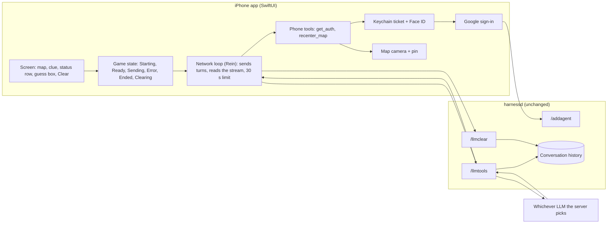

# Section 2: Project 2 Design, Architecture, and Features

## 1. Technical Plan

This plan distills the UX spec (E-A) and the technical design (E-B). Where they differ, E-B governs; every difference is listed in E-B section 8.

### What we are building
A one-screen iPhone game. A full-screen map shows where you are. At the bottom, a small panel shows the latest clue from an LLM, one status line, and a box for your guess. The LLM secretly picks a city and gives clues. When you guess right, the LLM asks the app to move the map to that city, but only after you prove who you are with Google sign-in and Face ID. A floating Clear button starts a fresh game.

### The pieces

### How the pieces talk

1. **Starting.** The app wipes the server's old conversation for this app, then sends the game rules plus a short "Begin". The rules ask the LLM to choose a well-known city and start its first reply with a hidden marker holding the city name, followed by a short welcome and one clue. The server stores that reply, so on every later turn it replays the marker to whichever LLM answers. That is how the city stays fixed and secret without the app ever knowing it. The app removes the marker before showing the clue.
2. **Guessing.** The app sends your text. The reply replaces the clue. Give-ups are just text: the LLM names the city and tells you to tap Clear. The app cannot tell a give-up from an ordinary reply.
3. **Winning.** On a correct guess the LLM calls `get_auth`. The phone checks for an unexpired ticket in the Keychain. If there is none, it shows Google sign-in and trades the Google proof for a ticket from the server. The ticket is saved behind Face ID, then read back with Face ID and handed to the LLM. The LLM then calls `recenter_map` with the ticket and the city's coordinates. The phone checks the ticket and the coordinates, flies the map, drops a pin, and reports success. The LLM's closing text arrives and the game moves to Ended with a Play again button. That is three requests to the server.
4. **Denial.** If sign-in or Face ID is cancelled, `get_auth` reports "denied", the map does not move, and the LLM reveals the city in text. The game still ends.
5. **Errors and time limits.** Every server call has a 30 second total limit. A failure shows one message with one Retry button. Retry restarts after a failed start or wipe, resends after a failed guess, and resumes with the stored tool results after a failure that follows a tool call. In those cases Send is disabled.
6. **Clear.** Clear asks for confirmation, then wipes the conversation through the existing `/llmclear` endpoint and starts a new game. The map and the Keychain ticket stay.

### What does not change
The server, its endpoints, its database layout and its data formats are untouched. The app reuses the tutorial's files and type names, extending them rather than adding structure (E-B section 2).

### Known limits we accept
The secret is enforced only by the LLM's obedience. The ticket lasts at most 3 minutes (a server setting). A timeout at the wrong moment can leave the stored conversation damaged until Clear. One tester at a time can use a given server. The LLM tends to choose the same few cities.

## 2. Alternatives

Each major decision lists the choice and at least two rejected alternatives.

### Decision A: How the LLM gets the token and moves the map
**Chosen:** two phone-side tools, `get_auth` then `recenter_map`, with the LLM carrying the ticket.
- **Rejected 1: one tool where the app handles the token internally (the first UX draft).** Simpler, but the LLM never "obtains" the token, which the assignment requires, and the win and the permission check blur together.
- **Rejected 2: a server-side tool that checks the ticket and returns coordinates.** The server cannot move the phone's map, so the phone would need another call anyway, and the server's ticket checking is not what the tutorial's phone-side tools use.
- **Rejected 3: let the app move the map by reading the city from the LLM's text.** Bypasses the tool-call and authorization requirement and makes the app parse free text.

### Decision B: How the city stays fixed and secret
**Chosen:** a hidden marker in the LLM's first reply, stored and replayed by the server.
- **Rejected 1: a list of cities in the app, picked at random.** Explicitly forbidden: the LLM must choose.
- **Rejected 2: a separate "remember the city" call or a new endpoint or table.** Adding endpoints or changing the database is forbidden.
- **Rejected 3: ask the LLM to re-derive the city from earlier clues each turn.** The city could drift; the stored marker is cheap and exact.

### Decision C: How the app learns the game is over
**Chosen:** the app watches for any game tool call (a win, or a denied sign-in); a give-up ends only in the LLM's text and Clear restarts.
- **Rejected 1: an "end game" tool for wins and give-ups.** Would detect give-ups, but the owner chose not to add a second signal; it also needs the LLM to remember to call it.
- **Rejected 2: parse the LLM's text for words like "game over".** Fragile, language-dependent, and gives the app logic the requirements put in the LLM.
- **Rejected 3: count only the `recenter_map` call as a win.** Would miss the denied-sign-in case, leaving the game unfinished with no Play again.

### Decision D: How the token is stored
**Chosen:** the tutorial's Keychain item (this device only, passcode required, Face ID or passcode to read), with the expiry kept as a visible attribute.
- **Rejected 1: an explicit Secure Enclave key that wraps the ticket.** Closer to a literal reading of the requirement, but a large change to the tutorial's ticket code; the owner accepted the tutorial approach.
- **Rejected 2: keep the ticket only in memory.** Would lose it on every relaunch and would not satisfy "stored encrypted in the Keychain".
- **Rejected 3: store the Google token instead of the server ticket.** The server needs its own ticket, and the Google token is already refreshed by the Google library.

### Decision E: Timer and retry
**Chosen:** a 30 second total limit per server call, and three kinds of Retry.
- **Rejected 1: an idle-time limit.** The server sends keep-alive pings, so an idle limit would almost never fire.
- **Rejected 2: wait for the first data only.** A stalled stream after the first word would hang the screen.
- **Rejected 3: one Retry that always restarts the game.** Simpler, but it would throw away a won game after a failed closing message, which the UX spec promises not to do.

### Decision F: Screen layout
**Chosen:** a full-bleed map with a compact bottom panel and a floating Clear button.
- **Rejected 1: a chat-style transcript with a small map.** Against the "map-dominant, minimal chrome" preference and against "only current hints show".
- **Rejected 2: a split screen with the map and the chat each taking half.** The map would stop being dominant, and the panel would still need the same controls.
- **Rejected 3: Clear inside the input row next to Send.** Easy to mis-tap and a destructive action beside the primary one.

### Decision G: Map component
**Chosen:** the system map (MapKit).
- **Rejected 1: Google Maps.** Needs an API key and adds a dependency for no gain on iOS.
- **Rejected 2: a static image of the city.** Cannot show the user's location or the fly-to animation.

### Decision H: Back end and shared conversations
**Chosen:** no back-end change, and the conversation is keyed by the app's bundle ID, so one tester at a time.
- **Rejected 1: change the server to hold the game state.** Forbidden by the endpoint, data-format and schema constraints.
- **Rejected 2: a per-install ID inside the app ID so testers do not share a conversation.** Not forbidden, but it departs from what the tutorials do and was not needed for a single-tester prototype.
- **Rejected 3: skip the wipe at launch.** A relaunch would put new rules on top of an old game and an old marker.
