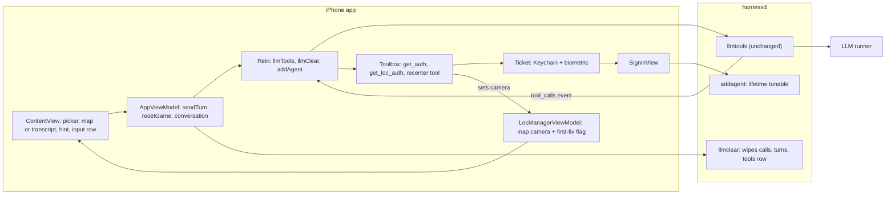
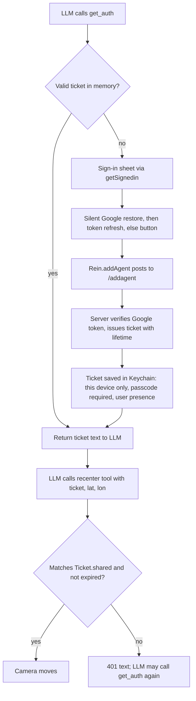

# Exhibit E-C v2: Project 2 Implementation Plan (full plan, no code)

Read-only session. I changed no files and ran nothing that changes state. Mermaid diagrams are the only code-like blocks.

## 0. Corrections and ground rules

**Opaque Dependencies correction.**
- In draft 1 I read the third-party Google Sign-In implementation source to test the professor's stale-token claim. That breached the Opaque Dependencies rule.
- I withdraw it. Nothing below relies on it. Its conclusions are not evidence.
- What I may cite is only:
  - our own call sites,
  - the library's public header documentation, and
  - the token's own contents.
- Any claim I cannot support that way is marked UNVERIFIED.
- The single public-header fact I did read is the documentation of the user object's refresh call. It says it refreshes the access and ID tokens "if they have expired or are about to expire". That is a public header, so it is allowed.

**Owner decisions applied.**
1. Keep the tutorial extras. The only addition is the map.
2. Clear starts a new game immediately: wipe, then re-send the rules.
3. The legacy sweep covers new and touched code only. Baseline offenders are reported, not fixed.
4. First frame is a plain progress indicator. Then the map appears already centered on the user once the first location fix arrives. The cached last-known location may be used for an instant first frame.

**Defaults I am choosing.** Please confirm.
- D1. The first message follows the tutorial: rules sent as the system message with no user message. This changes only if a runner fails on it (see F4).
- D2. The system blue location dot is allowed. Zoom is city level.
- D3. The ticket lifetime comes from an environment variable read at server startup, default 180 seconds.
- D4. The tutorial's Keychain and biometric approach is accepted (as in HW2). Biometric check happens at launch and at ticket save, not on every `get_auth`.
- D5. No project-settings changes except the location permission text. Swift language mode 5.0, the mixed 26.6/27.0 deployment targets, and default main-actor isolation all stay.
- D6. A fresh secret marker at the start of each new round is allowed.
- D7. The existing alert is kept for errors.
- D8. The tutorial tools stay registered: `get_loc_auth` on the phone, `get_weather_auth` on the server.
- D9. Whitespace-only text does not count as "something to send".
- D10. Tests run on whichever runners are available. Device availability is unknown.

## 1. Keeping the extras: conflicts with required elements

Checked against ui_requirements.md and the staff feedback.

| Kept extra | Conflict with a required element? | Smallest change that satisfies the requirement |
|---|---|---|
| Full transcript (ConversationView) | **Yes.** Requirement: "new hints overwrite old; only current hints show". A transcript on the main screen shows every old hint. It also competes with the map for the screen. | Two separate views. The hint area always shows only the latest assistant reply, sits directly above the text box, and is never a history. The transcript is shown only when the user asks for it, through a toolbar button in the existing navigation bar. It temporarily replaces the map area in place, not a sheet (reason below). Question Q1. |
| Game picker + 20 Questions | **Partly.** The picker takes screen space (fine). Changing it already triggers a wipe, so it acts as Clear. The "while sending, Clear is disabled" rule would be bypassed. 20 Questions has no city, so it cannot recenter. | Keep both. Disable the picker while a send or wipe is in flight. 20 Questions keeps its existing rules and never recenters (Q3). The hint area serves both games. |
| Role toggle (system or user draft) | **Mild.** "Send enabled only when there is something to send": both drafts persist across toggles, so Send can be enabled while the visible box is empty. | Keep it. Enable Send only if the currently shown draft has non-whitespace text (smallest reading of the requirement). Clear empties both drafts. Q4. |
| Clear confirmation | **Not in the baseline.** The baseline ClearButton has no confirmation (HW2 specified one). A confirmation also conflicts with the requirement "tapping it clears". | Default: do not add it, because the owner said the only addition is the map. Adding one is a one-line dialog on the button if you want it. Q2. |
| Existing alert for errors | None | Keep. |
| Navigation title "llmTools" | None | Keep. |

**Why the transcript swaps in place instead of a sheet.**
- The app already presents one sheet, the Google sign-in sheet.
- `getAuth` waits (suspends) until that sheet disappears.
- If the transcript were also a sheet and the user opened it while an answer was in flight, the sign-in sheet could fail to present and `getAuth` would wait forever.
- The in-place swap avoids a second sheet. The camera lives in model state, so a recenter while the transcript is showing still takes effect and is visible when the user returns to the map.

**One more conflict I found.**
- The root layout has a whole-screen tap that toggles keyboard focus.
- Over the map, a tap would pop the keyboard open when the box is unfocused.
- Smallest change: make that tap dismiss only, and keep it off the map area.

## 2. Architecture (changes only)

## 3. Ordered steps

Each step: what is reused or changed (names only), what must be true when done, and what it satisfies.

### Step 0: Preflight (no source edits)
- **Needs a read-only dump of the live SQLite definition.**
  - Tables expected from the code: turns, calls, tools, tickets.
  - Confirm keys and any cascading.
  - Hand the text to the coding agent as "the current schema that supports tool calls".
  - The definition is not in the repo.
- Confirm the baseline builds and runs in the simulator.
- **Done when:** the schema text is available and the baseline build is green.
- **Satisfies:** staff backend item "feed the LLM the current database schema".

### Back end

**B1. Clear wipes everything for the app ID** (`handlers.llmclear`)
- Delete the app's calls first, then its turns, then its row in the tools table, in one transaction, so a failure cannot leave half-cleared state.
- Do not touch the tickets table (the Keychain ticket stays).
- Reuse the existing error and log helpers. No new endpoint or schema change.
- **Done when:** after a game that included a tool call, read-only counts of turns, calls and tools rows for the app ID are zero, and another app ID's rows are unchanged.
- **Satisfies:** "adapt llmclear() to remove data cleanly"; the professor's cut-off "Clear deletes… not stored tool schemas"; the requirement that Clear removes history, system prompts and user prompts.
- **Why dropping the tools row is safe:** the existing fresh-turn path re-sends and upserts the schemas, and Clear is blocked during a send.

**B2. Tunable ticket lifetime** (`handlers.TICKET_MAX_LIFETIME`)
- Read once at startup from an environment variable, default 180 seconds. This copies the existing `RUNNERS_CONFIG` and `AGENTIC_ROOT` pattern.
- The current rule stays: the lifetime is the smaller of this value and the Google token's remaining life.
- **Done when:** restarting with a 20 second setting makes the `addagent` response report about 20, and an unset variable gives 180.
- **Satisfies:** "ticket lifetime is tunable".

**B3. Nothing else changes on the back end**
- The recenter tool is phone-resident. Its schema rides in the existing tools field and is stored by the existing upsert.
- `toolbox.py`, routes and `/llmtools` are untouched.
- **Done when:** a manual request offering the new schema gets back a `tool_calls` event for it, and the harnessd diff touches only `handlers.py`.
- **Satisfies:** "no change to API, data formats or schema; no new endpoints".

### Front end

**F1. Fix the stale sign-in token** (`SigninView` task, the `GIDSignIn` async helpers, `Ticket`)
- Remove the branch that prefers the current user's raw ID token.
- Single path: obtain the user (silent restore when needed), then call the user object's documented refresh-if-needed, then read the ID token.
- Reason: the public header documents that refresh call as refreshing expired or about-to-expire tokens. Whether the silent restore alone refreshes is UNVERIFIED from public docs.
- **Open point:** whether the refresh call has a ready-made async form in Swift is UNVERIFIED. If not, add one wrapper in the existing helper extension, in the same style as the two already there.
- Keep the button path and the "Refreshing credentials" overlay.
- **Evidence for the professor** (no library source):
  1. Quote the public header documentation for the refresh call.
  2. A short run. Temporary test logging decodes the `exp` claim inside the ID token string our own code hands to `Rein.addAgent`, a value we receive, not library code. Record it with the current time, then the server's accept or reject. Run it more than an hour after the last sign-in. The old code path should show an `exp` in the past and a rejection from `/addagent`; the fixed path should show a fresh `exp` and an accept. Remove the logging afterwards.
- **Done when:** a sign-in more than an hour after the last one, with no tap, yields a valid ticket.
- **Satisfies:** the professor's SigninView item.

**F2. Map camera state, set once from the first fix** (`LocManagerViewModel`, `LocManager.startUpdates`)
- Add two things to `LocManagerViewModel`: a map camera position and a "first fix received" flag. This follows the existing pattern where tool functions read `LocManagerViewModel.shared`.
- At launch, if the system's cached last-known location exists, use it for an instant first frame.
- Otherwise the first real update sets the camera once.
- Later updates only refresh the stored location that `get_loc_auth` reads. They never touch the camera.
- **Done when:**
  - with simulated location changes after launch, the camera moves exactly once;
  - with permission denied, only the progress indicator shows, never a map.
- **Satisfies:** "map centered on the user's current location at launch; no default view; no later move".

**F3. The recenter tool, reusing the tutorial tool machinery** (`Toolbox`, `Tool`, `ToolFunction`, `getAuth`, `getLocAuth`, `Ticket`, `tools/*.json`)
- Add one JSON schema file beside `get_loc_auth.json`, modelled on the back end's `get_weather_auth.json`: three string arguments (ticket, latitude, longitude). The synchronized project group includes it automatically.
- The description says it moves the map and nothing else. It never mentions a game or "game over".
- Add one phone-side function and register it in `Toolbox.init` next to `get_auth` and `get_loc_auth`.
- The function, in order:
  1. Checks the ticket exactly as `getLocAuth` does, with the same 401 text. Share that guard between the two functions rather than copying it.
  2. Parses the two numbers. On a non-number or out-of-range value it returns an error sentence to the LLM and does not move the map, so it never jumps to 0,0.
  3. Sets the camera (section 4).
  4. Returns a short success sentence.
- `get_auth` and `Toolbox.invoke` are unchanged.
- **Done when:** with a valid ticket the map visibly flies to the coordinates; with a wrong or expired ticket it returns the 401 text and the map stays; with garbage coordinates it returns an error and the map stays.
- **Satisfies:** "recenter tool needs a token"; "MUST reuse tutorial tools and functions"; no code duplication; "the tool only moves the map".

**F4. Rules and secret city** (`Game.rules`, `AppViewModel.sendTurn`, the marker stripper in `Rein`)
- Rewrite only the Guess-the-City rules. 20 Questions rules are unchanged.
- The city rules say, in plain terms:
  - Pick a well-known city and start the first reply with the hidden marker, then a short welcome and one hint. Never state the name in hints.
  - On a wrong guess, give a new hint.
  - On a correct guess, call `get_auth`, then call the recenter tool with that ticket and the city's coordinates, then invite another round.
  - If sign-in or the biometric check is denied, say so and reveal the city in text.
  - If the user gives up, reveal the city in text.
  - For a new round, start the reply with a fresh marker. The newest marker is the current city (D6).
- Delivery follows D1: system-only first message.
- **Contingency:** if some available runner returns an empty or odd first reply, add a short user message such as "Begin" for that case. Q5.
- **Done when:** over ten fresh starts the first visible hint contains no marker text; a correct guess leads to exactly `get_auth`, then the recenter tool, then closing text; a wrong guess leads to no tool call.
- **Satisfies:** "app sends rules; LLM picks the city; city fixed and secret".
- No game-state detection anywhere (staff).

**F5. The screen** (`ContentView`, `SubmitButton`, `ClearButton`, `RoleToggleButton`, `ChatView`, `ConversationView`, `AppViewModel`)
- Layout from top to bottom in a plain vertical stack:
  1. the game picker (unchanged),
  2. the map area, taking the remaining space,
  3. the current-hint area,
  4. one input row (text box, role toggle, Clear, Send).
- **Map area:**
  - Before the first fix: a progress indicator, no map.
  - After: the map bound to the camera, with the system location dot.
  - A toolbar button in the existing navigation bar swaps this area to the kept transcript (`ConversationView`) and back.
- **Hint area:**
  - It shows the latest assistant reply only. It reuses `ChatView` and reads the last entry of the existing `conversation` list when that entry is an assistant message. No new state.
  - It is blank until the first token of a new reply arrives, so each new reply overwrites the old.
  - Its height is capped and scrollable so a long reply cannot push the text box off screen.
- **Send and Clear:**
  - Send is enabled only when the shown draft has non-whitespace text and nothing is in flight.
  - Tapping it shows the existing spinner.
  - Clear is disabled while sending. Send and the picker are disabled while clearing.
  - Reuse the single busy flag, with the spinner on the button that was tapped.
- Make the whole-screen tap dismiss-only and keep it off the map.
- **Done when:** on a phone-size simulator with a location set, the map is centered on that spot at launch, the hint sits directly above the text box, the transcript is reachable but never on screen with the map, and the mutual-disable rule holds, including during the launch-time start and when the picker changes.
- **Satisfies:** all four screen requirements, "hints above, not side by side", and the owner's keep-extras decision.

**F6. Launch and Clear flow** (`AppViewModel.resetGame`, the `ContentView` launch task)
- Launch calls the same function as Clear: wipe on the server, then send the rules.
- If the wipe fails, stop, show the error, and do not send rules. Pressing Clear again is the retry, so there is no Retry feature.
- Clear also empties the conversation, the hint, and both drafts. The map and the Keychain ticket stay.
- **Done when:** relaunching mid-game yields a brand-new city with the previous game gone from the server; a forced wipe failure shows a readable alert and sends nothing.
- **Satisfies:** Clear semantics and the owner's decision 2. It also removes the stale-error and half-reset behavior in the baseline.

**F7. Housekeeping**
- Update the location permission text to say the app centers the map on the user.
- Change comments only where my change makes them false. Do not delete existing comments.

**F8. Legacy sweep** (checklist in section 6), new and touched code only. Report baseline offenders, do not fix them.

**F9. End-to-end verification** (simulator; one real device if available, D10)
- Scenarios:
  1. Cold start with the permission prompt.
  2. Wrong guess, then right guess.
  3. Right guess with a valid in-memory ticket.
  4. Right guess after expiry using the short B2 setting.
  5. Cancelled sign-in.
  6. Give-up text.
  7. Clear during and after a game.
  8. Relaunch.
  9. Picker switch, and transcript swap during a send.
  10. Each reachable runner.
- **Done when:** every scenario behaves as described and nothing from the do-not-build list appears.

## 4. How the map actually moves (not the authorization path)

- The Map view is bound to a single camera position value held in the shared observable location state (`LocManagerViewModel`).
- Moving the map means assigning that value a new camera centered on the given latitude and longitude at city-level distance, inside an animation so it visibly flies. The binding is two-way, so user panning updates it and the next assignment still wins.
- It is assigned only twice:
  1. Once, from the first location fix (or the cached location at launch).
  2. By the recenter tool.
- **Rejected:**
  - The "follow user" camera (it follows continuously and needs a fallback view, which is a default view).
  - A wrapped UIKit map.
  - Any marker or annotation (no pin).
- **Concurrency:** the project already defaults to main-actor isolation, so the tool function writes the state with no explicit main-actor attribute and no dispatch queue.
- **Edge cases:**
  - Assigning a value equal to the current one does nothing, which is harmless.
  - If the transcript is showing, the move still happens and is seen on return.

## 5. How the LLM obtains the token

- At launch, `Ticket.open` reads the Keychain item. It simulates the biometric check on the simulator and relies on the item's access control on a device. A still-valid ticket is loaded into memory.
- Reuse within the lifetime needs no new sign-in. This is the "no revalidation" requirement.
- Denial or cancel makes `get_auth` return the existing 401 text. The rules tell the LLM to reveal the city in text. The app does nothing special (no game-over handling).
- The recenter tool compares the ticket against the phone's own copy. The server's tickets table is used only by `get_weather_auth`.
- The Secure Enclave wording is satisfied only through the tutorial's Keychain access control (D4). No explicit Secure Enclave key is created. Q6.

## 6. Legacy-pattern checklist (new and touched code only)

| Check | Rule | Baseline offenders (reported, not fixed) |
|---|---|---|
| Dispatch queues, `Task.sleep`, `Thread.sleep`, run loops | None | None found |
| `ObservableObject`, `@Published`, `@StateObject`, `@ObservedObject`, `@EnvironmentObject` | None; use `@Observable` and `@Environment`; `@Binding` is fine | None found |
| Explicit main-actor attributes | Each must be justified (default isolation already applies) | None found |
| Layered stacks and geometry readers | Each must be justified | None found; the plan uses a plain vertical stack |
| Manual type assertions | Avoid in new code; explain unavoidable ones | Many in Toolbox, Rein, Ticket, SigninView; the HTTP response casts are unavoidable |
| Caseless enums as namespaces | None | None found |
| `do/catch` | Prefer `Result` | Rein, Toolbox, LocManager |
| Callback wrappers around async APIs | Avoid; a new wrapper only if no async form exists (UNVERIFIED, F1) | `withUnsafeContinuation` helpers in SigninView |
| Deprecated styling (`foregroundColor`, `cornerRadius`) | Use `foregroundStyle` and `clipShape` in new or touched views | ContentView, ChatView |
| Multi-line if/else | Prefer expressions | Check |
| Delete then insert | Use upsert; Clear is delete-only, which is fine | n/a |
| Comments | Only "why"; do not remove existing ones | Check |
| Naming | Descriptive nouns | Check |
| `print`, static mutable globals | Avoid | `print` in LocManager; static `isThinking` in Rein |
| Unrelated code | Surface, do not edit | Report in the final note |

## 7. Do-not-build list

Re-checked against the owner's decision. The extras (picker, 20 Questions, role toggle, transcript) are kept. A Clear confirmation is neither in the baseline nor added (Q2). Still forbidden:
- Pin, marker or annotation on the map.
- Play Again button.
- Give Up button.
- Status row or status line.
- Timers and the 30 second limit.
- Retry, in any form.
- Game-over or "Ended" detection, including treating a tool call as a win signal.
- Any new endpoint, or a change to the data format or SQLite schema.
- Security, scalability or reliability hardening beyond the spec.

## 8. Questions still needing the owner

- **Q1 (blocking for F5).** The transcript conflicts with "only current hints show". Is this acceptable: the hint area is the only always-visible text, and the transcript is a user-opened swap that replaces the map area? Alternatives:
  - A sheet. This risks colliding with the sign-in sheet and hanging `getAuth`.
  - Dropping the transcript.
- **Q2 (non-blocking, default: none added).** The baseline Clear has no confirmation, and the HW2 doc said it did. Add one, given it conflicts with "tapping it clears"? Adding one contradicts "the only addition is the map".
- **Q3 (non-blocking).** Should 20 Questions ever recenter? It has no city, so I assumed never.
- **Q4 (non-blocking).** With the role toggle kept, is "Send enabled only for the currently shown draft" the right reading? Or should it stay enabled when the hidden draft has text?
- **Q5 (non-blocking).** If a runner fails on the tutorial's system-only first message, may I add a short user message for it?
- **Q6 (non-blocking).** Is the tutorial's Keychain access control enough for "accessed through the Secure Enclave" in the eyes of the staff? Or must the plan add an explicit Secure Enclave key?
- **Q7 (blocking for Step 0 and B1).** Who runs the read-only schema dump on the server, and can the coding agent be given the result? Without it, B1 cannot be verified.
- **Q8 (non-blocking).** For the stale-token evidence, is a run more than an hour after the last sign-in acceptable, since Google's token lifetime cannot be shortened?
- **Q9 (non-blocking).** Which runners and devices are actually available for F9? A biometric prompt on a real device cannot be tested otherwise.
