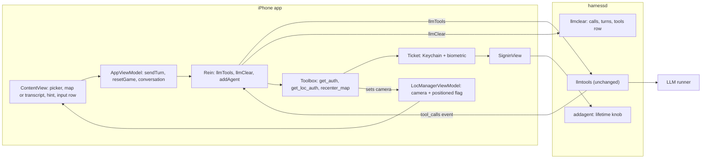
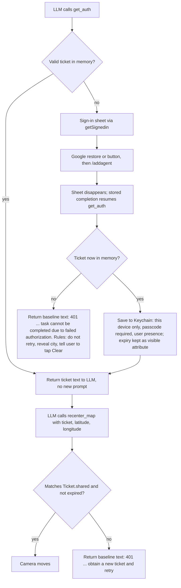

# Exhibit E-C v6: Project 2 Implementation Plan (full plan, no code)

Read-only session. I changed no files and ran nothing that changes state. I read no third-party library source. I reread our own `Toolbox.swift`, `SigninView.swift`, `ContentView.swift`, `AgentApp.swift` and `handlers.py` for the fact checks below. Claims I cannot support from our call sites, public headers or docs are marked UNVERIFIED. Mermaid diagrams are the only code-like blocks.

## Corrections to earlier drafts (read first)

1. **F3b was wrong. The baseline already distinguishes denial from an invalid ticket.** I confirmed in `Toolbox.swift` that the two sentences differ in their instruction, though both begin with "401 Unauthorized":
   - `getLocAuth`, invalid or expired ticket: "401 Unauthorized. Call get_auth to obtain a new ticket and retry. Never reuse an old ticket."
   - `getAuth`, no ticket after the sign-in sheet closes: "401 Unauthorized. Complete the prompt by informing user that task cannot be completed due to failed authorization."
   - My v3 to v5 claim that both were the same sentence, and the plan to replace the `getAuth` sentence, are withdrawn. F3b is now rules text only.
2. **The role toggle: Send sends both drafts in the baseline.** The review said the hidden draft is left untouched by Send. That is wrong. `SubmitButton` sends the system draft and the user draft together, clears both, and reverts to the user role. Send is enabled when either draft has content. My v4 and v5 default D6 ("Send looks only at the currently shown draft") would have changed that baseline behavior without being asked. It is withdrawn. D6 now only adds the requirement-driven whitespace rule.

## 0. Rules this plan follows

**Inputs given to the coding agent**
- The course AGENTS.md. The repo contains only CLAUDE.md; this plan assumes the course AGENTS.md is supplied separately.
- `db_schema.sql`.
- `staff_feedback.md`, `design_specs.md` and `ui_requirements.md`.
- This plan.

**Sources**
- Staff feedback overrides the HW2 design doc wherever they conflict.
- Reasoning uses only:
  - our own call sites,
  - public header documentation, and
  - the data we receive, such as a token's own contents.

**Owner decisions (fixed)**
1. Keep the tutorial extras: game picker, 20 Questions, role toggle, full transcript. The only addition is the map.
2. Clear starts a new game immediately: wipe, then re-send the rules.
3. The legacy sweep applies to new and touched lines only, as defined in section 7. Baseline offenders are reported, not fixed.
4. First frame is a plain progress indicator. Then the map appears, already centered on the user, at the first location fix only. There is no cached last-known location of our own.
5. The transcript is a user-opened, in-place swap for the map area. The hint area is the only always-visible text.
6. **Biometric timing is the tutorial behavior:**
   - Face ID happens when the Keychain item is read at launch, and when a ticket is saved.
   - A valid in-memory ticket is reused with no new prompt.
7. **After a win or a give-up, the LLM tells the user to tap Clear for a new game.**
   - A secret marker is written only at the start of a game.
   - There is no per-round marker, no "play another round in chat", and no play-again tests.

**Defaults (please confirm)**
- D1. The first message follows the tutorial: rules sent as the system message with no user message. Only if a runner fails on it do we add a short user message.
- D2. The system-drawn blue location dot is allowed. Zoom is city level.
- D3. The ticket lifetime comes from an environment variable read once at server startup, default 180 seconds.
- D4. The existing alert is kept for errors.
- D5. The tutorial tools stay registered: `get_loc_auth` on the phone, `get_weather_auth` on the server.
- D6. Send is enabled when either draft has non-whitespace text, because the requirement is "Send enabled only when there is something to send". Everything else about the role toggle is baseline: Send sends both drafts and clears both.
- D7. No project-settings changes except the location permission text.
- D8. Tests run on one working runner plus a named simulator. A real device only if available.

## 1. Departures from the HW2 design document

| # | HW2 said | This plan | Why |
|---|---|---|---|
| 1 | Decision F: full-bleed map, compact bottom panel, floating Clear | Tutorial layout: picker on top, map area, hint, one input row with Clear next to Send | Owner kept the tutorial layout |
| 2 | Rules plus a short "Begin" message | System-only first message (D1) | Follow the tutorial unless a runner fails |
| 3 | Pin, status row, Play Again button, Ended state, Decision C (game over detected from tool calls) | None of them | Staff feedback |
| 4 | 30 second timers and three kinds of Retry (Decision E) | None | Staff feedback |
| 5 | State machine: Starting, Ready, Sending, Error, Ended, Clearing | One busy flag (`isBusy`) in `AppViewModel`, as in the tutorial. Nothing models "ended". | Staff ban game-over detection and the status row |
| 6 | A failure shows one message with one Retry button | The tutorial's alert shows the error. There is no Retry. | Staff feedback |
| 7 | After a win the LLM invites the user to play again, and a Play again button appears. The requirements document also says the LLM "invites the user to play again". | After a win, a give-up or a denial, the LLM tells the user to tap Clear. No button is added. | Owner decision 7. This changes the requirement document's wording; flagged. |
| 8 | Ticket "saved behind Face ID, then read back with Face ID on each win" | Face ID at launch (Keychain read) and at save only. A valid in-memory ticket is reused with no new prompt. | Owner decision 6. This is how the tutorial code works. HW2 overstated it. |
| 9 | Clear asks for confirmation | No confirmation (the baseline has none) | The only addition is the map (Q2) |
| 10 | Server unchanged | Server changes: `llmclear` and the lifetime knob | Staff feedback |
| 11 | Picker, 20 Questions, role toggle, transcript were not part of the HW2 screen | All kept; the transcript sits behind a toolbar swap | Owner decision 1 |
| 12 | Marker written in the first reply | Unchanged: marker only at the start of a game | Same design, now with no later markers |
| 13 | A reply replaces the clue | The hint shows the newest non-empty assistant text. A reply that includes a tool round accumulates its pre-tool and post-tool text in one entry, so after a win the hint can show both | Tutorial reply handling is reused; no new state |
| 14 | Sending and Clearing blocked each other | The single busy flag also disables the game picker while a send or wipe runs | Changing the picker already wipes the conversation, so it behaves as Clear and must obey the same mutual-disable rule |

Denial handling is not a departure: the tutorial's two 401 sentences already differ (see Corrections).

## 2. Schema facts (Step 0 is done: db_schema.sql is read)

- **turns:** `turnID` is the primary key. `appID` and `prompt` are required. `reasoning` and `completion` are optional. A `completed` column exists that the code never uses.
  - There is an index on app and turn.
  - A trigger stamps a completion time after the completion is first set. It fires on updates, not deletes.
- **calls:** `id` alone is the primary key. It is not scoped to an app or a turn.
  - There is an ordering index on turn and call position, and a trigger that stamps the result time.
  - A foreign key points at the turns table with no cascade.
  - The server switches foreign keys on at startup (`main.py`).
- **tools:** `appID` is the primary key, with the schema blob and a timestamp.
- **tickets:** its own table, independent of everything above. A readable view of it shows expiration and creation time.
- Other views and a statistics table exist and are irrelevant to Clear.

**What this implies**
1. **Delete order is forced.** Calls go before turns. The existing two deletes are already in that order.
2. **The tools row has no dependants.** Deleting it is safe, and the next send re-upserts it.
3. **Do not touch tickets.**
4. **Risk: duplicate call ids.**
   - `calls.id` is globally unique, so a provider that reuses a call id would make an insert fail and produce an error event.
   - A win involves two tool rounds in one turn.
   - We cannot change the schema. This is sampled in T4 and reported.
5. **"Feed the LLM the current schema"** is read as: give the coding agent this dump as the authoritative table definition. This is a guess to confirm (Q3).

## 3. Architecture (changes only)

The view model reaches the clear handler only through `Rein.llmClear`.

## 4. Ordered steps

**Step 0 (done).** The live schema dump is read. Facts are in section 2. The coding agent receives db_schema.sql.
- **Satisfies:** staff backend item "feed the LLM the current database schema that supports tool calls".

### Back end

**B1. Clear removes everything for the app ID** (`handlers.llmclear`)
- Three plain deletes, in this order:
  1. the app's calls (found through its turns),
  2. the app's turns,
  3. the app's row in the tools table.
- No single transaction. The existing handlers never use explicit transactions (the connection is in autocommit).
- A partial failure heals on the next Clear:
  - If calls are deleted and turns remain, the app is missing tool results until then.
  - If the tools row stays, the next fresh send overwrites it anyway.
- Reuse the existing error and log helpers. Do not touch tickets. No new endpoint or schema change.
- **Reading of the professor's cut-off sentence.** "Clear deletes calls and turns but not stored tool schemas" is read as "Clear must also delete the tools row". This is a guess to confirm (Q3).
- **Done when:**
  - after a game that included tool calls, read-only counts of this app's rows in turns, calls and tools are all zero, while another app's rows and all tickets are unchanged;
  - the sequence Clear, then a new send, works (T9).
- **Satisfies:** "adapt llmclear() to remove data cleanly"; the requirement that Clear removes history and prompts (system and user prompts live in the turns' prompt blob).

**B2. Tunable ticket lifetime** (`handlers.TICKET_MAX_LIFETIME`)
- Read once from an environment variable at startup, default 180 seconds, following the existing `RUNNERS_CONFIG` and `AGENTIC_ROOT` pattern.
- The existing rule stays: the lifetime is the smaller of this value and the Google token's remaining life.
- **Done when**, after a restart with a 20 second setting:
  - the `lifetime` field in the `/addagent` response body reads about 20. I confirmed in `handlers.py` that the response body contains `ticket`, `creator` and `lifetime`. To read it, make one real sign-in and inspect the response with a temporary log at the app's call site or a manual call that carries a fresh ID token;
  - the new row in the tickets table shows expiration minus creation time of about 20 seconds (read-only query through the readable view);
  - an unset variable gives 180 on the same two checks.
- **Satisfies:** "ticket lifetime is tunable".

**B3. Nothing else changes on the back end**
- `recenter_map` is phone-resident. Its schema rides in the existing tools field and is stored by the existing upsert.
- `toolbox.py`, routes and `/llmtools` are untouched.
- **Done when:**
  - the harnessd diff touches only `handlers.py`;
  - after the first send from the new app, a read-only query of the tools row for the app ID shows a stored schema that contains `recenter_map` together with the other phone tools. This is deterministic, unlike waiting for the LLM to emit a tool-call event.
- **Satisfies:** "no change to API, data formats or schema; no new endpoints".

### Front end

**F1. Stale-token evidence FIRST, then a conditional fix** (file: `SigninView.swift` only)
- **F1a, evidence, before any sign-in code changes.**
  - **Frozen baseline build on its own simulator.**
    - Build the baseline once with only the temporary logging added.
    - Install it on a dedicated simulator that nothing else uses.
    - Do no further builds or runs on that simulator during the hour. Any rebuild replaces the running app and kills the run. All other development uses a different simulator.
  - **A person drives the run:** an interactive Google sign-in through the button, then keep the app alive for over an hour, then trigger a win so `get_auth` reaches the sign-in task again.
  - The coding agent supplies the analysis. It cannot perform the sign-in or the wait itself.
  - Read the public header documentation for the Google user's refresh call and for the current-user and restore calls. Quote it.
  - The temporary logging in `SigninView` records:
    1. which branch supplied the token (the current user's token or the silent restore);
    2. the ID token's `exp` claim, decoded from the string we receive;
    3. the wall-clock time just before the token is posted to `/addagent`.
  - Remove the logging afterwards.
- **The result must be able to fail.** The run counts as evidence only if the logs show the branch, the `exp` and the call time. Then:
  - `exp` earlier than the call time with the current-user branch means the bug is reproduced;
  - `exp` later than the call time means it is not reproduced;
  - a run in which the current-user branch was not used, or where values are missing, is inconclusive and must be repeated.
- **F1b, fix, only if F1a reproduces the bug.**
  - Delete the branch that prefers the current user's raw token. Always use the existing silent-restore helper. No new callback wrapper.
  - Whether silent restore itself refreshes an expired token is UNVERIFIED from public docs. Repeat the same frozen-build run after the fix.
  - Only if that run still shows a stale token, call the documented refresh-if-needed, and justify one wrapper in the same style as the existing helpers.
- **Artifacts captured for the professor, exactly:**
  1. the logged branch, `exp` and call time for each sign-in task;
  2. the server's accept or reject (HTTP status from `/addagent` and the server log line);
  3. the coding tool's own analysis of this one bug, which the person includes with the run.
- **Done when:** these three artifacts exist for the old code, and either the same run passes on the fixed code or the evidence shows "not reproduced" with valid logged values.
- **Satisfies:** the professor's SigninView item ("show me your coding tool output just for this bug").

**F2. Camera state, first fix only** (`LocManagerViewModel`, `LocManager.startUpdates`)
- Add a map camera position and a single "positioned" flag to `LocManagerViewModel`. This follows the pattern where tool functions already read `LocManagerViewModel.shared`.
- **Two writers:**
  1. The first-fix writer runs only if the flag is unset, then sets it.
  2. The `recenter_map` writer runs on every call and also sets the flag.
- So the first-fix writer fires at most once per launch, and a late first fix can never overwrite a tool move.
- Later location updates change only the stored location that `get_loc_auth` reads.
- The first fix the system delivers may be coarse or cached. That is an accepted limit (L8), with no correction.
- **Prerequisite for any run on the simulator:** set a simulated location in the simulator and grant the permission. Without one, the progress indicator spins forever and nothing else can be tested.
- **Done when:**
  - with simulated location changes after launch, the camera moves once, at the first fix, and never again until a tool call;
  - with permission denied, only the progress indicator shows until `recenter_map` runs (L3).
- **Satisfies:** "map centered on the user's current location at launch; no default view; no later move".

**F3. The `recenter_map` tool, reusing the tutorial tool machinery** (`Toolbox`, `Tool`, `ToolFunction`, `getAuth`, `getLocAuth`, `Ticket`, `tools/*.json`)
- **Name:** `recenter_map`. It matches the tutorial's snake_case verb naming.
- **Arguments:** three string arguments in this order: `ticket`, `latitude`, `longitude`. This mirrors `get_weather_auth.json`, so the existing argument-order mechanism in `Toolbox.invoke` works unchanged.
- **Schema file:** a new `recenter_map.json` beside `get_loc_auth.json`. The synchronized project group includes it automatically. The description says it moves the map and nothing else. It never mentions a game or "game over".
- **Function:** a new phone-side function next to `getLocAuth`, registered in `Toolbox.init`.
- **The function, in order:**
  1. It checks the ticket exactly as `getLocAuth` does. That guard, with its baseline sentence unchanged, becomes a shared piece used by both, so the sentence exists in one place.
  2. It parses the two numbers. A non-number, or a value the system's coordinate-validity check rejects, makes it return an error sentence to the LLM without moving the map. The map must never jump to 0,0.
  3. It sets the camera and the positioned flag.
  4. It returns a short success sentence.
- **Touched lines in `getLocAuth`:** extracting the guard makes the guard lines of `getLocAuth` touched. The sentence moves unchanged. The rest of the function (the line returning its latitude and longitude) ships unchanged.
- `getAuth` is not touched by this step.
- **No extra plausibility checks** (such as whether the coordinates fit a country) are added. That is hardening (L11).
- **Done when:**
  - a valid ticket makes the map fly to the coordinates;
  - a wrong or expired ticket returns the invalid-ticket sentence and the map stays;
  - garbage coordinates return an error and the map stays.
- **Satisfies:** "recenter tool needs a token"; "MUST reuse tutorial tools and functions"; no duplication; "the tool only moves the map".

**F3b. Denial versus invalid ticket: the rules do the work** (no code change in `getAuth`)
- The baseline already gives different instructions in the two sentences (quoted in Corrections). Reuse them as they are.
- F4's rules tell the LLM what to do on each:
  - on the "task cannot be completed due to failed authorization" sentence from `get_auth`, do not call `get_auth` again, reveal the city, and tell the user to tap Clear;
  - on the "obtain a new ticket and retry" sentence from `recenter_map`, follow it as written. The plan adds no retry rule.
- **Denied means:** after the sign-in sheet closes there is no ticket in memory (the user cancelled, or Google sign-in or the `/addagent` call failed).
- **Contingency, not planned:** both sentences start with "401 Unauthorized". If T6 shows a weak model looping on `get_auth`, the only fix would be rewording the `getAuth` sentence. Do not do this unless T6 fails.
- **Done when:** T6 passes as a sample observation.
- **Satisfies:** the requirement that the map moves only with a valid token.

**F4. Rules and secret city** (`Game.rules`, `AppViewModel.sendTurn`, the marker stripper in `Rein`)
- Rewrite only the Guess-the-City rules. 20 Questions rules are unchanged.
- The city rules say, in plain terms:
  - Pick a well-known city and begin the first reply with the hidden marker, then a short welcome and one hint. Never state the name in hints.
  - On a wrong guess, give a new hint.
  - On a correct guess, call `get_auth`, then call `recenter_map` with that ticket and the city's coordinates. After it, congratulate the user and tell them to tap Clear for a new game.
  - If `get_auth` reports failed authorization, say so, reveal the city in text, and tell the user to tap Clear.
  - If the user gives up, reveal the city and tell them to tap Clear.
  - The marker is written once, at the start of a game. Do not write it again.
- **Marker stripping while streaming.**
  - The existing stripper holds back the first characters of the reply until it can confirm the marker (and drops it up to the closing bracket) or rule it out.
  - Text reaches the hint only after the stripper releases it, so a half-arrived marker never flashes.
  - The stripper starts fresh for every request.
  - **Known limit L4:** if the LLM opens a marker but never closes it within 120 characters, the held text is flushed as ordinary text and would be visible.
- **Done when**, as sample observations of an LLM and not guarantees:
  - over ten fresh starts, the first visible hint never contains marker text, even mid-stream (T13);
  - in five correct-guess games, the observed order is `get_auth`, then `recenter_map`, then closing text that tells the user to tap Clear (T2);
  - a wrong guess usually leads to no tool call.
- **Satisfies:** "app sends rules; LLM picks the city; city fixed and secret"; owner decision 7.
- No game-state detection anywhere.

**F5. The screen** (`ContentView`, `SubmitButton`, `ClearButton`, `RoleToggleButton`, `ChatView`, `ConversationView`, `AppViewModel`)
- **Layout**, top to bottom in a plain vertical stack:
  1. the game picker,
  2. the map area, taking the remaining space,
  3. the hint area,
  4. one input row (text box, role toggle, Clear, Send).
- **Map area:**
  - Until the positioned flag is set: a progress indicator.
  - After that: the system MapKit view (SwiftUI `Map`) bound to the camera, with the system location dot.
  - A toolbar button in the existing navigation bar swaps this area in place with the transcript (`ConversationView`) and back. This is local view state.
  - The camera is kept in the model, so a recenter during the transcript view is not lost.
- **Hint area (precise behavior).**
  - It shows the content of the newest assistant entry in `conversation` that has non-empty text. No new stored state.
  - Because `sendTurn` appends an empty reply entry before streaming, the previous hint stays visible until the new reply's first visible character arrives. Then the new reply replaces it.
  - Entries from the user or system roles are never shown here, so a user message at the end of the list changes nothing.
  - Tool results are not in `conversation` at all. A tool round appends text to the same reply entry, so pre-tool and post-tool text accumulate there. If a tool round produces no text, the hint stays.
  - If a send fails with a connection error, the error goes to the existing alert. An empty reply entry stays empty, so the previous hint remains.
  - If the failure is a streaming parse failure, the tutorial appends its error text to the reply, and that becomes the shown hint.
  - After Clear, `conversation` is empty, so the hint is blank until the new rules reply arrives.
  - The hint area has a capped, scrollable height so a long reply cannot push the text box off screen.
- **Send and Clear (tutorial mechanism, reused).**
  - A single busy flag in `AppViewModel` disables Send, Clear and (new) the picker while a send or wipe runs.
  - Both buttons show the spinner while busy, as the tutorial does today. The app does not know which button was tapped, and the plan adds no mechanism for it.
  - Send is enabled when either draft has non-whitespace text (D6). A send still sends both drafts and clears both, as in the baseline. Clear does not clear drafts, as in the baseline.
- The root tap currently toggles keyboard focus. Make it dismiss-only and keep it off the map, so a map tap never pops the keyboard open.
- **Done when:** on a named phone-size simulator (for example an iPhone 17 Pro; record the device actually used) with a simulated location, launch shows the progress indicator and then the map on that spot, the hint sits directly above the text box with nothing overlapping, the transcript is reachable but never shown with the map, and the mutual-disable rule holds, including during the launch-time start.
- **Satisfies:** all four screen requirements; "hints above, not side by side"; owner decisions 1 and 5.

**F6. Launch and Clear flow** (`AppViewModel.resetGame`, the `ContentView` launch task)
- Launch calls the same function as the Clear button: wipe on the server (through `Rein.llmClear`), then send the rules.
- **The launch task runs once per launch.**
  - It keeps the baseline guard that the conversation is empty, and adds a check that the busy flag is not set.
  - Both are needed: during the wipe, the conversation is still empty, so a rebuilt view could otherwise start a second wipe and a second set of rules.
  - It is a task on the single root screen, which is not rebuilt by the in-place transcript swap.
- **Why launch changes from the baseline (not cut):** without the wipe, a relaunch stacks new rules on the previous game's history and its marker, so "the city stays fixed" breaks. This reuses `resetGame` and adds no new code.
- Clear's behavior is otherwise the baseline's `resetGame`: the wipe, empty the conversation, send the rules. The map and the Keychain ticket stay.
- There is **no Retry feature**: no button, no automatic retry, and no stored-state resume.
- **Baseline issue surfaced, not fixed.** If the wipe fails, `resetGame` still empties the screen and sends the rules, and `sendTurn` then blanks the error text, so the alert can show an empty message. Because the launch wipe is the first server call, it is the most likely place to see this (L9).
- **Done when:** relaunching mid-game gives a brand-new city with the previous game gone from the server (T10).
- **Satisfies:** owner decision 2 and the Clear requirement.

**F7. Housekeeping**
- Update the location permission text to say the app centers the map on the user.
- **Comment rule:** a comment that my change makes false is rewritten in place. No comment line is deleted unless it is replaced. Comments for removed code stay, as the project rules say.
- The Keychain item keeps its tutorial behavior of storing the ticket's expiry as a visible attribute. Nothing in this plan changes that.

**F8. Legacy sweep** (section 7).

**F9. Verification** (one working runner plus a named simulator; a real device only if available)

All LLM behavior below is a **sample observation of a model, not a guarantee**. Record the number of runs and the count of passes.

- **T1. Cold start.**
  - Prerequisites: simulated location set; fresh install.
  - Observe together: the location permission prompt, a possible Face ID prompt or the launch advisory from the Keychain read, and any error alert (for example "No previous Ticket found" on a first run). Then the progress indicator, then the map on the simulated location.
- **T2. Wrong guess, then right guess** (5 games).
  - Set the simulated user location far from any city the LLM is likely to choose, so a move is visible.
  - Expected sample: the map flies away from the user to the city, and the closing text tells the user to tap Clear.
  - The case where the city equals the current view cannot be judged and is excluded.
- **T3. Right guess with a valid in-memory ticket.** On the simulator, the only observable fact is that no sign-in sheet appears and the map moves. Whether a Face ID prompt would appear is not observable there.
- **T4. Two tool rounds in one turn** (5 wins): no server error event about duplicate call ids on this runner.
- **T5. Expired ticket, with the short B2 lifetime** (for example 20 seconds):
  1. play a game and win, so the first sign-in saves a ticket;
  2. wait past the short lifetime;
  3. press Clear and play a new game;
  4. win a second time, so `get_auth` meets an expired ticket and runs the sign-in task again;
  5. the map moves.
  - It also checks the saved outcome. After the first run a Keychain item exists, so the later save is a replacement. Whether a prompt appears at that save is platform behavior to be OBSERVED and recorded, not assumed. Any error alert is recorded.
- **T6. Cancelled sign-in** (3 runs).
  - At the sign-in sheet, use Google's Cancel. The sheet cannot be swiped away (the baseline disables that).
  - Verified in `SigninView.swift`: when the sheet disappears, a stored completion resumes the waiting `get_auth` call. Every dismissal path (success, failure, cancel) sets the sheet off and so resumes it.
  - Expected sample: no hang; the LLM receives the failed-authorization sentence, does not call `get_auth` again, reveals the city and tells the user to tap Clear.
- **T7. Face ID cancelled or failed at save time after a successful sign-in** (device only). The ticket is still usable in memory and `recenter_map` works (section 6). Without a device, report it as untested.
- **T8. Give-up text** (3 runs): the city is revealed and the user is told to tap Clear.
- **T9. Clear.**
  - During a send, Clear is disabled. Idle, Clear works.
  - After Clear, read-only counts show zero rows for the app in turns, calls and tools.
  - After the first new send, the tools row exists again, and the LLM can call `get_auth` in that very first new game.
  - After Clear and a new send, no turn row for the app contains the previous game's city name (a read-only search of the stored text). In addition, ask the new game "what was the previous city?" as a sample observation.
- **T10. Relaunch mid-game:** a new city and a clean server state, with one wipe and one set of rules (not two).
- **T11. Picker.**
  - While a send is in flight, assert that the picker, Send and Clear are all disabled.
  - Idle, switch the picker: the wipe runs, the conversation empties, and the new game's rules are sent.
  - Transcript swap: open and close it during a send, and confirm the hint area and the busy state are unaffected.
- **T12a. Connection failure** (for example, stop the back end): an alert shows the error, and the previous hint stays.
- **T12b. Streaming parse failure:** the tutorial appends its error text to the reply, so that text becomes the shown hint, and the alert shows. This needs a stub that returns a malformed stream line. If it cannot be induced, report it as untested.
- **T13. Ten fresh starts** (each through Clear): count the starts in which any marker text is visible, including mid-stream. Report the count.
- **Done when:** every test behaves as described (T7 and T12b as noted), the sample counts are recorded, and nothing from the do-not-build list appears.

## 5. How the map actually moves

- The Map is the system MapKit view, SwiftUI's `Map`, bound two-way to a camera position value held in `LocManagerViewModel`.
- Moving the map means assigning that value a new camera centered on the given latitude and longitude at city-level distance, inside an animation so it visibly flies. User panning also updates the value, so the next assignment still wins.
- **Writers:**
  1. the first-fix writer, which fires at most once per launch;
  2. `recenter_map`, which fires on every successful call.
- **Rejected:**
  - MapKit's "follow user" camera (it follows continuously and needs a fallback view, which is a default view);
  - a wrapped UIKit map;
  - any marker, pin or annotation that we add for the city. The system-drawn location dot (D2) is the only marker-like item and is allowed.
- **Concurrency:** the project setting `SWIFT_DEFAULT_ACTOR_ISOLATION = MainActor` is set in both build configurations of `project.pbxproj`, together with `SWIFT_APPROACHABLE_CONCURRENCY = YES`.
  - Under that setting the tool function should be able to write the state with no explicit main-actor attribute and no dispatch queue.
  - That consequence comes from the Swift compiler's documented behavior. It is UNVERIFIED until the project builds. Confirm with a clean build.
- **Edge cases:**
  - Assigning an equal value does nothing, which is harmless and not judged in tests.
  - If the transcript is showing, the move still happens.

## 6. How the LLM obtains the token

**Biometric behavior (owner decision 6), per the tutorial's real code**
- **At launch,** `Ticket.open` reads the Keychain item.
  - On the simulator, it first runs a simulated biometric check.
  - If that check fails, the user sees an advisory ("Will acquire on sign in"), and the ticket is not loaded.
  - On a device, if the read itself fails or is cancelled, the user sees the error alert and the ticket is not loaded.
  - Either way, the next `get_auth` falls back to Google sign-in. It is not a denial.
- **A still-valid ticket in memory is reused with no new prompt.**
- **If Face ID is cancelled or fails at save time after a successful Google sign-in:**
  - The server ticket is already placed in memory before the save is attempted.
  - A save failure shows the error alert ("You will need to sign in again on relaunch").
  - The ticket stays usable in memory for its lifetime, so the sheet closes, `get_auth` returns the ticket, and `recenter_map` succeeds.
  - It is **not** a denial. Only the persistence to the Keychain is lost, so the next launch needs a new sign-in.
- **Replacement saves.** After the first run a Keychain item already exists, so later saves replace it rather than add one. Whether a given add or replacement prompts is platform behavior I cannot verify from our call sites. It is OBSERVED in T5 and T7, not assumed.
- The recenter check compares against the phone's own copy of the ticket. The server's tickets table is used only by `get_weather_auth`.
- The Secure Enclave wording is satisfied only through the tutorial's Keychain access control. No explicit Secure Enclave key is created.

## 7. Legacy-pattern checklist

**"Touched lines only", defined.**
- A line is touched if it is added, if its text changes, or if it moves into a different statement.
- Pure re-indentation, or reordering of unchanged statements, does not make a line touched.
- **One rule is chosen: the line, not the enclosing function.** Every check below applies to touched lines only.
- **Consequence for what legacy code ships:** a touched function can still contain a baseline offender on lines we do not change. Examples that ship unchanged:
  - `LocManager.startUpdates` keeps its `do/catch` and `print` (we change only the line that stores the location);
  - `getAuth` is not touched and keeps its continuation call;
  - `getLocAuth`: only the guard lines are touched (they move into the shared guard, the sentence unchanged); its return line ships unchanged;
  - the `ContentView` buttons keep their `foregroundColor` and `cornerRadius` lines unless the line itself changes;
  - `SigninView` keeps its two continuation helpers.
- So the legacy count after this project is about the baseline's. The guarantee is only that added and edited lines are clean.
- **Risk note.** The staff wording is "presence of these legacy patterns in your code will lead to automatic point deductions". It may be applied to the whole code base, not just our changes, so baseline offenders may still cost points. This is the owner's accepted scope.
- The alternative, "enclosing function", would fix more offenders but enlarge the diff beyond the request.

**Swift checks, run on touched lines**
1. Search for `DispatchQueue`, `Task.sleep`, `Thread.sleep` and `RunLoop`: zero hits.
2. Search for `ObservableObject`, `@Published`, `@StateObject`, `@ObservedObject` and `@EnvironmentObject`: zero hits. `@Observable`, `@Environment` and `@Binding` are fine.
3. Search for `@MainActor`: zero hits.
4. Search for `ZStack` and `GeometryReader`: zero hits.
5. Search for `as?`, `as!` and `as `: zero new hits. Parse coordinates with a failable number conversion and validate with the system's coordinate-validity function.
6. Check every new `enum`: it must have cases.
7. Search for `do {` and `catch`: zero in new code. Use `Result`.
8. Review every new if/else that assigns a value: convert to an expression.
9. Touched views: use `foregroundStyle` and `clipShape`, not `foregroundColor` and `cornerRadius`, on touched lines.
10. Count new callback or continuation wrappers: zero, unless F1b is forced to add exactly one with its justification.
11. **Comments:** in the diff, count comment lines that are deleted without a replacement: zero. A comment made false is rewritten in place (F7).
12. Every new comment explains why, not what.
13. The invalid-ticket sentence appears in exactly one place on the phone, and the failed-authorization sentence is unchanged.
14. Names: every new identifier is a noun or a descriptive phrase for its function.

**Python checks for B1 and B2 (against the course AGENTS.md; CLAUDE.md stands in until it is supplied)**
1. No new import beyond what the change needs. B2 may need the standard `os` module.
2. No `threading`, `time.sleep`, `asyncio.get_event_loop`, or blocking calls in the handler. B1 uses the same awaited `rwdb` calls as today.
3. B1 contains no delete-then-insert. It is three pure deletes with bound `?` parameters and no string-built SQL.
4. B2 reads the variable once at import as a single expression with a default. No multi-line if/else, no config class, no argument parser.
5. Type hints, if any, use modern forms (`X | None`, built-in `list` and `dict`). Search for `Optional`, `List`, `Dict`, `typing.`: zero in changed lines.
6. Use f-strings only, no `.format(` and no `%` formatting.
7. No new helper function, class or wrapper for single-use code.
8. Errors reuse `_logClientErr`. No new broad exception handling beyond the one the handler already has.
9. The comment above the lifetime constant explains why it is tunable, and the existing "why capped" comment is kept.
10. **Indentation:** match the sibling lines in the same block (the same indentation run), because `handlers.py` mixes tabs and spaces. Do not reformat other lines.
11. No validation of the environment value beyond what the existing code does. That would be hardening.

**Baseline Python offenders, reported not fixed**
- `from __future__ import annotations` on a Python 3.14 project (`pyproject` requires 3.14 or newer).
- Mixed tabs and spaces in `handlers.py`.
- A synchronous `requests` session in `main.py`.
- Broad `except Exception` clauses.

**Baseline Swift offenders, reported not fixed**
- `do/catch`: `Rein.llmTools`, `Rein.processSse`, `Toolbox.jsonToSchema`, `LocManager.startUpdates`.
- Type assertions (`as?`): `Toolbox.invoke`, `Rein.addAgent`, `Rein` response casts (unavoidable), `Ticket`, `SigninView`, and the client-id lookup.
- Continuation helpers: two in `SigninView`, one in `getAuth`.
- Deprecated styling: `foregroundColor` and `cornerRadius` in `ContentView` and `ChatView`.
- `print` in `LocManager`; static mutable `isThinking` in `Rein`.
- Not found: dispatch queues, old property wrappers, layered stacks, geometry readers, caseless enums.

## 8. Do-not-build list

The tutorial extras (picker, 20 Questions, role toggle, transcript) are kept. No Clear confirmation is added (Q2). Still forbidden:
- Pin, marker or annotation that we add on the map.
- Play Again button.
- Give Up button.
- Status row or status line.
- Timers and any time limit.
- A Retry feature in any form (button, automatic retry, or resume from stored tool results).
- Game-over or "Ended" detection, including treating any tool call as a win signal.
- Any new endpoint, or any change to a data format or the SQLite schema.
- Security, scalability or reliability hardening beyond the spec: no tool-call loop cap, no locking against races, no extra coordinate plausibility checks.

## 9. Accepted limits (no hardening)

- **L1. Stalled or interrupted stream.**
  - With no timers (staff-mandated) and the kept mutual-disable rule, a stalled reply stream leaves Send, Clear and the picker disabled until the stream ends or the app is relaunched.
  - The same applies if the app is suspended, or the user switches to another app during sign-in, in the middle of a stream.
  - The tutorial request already carries a 20 minute request timeout (baseline, not added by this plan, so it does not conflict with the no-timer rule), and the server sends keep-alive pings. Whether those pings defeat that timeout is UNVERIFIED.
- **L2. Secrecy rests on LLM obedience.** The marker only hides the city from the screen, not from a model that ignores its rules.
- **L3. No location permission.** The area shows only the progress indicator, a dead screen, until the first `recenter_map`; then the map appears centered on the city. This is the tester-facing result.
- **L4. Unclosed marker.** After 120 characters the held text is shown.
- **L5. Duplicate call ids** from a provider could fail an insert (schema fact 4).
- **L6. Phone-side ticket check.** The recenter check is local, so the server's own ticket table is not consulted.
- **L7. One tester at a time.** The conversation is keyed by the app's bundle ID, so two devices on one back end share and wipe each other's game.
- **L8. Coarse or cached first fix.** The system may deliver a coarse or cached location as the first fix, and the map then centers there.
- **L9. Launch wipe failure.** If the wipe fails, the screen can show an alert with a blank message (the baseline bug surfaced in F6, not fixed). It is most likely at launch, as the first server call.
- **L10. Wipe racing an unfinished server turn.** Pressing Clear or relaunching while the server still finishes a turn is not locked against.
- **L11. Wrong or oddly formatted coordinates.** A plausible-but-wrong coordinate, or a format that fails to parse (for example "48.85 N"), is accepted or rejected as is. A parse failure returns an error to the LLM, which may or may not recover.
- **L12. Keep chatting after a win.** The user can keep typing, and the LLM might start another city without a wipe. No code prevents it.
- **L13. Tool loop.** A stubborn model that loops on tool calls keeps the controls locked until relaunch. There is no loop cap (staff: no hardening).

## 10. Goldfish 5 round 1 findings: not adopted, or adopted in part

- **"The hidden draft is left untouched by Send": not adopted.** It is wrong for the baseline: Send sends both drafts and clears both (Corrections, item 2). The plan states the real baseline behavior.
- **F3b "shrink to the rules text": adopted in full,** and the earlier false claim is withdrawn (Corrections, item 1).
- **A tool-call loop cap, locking out wipe races, extra coordinate sanity checks, timers: not adopted,** as instructed (hardening beyond the Minimum Reproducible Example). They appear as limits L10, L11 and L13.
- The range check by the system's coordinate-validity function is kept, not as a plausibility check but to stop an invalid coordinate from reaching the map.
- All other findings are adopted.

## 11. Questions that still need the owner

1. **20 Questions wording (non-blocking, default: leave unchanged).** Its baseline rules still say "invite them to play again" and it never recenters. Owner decision 7 tells the city game to say "tap Clear". Should 20 Questions get the same wording?
2. **Clear confirmation (non-blocking, default: none).** The baseline has none. HW2 specified one, and the owner said to keep the extras. Adding one is a new feature and conflicts with "tapping it clears".
3. **The professor's cut-off sentence (non-blocking, but confirm before submission).** B1 reads it as "Clear must also delete the tools row", and reads "feed the LLM the current schema" as handing the coding agent db_schema.sql. Both are guesses. Can you check them with the professor?
4. **Person for the stale-token run (blocking only for closing F1).** A person must do the interactive Google sign-in on a dedicated simulator and keep the app alive for over an hour. Who and when?
5. **Test runner and device (non-blocking).** Which single runner is the test runner, and is a real device available? T7 (Face ID at save) cannot run without one.
