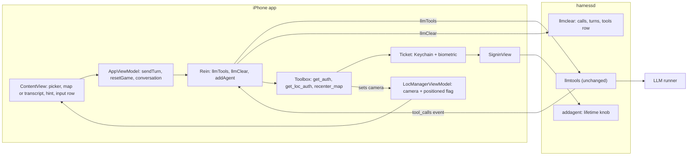
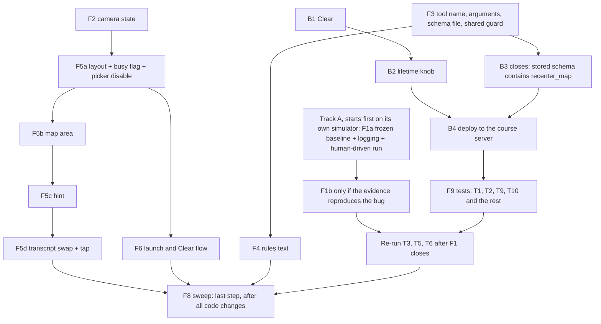
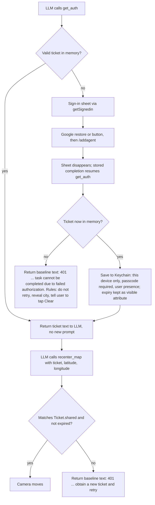

# Exhibit E-C v8: Project 2 Implementation Plan (full plan, no code)

Plan only. No code, no state changes. I read no third-party library source. I reread our own files, including `AgentApp.swift`, `ContentView.swift`, `ChatView.swift`, `Rein.swift`, `Toolbox.swift`, `runners.py` and `handlers.py`, for the facts below. Claims I cannot support from our call sites, public headers or docs are marked UNVERIFIED. Mermaid diagrams are the only code-like blocks.

## Decisions the implementer must not reopen (flagged for the owner to confirm)

1. Where any input document conflicts with this plan, this plan wins.
   - This plan was written to follow `staff_feedback.md`. If the implementer believes a staff item is violated, it reports that and does not resolve it silently.
2. **The hidden-marker format is reused exactly as the code has it.**
   - The marker is written as `[SECRET: <city>]`: square brackets, the capital word SECRET, a colon, a space, the city.
   - The matching prefix constant `secretPrefix`, which holds `[SECRET:`, is in `Rein.swift`.
   - The rules text that asks for it is `Game.rules`, in `AgentApp.swift`.
3. **Ticket lifetime variable:** `TICKET_LIFETIME_SECONDS`.
   - It is read in `handlers.py`, next to the definition of `TICKET_MAX_LIFETIME`, with default 180.
   - `TICKET_MAX_LIFETIME` keeps its name and is assigned from the variable.
4. **City-level zoom:** a map span of about 20 kilometres.
5. **Test runner:** Groq, `openai/gpt-oss-120b` (the first runner in `runners.toml`), unless it is unavailable.
   - Mechanism: the server picks runners by weighted random order per request, so "first in the file" does not pin anything.
   - To test on one runner, start the test server with only the Groq API key set. The local fallback stays as the last resort and shows in the server log if it is used.
   - Real device availability is unknown.
6. The course AGENTS.md, if supplied, governs both Swift and Python. CLAUDE.md governs otherwise.
7. The repository itself, not only the listed input files, is provided to the implementer.
8. **No biometric code is written.** Face ID behavior comes only from the existing `Ticket` code.
9. **The back end for B1 and B2 tests is the course server, reachable over ssh.**
   - Any write to the live database needs the owner's explicit go-ahead.
   - Deploying `handlers.py` and restarting `harnessd` also need that go-ahead (Q5).

## 0. Rules this plan follows

**Inputs given to the implementer**
- The course AGENTS.md (if supplied) or CLAUDE.md.
- `db_schema.sql`.
- `staff_feedback.md`, `design_specs.md` and `ui_requirements.md`.
- The repository.
- This plan.

**Sources**
- Staff feedback overrides the HW2 design document wherever they conflict.
- Reasoning uses only:
  - our own call sites,
  - public header documentation, and
  - the data we receive, such as a token's own contents.

**Baseline facts the implementer must not contradict**
- The two baseline authorization sentences, in `Toolbox.swift`, differ in their instruction though both begin with "401 Unauthorized":
  - `getLocAuth`, invalid or expired ticket: "401 Unauthorized. Call get_auth to obtain a new ticket and retry. Never reuse an old ticket."
  - `getAuth`, no ticket after the sign-in sheet closes: "401 Unauthorized. Complete the prompt by informing user that task cannot be completed due to failed authorization."
- `SubmitButton` sends the system draft and the user draft together, clears both, and reverts the role to user. Send is enabled when either draft has content.

**Owner decisions (fixed)**
1. Keep the tutorial extras: game picker, 20 Questions, role toggle, full transcript. The only addition is the map.
2. Clear starts a new game immediately: wipe, then re-send the rules.
3. The legacy sweep applies to new and touched lines only, as defined in section 7. Baseline offenders are reported, not fixed.
4. First frame is a plain progress indicator. Then the map appears, already centered on the user, at the first location fix only. There is no cached last-known location of our own.
5. The transcript is a user-opened, in-place swap for the map area. The hint area is the only always-visible text.
6. **Biometric timing is the tutorial behavior:**
   - Face ID happens when the Keychain item is read at launch, and when a ticket is saved.
   - A valid in-memory ticket is reused with no new prompt.
7. **After a win or a give-up, the LLM tells the user to tap Clear for a new game.**
   - A secret marker is written only at the start of a game.
   - There is no per-round marker, no "play another round in chat", and no play-again tests.

**Defaults (please confirm)**
- D1. The first message follows the tutorial: rules sent as the system message with no user message. Only if the test runner fails on it (an empty or odd first reply) do we add a short user message.
- D2. The system-drawn blue location dot is allowed.
- D3. The existing alert is kept for errors.
- D4. The tutorial tools stay registered: `get_loc_auth` on the phone, `get_weather_auth` on the server.
- D5. Send is enabled when either draft has non-whitespace text, because the requirement is "Send enabled only when there is something to send". Everything else about the role toggle is baseline.
- D6. No project-settings changes except the location permission text.

## 1. Departures from the HW2 design document

| # | HW2 said | This plan | Why |
|---|---|---|---|
| 1 | Decision F: full-bleed map, compact bottom panel, floating Clear | Tutorial layout: picker on top, map area, hint, one input row with Clear next to Send | Owner kept the tutorial layout |
| 2 | Rules plus a short "Begin" message | System-only first message (D1) | Follow the tutorial unless the runner fails |
| 3 | Pin, status row, Play Again button, Ended state, Decision C (game over detected from tool calls) | None of them | Staff feedback |
| 4 | 30 second timers and three kinds of Retry (Decision E) | None | Staff feedback |
| 5 | State machine: Starting, Ready, Sending, Error, Ended, Clearing | One busy flag (`isBusy`) in `AppViewModel`, as in the tutorial. Nothing models "ended". | Staff ban game-over detection and the status row |
| 6 | A failure shows one message with one Retry button | The tutorial's alert shows the error. There is no Retry. | Staff feedback |
| 7 | After a win the LLM invites the user to play again, and a Play again button appears. The requirements document also says the LLM "invites the user to play again". | After a win, a give-up or a denial, the LLM tells the user to tap Clear. No button is added. | Owner decision 7. This changes the requirement document's wording; flagged. |
| 8 | Ticket "saved behind Face ID, then read back with Face ID on each win" | Face ID at launch (Keychain read) and at save only. A valid in-memory ticket is reused with no new prompt. | Owner decision 6. This is how the tutorial code works. |
| 9 | Clear asks for confirmation | No confirmation (the baseline has none) | The only addition is the map (Q2) |
| 10 | Server unchanged | Server changes: `llmclear` and the lifetime knob | Staff feedback |
| 11 | Picker, 20 Questions, role toggle, transcript were not part of the HW2 screen | All kept; the transcript sits behind a toolbar swap | Owner decision 1 |
| 12 | Marker written in the first reply | Unchanged: marker only at the start of a game | Same design |
| 13 | A reply replaces the clue | The hint shows the newest non-whitespace assistant text. A reply that includes a tool round accumulates its pre-tool and post-tool text in one entry, so after a win the hint can show both | Tutorial reply handling is reused; no new state |
| 14 | Sending and Clearing blocked each other | The single busy flag also disables the game picker while a send or wipe runs | Changing the picker already wipes the conversation, so it behaves as Clear |

Denial handling is not a departure: the baseline's two 401 sentences already differ.

## 2. Schema facts (already done; not a task for the implementer)

The live schema dump `db_schema.sql` is read.

- **turns:** `turnID` is the primary key. `appID` and `prompt` are required. `reasoning` and `completion` are optional. A `completed` column exists that the code never uses.
  - There is an index on app and turn.
  - A trigger stamps a completion time after the completion is first set. It fires on updates, not deletes.
- **calls:** `id` alone is the primary key. It is not scoped to an app or a turn.
  - There is an ordering index on turn and call position, and a trigger that stamps the result time.
  - A foreign key points at the turns table with no cascade.
  - The server switches foreign keys on at startup (`main.py`).
- **tools:** `appID` is the primary key, with the schema blob and a timestamp.
- **tickets:** its own table, independent of everything above. A readable view of it shows expiration and creation time.
- Other views and a statistics table exist and are irrelevant to Clear.

**What this implies**
1. **Delete order is forced.** Calls go before turns. The existing two deletes are already in that order.
2. **The tools row has no dependants.** Deleting it is safe, and the next send re-upserts it.
3. **Do not touch tickets.**
4. **Risk: duplicate call ids.**
   - `calls.id` is globally unique, so a provider that reuses a call id would make an insert fail and produce an error event.
   - A win involves two tool rounds in one turn.
   - We cannot change the schema. This is sampled in T4 and reported.
5. **"Feed the LLM the current schema"** is read as: give the implementer this dump as the authoritative table definition. This is a guess to confirm (Q3).

## 3. Architecture (changes only)

The view model reaches the clear handler only through `Rein.llmClear`.

## 4. Order of work

- **Track A starts first.** F1a is built from the unmodified baseline plus only the temporary logging, before any other front-end change is installed on that simulator. It then runs for over an hour. All other work proceeds on other simulators without waiting for it.
- **Back end first:** B1 and B2 before anything that needs the server. B3 closes only after F3 exists, because the stored schema must contain the new tool.
- **F3 before F4**, because the rules name the tool, its arguments and the baseline sentences.
- **F2 before F5b**, because the map needs the camera state.
- **F1b lands only after the evidence,** and T3, T5 and T6 (which exercise `SigninView`) are re-run after F1 closes.
- **Tests need the back end deployed first** (B4).
- **F8 is last.**

## 5. Steps

**Step 0** is done (section 2). It is not a task for the implementer.

### Back end

**B1. Clear removes everything for the app ID** (`handlers.llmclear`)
- The app ID comes from the request body, as in the existing handler.
- Three plain deletes, in this order:
  1. the calls, selected by a subquery on this app's turn IDs (as the existing statement does),
  2. the app's turns,
  3. the app's row in the tools table.
- No single transaction. The existing handlers never use explicit transactions (the connection is in autocommit).
- A partial failure heals on the next Clear:
  - If calls are deleted and turns remain, the app is missing tool results until then.
  - If the tools row stays, the next fresh send overwrites it anyway.
- Reuse the existing error and log helpers. Do not touch tickets. No new endpoint or schema change.
- **The tools-row delete rests on a guess.** The professor's cut-off sentence "Clear deletes calls and turns but not stored tool schemas" is read as "Clear must also delete the tools row" (Q3).
  - It is reversible by removing that one statement.
  - The plan still works without it: the next fresh send re-upserts the row, so only T9's check changes, to "the tools row is overwritten, not absent".
- **Done when:**
  - after a game that included tool calls, read-only counts of this app's rows in turns, calls and tools are all zero, while another app's rows and all tickets are unchanged. This needs a second app ID's rows: use another app's existing rows if any, otherwise a test row written under a throwaway test app ID. That is a write to the live database and needs the owner's explicit go-ahead; delete it afterwards;
  - the sequence Clear, then a new send, works (T9).
- **Satisfies:** "adapt llmclear() to remove data cleanly"; the requirement that Clear removes history and prompts (system and user prompts live in the turns' prompt blob).

**B2. Tunable ticket lifetime** (`handlers.TICKET_MAX_LIFETIME`)
- Read the environment variable `TICKET_LIFETIME_SECONDS` once at startup, right where `TICKET_MAX_LIFETIME` is defined, with default 180. This follows the existing `RUNNERS_CONFIG` and `AGENTIC_ROOT` pattern.
- The existing rule stays: the lifetime is the smaller of this value and the Google token's remaining life.
- A non-numeric value is not handled. The server fails at startup, which is acceptable (no hardening).
- **Done when**, after a restart with the variable set to 20:
  - after a fresh sign-in (an old Google token would read lower than 20), the new row in the tickets table shows expiration minus creation time of about 20 seconds (read-only query through the readable view). The response body's `lifetime` field (confirmed present in `handlers.py`) is an optional extra check;
  - an unset variable gives 180 on the same check.
- **Satisfies:** "ticket lifetime is tunable".

**B3. Nothing else changes on the back end**
- `recenter_map` is phone-resident. Its schema rides in the existing tools field and is stored by the existing upsert.
- `toolbox.py`, routes and `/llmtools` are untouched.
- **Closes only after F3 exists.**
- **Done when:**
  - the harnessd diff touches only `handlers.py`;
  - after the first send from the new app, a read-only query of the tools row for the app ID shows a stored schema that contains `recenter_map` together with the other phone tools. This is deterministic, unlike waiting for the LLM to emit a tool-call event.
- **Satisfies:** "no change to API, data formats or schema; no new endpoints".

**B4. Deploy for tests (operational; needs the owner's go-ahead, Q5)**
- Copy the changed `handlers.py` to the course server over ssh and restart `harnessd`.
- How `harnessd` is started on the server is UNVERIFIED from the repository. The implementer finds out and reports it.
- Start it with `TICKET_LIFETIME_SECONDS` set when a test needs it (20 for T5; unset otherwise).
- For single-runner tests, start it with only the Groq key set (decision 5).
- All database checks are read-only queries on the server.
- The phone's existing back-end address constant in `Rein.swift` is not changed.
- **Done when:** a test send from the phone reaches the changed server and the log shows the chosen runner.

### Front end

**F1. Stale-token evidence FIRST, then a conditional fix** (file: `SigninView.swift` only)
- **F1a, evidence, its own track, before any sign-in code changes.**
  - **Frozen baseline build on its own simulator.**
    - Build the baseline once with only the temporary logging added.
    - Install it on a dedicated simulator that nothing else uses.
    - Do no further builds or runs on that simulator during the hour. Any rebuild replaces the running app and kills the run. All other development uses a different simulator.
  - **Server expiry check (from `handlers.py`):** the server verifies the ID token with the Google library's verifier and a 50 second clock-skew allowance, and answers 401 on failure. A token expired by more than about 50 seconds is rejected, so artifact 2 is informative.
  - **A person drives the run:** an interactive Google sign-in through the button, then keep the app alive for over an hour, then trigger a win so `get_auth` reaches the sign-in task again.
  - The coding agent supplies the analysis. It cannot perform the sign-in or the wait itself.
  - Read the public header documentation for the Google user's refresh call and for the current-user and restore calls. Quote it.
  - The temporary logging in `SigninView` records:
    1. which branch supplied the token (the current user's token or the silent restore);
    2. the ID token's `exp` claim, decoded from the string we receive;
    3. the wall-clock time just before the token is posted to `/addagent`.
  - Remove the logging afterwards.
- **The result must be able to fail.** The run counts as evidence only if the logs show the branch, the `exp` and the call time. Then:
  - `exp` earlier than the call time with the current-user branch means the bug is reproduced;
  - `exp` later than the call time means it is not reproduced;
  - a run in which the current-user branch was not used, or where values are missing, is inconclusive and must be repeated.
- **F1b, fix, only if F1a reproduces the bug.**
  - Delete the branch that prefers the current user's raw token. Always use the existing silent-restore helper. No new callback wrapper.
  - Whether silent restore itself refreshes an expired token is UNVERIFIED from public docs. Repeat the same frozen-build run after the fix.
  - Only if that run still shows a stale token, call the documented refresh-if-needed, and justify one wrapper in the same style as the existing helpers.
- **Artifacts captured for the professor, exactly:**
  1. the logged branch, `exp` and call time for each sign-in task;
  2. the server's accept or reject (HTTP status from `/addagent` and the server log line);
  3. the coding tool's own analysis of this one bug, which the person includes with the run.
- **Done when:** these three artifacts exist for the old code, and either the same run passes on the fixed code or the evidence shows "not reproduced" with valid logged values. Then T3, T5 and T6 are re-run.
- **Satisfies:** the professor's SigninView item ("show me your coding tool output just for this bug").

**F2. Camera state, first fix only** (`LocManagerViewModel` and `LocManager.startUpdates`, both in `LocManager.swift`)
- Add a map camera position and a single "positioned" flag to `LocManagerViewModel`. This follows the pattern where tool functions already read `LocManagerViewModel.shared`.
- **Two writers:**
  1. The first-fix writer runs only if the flag is unset, then sets it.
  2. The `recenter_map` writer runs on every call and also sets the flag.
- So the first-fix writer fires at most once per launch, and a late first fix can never overwrite a tool move.
- Later location updates change only the stored location that `get_loc_auth` reads.
- The first fix the system delivers may be coarse or cached. That is an accepted limit (L8), with no correction.
- **Prerequisite for any run on the simulator:** set a simulated location in the simulator and grant the permission. Without one, the progress indicator spins forever and nothing else can be tested.
- **Done when:**
  - with simulated location changes after launch, the camera moves once, at the first fix, and never again until a tool call (checked visually, or with a temporary counter that is removed afterwards);
  - with permission denied, only the progress indicator shows until `recenter_map` runs (L3).
- **Satisfies:** "map centered on the user's current location at launch; no default view; no later move".

**F3. The `recenter_map` tool, reusing the tutorial tool machinery** (files: `Toolbox.swift`, a new `tools/recenter_map.json` beside `get_loc_auth.json`)
- **Name:** `recenter_map`. It matches the tutorial's snake_case verb naming.
- **Arguments:** three string arguments in this order: `ticket`, `latitude`, `longitude`. This mirrors `get_weather_auth.json`, so the existing argument-order mechanism in `Toolbox.invoke` works unchanged.
- **Schema file** (the synchronized project group includes it automatically):
  - The description says the tool moves the map to the given coordinates and requires a ticket from `get_auth`.
  - It must say that coordinates are plain decimal numbers, with no degree signs and no N, S, E or W letters.
  - It must not copy the weather wording from `get_weather_auth.json`.
  - It must never mention a game or "game over".
  - The ticket parameter's description may reuse the baseline wording "Authorization ticket obtained from get_auth tool".
- **Shared guard:** a function in `Toolbox.swift`, named `ticketRejection(for:)`.
  - It takes the ticket argument.
  - It returns nothing when the ticket matches the current valid in-memory ticket.
  - Otherwise it returns the baseline invalid-ticket sentence, which moves into it unchanged.
  - `getLocAuth` and the new function both call it, so the sentence exists in one place.
- **Function:** a new phone-side function next to `getLocAuth`, registered in `Toolbox.init`, which does the following in order:
  1. It calls the shared guard and returns its sentence if there is one.
  2. It parses the two numbers. It returns an error sentence to the LLM, without moving the map, when:
     - either is not a number,
     - the system's coordinate-validity check rejects the pair, or
     - the pair is exactly latitude 0 and longitude 0. The system check accepts that pair, and a model that omits or zeroes the arguments would send it. This rejection is a correctness check, not hardening, and must be kept.
  3. It sets the camera (a region of about 20 kilometres across, section 6) and the positioned flag.
  4. It returns a short success sentence.
- **Touched lines in `getLocAuth`:** extracting the guard makes the guard lines of `getLocAuth` touched. The sentence moves unchanged. The line returning its latitude and longitude ships unchanged.
- `getAuth` is not touched.
- **No extra plausibility checks** (such as whether the coordinates fit a country). That is hardening (L11).
- **Done when:**
  - a valid ticket makes the map fly to the coordinates;
  - garbage coordinates and (0, 0) return an error and the map stays;
  - the invalid-ticket branch cannot be triggered by a real model on demand. Verify it with a one-off manual tool call (a debug-only call with a wrong ticket string) or by reading the code, and report it as read-only verified if no trigger exists.
- **Satisfies:** "recenter tool needs a token"; "MUST reuse tutorial tools and functions"; no duplication; "the tool only moves the map".

**F4. Rules and secret city**

*F4a. Rules text* (`Game.rules`, the Guess-the-City case, in `AgentApp.swift`; 20 Questions rules are unchanged)

The rules say the following, in plain English. The implementer pastes this in spirit:

1. You are hosting a "Guess the City" game with the user. Choose a well-known city yourself.
2. On your very first reply, before any other text, write the hidden marker in exactly this form: `[SECRET: <the city you chose>]`, for example `[SECRET: Paris]`. It is hidden from the player and is how you remember your choice. Never contradict it. Write it once, at the start of the game, and never again.
3. After the marker, give a short welcome and one hint. Hints never include the city's name.
4. When the user guesses wrong or asks for a clue, give one new hint.
5. When the user guesses the city correctly, first call `get_auth` to obtain a ticket.
6. Then call `recenter_map` with that ticket and the city's latitude and longitude. Give the coordinates as plain decimal numbers (for example 48.8566 and 2.3522), negative for south and west, with no degree signs and no N, S, E or W letters, and never both zero.
7. After `recenter_map` succeeds, congratulate the user and tell them to tap Clear for a new game.
8. If `get_auth` reports that the task cannot be completed due to failed authorization, do not call it again. Tell the user authorization failed, reveal the city, and tell them to tap Clear.
9. If `recenter_map` reports a rejected ticket, follow the instruction in that message. No other retry rule applies.
10. If the user gives up, reveal the city and tell them to tap Clear.
11. After the game has ended, do not start another game. Remind the user to tap Clear.
12. Use only `get_auth` and `recenter_map`. Never call `recenter_map` before a correct guess.

*F4b. Confirm the existing marker stripper handles the marker.* **Yes, no code change is expected.**
- I read `Rein.stripSecretMarker`. It holds back the start of each reply until it either confirms the prefix `[SECRET:` and drops everything up to the first closing bracket, or rules the marker out and releases the text.
- It tolerates leading whitespace and newlines.
- The marker state is created fresh for each request, in `SseAccumulator`, so a later reply is stripped independently.
- A half-arrived marker never flashes, because the reply's visible text is only appended after the stripper releases it.
- It leaves any text after the bracket as it arrives, which can start with a space or newline. The hint computation (F5c) ignores whitespace-only text.
- **Known limit L4:** if the LLM opens a marker but never closes it within 120 characters, the held text is flushed as ordinary text and would be visible.
- The implementer must confirm this by running T13 and the first-hint check in T1, and only change the stripper if those fail. The format in the rules must match `secretPrefix` exactly, including its capital letters and the space after the colon.

- **Done when**, as sample observations of an LLM and not guarantees:
  - over ten fresh starts, the first visible hint never contains marker text, even mid-stream (T13);
  - in five correct-guess games, the observed order is `get_auth`, then `recenter_map`, then closing text that tells the user to tap Clear (T2);
  - a wrong guess leads to no tool call in at least 4 of 5 wrong guesses.
- **Satisfies:** "app sends rules; LLM picks the city; city fixed and secret"; owner decision 7.
- No game-state detection anywhere.

**F5. The screen.** The files and types:
- `ContentView.swift` holds `SubmitButton`, `RoleToggleButton`, `ClearButton` and `ContentView`. `ContentView` holds the game picker and its change handler that calls `resetGame`.
- `AgentApp.swift` holds `Game` (with `rules`), `AppViewModel` (with `isBusy`, `conversation`, `sendTurn`, `resetGame`) and `AgentApp`.
- `ChatView.swift` holds `Chat`, `ChatView` and `ConversationView`. All of these already exist and are reused.
- `LocManager.swift` holds `LocManagerViewModel`.

*F5a. Layout and the busy flag* (`ContentView.swift`)
- Restructure `ContentView`'s body into a plain vertical stack, top to bottom:
  1. the game picker,
  2. the map area, taking the remaining space,
  3. the hint area,
  4. one input row (text box, role toggle, Clear, Send).
- Disable the picker while `isBusy` is set.
- **Type changes:** `ContentView` (layout, picker disabled), and `SubmitButton` (its content test becomes whitespace-aware, D5).
- **Unchanged:** `ClearButton` (it is already disabled while busy and shows the same spinner) and `RoleToggleButton`.
- Both buttons show the spinner while busy, as the tutorial does today. The app does not know which button was tapped.
- **Done when:** during a send, the picker, Send and Clear are all disabled; a whitespace-only draft does not enable Send.

*F5b. Map area* (a small new view type in `ContentView.swift`, in the same style as `SubmitButton`; `LocManager.swift` from F2)
- Until the positioned flag is set: a progress indicator.
- After that: the system MapKit view (SwiftUI `Map`) bound to the camera in `LocManagerViewModel`, with the system location dot.
- **Done when:** with a simulated location, launch shows the progress indicator and then the map on that spot.

*F5c. Hint* (`AgentApp.swift` for the computed value, `ContentView.swift` for the display)
- A computed property on `AppViewModel`, with no new stored variable, returns the newest entry in `conversation` whose role begins with "assistant" and whose text contains a non-whitespace character. A whitespace-only entry, or a newline left over after the stripped marker, does not count.
- The role is a plain string in the baseline (it becomes "assistant (model)" after the first token), so compare by its prefix.
- The hint area displays that entry with the existing `ChatView`. Because `Chat` is observable, the text updates as it streams.
- Behavior:
  - Because `sendTurn` appends an empty reply entry before streaming, the previous hint stays visible until the new reply's first non-whitespace character arrives. Then the new reply replaces it.
  - Entries from the user or system roles are never shown, so a user message at the end of the list changes nothing.
  - Tool results are not in `conversation` at all. A tool round appends text to the same reply entry, so pre-tool and post-tool text accumulate there. If a tool round produces no text, the hint stays.
  - A connection error goes to the existing alert, and the previous hint remains.
  - A streaming parse failure makes the tutorial append its error text to the reply, and that becomes the shown hint.
  - After Clear, `conversation` is empty, so the hint is blank until the new rules reply arrives.
  - The hint area has a capped, scrollable height so a long reply cannot push the text box off screen.
- **Done when:** the hint sits directly above the text box with nothing overlapping, on a named phone-size simulator (for example an iPhone 17 Pro; record the device actually used).

*F5d. Transcript swap and tap behavior* (`ContentView.swift`)
- A toolbar button in the existing navigation bar toggles local view state that swaps the map area, in place, with `ConversationView`, and back. `ConversationView` is unchanged.
- The camera is kept in the model, so a recenter during the transcript view is not lost.
- The root tap currently toggles keyboard focus. Change it to dismiss only, and attach it to the parts other than the map area, so a map tap never pops the keyboard open.
- **Done when:** the transcript is reachable but never shown with the map, and a map tap does not open the keyboard.

- **Satisfies (F5 overall):** all four screen requirements; "hints above, not side by side"; owner decisions 1 and 5.

**F6. Launch and Clear flow** (`AppViewModel.resetGame`, the launch task on the root view in `ContentView.swift`)
- Launch calls the same function as the Clear button: wipe on the server (through `Rein.llmClear`), then send the rules.
- **Once per launch,** through the existing launch task:
  - it keeps the baseline guard that the conversation is empty;
  - it adds a check that the busy flag is not set. If the flag is set, the task returns silently, with no message and no alert;
  - both are needed, because during the wipe the conversation is still empty, so a rebuilt view could otherwise start a second wipe and a second set of rules;
  - the in-place transcript swap does not rebuild the root view.
- **Why launch changes from the baseline (not cut):** without the wipe, a relaunch stacks new rules on the previous game's history and its marker, so "the city stays fixed" breaks. This reuses `resetGame` and adds no new code.
- Clear's behavior is otherwise the baseline's `resetGame`: the wipe, empty the conversation, send the rules. The map and the Keychain ticket stay.
- There is **no Retry feature**: no button, no automatic retry, and no stored-state resume.
- **Baseline issue surfaced, not fixed.** If the wipe fails, `resetGame` still empties the screen and sends the rules, and `sendTurn` then blanks the error text, so the alert can show an empty message. Because the launch wipe is the first server call, it is the most likely place to see this (L9).
- **Done when:** relaunching mid-game gives a brand-new city with the previous game gone from the server (T10).
- **Satisfies:** owner decision 2 and the Clear requirement.

**F7. Housekeeping**
- Update the location permission text to say the app centers the map on the user.
- **Comment rule:** a comment that my change makes false is rewritten in place. No comment line is deleted unless it is replaced. Comments for removed code stay, as the project rules say.
- The Keychain item keeps its tutorial behavior of storing the ticket's expiry as a visible attribute. Nothing in this plan changes that.

**F8. Legacy sweep: the final step, performed by the implementer on its own diff**
- After every code change, including F1b, the implementer greps its own diff with every check in section 7 (Swift and Python), and the do-not-build list in section 9.
- For each check it records the search term used and the number of hits, and for each hit whether it sits on a touched line.
- The output is attached to the hand-off, together with the list of baseline offenders it saw and did not fix.
- **Done when:** every check shows zero hits on touched lines, or an explained exception.

**F9. Verification** (the Groq runner plus a named simulator; a real device only if available)

How the back end is run: B4 (the course server, changed `handlers.py` deployed, restarted with only the Groq key set, `TICKET_LIFETIME_SECONDS` set when a test needs it). All database checks are read-only queries on the server.

All LLM behavior below is a **sample observation of a model, not a guarantee**. Record the number of runs and the count of passes.

**Must-run: T1, T2, T9, T10, T6, T3.** T3 and T6 exercise `SigninView`, so they run after F1 closes.
**Nice-to-have: T4, T7, T11, T12b, T13, T5 if time, T8, T12a.** T5 also exercises `SigninView` and runs after F1 closes.

- **T1. Cold start (must-run).**
  - Prerequisites: simulated location set; fresh install; the back end is running (a stopped back end shows the blank-alert limit L9 instead).
  - Pass condition: the first hint arrives (a silent empty first reply is a failure). If the first reply is empty or odd on the chosen runner, apply the D1 contingency (add a short user message).
  - Observe together: the location permission prompt, a possible Face ID prompt or the launch advisory from the Keychain read, and any error alert (for example "No previous Ticket found" on a first run). Then the progress indicator, then the map on the simulated location. Any stream interruption by these system sheets is recorded (L13).
- **T2. Wrong guess, then right guess (must-run, 5 games).**
  - Set the simulated user location somewhere no well-known city sits, for example the middle of an ocean, so any move is visible.
  - Check that the destination matches the city the LLM named; "the map moved" alone passes a wrong place (L11).
  - Expected sample: the map flies away from the user to the city, and the closing text tells the user to tap Clear.
  - The case where the city equals the current view cannot be judged and is excluded.
- **T3. Right guess with a valid in-memory ticket (must-run, after F1 closes).** Sequence: win once, press Clear, then win a second game within the ticket lifetime (default 180 seconds). On the simulator, the only observable fact is that no sign-in sheet appears and the map moves. Whether a Face ID prompt would appear is not observable there.
- **T4. Two tool rounds in one turn (nice-to-have, 5 wins):** no server error event about duplicate call ids on this runner (read the back end's own log output on the server).
- **T5. Expired ticket, with the short B2 lifetime (nice-to-have, after F1 closes):**
  0. restart the back end with the short setting first;
  1. play a game and win, so the first sign-in saves a ticket;
  2. wait past the short lifetime;
  3. press Clear and play a new game;
  4. win a second time, so `get_auth` meets an expired ticket and runs the sign-in task again;
  5. the map moves.
  - It also checks the saved outcome. After the first run a Keychain item exists, so the later save is a replacement. Whether a prompt appears at that save is platform behavior to be OBSERVED and recorded, not assumed. Any error alert is recorded.
- **T6. Cancelled sign-in (must-run, after F1 closes, 3 runs).**
  - At the sign-in sheet, use Google's Cancel. The sheet cannot be swiped away (the baseline disables that).
  - Verified in `SigninView.swift`: when the sheet disappears, a stored completion resumes the waiting `get_auth` call. Every dismissal path (success, failure, cancel) sets the sheet off and so resumes it.
  - Expected sample: no hang; the LLM receives the failed-authorization sentence, does not call `get_auth` again, reveals the city and tells the user to tap Clear.
- **T7. Face ID cancelled or failed at save time after a successful sign-in (nice-to-have, device only).** The ticket is still usable in memory and `recenter_map` works (section 7). Without a device, report it as untested.
- **T8. Give-up text (nice-to-have, 3 runs):** the city is revealed and the user is told to tap Clear.
- **T9. Clear (must-run).**
  - During a send, Clear is disabled. Idle, Clear works.
  - After Clear, read-only counts show zero rows for the app in turns and calls, and zero in tools (or an overwritten row, if the tools delete was reverted, see B1).
  - After the first new send, the tools row exists again, and the LLM can call `get_auth` in that very first new game.
  - After Clear and a new send, no turn row for the app contains the previous game's city name (a read-only search of the stored text). In addition, ask the new game "what was the previous city?" as a sample observation.
- **T10. Relaunch mid-game (must-run):** a new city and a clean server state, with one wipe and one set of rules (not two).
- **T11. Picker (nice-to-have).**
  - While a send is in flight, assert that the picker, Send and Clear are all disabled.
  - Idle, switch the picker: the wipe runs, the conversation empties, and the new game's rules are sent.
  - Transcript swap: open and close it during a send, and confirm the hint area and the busy state are unaffected.
- **T12a. Connection failure (nice-to-have; for example, stop the back end):** an alert shows the error, and the previous hint stays.
- **T12b. Streaming parse failure (nice-to-have):** the tutorial appends its error text to the reply, so that text becomes the shown hint, and the alert shows. This needs a stub that returns a malformed stream line. If it cannot be induced, report it as untested.
- **T13. Ten fresh starts (nice-to-have; each through Clear):** count the starts in which any marker text is visible, including mid-stream. Report the count.
- **Done when:** every must-run test behaves as described, the sample counts are recorded, and a text search of the diff finds nothing from the do-not-build list. The launch-time mutual-disable check is observed with a slow or stopped back end so the state lasts long enough to see.

## 6. How the map actually moves

- The Map is the system MapKit view, SwiftUI's `Map`, bound two-way to a camera position value held in `LocManagerViewModel`.
- Moving the map means assigning that value a new camera centered on the given latitude and longitude, with a span of about 20 kilometres (decision 4), inside an animation so it visibly flies. User panning also updates the value, so the next assignment still wins.
- **Writers:**
  1. the first-fix writer, which fires at most once per launch;
  2. `recenter_map`, which fires on every successful call.
- **Rejected:**
  - MapKit's "follow user" camera (it follows continuously and needs a fallback view, which is a default view);
  - a wrapped UIKit map;
  - any marker, pin or annotation that we add for the city. The system-drawn location dot (D2) is the only marker-like item and is allowed.
- **Concurrency:** the project setting `SWIFT_DEFAULT_ACTOR_ISOLATION = MainActor` is set in both build configurations of `project.pbxproj`, together with `SWIFT_APPROACHABLE_CONCURRENCY = YES`.
  - Under that setting the tool function should be able to write the state with no explicit main-actor attribute and no dispatch queue.
  - That consequence comes from the Swift compiler's documented behavior. It is UNVERIFIED until the project builds. Confirm with a clean build.
- **Edge cases:**
  - Assigning an equal value does nothing, which is harmless and not judged in tests.
  - If the transcript is showing, the move still happens.

## 7. How the LLM obtains the token

**Biometric behavior (owner decision 6, decision 8), per the tutorial's real code. No biometric code is written.**
- **At launch,** `Ticket.open` reads the Keychain item.
  - On the simulator, it first runs a simulated biometric check.
  - If that check fails, the user sees an advisory ("Will acquire on sign in"), and the ticket is not loaded.
  - On a device, if the read itself fails or is cancelled, the user sees the error alert and the ticket is not loaded.
  - Either way, the next `get_auth` falls back to Google sign-in. It is not a denial.
- **A still-valid ticket in memory is reused with no new prompt.**
- **If Face ID is cancelled or fails at save time after a successful Google sign-in:**
  - The server ticket is already placed in memory before the save is attempted.
  - A save failure shows the error alert ("You will need to sign in again on relaunch").
  - The ticket stays usable in memory for its lifetime, so the sheet closes, `get_auth` returns the ticket, and `recenter_map` succeeds.
  - It is **not** a denial. Only the persistence to the Keychain is lost, so the next launch needs a new sign-in.
- **Replacement saves.** After the first run a Keychain item already exists, so later saves replace it rather than add one. Whether a given add or replacement prompts is platform behavior I cannot verify from our call sites. It is OBSERVED in T5 and T7, not assumed.
- The recenter check compares against the phone's own copy of the ticket. The server's tickets table is used only by `get_weather_auth`.
- The Secure Enclave wording is satisfied only through the tutorial's Keychain access control. No explicit Secure Enclave key is created.

## 8. Legacy-pattern checklist

**"Touched lines only", defined.**
- A line is touched if it is added, if its text changes, or if it moves into a different statement.
- Pure re-indentation, or reordering of unchanged statements, does not make a line touched.
- **One rule is chosen: the line, not the enclosing function.** Every check below applies to touched lines only.
- **Consequence for what legacy code ships:** a touched function can still contain a baseline offender on lines we do not change. Examples that ship unchanged:
  - `LocManager.startUpdates` keeps its `do/catch` and `print` (we change only the line that stores the location);
  - `getAuth` is not touched and keeps its continuation call;
  - `getLocAuth`: only the guard lines are touched (they move into the shared guard, the sentence unchanged); its return line ships unchanged;
  - the `ContentView` buttons keep their `foregroundColor` and `cornerRadius` lines unless the line itself changes;
  - `SigninView` keeps its two continuation helpers.
- So the legacy count after this project is about the baseline's. The guarantee is only that added and edited lines are clean.
- **Risk note.** The staff wording is "presence of these legacy patterns in your code will lead to automatic point deductions". It may be applied to the whole code base, not just our changes, so baseline offenders may still cost points. This is the owner's accepted scope.
- The alternative, "enclosing function", would fix more offenders but enlarge the diff beyond the request.

**Swift checks, run on touched lines (the F8 sweep)**
1. Search for `DispatchQueue`, `Task.sleep`, `Thread.sleep` and `RunLoop`: zero hits.
2. Search for `ObservableObject`, `@Published`, `@StateObject`, `@ObservedObject` and `@EnvironmentObject`: zero hits. `@Observable`, `@Environment` and `@Binding` are fine.
3. Search for `@MainActor`: zero hits.
4. Search for `ZStack` and `GeometryReader`: zero hits.
5. Search for `as?`, `as!` and `as `: zero new hits. Parse coordinates with a failable number conversion and validate with the system's coordinate-validity function.
6. Check every new `enum`: it must have cases.
7. Search for `do {` and `catch`: zero in new code. Use `Result`.
8. Review every new if/else that assigns a value: convert to an expression.
9. Touched views: use `foregroundStyle` and `clipShape`, not `foregroundColor` and `cornerRadius`, on touched lines.
10. Count new callback or continuation wrappers: zero, unless F1b is forced to add exactly one with its justification.
11. **Comments:** in the diff, count comment lines that are deleted without a replacement: zero. A comment made false is rewritten in place (F7).
12. Every new comment explains why, not what.
13. The invalid-ticket sentence appears in exactly one place on the phone, and the failed-authorization sentence is unchanged.
14. Names: every new identifier is a noun or a descriptive phrase for its function.

**Python checks for B1 and B2 (against the course AGENTS.md, or CLAUDE.md)**
1. No new import beyond what the change needs. B2 may need the standard `os` module.
2. No `threading`, `time.sleep`, `asyncio.get_event_loop`, or blocking calls in the handler. B1 uses the same awaited `rwdb` calls as today.
3. B1 contains no delete-then-insert. It is three pure deletes with bound `?` parameters and no string-built SQL.
4. B2 reads the variable once at import as a single expression with a default. No multi-line if/else, no config class, no argument parser.
5. Type hints, if any, use modern forms (`X | None`, built-in `list` and `dict`). Search for `Optional`, `List`, `Dict`, `typing.`: zero in changed lines.
6. Use f-strings only, no `.format(` and no `%` formatting.
7. No new helper function, class or wrapper for single-use code.
8. Errors reuse `_logClientErr`. No new broad exception handling beyond the one the handler already has.
9. The comment above the lifetime constant explains why it is tunable, and the existing "why capped" comment is kept.
10. **Indentation:** match the sibling lines in the same block (the same indentation run), because `handlers.py` mixes tabs and spaces. Do not reformat other lines.
11. No validation of the environment value beyond what the existing code does. That would be hardening.

**Baseline Python offenders, reported not fixed**
- `from __future__ import annotations` on a Python 3.14 project (`pyproject` requires 3.14 or newer).
- Mixed tabs and spaces in `handlers.py`.
- A synchronous `requests` session in `main.py`.
- Broad `except Exception` clauses.

**Baseline Swift offenders, reported not fixed**
- `do/catch`: `Rein.llmTools`, `Rein.processSse`, `Toolbox.jsonToSchema`, `LocManager.startUpdates`.
- Type assertions (`as?`): `Toolbox.invoke`, `Rein.addAgent`, `Rein` response casts (unavoidable), `Ticket`, `SigninView`, and the client-id lookup.
- Continuation helpers: two in `SigninView`, one in `getAuth`.
- Deprecated styling: `foregroundColor` and `cornerRadius` in `ContentView` and `ChatView`.
- `print` in `LocManager`; static mutable `isThinking` in `Rein`.
- Not found: dispatch queues, old property wrappers, layered stacks, geometry readers, caseless enums.

## 9. Do-not-build list

The tutorial extras (picker, 20 Questions, role toggle, transcript) are kept. No Clear confirmation is added (Q2). Still forbidden:
- Pin, marker or annotation that we add on the map.
- Play Again button.
- Give Up button.
- Status row or status line.
- Timers and any time limit.
- A Retry feature in any form (button, automatic retry, or resume from stored tool results).
- Game-over or "Ended" detection, including treating any tool call as a win signal.
- Any new endpoint, or any change to a data format or the SQLite schema.
- Security, scalability or reliability hardening beyond the spec: no tool-call loop cap, no locking against races, no extra coordinate plausibility checks.

## 10. Accepted limits (no hardening)

- **L1. Stalled or interrupted stream.**
  - With no timers (staff-mandated) and the kept mutual-disable rule, a stalled reply stream leaves Send, Clear and the picker disabled until the stream ends or the app is relaunched.
  - The same applies if the app is suspended, or the user switches to another app during sign-in, in the middle of a stream.
  - The tutorial request already carries a 20 minute request timeout (baseline, not added by this plan, so it does not conflict with the no-timer rule), and the server sends keep-alive pings. Whether those pings defeat that timeout is UNVERIFIED.
- **L2. Secrecy rests on LLM obedience.** The marker only hides the city from the screen, not from a model that ignores its rules.
- **L3. No location permission.** The area shows only the progress indicator, a dead screen, until the first `recenter_map`; then the map appears centered on the city. This is the tester-facing result.
- **L4. Unclosed marker.** After 120 characters the held text is shown.
- **L5. Duplicate call ids** from a provider could fail an insert (schema fact 4).
- **L6. Phone-side ticket check.** The recenter check is local, so the server's own ticket table is not consulted.
- **L7. One tester at a time.** The conversation is keyed by the app's bundle ID, so two devices on one back end share and wipe each other's game. Restarting the course server for tests also affects any other user of it.
- **L8. Coarse or cached first fix.** The system may deliver a coarse or cached location as the first fix, and the map then centers there.
- **L9. Launch wipe failure.** If the wipe fails, the screen can show an alert with a blank message (the baseline bug surfaced in F6, not fixed). It is most likely at launch, as the first server call.
- **L10. Wipe racing an unfinished server turn.** Pressing Clear or relaunching while the server still finishes a turn is not locked against.
- **L11. Wrong or oddly formatted coordinates.** A plausible-but-wrong coordinate, or a format that fails to parse (for example "48.85 N"), is accepted or rejected as is. A parse failure returns an error to the LLM, which may or may not recover.
- **L12. Keep chatting after a win.** The rules tell the LLM not to start another game, but nothing in code prevents it.
- **L13. Launch-time system sheets.** On a cold start the location prompt, the Keychain read (Face ID or the simulated check) and the wipe plus rules stream all start together. A system sheet appearing mid-stream can interrupt the stream and leave the controls locked until relaunch. This is the likeliest first-run lock-up and is accepted; T1 observes it.
- **L14. Tool arguments in the transcript.** The transcript view may show tool-call text, including coordinates, if a model calls `recenter_map` before a correct guess. Nothing guards it. The history lives on the server and the app never resends a stripped copy, so the marker stays in the model's context.
- **L15. Tool loop.** A stubborn model that loops on tool calls keeps the controls locked until relaunch. There is no loop cap (staff: no hardening).

## 11. Questions that still need the owner

1. **20 Questions wording (non-blocking, default: leave unchanged).** Its baseline rules still say "invite them to play again" and it never recenters. Owner decision 7 tells the city game to say "tap Clear". Should 20 Questions get the same wording?
2. **Clear confirmation (non-blocking, default: none).** The baseline has none. HW2 specified one, and the owner said to keep the extras. Adding one is a new feature and conflicts with "tapping it clears".
3. **The professor's cut-off sentence (non-blocking, but confirm before submission).** B1 reads it as "Clear must also delete the tools row", and reads "feed the LLM the current schema" as handing the implementer db_schema.sql. Both are guesses. B1's tools-row delete is reversible by removing one statement. Can you check them with the professor?
4. **Person for the stale-token run (blocking only for closing F1).** A person must do the interactive Google sign-in on a dedicated simulator and keep the app alive for over an hour. Who and when?
5. **Go-ahead for the course server (blocking for any test run, not for coding).** May the implementer deploy `handlers.py`, restart `harnessd` (with `TICKET_LIFETIME_SECONDS` set and only the Groq key set), and write one throwaway row under a test app ID for B1's check (deleted afterwards)? Restarting affects any other user of the server (L7).
6. **Real device (non-blocking).** Is one available? T7 (Face ID at save) cannot run without one.
