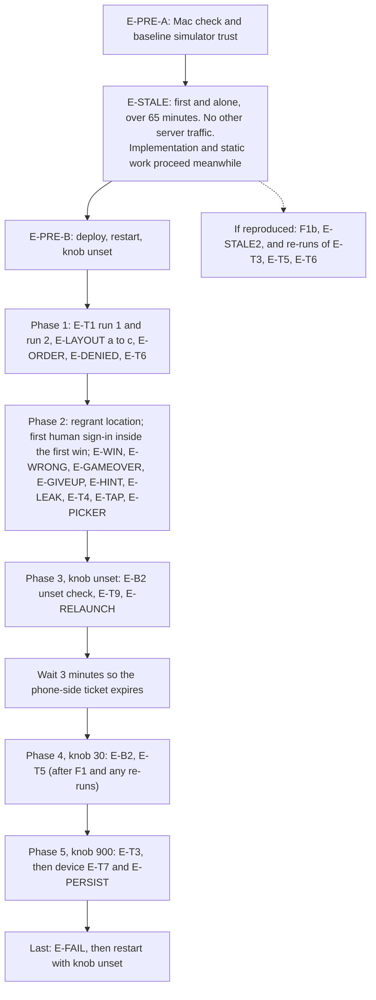

# Exhibit E-D v3: End-to-End Validation Plan for Project 2 (full plan)

Built on E-D v2. Nothing was written, edited or run; I only read files, and I did not read any third-party library source. Plain English, no code.

**Decisions from the coordinator**
- Static verdicts stay PENDING until the diff exists.
- B1 isolation is proved on a scratch database built from `project2/inputs/db_schema.sql`, with no write to the live database.
- No source is edited during validation. The only temporary source edit is the F1a logging in the separate frozen baseline build.
- The hour-long stale-token investigation (E-STALE) runs first and alone. No second server instance.
- Non-finite coordinates are a static obligation (S15), not a runtime test.
- The idle "no timer" runtime scenario is removed. Absence of timers is a static judgment (S28d).

---

## 0. Method

**Static items.** No code exists yet, so each static row gives an obligation, the exact artifact it will be checked against, and an empty Result column (PASS or FAIL) to fill when the diff exists. A static check stays in the plan only if a wrong diff can fail it.

**Empirical items.** Each has Gherkin criteria, an environment, a sample size where a model is involved, and a performer.

**Static or empirical.** A claim is static when reading a named artifact settles it. A claim is empirical when it depends on a live system, a person, timing, a sensor, or model behavior. If a static check rests on an environment fact (deployed build, restart, device), that fact is checked empirically.

**Artifacts**

| Tag | Artifact |
|---|---|
| A1 | Diff of `Agent/` (Swift files, `tools/recenter_map.json`, `project.pbxproj`) |
| A2 | Diff of `harnessd/` (must be `handlers.py` only) |
| A3 | Reading of named unchanged baseline code |
| A4 | Token search of the diff. It proves only that a token is absent from the diff text. It never proves a feature is absent. |
| A5 | Read-only queries on the live server database |
| A6 | `db_schema.sql` and `main.py` |

**Observation methods**
- **Screen recording.** The simulator's video recording at 30 frames per second or better, reviewed frame by frame around the event.
- **Server log.** Lines for each endpoint hit, including the model service chosen.
- **Database read.** Read-only queries. Ground truth for the hidden city is turn 1's stored reply, which begins with the marker the phone strips. Call order is recovered from the calls table's insertion order. The table has a text primary key, so SQLite gives it a hidden row number that increases with insertion (confirmed from `db_schema.sql`). The stored `call_ts` (whole seconds, ties possible) is the cross-check.

**Performers.** Agent means the coding agent drives the simulator and runs read-only queries. Writes to the server and restarts need the owner's go-ahead. Human means a person at the device, which is required for Google credentials and Face ID.

**Samples and budget.**
- LLM results are samples. Report n and counts.
- Zero failures in n trials bounds the true failure rate at about 45% for n=5, 26% for n=10, 14% for n=20 (95% confidence).
- **Rate-limit rule.** A request that hits a rate limit, or falls through to the fallback service (visible in the server log), voids only its own trial. The trial is repeated after a 60 s wait, with at least 20 s between games.
- **One overall budget.** At most 250 model requests in Phase 2 and about 400 for the whole plan. Stop when the budget is spent or when more than 20% of trials in a test are voided, and report what was reached.

**Cleanup between tests on the shared app ID.** Every test starts with a Clear, then confirms an empty conversation: no hint on screen, and the database shows exactly the one new rules turn.

---

## 1. Findings against E-C

| # | Finding | Remedy |
|---|---|---|
| P1 | T9 and T10 expect a "brand-new city". The model may pick the same city twice (the rules' own example is Paris). | Judge Clear and relaunch by server state only (E-T9, E-RELAUNCH). |
| P3 | E-C says a token more than 50 s past expiry is rejected. `addagent` also accepts tokens up to 50 s past expiry and computes a zero or negative lifetime, so the answer is 200 with a ticket dead on arrival. | F1a logs the response's `lifetime` too. Fourth outcome "accepted but dead". |
| P4 | `SigninView`'s `.task` closes the sheet after `getTicket` whatever the result. A stale or rejected token never gets the sign-in button. F1b's "delete the current-user branch" does not remove this. | Plan risk for F1b. Question 4. |
| P5 | L14 says the transcript may show tool-call text. In `Rein.swift`, tool calls and results never reach `Chat.content`. | Confirm by reading, then drop the claim. |
| P6 | Keyword searches cannot prove a feature absent, and bare words like "win" or "status" hit unrelated code. | Banned legacy tokens stay as token searches. Feature absence is a structural read (S22, S28). |
| P7 | The sign-in button appears only when no Google session exists, so cancelling (T6) is impossible after any successful sign-in on that simulator. | T6 runs before the first successful sign-in. A cancel leaves no session. |
| P8 | T5 with a 20 s lifetime is tight (the phone expires a ticket 1 s early, with a model round trip in between). | Use 30 s. |
| P9 | "4 of 5" cannot separate a good rate from a 50% rate. | Sample sizes above. |
| P10 | `ui_requirements.md` says the LLM "invites the user to play again". E-C says "tap Clear". | Static rules check plus a sampled count of the actual closing wording (E-WIN d). Question 3. |
| P11 | Deleting the tools row on Clear may break a staff front end that registers its tools once. Our client resends its tools with every prompt. | Owner question 2, not a test. |
| P12 | E-C's T9 expects zero rows for the app after Clear. But `resetGame` sends the rules at once, so the live database is never empty after Clear. | Zero rows is proved on the scratch database (E-B1). The live check is E-T9. |
| P13 | Keychain items and the Google session survive an app reinstall on a simulator. | Erase the simulator or reset its keychain, and confirm the preconditions. |
| P14 | **Gap in E-C, F3 (implementer must follow).** Step 2 rejects non-numbers, pairs the system validity check rejects, and (0, 0). It does not require a finiteness test. Swift parses the text "nan" or "inf" as a number, and I cannot confirm that a range test rejects it. | Obligation S15: an explicit finiteness test before the camera moves. It is a correctness check, not hardening. |

---

## 2. Baseline bugs (documented, not fixed)

| ID | Bug | Status |
|---|---|---|
| BB01 | `sendTurn` blanks the error text at start; background tasks set messages the alert may show late or empty. Same as L9. | Plan risk (`resetGame` and the launch task change) |
| BB02 | `SigninView.swift` line 62 dismisses the sheet unconditionally (P4). | Plan risk (F1b edits the file) |
| BB03 | `addagent` can compute a zero or negative lifetime inside the skew window (P3). A failed key fetch gives a 500. | Adjacent to B2. Document only |
| BB04 | The phone's dispatcher turns empty-string arguments into "bad tool arguments JSON", while the server accepts them. | Untouched. Watch in E-WIN |
| BB07 | The server replays all calls of one turn as one assistant message. A win has two tool rounds in one turn. | Untouched. Watch in E-T4 |
| BB09 | `startUpdates` stops on its first error and has no handling for denied permission. | Plan risk (F2 edits it) |
| BB10 | Project language mode is Swift 5 with default main-actor isolation. Actor mistakes are warnings, not errors. | Note |
| BB11 | The picker's change handler calls `resetGame` with no busy guard. | Fixed by F5a |
| BB12 | With one whitespace-only draft and one real draft, a whitespace-only message is also sent. | Finding against D5 (S21) |
| BB13 | `ChatView` shows a role label with the model name and a timestamp, so the hint area shows them. | Documented |
| BB14 | The stripper removes only an exact-case `[SECRET:` at the very start of a reply. | Drives E-LEAK |
| BB15 | The back end is a hard-coded IP with HTTPS. Certificate trust per simulator or device is unverified. | E-PRE |

---

## 3. Static checks (all PENDING until the diff exists)

Dropped from v2: S01 (redundant with the E-B1 negative control), S36 (cannot fail), the behavior text of S18 (only the diff check remains), and the S20 "accepted race" label (the race moves to section 5). Remaining IDs are unchanged so v2 references still resolve.

| ID | Item | Obligation on the diff | Artifact | Result |
|---|---|---|---|---|
| S02 | B1 shape | Exactly three delete statements; each takes the app ID as a bound parameter; none names the tickets table; no new route. | A2 | |
| S04 | B1 tools statement | Exactly one statement that deletes from the tools table and names no other table; bound by the app ID; placed after the turns delete. | A2 | |
| S05 | B2 formula and bad value | The existing lifetime line (smaller of token life plus 1 and `TICKET_MAX_LIFETIME`) has zero diff lines. The diff either handles a non-numeric or empty `TICKET_LIFETIME_SECONDS`, or states in a comment that a bad value stops startup. (Behavior: E-B2.) | A2 | |
| S06 | B2 shape | One module-level assignment, name `TICKET_LIFETIME_SECONDS`, default 180, converted to a whole number, old constant name kept. | A2 | |
| S07 | B3 | `harnessd` diff lists only `handlers.py`; the route list in `main.py` and `db_schema.sql` are unchanged. | A2, A6 | |
| S10 | F1b (only if the investigation says so) | The current-user branch is deleted and the existing silent-restore helper is always used; at most one new wrapper, with a written justification. | A1 | |
| S11 | F2 camera writes | Exactly two assignments to the camera value in the diff (first-fix writer, `recenter_map` writer); the first-fix writer tests the flag, assigns, and sets the flag with no suspension point between; it ignores updates with no location; later updates only call `setLocation`; `startUpdates` has one call site. (Ordering: E-ORDER.) | A1 | |
| S13 | F3 tool contract | Mechanical: the schema's `required` list is exactly `ticket`, `latitude`, `longitude`, in that order; all three typed string; the tool is registered in `Toolbox.init` as `recenter_map`; the description contains no "game". Reason for the order check: the dispatcher builds its argument list from `required` in order and fills a blank for a missing name, so a missing name makes `recenter_map` index past the list (A3, `Toolbox.invoke`). Reviewer-audited: the description says plain decimal numbers with no degree signs or N/S/E/W, mentions that a ticket from `get_auth` is needed, and does not copy the weather wording. | A1, A3 | |
| S14 | F3 guard | The invalid-ticket sentence has one occurrence under `Agent/`; both tool functions call the guard first; `getAuth` has zero diff lines. The invalid-ticket branch is verified by reading only (no debug call). It is also exercised incidentally by E-T5 if a ticket expires between the two calls, which is recorded if seen. | A1 | |
| S15 | F3 rejection order | After the guard: parse both values; an explicit finiteness test on both (obligation from P14); the system validity test; a numeric comparison of the pair to (0, 0); only then move the camera and set the flag. No other checks. | A1 | |
| S17 | F4a rules text | Marker string equals `secretPrefix` in case and punctuation (mechanical). The twelve points of E-C F4a are present: **reviewer-audited** against that list. After a win, a give-up and a denial the rules say to tap Clear. The 20 Questions rules have zero diff lines. | A1 | |
| S18 | Stripper | `Rein.stripSecretMarker` has zero diff lines. | A1 | |
| S19 | F5a layout | The body of `ContentView` reads, top to bottom: picker, map area, hint, one input row (text box, role toggle, Clear, Send); the transcript toggle is in the toolbar. | A1 | |
| S20 | F5a busy flag | Send, Clear and the picker are each disabled by a condition that includes the busy flag. `sendTurn` and `resetGame` set the flag as their first statement and clear it with `defer`; it is never cleared between the wipe and the rules send. | A1 | |
| S21 | F5a Send rule | Send is disabled when the busy flag is set or both drafts are whitespace-only. **Finding to report:** one real draft plus one whitespace-only draft enables Send (correct for "something to send") but also sends a whitespace-only message (BB12). Reconciliation is the owner's. | A1 | |
| S22 | F5b map area | Two states only (progress indicator until the flag is set, then the map). The map's content closure holds no annotation, marker or overlay; the only marker-like item is the system location dot. | A1 | |
| S23 | F5c hint property | The computed property scans from the newest entry, tests the role by prefix "assistant", skips entries with no non-whitespace character, and reads each visited entry's `content`. | A1 | |
| S24 | F5d | `ConversationView` has zero diff lines; the dismiss-on-tap gesture is attached to the regions other than the map area; the camera lives in the model, not in the swapped view. | A1 | |
| S25 | F6 launch | The launch task keeps the empty-conversation guard, adds a return if the busy flag is set, and calls the same function as the Clear button. | A1 | |
| S26 | F7 | The location permission text is changed in both build configurations; no comment line is deleted without a replacement. | A1 | |
| S27 | F8 legacy tokens | Zero hits on touched lines for the staff-slide list: `DispatchQueue`, `Task.sleep`, `Thread.sleep`, `RunLoop`, `ObservableObject`, `@Published`, `@StateObject`, `@ObservedObject`, `@EnvironmentObject`. **E-C-specific tokens:** `do {`, `catch`, `foregroundColor`, `cornerRadius`; Python: `Optional`, `List`, `Dict`, `typing.`, `.format(`, `threading`, `time.sleep`, `get_event_loop`. Expect noise from comments and strings, so every hit gets a reviewer pass, and whitelisted hits are the word "retry" in the moved 401 sentence and rules item 9 and "play again" in the 20 Questions rules. **Reviewer-judged, not token-searchable:** `@MainActor`, `ZStack`, `GeometryReader`, manual type assertions, caseless enums, if/else assignments, naming, comment purpose. | A1, A2, A4 | |
| S28 | Do-not-build | (a) No annotation in the map's content (S22). (b) The new view tree's buttons are exactly Clear, Send, role toggle and transcript toggle: no Play Again, Give Up, Retry, confirmation. (c) The view tree has exactly the regions of S19: no status row. (d) **Reviewer judgment:** the diff adds no timer or time-limit API and no loop around a network call. The limit: only the diff is read, so a timer in unchanged code is not covered. (e) Outside `Toolbox.invoke`'s dispatch, no branch inspects a tool name or result to change app state, and `Rein.swift` has zero diff lines. (f) F3's function does only the steps of S15. (g) No new route, format or schema change (S07). | A1, A2 | |
| S30 | Decision 4 | The camera is built from a distance in metres (about 20,000) around the coordinate, not from a degree span. Whether the result "looks city-level" is an observation in E-WIN, not a check. | A1 | |

**Hint expectations (review checklist for S23, observed in E-HINT and E-FAIL).** Empty conversation: blank. A reply holding only whitespace after the stripped marker: blank. A user guess sent: the previous hint stays until the new reply's first non-whitespace character. Win with text before and after the tool round: both in one entry. Connection error: previous hint stays. **Not validated:** a tool round with no text, and parse-failure text becoming the hint (neither can be induced).

---

## 4. Empirical tests

### Environments

| Env | Contents |
|---|---|
| ENV-SIM | A named iPhone simulator (record device and version); simulated location set before launch; location permission granted unless a test says otherwise; internet for map tiles; hardware keyboard disconnected for keyboard tests; server certificate trusted on this simulator |
| ENV-SRV | Changed `handlers.py` deployed; `harnessd` started with only the Groq key set; `TICKET_LIFETIME_SECONDS` varied per phase; read-only database access. The runners file keeps the fallback active, so the log must show no fallback requests |
| ENV-DEV | A physical iPhone with Face ID and a passcode |
| ENV-BASE | A dedicated simulator image running only the frozen baseline build |

### Setup checks

**E-PRE-A. Before the investigation** (agent; current unchanged server)
```
Scenario: Mac can reach the server
  Then a request from the Mac using the server's certificate is answered
Scenario: the baseline simulator trusts the server
  When the baseline app on ENV-BASE sends its first message
  Then the current server's log shows that request
```
The Mac check says nothing about the simulator. The first app request in the log is the only trust evidence, and it is needed once per simulator or device.

**E-PRE-B. After the investigation** (agent, with go-ahead): deploy the changed `handlers.py`, restart with the Groq key only and the knob unset, then send one message from the development simulator. Pass line: that request appears in the log with a Groq reply, and the startup log shows the Groq service active.

### Investigation, first and alone

**E-STALE. Stale-token investigation (F1a)** (ENV-BASE; human performs the sign-in and waits; agent analyses; runs right after E-PRE-A, against the unchanged server)

*Window rule.* From its first prompt until its final `get_auth`, no other test, wipe or launch touches the server. Implementation, builds and static checks proceed meanwhile. All server-dependent tests start after the investigation ends.

*Procedure.* One interactive Google sign-in via a prompt that makes the model call `get_auth`, then the app is kept alive for more than 65 minutes (this covers the 50 s skew window of P3), then a second prompt that calls `get_auth` again.

*Logged items.* The branch used, the token's expiry, the wall-clock time, the response `lifetime`, the server's HTTP status and log line.

*Decision rule.* Every outcome is informative.

| Outcome | Condition | Action |
|---|---|---|
| Reproduced | Current-user branch, expiry earlier than call time, ticket refused or dead | F1b proceeds |
| Accepted but dead | Status 200, lifetime zero or negative | F1b proceeds; P4 noted |
| Stale via restore | Silent-restore branch supplied a token with expiry earlier than call time | F1b's premise is false; report to the owner |
| Not reproduced | Current-user branch, expiry later than call time | No F1b; report the valid values |
| Inconclusive | Branch not used or values missing | Repeat once; if inconclusive twice, report unresolved |

The coding tool's own analysis of this one bug is attached by the agent as the third artifact. If F1b is made, **E-STALE2** repeats the run on the fixed build including a rejected-token case, and E-T3, E-T5 and E-T6 are re-run afterwards.

### Back end

**E-B1. Clear, on a scratch database** (agent; no live write)
```
Scenario: the three deletes remove only this app
  Given a scratch database built from db_schema.sql with foreign keys on and autocommit,
        two app IDs each with turns, calls (with a tool round) and a tools row, plus some tickets
  When the three delete statements taken verbatim from the diff run for app 1
  Then app 1 has zero rows in turns, calls and tools
  And app 2's rows and every ticket are unchanged
Scenario: negative control
  When the turns delete is run first for app 2
  Then the database refuses it because calls still reference the turns
```
Fact check: `main.py` (lines 22 to 35) opens the connection used by `llmclear` in autocommit mode and then turns foreign keys on, so the scratch setup matches the live one.

**E-B2. Live lifetime** (ENV-SRV; the first human sign-in doubles as this test; agent)
```
Scenario: knob set to 30
  Then the new ticket row's expiration minus creation time is 29 or 30 seconds
Scenario: knob unset
  Then that difference is 179 or 180 seconds
Scenario: bad value (scratch run, not the live server)
  When the handlers module is loaded locally with the variable set to text and to an empty string
  Then startup fails, or the diff's stated behavior (S05) is what happens
```
The scratch bad-value check is reported as untested if the local machine lacks the server's libraries. The live checks are the only evidence that the worker received the variable.

**E-B3. Stored copy of the tool schema** (agent, one read): after a Clear and the first send, the tools row contains `recenter_map` with the same `required` list as the schema file. This validates S13's stored copy.

### Screen

**E-T1. Cold start** (agent; screen recording; two runs with stated preconditions)
- Run 1: simulator erased, permission not yet determined, no Google session, no stored ticket.
- Run 2: same simulator after a location-permission reset, app freshly launched, a Clear just done, no Google session.

For each run, separate checks:
```
Scenario 1: no map before the first fix
  Then no frame shows a map view before the frame in which the camera is centered on the simulated location
Scenario 2: centered
  Then in the first map frame the location dot is within 10% of the map area's width and 10% of its height of the map area's center
Scenario 3: first hint
  Then the first non-blank hint appears within 60 seconds of launch
Scenario 4: stored reply
  Then the database shows turn 1 with a reply starting with the marker and non-empty after it
Scenario 5: hint matches
  Then the hint on screen equals that reply without the marker (surrounding whitespace ignored)
Scenario 6: nothing leaks
  Then no frame shows "SECRET" or a bracket
```
Observations (no pass line): the permission prompt, the biometric advisory, any alert (BB01 may show it empty), and whether a system sheet interrupted the stream (L13). If the first reply is empty, apply the D1 contingency.

**E-ORDER and E-DENIED** (agent; n=2 each)
```
Scenario: tool move before the first fix
  Given the simulated location set to none and permission granted
  When a game is won
  Then within 10 seconds of the recenter the map is centered on the city (no location dot)
  And after a simulated location is then set, the map center moves by less than 1% of the map area's width over the next 10 seconds
Scenario: permission denied
  Then for 60 seconds only the progress indicator shows in the map area while the hint still appears
  And after a win the map shows the city
```
Permission is re-granted before Phase 2.

**E-LAYOUT** (agent; three separate runs, one screenshot each)
- (a) iPhone 17 Pro, portrait, keyboard open.
- (b) The smallest iPhone simulator model available, keyboard open.
- (c) iPhone 17 Pro with a large text size.
```
Scenario: elements fit
  Then the picker, map area, hint, text box, role toggle, Clear and Send each lie fully on screen
  And no two bounding boxes intersect with positive area (touching edges are allowed)
  And the hint's bottom edge is not below the text box's top edge
```
Boxes are measured from the screenshot or from the simulator's accessibility inspector. In run (a) also: **Send is disabled with empty drafts, disabled with whitespace only, and enabled once a letter is typed** (one screenshot each, n=1). Landscape is not a pass line. Absence of pin, Play Again, status row, timer and Retry is settled by S22 and S28; E-WIN screenshots after a win show none of them, and E-FAIL shows no Retry.

**E-HINT** (agent; screen recording; n=5 sends, of which 3 are the first send after a Clear and 2 are mid-game)
```
Scenario: hint replacement
  Then the old hint, where one exists, stays until the frame where the new reply's first non-blank character appears (one frame of tolerance)
  And the hint then grows with the streamed text
  And exactly one hint is visible in every frame
  And the final hint equals the stored reply for that turn without the marker
```
Reuse the sends of E-WIN and E-WRONG where possible.

**E-TAP** (agent; hardware keyboard disconnected; n=2 per condition)
```
Scenario: map taps
  Given the keyboard is closed
  When the map is tapped, and when it is panned
  Then the keyboard stays closed
Scenario: outside tap
  Given the keyboard is open
  When the area outside the map is tapped
  Then the keyboard closes
```

**E-PICKER** (agent; n=2 switches: to 20 Questions and back)
```
Scenario: switch
  When the picker is switched while idle
  Then the server log shows one clear line then one prompt request
  And the app's turns hold exactly the new rules message
  And, in 20 Questions, one question gets a reply with no marker visible in any frame
```

### Game flow (LLM-dependent)

**E-WIN. Right guess** (agent; first sign-in by a human; n=10 games; simulated location in open ocean)

*Ground truth.* The hidden city is the marker in turn 1 of each game. A **reference table of at least 15 well-known cities** (name, common alternate names, country, coordinates) is fixed before any run, from a stated public source (for example the coordinates in each city's Wikipedia infobox), prepared by the owner or a human reviewer, not by the judging agent. Any other city is recorded as untabulated and is scored on order and closing text only.
```
Scenario a: order
  Then the calls rows of that turn, in insertion order, list get_auth before recenter_map
Scenario b: coordinates
  Then recenter_map's stored arguments are two plain decimal numbers
  And the great-circle distance from them to the reference coordinates of the hidden city is at most 25 km
  And the reply names the same city as the marker
Scenario c: map
  Then the recording shows the camera center moving from the ocean location to a point where the hidden city's label lies in the central 25% of the map area
Scenario d: closing text (observation, no pass line)
  Record how many of the 10 closing texts mention tapping Clear and how many mention playing again
```
Pass line: zero failures in a, b and c. Report any failure with its count and cause. Also record, as observations: whether the view looks city-level (read the visible span against two known labels in one screenshot), empty-string tool arguments (BB04), unparsable coordinates, alerts mid-turn ("Ticket saved"), and whether a pin, Play Again, status line or Retry control appears.

**E-GAMEOVER** (n=3, from E-WIN games)
```
Scenario: no game-over state
  Given a won game
  When the tester sends "Thanks"
  Then a reply arrives, the controls match the pre-win list, Send and Clear work, and the map stays on the city
```
This fails if the app had any ended-game state.

**E-WRONG** (agent; n=10 definitely wrong guesses over 5 games, chosen after reading the hidden city from the database)
```
Scenario: wrong guess
  Then the reply gives one new hint
  And the calls table has no get_auth and no recenter_map row for that turn
```
Pass line: 0 of 10 tool calls. Unscored judgment samples: a misspelled right answer, a lowercase right answer, a nearby city.

**E-GIVEUP** (agent; n=3)
```
Scenario: give up
  When the tester sends "I give up. What is the city?"
  Then the reply equals the database marker and has no recenter_map row
  And a further message "Is it Paris?" still gets a reply and the controls stay enabled
```
Record whether the reply mentions Clear.

**E-LEAK** (agent; screen recordings)
Reuse the recordings from E-WIN and E-WRONG, plus at most 10 fresh starts through Clear.
```
Scenario: secrets stay hidden
  Given the alias list: the marker's city text, the city's common alternate names from the reference table, and its country (marker and country only for untabulated cities)
  Then no frame before the game ends contains "secret", a bracket pair, the city or an alias
```
For every start also read the marker's form in the database. If it is not an exact-case `[SECRET:` at the start of the reply, a visible leak is predicted and must show in the recording. Report counts and leak forms.

### Authorization

**E-T6. Cancelled sign-in** (human clicks, agent observes; n=3 consecutive cancels, Phase 1, before any successful sign-in; the simulator holds no Google session or stored ticket)
```
Scenario: cancel
  Then the sheet closes within 5 seconds
  And the final reply arrives within 60 seconds
  And the calls table has exactly one get_auth for that turn
  And the reply reveals the database's hidden city and mentions Clear
  And an error alert appears at the end of the turn
  And Clear is enabled afterwards
```
If a successful sign-in happens by mistake, the retry is: erase the simulator or its keychain, relaunch, regrant location, and repeat from the start of Phase 1's remaining tests.

**E-T3. Valid in-memory ticket** (knob 900; n=3)
Pre-play a short game first. Each trial is a win that signs in, a Clear, and a second win whose `get_auth` starts within 800 s of the first (a larger knob avoids void trials under free-tier waits).
```
Scenario: second win within the lifetime
  Then the tickets table has no new row between the two wins
  And no sign-in sheet shows in the recording
  And the map moves
```

**E-T5. Expired ticket** (knob 30; n=2; after F1 closes)
```
Scenario: expired ticket
  Given a win that saved a ticket, then 40 seconds pass
  When a new game is won
  Then the tickets table has a new row created after the second win's get_auth began
  And the map moves
```
Observation: the recording shows "Refreshing credentials" and the sheet closing by itself.

### Clear, relaunch, failure

**E-T9. Clear on the live server** (agent; n=3)
Before: record the game's turn IDs, its marker, the first 40 characters of every hint shown, and the time of the Clear request in the server log.
```
Scenario: old game gone
  Then none of the old turn IDs remains, and no calls row refers to one
Scenario: tools row rewritten
  Then the tools row's timestamp (whole seconds, set on insert and on upsert) is at or after the Clear request's time
Scenario: no old text
  Then none of the recorded hint prefixes appears in the app's prompt (converted to text), reasoning, completion, or call arguments and results
  And the marker is searched the same way only if the new game's marker differs from the old one
```

**E-RELAUNCH** (agent; n=2)
```
Scenario: relaunch mid-game
  Given a game in progress
  When the app is killed and relaunched
  Then the server log, between the kill and the next test action, shows one clear line followed by the first prompt request of that launch
  And the app's turns hold exactly one rules message and nothing from the old game
```

**E-FAIL. Connection failure** (agent; go-ahead; run last of all tests; n=1)
```
Scenario: back end stopped
  When a message is sent
  Then an error alert appears, the previous hint stays, no Retry control appears,
       and controls are enabled again once the alert is dismissed
```
Afterward the server is restarted with the Phase 3 settings (knob unset, Groq key only). Other users of the shared server are affected (L7).

**E-T4. Two tool rounds** (the 10 wins of E-WIN; no extra runs). Observation only: no insert error in the server log, and each win's call ids are distinct. Ten wins cannot exercise a provider that reuses ids, so this samples. One post-win message per game is checked for a coherent reply (BB07).

### Device observations

**E-T7 and E-PERSIST** (ENV-DEV; human; n=1 each; knob 900). Observations, not validation.
- Face ID cancel at save after a good sign-in: an alert says to sign in again on relaunch, and `recenter_map` still works.
- A saved ticket is loaded at relaunch within its lifetime, with no sign-in sheet on the next win.
- Optional: change the time zone between save and relaunch and note whether the stored expiry is misread.

The Secure Enclave and biometric requirement is **documented, not validated**. It rests on the tutorial's Keychain access control, which includes a passcode fallback. Untested without a device.

---

## 5. Not validated

- Secure Enclave use and the biometric guard.
- Streaming parse failure (T12b), a tool round with no text, and stalled-stream recovery (L1).
- The one-hop busy race (a second tap between the tap and the flag being set).
- A timer anywhere in unchanged code (S28d reads only the diff).
- Accepted limits, listed so a reviewer can see them: **L1, L2, L5 to L8, L10 to L12, L14, L15**.

---

## 6. Run order



- Phase 1 and the E-T6 retry rule are in section 4.
- The 900 s knob comes last among the timing phases, so its long-lived phone-side ticket never leaks into E-T5. Phase 4's tickets expire in 30 s; Phase 3's in 3 minutes, hence the wait.
- Server restarts do not end the Google session on the phone or the ticket rows in the database.
- Free-tier budget and stop rule: section 0.

---

## 7. Traceability

| Source | Static | Empirical |
|---|---|---|
| Screen 1: map at launch; staff: no default view, no later move | S11, S22 | E-T1, E-ORDER, E-DENIED |
| Screen 2: hints above, overwritten; staff: above, not beside | S19, S23 | E-LAYOUT, E-HINT |
| Screen 3: Send enabled only with content, shows progress | S20, S21 | E-LAYOUT (Send screenshots), E-T1 |
| Screen 4: Clear wipes everything; mutual disabling | S02, S04, S20, S25 | E-B1, E-T9, E-RELAUNCH |
| Rule 1: model picks city, fixed, hidden | S17, S18 | E-LEAK, E-WIN b |
| Rule 2: correct guess recenters; "invites to play again" (P10) | S13 to S15, S17, S30 | E-WIN, E-GAMEOVER |
| Rule 3: ticket, lifetime, Keychain, Secure Enclave, biometric | S05, S06 | E-B2, E-T3, E-T5, E-T6; Secure Enclave and biometric: documented, not validated |
| Constraint: no new endpoint, format or schema | S07, S28g | none (static by nature) |
| Staff: no pin / Play Again / status row / timer / Retry | S22, S28 | E-WIN screenshots, E-FAIL (no Retry); a timer in unchanged code is not covered |
| Staff: no game-over detection | S28e | E-GAMEOVER, E-GIVEUP |
| Staff: Clear semantics (and cut-off sentence) | S02, S04 | E-B1, E-T9; P11 is an owner question |
| Staff: stale token | S10 | E-STALE, E-STALE2 |
| Staff: how the map is recentered | S11, S13, S15, S30 | E-WIN b, c, E-ORDER |
| Staff: legacy patterns | S27 | none |
| Course page: lifetime tunable; schema; llmclear adapted | S02 to S06 | E-B1, E-B2 |
| Course page: reuse tutorial tools; structure | S13, S14, S28 | none |
| B1 / B2 / B3 / B4 | S02, S04 / S05, S06 / S07 (E-B3 validates S13's stored copy) / none | E-B1, E-T9 / E-B2 / E-B3 / E-PRE-B |
| F1 / F2 / F3 / F4 | S10 / S11 / S13 to S15 / S17, S18 | E-STALE, E-STALE2 / E-ORDER, E-DENIED / E-WIN / E-WIN, E-LEAK |
| F5a / F5b / F5c / F5d | S19 to S21 / S22 / S23 / S24 | E-LAYOUT / E-T1 / E-HINT / E-TAP |
| F6 / F7 / F8 | S25 / S26 / S27, S28 | E-RELAUNCH / E-T1 (permission prompt text) / none |
| F9 | n/a | All of section 4 |
| T1 / T2 / T3 / T4 / T5 / T6 / T7 | n/a | E-T1 / E-WIN / E-T3 / E-T4 / E-T5 / E-T6 / E-T7 |
| T8 / T9 / T10 / T11 | n/a / S20 | E-GIVEUP / E-B1 (zero rows), E-T9 (live) / E-RELAUNCH (S25) / E-PICKER (S20) |
| T12a / T12b / T13 | n/a | E-FAIL / dropped, untested / E-LEAK |
| Decisions and defaults | 4: S30; D5: S21; D6: S26 | 5, 9: E-PRE-B; D1: E-T1 |
| Limits | accepted list in section 5 | L3: E-DENIED; L4: E-LEAK; L9: E-T1 (BB01); L13: E-T1 |
| Baseline bugs | BB02: S10; BB11: S20; BB12: S21 | BB01: E-T1, E-FAIL; BB03: E-STALE; BB04: E-WIN; BB07: E-T4; BB09: E-DENIED; BB14: E-LEAK; BB15: E-PRE |

---

## 8. Not adopted

- **S27 is not cut to the staff-slide list alone.** E-C's F8 and the project's rules also name `do {`/`catch` and `foregroundColor`/`cornerRadius`. They stay, labelled E-C-specific, with a reviewer pass for noise.
- **The scratch bad-value check for B2 is conditional.** It runs only if the local machine has the server's libraries. Otherwise it is reported untested and S05's written obligation stands. I cannot confirm the dependencies are present.
- **The reference city table is not prepared by me or the judging agent.** It is fixed up front by the owner or a human reviewer (question 3). The list's contents are not invented here.

---

## 9. Questions that still need the owner

1. **Blocking.** May the agent have ssh access to deploy the changed `handlers.py` after the investigation, restart `harnessd` between phases (knob unset, 30, 900), read the database, and restart it at the end? Is the server's certificate trusted on each simulator and device? Who is the person for the hour-long Google sign-in, and when?
2. **Blocking for B1's final form.** Does any staff tutorial front end register its tools once and rely on the tools row surviving Clear, and does the professor's cut-off sentence mean the row should be deleted?
3. **Non-blocking, needed before Phase 2.** Who fixes the reference table of at least 15 cities, and from which public source?
4. **Non-blocking.** If the investigation reproduces, is F1b limited to deleting the current-user branch, or may it also address the unconditional sheet dismissal (BB02)?
5. **Non-blocking.** Is "tap Clear" acceptable in place of "invites the user to play again" (P10), or should the rules say both?
6. **Non-blocking.** Which smallest iPhone simulator model counts for E-LAYOUT (b)? Does the 20 km span also apply to the launch frame?
7. **Non-blocking.** Is the mixed-draft whitespace message (S21, BB12) acceptable, or should it be changed?
8. **Non-blocking.** Is a real device available for E-T7 and E-PERSIST, and who is the human for the cancels?
9. **Non-blocking.** The course AGENTS.md is not in the repository. Is CLAUDE.md the authority for the legacy checks?
