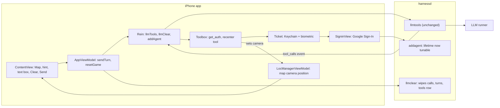
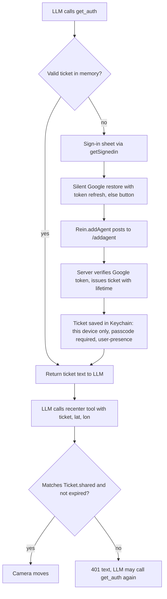

# Elephant_E-C_draft1: verbatim output

# Exhibit E-C: Project 2 Implementation Plan (my own proposal, no code)

Read-only session. I changed nothing. I read the four inputs and all baseline files: the Agent Swift files, harnessd handlers, toolbox, runners and main, the tool JSON files, CLAUDE.md and runners.toml. I also read the Google Sign-In source already checked out in Xcode's DerivedData to test the professor's stale-token claim.

## 0. Findings that shape the plan

1. **The baseline is not a map app yet.**
   - ContentView has no map. It shows a game picker, a full chat transcript, a role toggle, Clear and Send.
   - LocManagerViewModel starts at latitude 0, longitude 0. Any map built on it today would open at that point in the Gulf of Guinea, which is exactly the "default view" the professor rejects.
   - The shared location is also unusable as a "fix arrived" signal, because 0,0 looks like a real value.

2. **hw2_design_doc.md contradicts the staff feedback in many places.** All of these are overridden:
   - Pin on the map.
   - Status row.
   - Play again button.
   - Ended state, with game-over detected from tool calls (Decision C).
   - 30 second timers and three kinds of Retry (Decision E).
   - Clear confirmation dialog (not in the requirements either).
   - "Server unchanged" (staff now require a changed `llmclear` and a tunable ticket lifetime).

3. **The professor's stale-token claim is true.**
   - In GoogleSignIn-iOS 10.0.0, `GIDSignIn.m` (around lines 778-779) refreshes tokens only inside the silent restore path, when there is a current user.
   - A bare read of `currentUser.idToken` never refreshes.
   - An ID token lives about one hour, and harnessd rejects an expired one.
   - So the "use the current user's token first" branch in SigninView is a real bug.
   - The plan produces output evidence for this one bug, as the professor asked (step F1).

4. **The database definition is not in the repo.**
   - The table definitions are not in any input or in harnessd.
   - From the code I can infer the tables turns, calls, tools and tickets.
   - Whether any foreign key cascades is unverified.
   - "Feed the LLM the current schema" therefore needs a real step: dump the schema from the live database, read-only.

5. **The tool-schema table is currently orphaned by Clear.**
   - `llmclear` deletes calls and turns for the app ID but not the app's row in the tools table. This is almost certainly the professor's cut-off "Clear deletes calls and turns but not stored tool schemas".
   - Safe to delete: every fresh turn re-sends and upserts the schemas, and Clear is blocked while a turn is in flight.
   - The two deletes are separate autocommit statements, so a failure between them leaves half-cleared state.

6. **Both game rules already exist and mostly fit.**
   - The `Game.rules` text and the hidden "secret marker" are reused. The LLM states its chosen city inside a marker at the start of its first reply.
   - The server stores that reply and replays it every turn.
   - Rein's marker stripper hides it from the user. It runs fresh on every completion, so a marker at the start of any later reply is also stripped. This matters for play-again.
   - The current rules ask the LLM to reveal coordinates in text. They must instead make it call the auth tool, then the recenter tool.

7. **Relaunch leaves an old game on the server.** Launch currently only sends the rules if the on-screen list is empty. A relaunch stacks new rules on the old conversation with a second marker. Launch should use the same clear-then-rules path as the Clear button.

8. **`resetGame` has a latent bug.**
   - If the clear call fails, it still empties the screen and sends rules.
   - `sendTurn` then blanks the error text, so the failure alert can show with an empty message.

9. **Authorization checks differ between server and phone.**
   - The phone-side tools check the ticket against the phone's own in-memory copy and expiry. The server's tickets table is used only by `get_weather_auth`.
   - That is acceptable for an MRE, but it means the server-issued ticket is only a bearer string for the phone's own check.
   - The biometric prompt happens at app launch (Ticket open) and when a new ticket is saved, not on each `get_auth` call. This matches the tutorial.

10. **Project settings versus CLAUDE.md.**
    - Swift language mode is 5.0 (CLAUDE.md says 6.2+).
    - Default isolation is already MainActor.
    - Deployment target is 26.6 in one place and 27.0 in another.
    - The location permission text reads "To lookup weather at location".

## 1. Architecture (changes only)

## 2. Ordered steps

Each step lists what changes, what must be true when done, and what it satisfies.

### Step 0: Preflight (no source edits)

- Dump the live database definition with a read-only schema listing. Hand that text to the coding agent as the "current schema that supports tool calls".
- Confirm the tables turns, calls, tools and tickets, their keys, and whether the tools table is keyed by app ID.
- Record that the baseline builds and runs in the simulator.
- **Done when:** the schema text is in the agent's context and the baseline build is green.
- **Satisfies:** staff backend item "feed the LLM the current schema".

### Back end

**B1. Make Clear wipe everything for the app ID** (`handlers.llmclear`)
- Delete the app's calls first, then its turns, then its row in the tools table, in that order, all inside one transaction so a failure cannot leave half-cleared state.
- Do not touch the tickets table. The phone's Keychain ticket stays, as HW2 specified.
- Reuse the existing error and log helpers. Add no endpoint and make no schema change.
- **Done when:** after a game with a tool call, a read-only count of turns, calls and tools rows for that app ID is zero, and another app ID's rows are untouched.
- **Satisfies:** "adapt llmclear() to remove data cleanly"; the professor's cut-off "Clear deletes… not stored tool schemas"; requirement "clears all history and context including system and user prompts".

**B2. Make the ticket lifetime tunable** (`handlers.TICKET_MAX_LIFETIME`)
- Read it once at startup from an environment variable, with the current 180 seconds as the default. This follows the existing environment-variable pattern in runners.py (`RUNNERS_CONFIG`) and harnessd.py (`AGENTIC_ROOT`).
- Keep the existing rule that the ticket lifetime is the smaller of this knob and the Google ID token's remaining life. Because of that rule, values above about 3600 seconds have no effect.
- **Done when:** restarting with a 20 second setting makes the `addagent` response report about 20, and an unset variable reports 180.
- **Satisfies:** "ticket lifetime is tunable for playability or testing, not a fixed value".

**B3. Confirm nothing else changes on the back end**
- The recenter tool is phone-resident. Its schema rides in the request's tools field and is stored by the existing upsert.
- `toolbox.py`, `main.py` routes, the data formats and `/llmtools` stay untouched.
- **Done when:** a manual request that offers the new schema gets back a `tool_calls` event for it (the server treats it as non-resident), and the diff of harnessd touches only `handlers.py`.
- **Satisfies:** "no change to API, data format, SQLite schema; no new endpoints".

### Front end

**F1. Fix the stale sign-in token** (`SigninView` task, `GIDSignIn` helpers, `Ticket`)
- Remove the branch that prefers `currentUser.idToken`. Always use the silent restore, which refreshes tokens when needed. The alternative is the user object's refresh-if-needed, which the SDK also offers as an async call.
- Capture the evidence the professor asked for: the SDK source lines above, plus a short run showing a stale token rejected by `/addagent` and a fresh one accepted (use B2's short setting to speed this up).
- Leave the manual-button path and the "Refreshing credentials" overlay as they are.
- **Done when:** a sign-in more than an hour after the last one, with no tap, yields a valid ticket.
- **Satisfies:** the professor's SigninView item.

**F2. Map camera state, set once from the first fix** (`LocManagerViewModel`, `LocManager.startUpdates`)
- Add a map camera position and a "first fix received" signal to LocManagerViewModel. This follows the tutorial pattern where tool functions already read `LocManagerViewModel.shared`.
- On the first real location update only, set the camera centered on the user. Later updates change the stored location (used by `get_loc_auth`) but never the camera.
- If the system's cached last-known location is available at launch, use it so the first frame needs no wait (question 4).
- **Done when:** with simulated location changes after launch, the camera moves exactly once; with permission denied, no map is drawn.
- **Satisfies:** "map centered on the user's current location at launch; no default view; no later move".
- Do not use the MapKit "follow user location" camera. It follows continuously and requires a fallback, which is a default view.

**F3. The recenter tool, reusing the tutorial tool machinery** (`Toolbox`, `tools/*.json`, `getAuth`, `getLocAuth`, `Ticket`)
- Add one JSON schema file beside `get_loc_auth.json`, modelled on the back end's `get_weather_auth.json`: three string arguments (ticket, latitude, longitude). The synchronized project group picks it up automatically.
- The description says it moves the map and nothing else. It must not mention game over.
- Add one phone-side function and register it next to `get_auth` and `get_loc_auth` in `Toolbox.init`.
- The function does four things in order:
  1. It checks the ticket exactly as `getLocAuth` does, using the same 401 message. Share that guard instead of copying it.
  2. It parses the two numbers and checks they are valid coordinates. On a bad value it returns an error sentence to the LLM, so the map never jumps to 0,0.
  3. It sets the camera in the shared location state (see "How the map actually moves" below).
  4. It returns a short success sentence.
- Keep `get_auth` as is. Reuse `Toolbox.invoke`, so arguments arrive in the schema's required order.
- **Done when:** called with a valid ticket the map visibly flies to the coordinates; with a wrong or expired ticket it returns the 401 text and the map stays put; with garbage coordinates it returns an error and the map stays put.
- **Satisfies:** requirement "recenter tool needs a token"; "MUST reuse tutorial tools and functions"; no duplication; "tool only moves the map".

**F4. Deliver the game rules and secret city** (`Game.rules`, `AppViewModel.sendTurn`, `Rein` marker stripper)
- Keep only the city game. Drop the 20 Questions case and the picker (subject to question 6).
- Rewrite the city rules to say, in plain terms:
  - Pick a well-known city and begin the first reply with the hidden marker, then a short welcome and one hint. Never state the city name in hints.
  - On a wrong guess, give a new hint.
  - On a correct guess, first call `get_auth`, then call the recenter tool with that ticket and the city's coordinates, and then invite another round.
  - If sign-in or the biometric check is denied, say so and reveal the city in text.
  - If the user gives up, reveal the city in text.
  - For a new round, begin the reply with a fresh marker; the newest marker is the current city (question 12).
- Rules are sent as the system message at start. Whether a short synthetic user message such as "Begin" is also sent is question 2.
- Reuse the existing marker stripper. Add no game-state detection anywhere.
- **Done when:** over ten fresh starts the first visible hint contains no marker text; guessing the city leads to exactly get_auth, recenter, then closing text; a wrong guess leads to no tool call.
- **Satisfies:** requirement "app sends rules; LLM chooses; city fixed and secret"; staff "no game-over detection".

**F5. The screen** (`ContentView`, `SubmitButton`, `ClearButton`, `ChatView`, `ConversationView`)
- Layout from top to bottom in a plain vertical stack: map taking the remaining space, then the current hint, then one row with the text box, Clear and Send. No layered stacks and no geometry readers.
- The hint is the latest assistant reply only. Reuse `Chat` and `ChatView` for it. A new send replaces it, and Clear empties it.
- Cap the hint's height with scrolling so a long reply cannot push the text box off screen.
- Send is enabled only when the trimmed text is non-empty and nothing is in flight. Tapping it shows the existing spinner.
- Clear is disabled while sending, and Send is disabled while clearing. Reuse the single busy flag, with the spinner shown only on the button that was tapped.
- Before the first fix, show a plain progress indicator in the map area, not a map.
- Remove the role toggle, the system draft, the game picker and `ConversationView` (question 6). Keep the error and advisory alert.
- **Done when:** on a phone-size simulator with a location set, launch shows the map on that spot, the hint sits directly above the text box, and both buttons obey the mutual-disable rule, including during the launch-time start.
- **Satisfies:** all four screen requirements; "hints above, not side by side".

**F6. Launch and Clear flow** (`AppViewModel.resetGame`, `ContentView` launch task)
- Launch calls the same function as Clear: wipe on the server, then send the rules.
- If the wipe fails, stop, show the error and do not send rules. Pressing Clear again is the retry, so no Retry feature exists.
- Clear also empties the hint, the draft text and the in-memory conversation.
- The map and the Keychain ticket stay.
- **Done when:** relaunching mid-game yields a brand new city and a server row count of one game; a forced wipe failure shows a readable alert and sends nothing.
- **Satisfies:** requirement Clear semantics; "no Retry"; removes the stale-error and half-reset bug.

**F7. Small housekeeping**
- Update the location permission text in the project settings to say the app centers the map on the user.
- Update stale comments only where my change makes them false. Do not delete existing comments.

**F8. Legacy sweep and dead code** (checklist in section 5)
- Run the checklist over every file touched. Surface, but do not silently fix, baseline offenders outside the diff (question 10).

**F9. End-to-end verification, simulator plus one real device if available**
- Scenarios:
  1. Cold start with the permission prompt.
  2. Wrong guess, then right guess.
  3. Right guess with a valid in-memory ticket (no prompt).
  4. Right guess after expiry using the short B2 lifetime (silent re-sign-in, then biometric on save).
  5. Cancelled sign-in.
  6. Give-up text.
  7. Clear during and after a game.
  8. Relaunch.
  9. Each reachable runner in runners.toml.
- **Done when:** every scenario behaves as described and no step added anything on the do-not-build list.

## 3. How the map actually moves (not the auth path)

- The Map view is bound to a single camera position value held in the shared, observable location state.
- Moving the map means assigning a new camera position, centered on the given latitude and longitude at a city-level distance, inside an animation so it visibly flies. SwiftUI's MapKit Map follows that binding in both directions, so user panning also updates it and the next assignment still wins.
- That value is written at two moments only:
  1. Once, from the first location fix.
  2. By the recenter tool.
- Rejected:
  - The follow-user camera (it moves continuously and needs a fallback view).
  - Wrapping the UIKit map view (a wrapper).
  - Any annotation or marker (staff forbid a pin).
- Edge case: assigning a value equal to the current one does nothing, which is harmless.
- **Concurrency:** the project already defaults to main-actor isolation, so the tool function can write the state with no explicit main-actor attribute and no dispatch queue. This avoids the legacy patterns.

## 4. How the LLM obtains the authorization token

- At launch, `Ticket.open` reads the Keychain item. It checks the biometric first on the simulator, and relies on the item's access control on a device. A still-valid ticket is loaded into memory.
- Reuse within its lifetime needs no new sign-in, which is the "no revalidation" requirement.
- Denial or cancel makes `get_auth` return the existing 401 text. The rules tell the LLM to reveal the city in text. The app does nothing special.

## 5. Legacy-pattern checklist

Run it for every touched file. Baseline findings are marked.

| Check | Rule | Baseline status |
|---|---|---|
| Dispatch queues, `Task.sleep`, `Thread.sleep`, run loops | None allowed | None found; keep it so |
| `ObservableObject`, `@Published`, `@StateObject`, `@ObservedObject`, `@EnvironmentObject` | None; use `@Observable` and `@Environment`; `@Binding` is fine | None found |
| Explicit main-actor attributes | Each must be justified; default isolation already covers it | None found; add none |
| Layered stacks and geometry readers | Each must be justified | None found; the plan uses a plain vertical stack |
| Manual type assertions | Avoid in new code; explain unavoidable ones | Many in Toolbox, Rein, Ticket and SigninView; the HTTP response casts are unavoidable |
| Caseless enums as namespaces | None | None found |
| `do/catch` | Prefer `Result`; avoid in new code | Present in Rein, Toolbox and LocManager |
| Callback wrappers around async APIs | Avoid | `withUnsafeContinuation` wrappers in SigninView; Google's API has async forms |
| Deprecated styling (`foregroundColor`, `cornerRadius`) | Use `foregroundStyle` and `clipShape` in new or touched views | Present in ContentView and ChatView |
| Multi-line if/else | Prefer expressions | Check new code |
| Delete then insert | Use upsert | Server tools table already upserts; Clear is delete-only, which is fine |
| Comments | Only "why"; do not remove existing ones | Check |
| Naming | Descriptive nouns | Check |
| Unrelated code | Surface, do not edit | Report in the final note |
| Print statements and static mutable globals | Avoid | `print` in LocManager; static `isThinking` in Rein |

## 6. Do NOT build

- Pin, marker or annotation on the map.
- Play Again button.
- Give Up button.
- Status row or status line.
- Timers and the 30 second limit.
- Retry, in any of its three forms.
- Game-over or "Ended" detection, including treating a tool call as a win signal.
- Any new endpoint or schema change.
- Security, scalability or reliability hardening beyond the spec.
- My additions to this list, pending question 6: Clear confirmation dialog, game picker, 20 Questions, role toggle, full transcript.

## 7. Clarifying questions, most important first

1. **Does Clear start a new game immediately?** Or does it leave the LLM with nothing until the user types? I assumed it immediately re-sends the rules (as HW2 and `resetGame` do), because without rules there is no game. This drives F4, F5 and F6, and the interaction with B1.
2. **What does "feed the LLM a schema that supports tool calls" mean?** Two readings:
   - (a) Give the coding agent the real SQLite definition so it adapts `llmclear` correctly. I assumed this, since the definition is not in the repo.
   - (b) Change what the server hands the LLM at runtime.
   Also: should Clear delete the tools row? I assumed yes. This drives Step 0 and B1.
3. **Rules delivery.** Is a system-only start acceptable, or should it add a synthetic user message such as "Begin"? System-only can yield an empty or odd first reply on some runners. This drives F4 and the test matrix.
4. **Map before the first fix.** Is a plain progress area acceptable? May I use the cached last-known location for an instant first frame? What happens if permission is denied (no map, nothing)? This drives F2 and F5.
5. **Blue user-location dot and zoom level.** Is the system dot allowed alongside "no pin"? What distance should "centered on the city" use? This drives F2 and F3.
6. **Removal scope.** CLAUDE.md says to surface dead code and not auto-edit, but the requirements list only four screen elements. May I remove the picker, 20 Questions, role toggle, transcript and Clear confirmation? This drives F4 to F6.
7. **Stale-token fix approach and evidence.** Do you want the SDK source reading plus a short run as the "output" the professor asked for, and is the silent-restore-only fix acceptable? This drives F1.
8. **Ticket lifetime knob.** Is an environment variable read at startup (restart to change) fine, and is 180 seconds the right default? The effective cap is the Google token's remaining life. This drives B2.
9. **Secure Enclave wording.**
   - The tutorial's Keychain item uses a user-presence access control and relies on the device's hardware-backed Keychain.
   - It does not create an explicit Secure Enclave key.
   - The biometric prompt happens at launch and at save, not on each `get_auth`.
   - Is that acceptable, or do you want a biometric on every `get_auth`?
   This drives F3 and section 4.
10. **Baseline cleanup scope.**
    - Should the coding agent fix the baseline's `do/catch`, `as?` and callback-wrapper findings?
    - That risks touching many tutorial-structure files.
    - Or only keep new code clean and report the rest?
    This drives F8.
11. **Project settings.** Swift language mode 5.0 versus the 6.2+ target in CLAUDE.md, and deployment targets of 26.6 versus 27.0. May the agent align them? Raising the language mode may surface strict-concurrency errors in tutorial code.
12. **Play again with a new city.** The marker is only pinned on the first reply. May the rules require a fresh marker at the start of each new round, with the newest marker current? The stripper already handles it, but the replayed history then holds several markers.
13. **Error surface.** Is keeping the existing alert for failures acceptable, given staff rejected a "status row"?
14. **Tool clutter.** The LLM also sees the tutorial tools `get_loc_auth` (phone) and `get_weather_auth` (server), which are irrelevant to the game. Keep them registered, as "reuse" suggests, or hide them? Hiding the phone one is a one-line change; hiding the server one would break "unchanged back end".
15. **Runners and testing.**
    - Which runners and models must pass the end-to-end scenarios?
    - The front end sends the model name "qwen3.5:9b" but runners override it. Tool calling and secret-keeping vary by model.
    - Is a physical device available for the biometric path?
16. **Whitespace-only guesses.** Should these count as "something to send"? I assumed not.

### Which choices depend on which answers

| Choice | Depends on |
|---|---|
| Rules delivery and first-reply shape (F4) | 1, 3, 12 |
| Clear's server and screen behavior (B1, F6) | 1, 2 |
| Map startup and permission (F2, F5) | 4, 5 |
| Removing tutorial extras (F4-F6) | 6 |
| Token freshness fix (F1) | 7 |
| Ticket lifetime knob (B2) | 8 |
| Biometric timing (F3, section 4) | 9 |
| Size of the legacy sweep (F8) | 10, 11 |
| Test matrix (F9) | 14, 15 |

Relevant files, all under /Users/nautica/Documents/classes/eecs498-8/agentic:
- Agent/Agent/ContentView.swift
- Agent/Agent/AgentApp.swift
- Agent/Agent/ChatView.swift
- Agent/Agent/Toolbox.swift
- Agent/Agent/Ticket.swift
- Agent/Agent/SigninView.swift
- Agent/Agent/LocManager.swift
- Agent/Agent/Rein.swift
- Agent/Agent/tools/*.json
- harnessd/handlers.py (llmclear, TICKET_MAX_LIFETIME, addagent)
- harnessd/toolbox.py
- harnessd/tools/get_weather_auth.json
