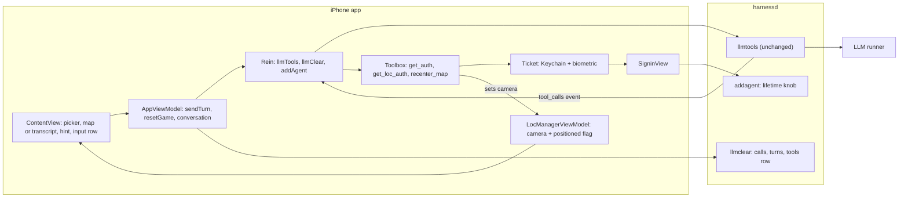
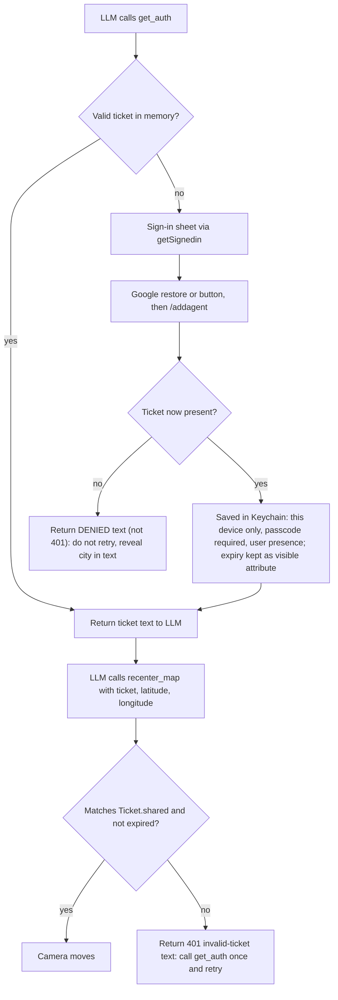

# Elephant (E-C), round 3: verbatim output

# Exhibit E-C v3: Project 2 Implementation Plan (full plan, no code)

Read-only session. I changed no files and ran nothing that changes state. I read db_schema.sql plus our own code and docs, and I read no third-party source. Claims I cannot support from our call sites, public headers or docs are marked UNVERIFIED. Mermaid diagrams are the only code-like blocks.

## 0. Rules this plan follows

**Sources**
- Staff feedback overrides the HW2 design doc wherever they conflict. Departures are listed in section 1.
- Reasoning uses only:
  - our own call sites,
  - public header documentation, and
  - the data we receive, such as a token's own contents.

**Owner decisions (fixed)**
1. Keep the tutorial extras: game picker, 20 Questions, role toggle, full transcript. The only addition is the map.
2. Clear starts a new game immediately: wipe, then re-send the rules.
3. The legacy sweep covers new and touched code only. Baseline offenders are reported, not fixed.
4. First frame is a plain progress indicator. Then the map appears, already centered on the user, at the first location fix only (no cached last-known location).
5. The transcript stays as a user-opened, in-place swap for the map area. The hint area is the only always-visible text.

**Defaults (please confirm)**
- D1. The first message follows the tutorial: rules sent as the system message with no user message. Only if a runner fails on it do we add a short user message.
- D2. The system blue location dot is allowed. Zoom is city level.
- D3. The ticket lifetime comes from an environment variable read once at server startup, default 180 seconds.
- D4. The ticket handling is the tutorial's: biometric check at launch (reading the Keychain) and at save. See departures, row 5.
- D5. No project-settings changes except the location permission text.
- D6. A fresh secret marker at the start of each new round is allowed.
- D7. The existing alert is kept for errors.
- D8. The tutorial tools stay registered: `get_loc_auth` on the phone, `get_weather_auth` on the server.
- D9. Whitespace-only text is not "something to send".
- D10. Tests run on one working runner plus the simulator. A real device only if available.

## 1. Departures from the HW2 design document

| # | HW2 said | This plan | Why |
|---|---|---|---|
| 1 | Decision F: full-bleed map, compact bottom panel, floating Clear button | Tutorial layout: picker on top, map area, hint, one input row with Clear next to Send | Owner kept the tutorial layout |
| 2 | Rules plus a short "Begin" message | System-only first message (D1) | Follow the tutorial unless a runner fails |
| 3 | Pin, status row, Play Again, Ended state, Decision C (game-over from tool calls) | None of them | Staff feedback |
| 4 | 30 second timers and three kinds of Retry (Decision E) | None | Staff feedback |
| 5 | Ticket "saved behind Face ID, then read back with Face ID on each win" | Biometric only when the Keychain is read at launch and when a ticket is saved. The ticket then lives in memory until expiry. | Deliberate departure, to confirm. This is how the tutorial code works. HW2 overstated it. |
| 6 | Server unchanged | Server changes: `llmclear` and the lifetime knob | Staff feedback |
| 7 | Clear asks for confirmation | No confirmation (the baseline has none) | Owner says the only addition is the map (Q1) |

## 2. Schema facts (Step 0 is done: db_schema.sql is read)

- **turns:** `turnID` is the primary key. `appID` and `prompt` are required. `reasoning` and `completion` are optional. There is a `completed` column the code never uses.
  - There is an index on app and turn.
  - There is a trigger that stamps a completion time after the completion is first set.
  - Updates, not deletes, fire it.
- **calls:** `id` alone is the primary key. It is not scoped to an app or a turn.
  - There is an ordering index on turn and call position.
  - There is a trigger that stamps the result time.
  - A foreign key points at the turns table with no cascade.
  - The server switches foreign keys on at startup.
- **tools:** `appID` is the primary key. It holds one row per app, with the schema blob and a timestamp.
- **tickets:** its own table, keyed by ticket, with creator and expiration. It is independent of everything above.
- There are also views for readable timestamps and a statistics table. They are irrelevant to Clear.

**What this implies**

1. **Delete order in `llmclear` is forced.** Calls must go before turns, because a turn referenced by a call cannot be removed. The existing two deletes are already in that order.
2. **The tools row.** Deleting the tools row is safe and independent of order, because it has no dependants. The next send re-upserts it (test T7).
3. **Do not touch tickets.** Tickets belong to sign-in, not to a conversation.
4. **Risk: duplicate call ids.**
   - Because `calls.id` is globally unique, any LLM provider that reuses a call id (for example the same short id in two rounds) would make the second insert fail, and the server would send an error event.
   - A win involves two tool rounds in one turn: `get_auth`, then `recenter_map`.
   - We cannot change the schema, so this is tested across the available runner (T4) and reported.
5. **Risk: call ordering within a turn.**
   - The call position restarts in each round of one turn. The two rounds' calls therefore tie in the history rebuild.
   - Replay merges them into one assistant message with two tool calls.
   - Test T8 checks that a play-again turn after a win is accepted by the runner.
6. **"Feed the LLM the current schema."**
   - Read as: give the coding agent this dump as the authoritative table definition.
   - This is Step 0.
   - This reading is a guess to confirm (Q3).

## 3. Architecture (changes only)

## 4. Ordered steps

**Step 0 (done).** The live schema dump is read. Facts are in section 2. The coding agent receives db_schema.sql as input.
- **Satisfies:** staff backend item "feed the LLM the current database schema that supports tool calls".

### Back end

**B1. Clear removes everything for the app ID** (`handlers.llmclear`)
- Three plain deletes, in this order:
  1. the app's calls (found through its turns),
  2. the app's turns,
  3. the app's row in the tools table.
- Do not add a single transaction. The existing handlers never use explicit transactions: the connection is in autocommit, and the one "atomic transaction" comment sits on a single insert. Adding one would be a new pattern.
- A partial failure is harmless:
  - If calls are deleted and turns remain, the app is just missing tool results.
  - If the tools row is not deleted, the next fresh send overwrites it.
- Reuse the existing error and log helpers. Do not touch tickets. No new endpoint or schema change.
- **Reading of the professor's cut-off sentence.** "Clear deletes calls and turns but not stored tool schemas" is read as "Clear must also delete the tools row". This reading is a guess to confirm (Q3).
- **Done when:**
  - after a game that included tool calls, read-only counts of this app's rows in turns, calls and tools are all zero, while another app's rows and all tickets are unchanged;
  - the sequence Clear, then a new send, works (T7).
- **Satisfies:** "adapt llmclear() to remove data cleanly"; the requirement that Clear removes history and prompts (system and user prompts live in the turns' prompt blob).

**B2. Tunable ticket lifetime** (`handlers.TICKET_MAX_LIFETIME`)
- Read once from an environment variable at startup, default 180 seconds, following the existing `RUNNERS_CONFIG` and `AGENTIC_ROOT` pattern.
- The existing rule stays: the lifetime is the smaller of this value and the Google token's remaining life.
- **Done when:** a restart with a 20 second setting makes the `addagent` response report about 20, and an unset variable reports 180.
- **Satisfies:** "ticket lifetime is tunable".

**B3. Nothing else changes on the back end**
- `recenter_map` is phone-resident. Its schema rides in the existing tools field and is stored by the existing upsert.
- `toolbox.py`, routes and `/llmtools` are untouched.
- **Done when:** the harnessd diff touches only `handlers.py`, and a manual request offering the new schema gets a `tool_calls` event for it.
- **Satisfies:** "no change to API, data formats or schema; no new endpoints".

### Front end

**F1. Stale-token evidence FIRST, then a conditional fix** (`SigninView` task, `Ticket`, `Rein.addAgent`)
- **F1a, evidence, before any sign-in code changes.**
  - Start this at the very beginning, because it needs more than an hour of wall-clock time.
  - Read the public header documentation for the Google user's refresh call and for the current-user and restore calls. Quote it.
  - Do a short run on the unmodified code:
    1. Add temporary logging at our own call site that decodes the `exp` claim of the ID token string handed to `Rein.addAgent`. This is a value we receive, not library code.
    2. Sign in and keep the app alive for over an hour.
    3. After the ticket expires, trigger a win so `get_auth` opens the sign-in task.
    4. Record `exp` against the current time and the server's accept or reject.
  - Remove the logging afterwards.
- **F1b, fix, only if F1a shows an expired token reaching `/addagent`.**
  - Delete the branch that prefers the current user's raw token. Always use the existing silent-restore helper.
  - No new callback wrapper is added.
  - Whether silent restore itself refreshes an expired token is UNVERIFIED from public docs. The same run, repeated after the fix, shows a fresh `exp` and an accept.
  - Only if that run still shows a stale token, call the documented refresh-if-needed. Then justify one wrapper, in the same style as the existing helper extension, because no other route exists.
- If F1a does not reproduce, report "not reproduced" with the logged values and change nothing.
- **Done when:** the evidence run is recorded, and either the fixed code passes the same run or the report says not reproduced.
- **Satisfies:** the professor's SigninView item ("show me output for this bug").

**F2. Camera state, first fix only** (`LocManagerViewModel`, `LocManager.startUpdates`)
- Add a map camera position and a single "positioned" flag to `LocManagerViewModel`. This follows the pattern where tool functions already read `LocManagerViewModel.shared`.
- **Two writers and a rule:**
  1. The first-fix writer runs only if the flag is still unset. It then sets the flag.
  2. The `recenter_map` writer runs on every call and also sets the flag.
- So the first-fix writer fires at most once per launch, and a late first fix can never overwrite a tool move.
- Later location updates change only the stored location that `get_loc_auth` reads. They never move the camera.
- Do not use the system cached last-known location. It can be stale and would cause a wrong first frame.
- **Done when:**
  - with simulated location changes after launch, the camera moves once, at the first fix, and never again until a tool call;
  - with permission denied, only the progress indicator shows.
- **Satisfies:** "map centered on the user's current location at launch; no default view; no later move".

**F3. The `recenter_map` tool, reusing the tutorial tool machinery** (`Toolbox`, `Tool`, `ToolFunction`, `getAuth`, `getLocAuth`, `Ticket`, `tools/*.json`)
- **Name:** `recenter_map`. This matches the tutorial's snake_case verb naming (`get_auth`, `get_loc_auth`, `get_weather_auth`).
- **Arguments:** three string arguments in this order: `ticket`, `latitude`, `longitude`. This mirrors `get_weather_auth.json`, so the existing argument-order mechanism in `Toolbox.invoke` works unchanged.
- **Schema file:** a new `recenter_map.json` beside `get_loc_auth.json`. The synchronized project group includes it automatically. The description says it moves the map and nothing else. It never mentions a game or "game over".
- **Function:** a new phone-side function next to `getLocAuth`, registered in `Toolbox.init`.
- **The function, in order:**
  1. It checks the ticket exactly as `getLocAuth` does, using the same "invalid ticket" 401 text. That guard is shared by both functions so the text exists in one place.
  2. It parses the two numbers. A non-number or an invalid coordinate makes it return an error sentence to the LLM without moving the map. The map must never jump to 0,0.
  3. It sets the camera and the positioned flag (F2, section 5).
  4. It returns a short success sentence.
- **Done when:**
  - a valid ticket makes the map fly to the coordinates;
  - a wrong or expired ticket returns the 401 text and the map stays;
  - garbage coordinates return an error and the map stays.
- **Satisfies:** "recenter tool needs a token"; "MUST reuse tutorial tools and functions"; no duplication; "the tool only moves the map".

**F3b. Denial must be distinguishable from an invalid ticket** (`getAuth`)
- **Smallest change:** the sentence `getAuth` returns when no ticket exists after the sign-in sheet closes is replaced with a clearly different "denied" result:
  - it does not start with "401" and does not say "call get_auth";
  - it says the user declined or failed authorization;
  - it tells the LLM not to call `get_auth` or `recenter_map` again this round, and to tell the user and reveal the city in text.
- The invalid-ticket message (used by `recenter_map` and `get_loc_auth`) stays as is, because that case should lead to a retry via `get_auth`.
- The structure is unchanged: same function, same single return point, only one string differs.
- The rules (F4) name both outcomes, so the LLM does not loop on sign-in.
- **What counts as denied:** the user cancels, or Google sign-in or the `/addagent` call fails, so there is no ticket after the sheet closes.
- **A failed biometric check at launch is not a denial.** It only prevents the stored ticket from loading, and the tutorial then falls back to a fresh Google sign-in (Q4).
- **Done when:** a cancelled sign-in produces the "denied" text, an expired ticket produces the "401" text, and in both cases the LLM does not repeat the same tool call more than once.
- **Satisfies:** Goldfish finding 2; the requirement that the map moves only with a valid token.

**F4. Rules and secret city** (`Game.rules`, `AppViewModel.sendTurn`, the marker stripper in `Rein`)
- Rewrite only the Guess-the-City rules. 20 Questions rules are unchanged.
- The city rules say, in plain terms:
  - Pick a well-known city and begin the first reply with the hidden marker, then a short welcome and one hint. Never state the name in hints.
  - On a wrong guess, give a new hint.
  - On a correct guess, call `get_auth`, then call `recenter_map` with that ticket and the city's coordinates, then invite another round.
  - If `get_auth` reports that authorization was denied, say so, do not retry, and reveal the city in text.
  - If the result says the ticket is invalid, call `get_auth` once and retry.
  - If the user gives up, reveal the city in text.
  - For a new round, begin the reply with a fresh marker. The newest marker is the current city (D6).
- **Marker stripping while streaming.**
  - The existing stripper holds back the first characters of each reply until it can either confirm the marker (and drops it up to the closing bracket) or rule it out.
  - Text reaches the hint only after the stripper releases it.
  - So a half-arrived marker never flashes. The hint is read from the reply's already-stripped text.
  - The stripper starts fresh for every request, so a marker at the start of any later reply, including after a tool round, is stripped too.
  - **Known limit:** if the LLM opens a marker but never closes it within 120 characters, the held text is flushed as ordinary text and would be visible.
- **Done when:**
  - over ten fresh starts the first visible hint never contains marker text, even mid-stream;
  - a correct guess leads to exactly `get_auth`, then `recenter_map`, then closing text;
  - a wrong guess leads to no tool call;
  - the second-round marker test passes (T6).
- **Satisfies:** "app sends rules; LLM picks the city; city fixed and secret".
- No game-state detection anywhere.

**F5. The screen** (`ContentView`, `SubmitButton`, `ClearButton`, `RoleToggleButton`, `ChatView`, `ConversationView`, `AppViewModel`)
- **Layout**, top to bottom in a plain vertical stack:
  1. the game picker,
  2. the map area, taking the remaining space,
  3. the hint area,
  4. one input row (text box, role toggle, Clear, Send).
- **Map area:**
  - Until the positioned flag is set: a progress indicator.
  - After that: the system MapKit view (SwiftUI `Map`) bound to the camera, with the system location dot.
  - A toolbar button in the existing navigation bar swaps this area in place with the transcript (`ConversationView`) and back. This is local view state.
  - The map's state is kept in the model, so a recenter during the transcript view is not lost.
- **Hint area (precise behavior).**
  - It shows the content of the newest assistant entry in `conversation` that has non-empty text. No new stored state.
  - Because `sendTurn` appends an empty reply entry before streaming, the previous hint stays visible until the new reply's first visible character arrives. Then the new reply replaces it.
  - Entries from the user or system roles are never shown here, so a user message at the end of the list changes nothing.
  - Tool results are not in `conversation` at all. They travel only to the server. A tool round appends text to the same reply entry, so pre-tool and post-tool text accumulate there. If a tool round produces no text, the hint simply stays.
  - If a send fails, the error goes to the existing alert. An empty reply entry stays empty, so the previous hint remains. If the failure is a streaming parse failure, the tutorial appends its error text to the reply, and that becomes the shown hint.
  - After Clear, `conversation` is empty, so the hint is blank until the new rules reply arrives.
  - The hint area has a capped, scrollable height so a long reply cannot push the text box off screen.
- **Send and Clear (tutorial mechanism, reused).**
  - A single busy flag in `AppViewModel` disables Send, Clear and (new) the picker while a send or wipe runs.
  - Both buttons show the spinner while busy, as the tutorial does today. The app does not know which button was tapped, and the plan adds no mechanism for it. This satisfies "Send shows that work is in progress" and the mutual-disable rule (Q6).
  - Send is also disabled unless the currently shown draft has non-whitespace text (D9).
- The root tap currently toggles keyboard focus. Make it dismiss-only and keep it off the map, so a map tap never pops the keyboard open.
- **Done when:** on a phone-size simulator with a simulated location, launch shows the progress indicator and then the map on that spot, the hint sits directly above the text box, the transcript is reachable but never shown with the map, and the mutual-disable rule holds, including during the launch-time start and when the picker changes.
- **Satisfies:** all four screen requirements; "hints above, not side by side"; the owner's keep-extras decision.

**F6. Launch and Clear flow** (`AppViewModel.resetGame`, the `ContentView` launch task)
- Launch calls the same function as Clear: wipe on the server, then send the rules.
- If the wipe fails, stop, show the error, and send no rules. The app then has no game until the user presses Clear again.
- There is **no Retry feature**: no button, no automatic retry, and no stored-state resume. Pressing Clear or Send again is ordinary tutorial behavior, not a new mechanism.
- Clear also empties the conversation, the hint, and both drafts. The map and the Keychain ticket stay.
- **Done when:** relaunching mid-game gives a brand-new city with the previous game gone from the server; a forced wipe failure shows a readable alert and sends nothing.
- **Satisfies:** Clear semantics and owner decision 2. It also removes the baseline's stale-error and half-reset behavior.

**F7. Housekeeping**
- Update the location permission text to say the app centers the map on the user.
- Change comments only where my change makes them false. Do not delete existing comments.
- The Keychain ticket keeps its tutorial behavior of storing the expiry as a visible item attribute. Nothing in this plan changes that.

**F8. Legacy sweep** (section 7)
- New and touched lines only. Report the baseline offenders.

**F9. Verification** (one working runner plus the simulator; a real device only if available)
- **T1.** Cold start with the permission prompt: progress indicator, then the map on the simulated location.
- **T2.** Wrong guess, then right guess: `get_auth`, `recenter_map`, map moves, closing text.
- **T3.** Right guess with a valid in-memory ticket: no sign-in sheet.
- **T4.** Two tool rounds in one turn: the call ids stay unique on this runner (schema risk 4).
- **T5.** Ticket expiry using the short B2 setting, then a win: the silent re-sign-in path.
- **T6.** Second-round marker: after a win, answer "yes" to play again. The new reply starts with a marker that is never visible, and a later correct guess recenters to the new city.
- **T7.** First turn after Clear still gets its tool schemas: after Clear, read-only counts show zero tools rows. After the first new send, the tools row exists again, and the LLM can call `get_auth` in that very first game.
- **T8.** Play-again turn after a win: the runner accepts the rebuilt history with both tool calls.
- **T9.** Cancelled sign-in: the "denied" result, no loop.
- **T10.** Give-up text.
- **T11.** Clear during and after a game.
- **T12.** Relaunch mid-game.
- **T13.** Picker switch and transcript swap during a send.
- **T14.** Failed send: the previous hint stays and the alert shows.
- **Done when:** every test behaves as described and nothing from the do-not-build list appears.

## 5. How the map actually moves

- The Map is the system MapKit view, SwiftUI's `Map`, bound two-way to a camera position value held in `LocManagerViewModel`.
- Moving the map means assigning that value a new camera centered on the given latitude and longitude at city-level distance, inside an animation so it visibly flies. User panning also updates the value, so the next assignment still wins.
- **Writers**, to be exact:
  1. the first-fix writer, which fires at most once per launch;
  2. `recenter_map`, which fires on every successful call.
- **Rejected:**
  - MapKit's "follow user" camera (it follows continuously and needs a fallback view, which is a default view);
  - a wrapped UIKit map;
  - any marker or annotation (no pin).
- **Concurrency:** the project defaults to main-actor isolation, so the tool function writes the state with no explicit main-actor attribute and no dispatch queue.
- **Edge cases:**
  - Assigning an equal value does nothing, which is harmless.
  - If the transcript is showing, the move still happens.
  - With location permission denied, the area shows the progress indicator until `recenter_map` first sets the camera. Then the map appears centered on the city (Q5).

## 6. How the LLM obtains the token

- At launch, `Ticket.open` reads the Keychain item. On the simulator it simulates the biometric check. A still-valid ticket is loaded into memory. If the check fails, the tutorial falls back to Google sign-in later.
- Reuse within the lifetime needs no new sign-in.
- The check in `recenter_map` compares against the phone's own copy of the ticket. The server's tickets table is used only by `get_weather_auth`.
- The Secure Enclave wording is satisfied only through the tutorial's Keychain access control (D4). No explicit Secure Enclave key is created.

## 7. Legacy-pattern checklist, with concrete checks

**Risk note, read this first.** The staff wording is "presence of these legacy patterns in your code will lead to automatic point deductions". It may be applied to the whole code base, not only to our changed lines. The owner's scope is new and touched lines only, so the baseline offenders below stay in place and may still cost points. This is a risk to accept or reverse (Q7).

**Concrete checks, run on every added or changed line**
1. Search for `DispatchQueue`, `Task.sleep`, `Thread.sleep` and `RunLoop`: zero hits.
2. Search for `ObservableObject`, `@Published`, `@StateObject`, `@ObservedObject` and `@EnvironmentObject`: zero hits. `@Observable`, `@Environment` and `@Binding` are fine.
3. Search for `@MainActor`: zero hits. The project's default isolation already covers it.
4. Search for `ZStack` and `GeometryReader`: zero hits.
5. Search for `as?`, `as!` and `as `: zero new hits. Parse coordinates with a failable number conversion and validate with the system's coordinate-validity function. Each hit that remains must be explained in the final note.
6. Check every new `enum`: it must have cases. No caseless namespaces.
7. Search for `do {` and `catch`: zero in new code. Use `Result`.
8. Review every new if/else that assigns a value: convert to an expression.
9. Search touched views for `foregroundColor` and `cornerRadius`: use `foregroundStyle` and `clipShape` on touched lines.
10. Count new callback or continuation wrappers: zero, unless F1b is forced to add exactly one with its justification.
11. In the diff, count removed comment lines: zero, even where code is removed.
12. Every new comment explains why, not what.
13. In harnessd, no new delete-then-insert. B1's deletes are pure deletes.
14. Search the repo for the invalid-ticket sentence: it appears in exactly one place on the phone and one on the server.
15. Names: every new identifier reads as a noun or a verb phrase that names its function, not an implementation detail.

**Baseline offenders (reported, not fixed)**
- `do/catch`: `Rein.llmTools`, `Rein.processSse`, `Toolbox.jsonToSchema`, `LocManager.startUpdates`.
- Type assertions (`as?`): `Toolbox.invoke`, `Rein.addAgent`, `Rein` response casts (unavoidable), `Ticket`, `SigninView`, and the client-id lookup.
- Continuation helpers: two in `SigninView`, one in `getAuth`.
- Deprecated styling: `foregroundColor` and `cornerRadius` in `ContentView` and `ChatView`.
- `print` in `LocManager`; static mutable `isThinking` in `Rein`.
- Not found: dispatch queues, old property wrappers, layered stacks, geometry readers, caseless enums.

## 8. Do-not-build list

The tutorial extras (picker, 20 Questions, role toggle, transcript) are kept, as is the Clear behavior. No Clear confirmation is added (Q1). Still forbidden:
- Pin, marker or annotation on the map.
- Play Again button.
- Give Up button.
- Status row or status line.
- Timers and any time limit.
- A Retry feature in any form (button, automatic retry, or resume from stored tool results).
- Game-over or "Ended" detection, including treating any tool call as a win signal.
- Any new endpoint, or any change to a data format or the SQLite schema.
- Security, scalability or reliability hardening beyond the spec.

## 9. Goldfish 4 findings not adopted, or adopted in part

- **Finding 2, "failed biometric makes `get_auth` return denied": not adopted in that part.**
  - Reason: in the tutorial a failed biometric check only stops the stored ticket loading at launch. The ticket then comes from Google sign-in, so the game is not blocked.
  - What is adopted: cancelled or failed sign-in returns a distinct "denied" result.
  - HW2 treated a failed Face ID as a denial. Confirm the tutorial behavior is acceptable (Q4).
- **Finding 8(d), "know which button was tapped": adopted as "reuse the tutorial mechanism".**
  - Reason: the tutorial's single busy flag shows the spinner on both buttons. Distinguishing them needs a new state, which "only the map is added" argues against (Q6).
- All other findings are adopted.

## 10. Questions that still need the owner

1. **Clear confirmation (non-blocking, default: none added).** The baseline has no confirmation, and HW2 specified one. Adding one conflicts with "tapping it clears" and with "only the map is added".
2. **20 Questions (non-blocking, default: never recenters).** It has no city. Should it ever recenter?
3. **Reading of the professor's cut-off sentence (non-blocking, but confirm before submission).** B1 reads it as "Clear must also delete the tools row". This is a guess. Can you check with the professor? Also confirm that "feed the LLM the current schema" means handing the coding agent db_schema.sql.
4. **Failed biometric (non-blocking).** Is the tutorial behavior acceptable, where a failed biometric check at launch falls back to Google sign-in and is not a denial? This is departure 5 from HW2.
5. **No location permission (non-blocking, default: the map appears at the city after the first `recenter_map`).** Acceptable, given "no default view"?
6. **Spinner on both buttons (non-blocking).** The tutorial shows the busy spinner on both Send and Clear. Acceptable for "Send shows that work is in progress"?
7. **Baseline legacy offenders (non-blocking, but a grading risk).** Do you accept that baseline code may still be penalized, or should the scope widen after all?
8. **Role toggle and Send (non-blocking).** Is "Send enabled only for the currently shown draft" the right reading? Or should it stay enabled when the hidden draft has text?
9. **Stale-token evidence (non-blocking).** It needs more than an hour of wall-clock waiting. Acceptable?
10. **Test runner and device (non-blocking).** Which single runner is the test runner, and is a real device available? The duplicate-call-id risk (schema fact 4) is judged on that runner only.
