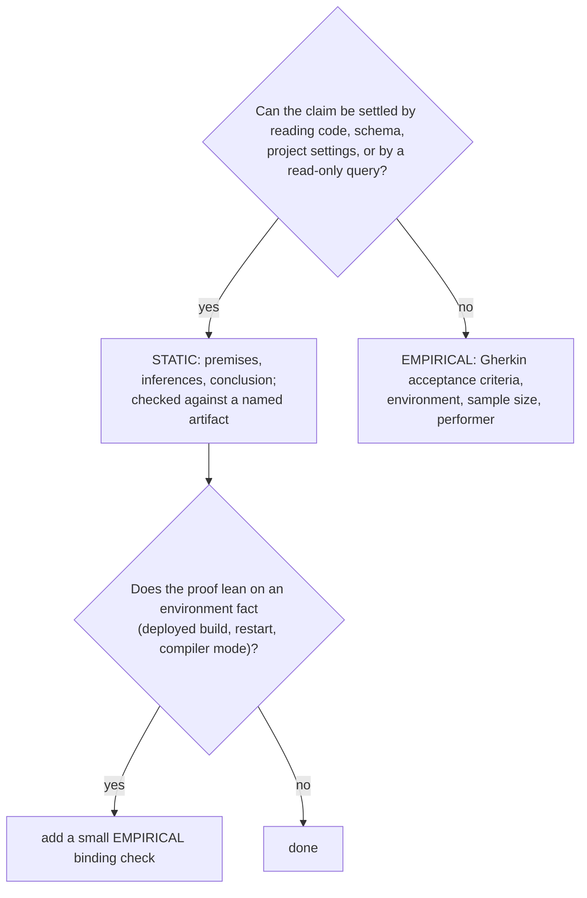
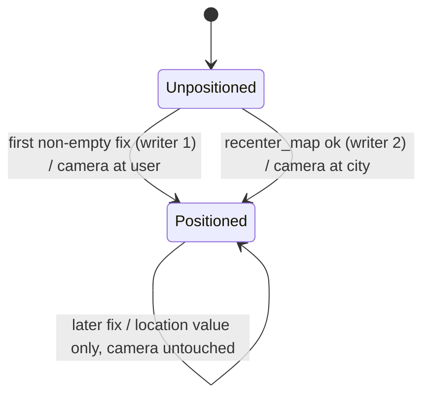
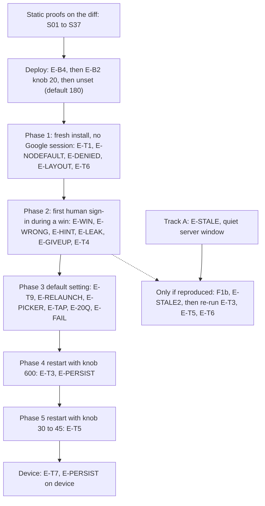

# Elephant (E-D), round 1: verbatim output

# Exhibit E-D: End-to-End Validation Plan for Project 2

Nothing was written, edited or run; I only read files. `project2/E-C.md` is identical to `project2/inputs/E-C_final.md` (a diff printed nothing). I also read `staff_feedback.md`, `ui_requirements.md`, `design_specs.md`, `db_schema.sql`, all of `Agent/Agent/*.swift`, and `harnessd/handlers.py`, `main.py`, `toolbox.py`, `runners.py` and `runners.toml`. I did not read any third-party library source. The implementation does not exist yet, so every static verdict has two parts:
- **Plan-level verdict** (pass or fail): whether the plan, as written and checked against the baseline code I read, can satisfy the proof.
- **Code-level check** (pending): what the implementer's diff must show, and against which artifact.

---

## 1. How items were routed

**Rule used.** An item is **static** if its truth follows from the text of the code, the schema, or the project settings. That means a premise, an inference and a conclusion that I can check by reading a diff or running a read-only query. An item is **empirical** if its truth depends on something outside the text: a live OS, a network, a model, a person, a sensor, or the actual timing of events.

Some items have both a static proof and an empirical confirmation. These are listed twice, with the reason. A static proof is only as good as its environment assumptions: that the right file was deployed, that the restart really read the variable, that the actor setting is what the compiler uses.



**Artifacts that static proofs are checked against**

| Tag | Artifact |
|---|---|
| A1 | Diff of `Agent/` (Swift files, `tools/recenter_map.json`, `project.pbxproj`) |
| A2 | Diff of `harnessd/` (must be `handlers.py` only) |
| A3 | A code reading of named, unchanged baseline functions |
| A4 | Text search of the diff (search terms and hit counts recorded) |
| A5 | Read-only queries on the server database |
| A6 | `db_schema.sql` and `main.py` (foreign-key switch) |
| A7 | `project.pbxproj` settings |

---

## 2. Findings against E-C

These are defects in the plan itself, found while building this validation plan. Remedies are given because these are failures.

| # | Defect in E-C | Why | Remedy |
|---|---|---|---|
| P1 | **T9 and T10 can fail for a non-bug.** T10 expects "a brand-new city". T9 searches new rows for the previous city's name. | The model may well choose the same city twice, and the rules' own example is Paris. An identical city makes both checks flip. | Judge Clear and relaunch by server state only: zero rows after the wipe, new turn IDs, and the previous game's distinctive hint text absent. Treat "different city" as an observation, not a pass condition. |
| P2 | **Track A is contaminated by the shared app ID.** Track A runs the frozen baseline for over an hour while other simulators build, wipe and play. | The app ID is the bundle ID, and every simulator uses the same one. The new app now wipes at every launch, and Clear wipes the baseline's server history. L7 mentions this but the plan still runs them in parallel. Changing the bundle ID is not a free fix, because the OAuth client ID is registered per bundle. | Quiet window: no other client touches the server from Track A's start until its final `get_auth`. Otherwise use a second harness instance with its own database. See question 1. |
| P3 | **F1a evidence would miss the real failure mode.** E-C says a token more than 50 s past expiry is rejected. | `addagent` accepts a token up to 50 s past expiry, then computes the lifetime as expiry minus now plus 1, which is zero or negative. The server returns 200 with a ticket that is already dead on arrival. Artifact 2 (HTTP status) would show success while `get_auth` still fails. | Add the response's `lifetime` value to the logged items. Add the "accepted but already dead" case as a fourth outcome of the run. |
| P4 | **F1b's fix is incomplete.** E-C deletes the current-user token branch and keeps the rest. | In `SigninView`'s `.task`, `isPresenting = false` runs after `getTicket` whatever its result. If the silent-restore token is rejected or dead, the sheet closes and the sign-in button never appears. The user gets a denial with no way to retry. The delete-the-branch fix does not remove this. | Do not plan a fix here, since the plan only documents. Record it as a plan risk for F1b. F1b's re-run must test the rejected-token case, not only the fresh-token case. Ask whether it is in scope (question 9). |
| P5 | **L14 looks wrong.** It says the transcript "may show tool-call text, including coordinates". | In `Rein.swift`, tool calls go into `acc.parallelCalls` and tool results are posted back. Nothing appends them to `Chat.content`. Only model text and error strings reach the transcript. | Verify by reading, then drop the claim. A model that writes the coordinates in its own text is a different matter (covered by E-LEAK below). |
| P6 | **The do-not-build and legacy text searches are noisy as written.** Searching for "retry" hits the baseline 401 sentence ("...obtain a new ticket and retry"), which F3 moves. It also hits rules item 9. "Play" and "ended" hit the 20 Questions rules and rules item 11. `as ` hits ordinary English in comments. `do {` hits comments. | Naive searches give false hits that bury real ones. | Use the refined term list in S27 and S28, and a pre-agreed whitelist of expected hits. |
| P7 | **T6 conflicts with T3 and T5 on Google session state.** | The sign-in button only appears when `restorePreviousSignIn` finds no prior session. After one successful sign-in, later sign-ins are silent and the sheet closes by itself. A cancel test is impossible once any sign-in has succeeded on that install. | Run T6 first, on a fresh install, before any successful sign-in. Session order is in section 6. |
| P8 | **T5's 20 s lifetime is tight.** | The client expires a ticket 1 s early, so 19 s, and the gap between `get_auth` and `recenter_map` includes a model round trip. | Use a 30 to 45 s setting for T5, or accept and record that the ticket may expire between the two calls. B2's own check can still use 20. |
| P9 | **"4 of 5" proves almost nothing.** | Five samples with no failures only rule out failure rates above about 45% (95% confidence). Four of five is consistent with a 50% failure rate. | Use the sample sizes in section 6 and report counts, not a pass line. |
| P10 | **Requirement conflict.** `ui_requirements.md` says the LLM "invites the user to play again" after a win. E-C says "tap Clear" and flags it. | A grader reading the requirement document may mark this. | Cheap hedge: the rules could say "invite them to play again by tapping Clear". Question 4. |
| P11 | **The tools-row delete may break other front ends.** The tutorial and staff front ends must keep working with this back end (`design_specs.md`). | Our client sends its tool list with every new prompt, so it survives. A staff client that registers tools once and never resends would lose them after Clear. | Cannot be decided from the repository. Question 3. |
| P12 | **The "Face ID at launch" decision has little value.** | The default ticket lifetime is 180 s, so a stored ticket is almost always expired at the next launch. `Ticket.open` checks expiry only after the biometric read. | Document it (BB05). It also means "persistence across relaunch" needs a longer lifetime to be observable. Added as E-PERSIST. |

---

## 3. Baseline bug register (tutorial code, documented, not to be fixed)

A bug in code the plan modifies is marked as a plan risk. A bug in untouched code is only documented.

| ID | Where | Bug | Status |
|---|---|---|---|
| BB01 | `AgentApp.swift` `sendTurn`; `Ticket.open`; `ContentView` alert | `sendTurn` blanks `errMsg` at start. `Ticket.open` and `SigninView` set messages in the background, and the alert sees them. Errors surface only at the end of the next turn. An advisory flag can stay set while its message is blanked, producing an alert with an empty body. Confirms L9, and the same defect can hit T1's "No previous Ticket found" alert. | Plan risk: `resetGame` and the launch task are modified |
| BB02 | `SigninView.swift` line 62 | Unconditional sheet dismissal after the `.task` path (P4). | Plan risk: F1b modifies this file |
| BB03 | `handlers.py` `addagent` | The lifetime formula can be zero or negative within the 50 s skew window (P3). A failed or missing cached lookup of JWKS raises a non-`ValueError` and gives a 500. | Adjacent to B2's line. Document only |
| BB04 | `Toolbox.swift` `invoke` | Arguments of `""` (empty string) give "bad tool arguments JSON". The server's tool handling accepts `''` as `{}`. A model that sends empty-string arguments for the no-argument `get_auth` fails on the phone. | Untouched. Visible risk for T2. |
| BB05 | `Ticket.open` | Biometric prompt happens before the expiry check, so a Keychain item that is almost always expired still costs a prompt on every launch. | Untouched |
| BB06 | `Ticket.delete` | Its comment says it forces a fresh sign-in when the server rejects the ticket, but it is only called for an invalid Keychain item. Dead code relative to its comment. | Surfaced per CLAUDE.md, not edited |
| BB07 | `handlers.py` `_retrieveHistory` | All calls of one turn are replayed as one assistant message with parallel calls, and the pre-tool texts of both rounds are concatenated. A win has two rounds in one turn. Order of ties on `idx` 0 is unspecified (in practice insertion order). | Untouched. T4 must check the model's behavior after a two-round win, not only the duplicate-ID error. |
| BB08 | `handlers.py` `_assembleToolCall` | A provider that omits call ids yields id `""`, which collides with `calls.id` globally. | Untouched. Same family as L5 |
| BB09 | `LocManager.startUpdates` | The loop ends on the first error with only a `print`. Updates with no location are ignored. No handling of denied permission. | Plan risk: F2 modifies this function |
| BB10 | `project.pbxproj` | `SWIFT_VERSION = 5.0` (language mode 5) while the plan and CLAUDE.md say latest toolchain. Actor-isolation violations are warnings, not errors. | Documented. Affects the confidence in S11 |
| BB11 | `ContentView` | The picker's change handler calls `resetGame` with no busy guard (F5a fixes it by disabling the picker). | Fixed by F5a |
| BB12 | `SubmitButton` | If the system draft is whitespace and the user draft has text, a whitespace-only system message is sent (`sendTurn` tests for non-empty, not non-blank). | Plan risk: `SubmitButton` modified (D5) |
| BB13 | `ChatView` | Blank bubble if content is whitespace only. Role label and timestamp always shown, so the hint area will display "assistant (model-name)" and a timestamp. | Documented. Question 7 |
| BB14 | `Rein.stripSecretMarker` | Only an exact-case `[SECRET:` at the very start is stripped. `[Secret: X]`, a bold-wrapped marker, or a marker after a greeting is shown. A reply that ends while still buffering a short prefix is dropped silently. | Untouched. Drives E-LEAK |
| BB15 | `Rein.swift` | `harness` is a hard-coded IP with HTTPS. TLS trust of the certificate on a simulator or device is an environment prerequisite I cannot verify. | Environment, question 2 |

---

## 4. Static logical reasoning

Verdict column is the plan-level verdict now. Reasons and remedies appear only for failures.

### 4.1 Full proofs for the main contracts

**S01. B1 delete order under the foreign key.** Artifact: A2 and A6.
1. The `calls.turnID` column references `turns.turnID` with no cascade (A6).
2. The server switches foreign keys on for the connection every handler uses (`main.py`, `rwdb`).
3. With foreign keys on, deleting a turn that still has a call row is refused.
4. So any statement deleting turns must run after the statement deleting those turns' calls.
5. The existing handler already has calls first, then turns. B1 appends the tools delete, which has no dependants.
6. Conclusion: the order calls, turns, tools is forced and safe, provided the diff keeps calls before turns and does not wrap the calls delete behind a condition. **Plan-level: PASS.**
7. If foreign keys were off, the order would still do no harm, so the proof does not depend on the pragma.

**S02. B1 touches only this app and never tickets.** Artifact: A2.
1. Each of the three deletes is parameterized by the app ID from the request body.
2. The calls delete selects by a subquery on that app's turn IDs, so calls of other apps are unreachable.
3. Tickets have no dependency on any of the three tables (A6), and no statement names the tickets table.
4. Conclusion: other apps' rows and every ticket are untouched by construction. Search the diff for `tickets` and for any statement without the app ID bound. **PASS.**
5. This replaces E-C's "throwaway row in the live database" as the main evidence. An optional empirical confirmation can be run on a scratch copy of the schema (E-B1), with no live write. See question 12.

**S03. B1 partial-failure behavior.** Artifact: A2.
1. The connection is in autocommit, so each delete commits alone.
2. A failure after the calls delete leaves turns without their calls (app missing tool results). A failure before the tools delete leaves a stale row that the next send overwrites by upsert.
3. A second Clear repeats all three deletes with the same parameters, and each is idempotent.
4. Conclusion: the state after any single failure is repaired by one more Clear. No transaction is needed. **PASS.**
5. Note that between the statements another request on the same connection can interleave (L10, accepted).

**S05. B2: lifetime is the smaller of the knob and the token's remaining life.** Artifact: A2.
1. The existing formula takes the smaller of (token expiry minus now plus 1) and `TICKET_MAX_LIFETIME`.
2. B2 changes only how `TICKET_MAX_LIFETIME` is assigned.
3. Therefore the lifetime is the smaller of the knob and the token term.
4. Conclusion: the property holds if and only if the formula line is untouched and the constant is assigned from the converted variable. **PASS.**
5. Boundary: the token term is "remaining life plus one", and it is zero or negative inside the skew window (BB03). The proof says "smaller of", never "positive". A knob of 1 or less gives a ticket that expires immediately on the phone, which subtracts 1 more.

**S06. B2: environment variable read once, at import, default 180.** Artifact: A2.
1. The constant is module-level, so it runs once at import.
2. The worker process inherits the environment of its parent, so the restart environment reaches it (confirmed empirically by E-B2).
3. Conclusion: the diff must show one assignment, one conversion, the exact name `TICKET_LIFETIME_SECONDS`, default 180, and the old name kept. **PASS.**
4. An empty string fails at import (accepted by E-C). With the server's respawn setting, a bad value shows up as a worker restart loop in the log rather than a clean failure. Note this for operators.

**S11 and S12. F2 camera writers.** Artifact: A1.

1. Premises: writer 1 tests the flag, then assigns the camera and sets the flag. Writer 2 assigns the camera and sets the flag. Both run on the main actor (default isolation, A7). There is no suspension point between test and set in writer 1.
2. Event orders: fix then tool gives the user position, then the city. Tool then fix gives the city, and the fix is suppressed because the flag is set. Fix, fix gives one move. Tool, tool gives two moves.
3. Later fixes only call `setLocation`, which writes the location value that `get_loc_auth` reads and never the camera.
4. Conclusion: writer 1 fires at most once per process, and a late fix can never overwrite a tool move. **PASS.**
5. Diff obligations: exactly two assignments to the camera value in the whole diff (grep), the flag check in writer 1 has no `await` between test and set, and writer 1 ignores updates whose location is empty (BB09). `startUpdates` is called from exactly one place (`AgentApp.init`), so "once per launch" equals "once per process". The language-mode caveat (BB10) means this is semantic reasoning, not compiler-enforced.

**S14. F3 ticket-guard sentences.** Artifact: A1.
1. `ticketRejection(for:)` returns nothing exactly when the argument equals the in-memory ticket and that ticket is not expired. The `ticket` getter returns nothing after expiry.
2. In every other case it returns the invalid-ticket sentence, moved unchanged from `getLocAuth`.
3. `getLocAuth` and the new function both call it first and return its sentence if present.
4. Conclusion: the sentence appears once on the phone, both tools reject identically, and no camera write is reachable without passing the guard. **PASS.**
5. Checks on the diff: the 401 sentence has exactly one occurrence under `Agent/`; the failed-authorization sentence in `getAuth` is unchanged (zero diff lines in `getAuth`); no other writer to the camera.

**S15. F3 rejection rules.** Artifact: A1.
1. Order: guard, parse, validity, zero check, move.
2. Either argument unparseable gives an error sentence, with no move.
3. A pair rejected by the system validity function gives an error, with no move.
4. The pair (0, 0) is rejected by numeric comparison, not text comparison.
5. Conclusion: only a valid, nonzero pair with a valid ticket reaches the camera. **PASS** with obligations: the zero test must be numeric, so "0", "0.0" and "-0.0" are all caught. A string like "48.85 N" fails to parse, so the model gets an error. Also "nan" and "inf" parse as numbers in Swift, so correctness rests on the system validity function rejecting them. That is a documented behavior I cannot verify here, so it is confirmed in E-F3 (a one-off call).

**S13. F3 tool contract.** Artifact: A1 (schema file and `Toolbox.init`).
1. The schema's parameter list must be `ticket`, `latitude`, `longitude`, all string-typed, all in `required`, in that order. `Toolbox.invoke` maps arguments by the `required` list.
2. If `required` is missing, the argument list is empty, and indexing it would crash the app. So the `required` array is a safety obligation.
3. Description text must say: plain decimal numbers, no degree signs, no N, S, E, W; requires a ticket from `get_auth`; and not copy the weather wording.
4. The description and the code must not say "game" or "game over".
5. Registered in `Toolbox.init` under the key `recenter_map`, next to `getLocAuth`.
6. Conclusion: reading the schema file and `Toolbox.init` settles it. **PASS.** The file ships automatically only if the project uses a synchronized folder. The `tools/` folder is part of the project's file group today, so the new file is bundled. Confirmed by the stored-schema check in E-B3.

**S18. F4b stripper paper trace.** Artifact: A3 (`stripSecretMarker`) and the F4a rules text.
Obligation: the marker text in the rules is exactly `[SECRET: <city>]`, matching `secretPrefix` in case and punctuation. Trace of the unchanged function:

| Stream (tokens) | Result |
|---|---|
| `[SECRET: Pa` / `ris] Hello` | Held, then shown " Hello". PASS |
| `\n[SECRET: Paris]\nWelcome` | Leading whitespace tolerated; shown "\nWelcome". PASS |
| `[Sorry` | Held while it could still be the prefix, released on the 8th character since it is not the prefix. PASS |
| `[Secret: Paris] Hi` (wrong case) | Released. The marker is visible. FAIL of the model, not of the code (BB14) |
| `**[SECRET: Paris]**` | Released. Visible. Same |
| `[SECRET: Paris` and never `]` | Held to 120 characters, then released (L4) |
| `Welcome [SECRET: Paris]` | Released. Visible |

Conclusion: the code strips only an exact-case marker at the start of a reply. It is state-fresh per request round. The statement "the marker never flashes" holds for the stripped case. Everything else is a model-compliance question, handled by E-LEAK. **PASS** as to the code. The rules text is checked by exact string comparison with `secretPrefix`.

**S20. F5a busy-flag mutual disabling.** Artifact: A1.
1. Send is disabled when the busy flag is set or nothing can be sent. Clear is disabled when the busy flag is set. The picker will be disabled when the busy flag is set.
2. `sendTurn` and `resetGame` both set the flag as their first statement and clear it with `defer`.
3. `resetGame` sets the flag, calls `sendTurn` (which sets it again), and its own defer clears it at the end. The flag is never false between the wipe and the rules send.
4. Conclusion: while a send or wipe runs, all three controls are disabled. **PASS.**
5. Residual: the button action starts a task that sets the flag when it runs, so there is a one-hop window between the tap and the flag. A second Clear tap landing in that window could start a second wipe. Accepted as part of "no locking against races". The drafts are cleared in the action itself, so a second Send is blocked by "nothing to send".

**S21. F5a Send rule (D5).** Artifact: A1. Send enabled iff the busy flag is clear and at least one draft contains a non-whitespace character. A whitespace-only pair keeps it disabled. **PASS.** Residual: BB12 (a whitespace draft paired with a real one is still sent).

**S23. F5c hint computation rules.** Artifact: A1 (computed property on `AppViewModel`).
Decision table, newest entry first, role must start with "assistant", text must contain a non-whitespace character:

| Conversation state | Hint shown |
|---|---|
| Empty (after Clear, before first reply) | Blank |
| Rules sent, empty assistant entry appended | Blank until first non-whitespace arrives |
| First reply streaming, marker stripped, only "\n" so far | Blank |
| Hint 1 shown, user sends a guess (user entry, empty assistant entry) | Hint 1 stays |
| New reply's first non-whitespace arrives | New text replaces Hint 1 |
| Win: pre-tool text then post-tool text, same entry | Both texts together in one entry |
| Tool round with no text | Previous hint stays |
| Connection error | Previous hint stays; alert shows |
| Parse failure appends error text to the reply | That text becomes the hint |

Reactivity proof: `Chat.content` is observed and `role` is not (it is marked as ignored). The property reads `conversation` (observed) and the `content` of each entry it visits, so growth of the list or of the newest visited entry's text re-evaluates it. A role change from "assistant" to "assistant (model)" is invisible to observation but harmless, since both begin with "assistant". **PASS**, provided the diff scans from the newest entry, tests the role by prefix and reads `content` for each entry visited. A "last assistant entry" shortcut would fail the whitespace row.

**S25. F6 launch and Clear sequence.** Artifact: A1.
1. The launch task keeps the empty-conversation guard and adds "return silently if busy".
2. During the wipe the conversation is still empty, so without the second guard a rebuilt view would start a second wipe.
3. The launch task calls the same function as the Clear button.
4. Conclusion: a single wipe followed by a single rules send, on every launch, and the transcript swap cannot re-trigger it because the root view is not rebuilt by the swap. **PASS**, with a note that the guard "once per launch" relies on view identity; E-RELAUNCH observes it.

**S29. Ticket validity arithmetic (supports T3 and T5).** Artifact: A3.
Server expiry is issue time plus lifetime. The phone sets its own expiry to receipt time plus lifetime minus 1, and the `ticket` getter returns nothing after it. A ticket is therefore reusable for about (lifetime minus 1) seconds on the phone, regardless of clock differences, since only relative time is used. The Keychain label stores that phone expiry in local time with a fractional-seconds field. **PASS.**

**S30. Decision 4, city-level zoom.** Artifact: A1. The camera is built from a distance in metres (about 20,000) around the coordinate, not from a degree span. A degree span gives a different ground distance at high latitudes (Reykjavik, Oslo). **PASS** if the diff uses a metre-based construction. Whether the same span applies to the launch frame is question 6.

**S31. Concurrency claim.** Artifact: A7. Both build configurations (Debug and Release) set default main-actor isolation. **PASS** (read directly). The caveat is BB10.

### 4.2 Summary of the remaining static items

| ID | Requirement / step | Obligation (condensed) | Artifact | Plan-level |
|---|---|---|---|---|
| S04 | B1 tools-row delete | One extra statement, scoped by app ID, removable alone; its absence changes only T9's tools check | A2 | PASS (premise is a guess: Q3) |
| S07 | B3 | `git diff --stat harnessd/` lists only `handlers.py`; `toolbox.py`, `main.py` routes unchanged | A2 | PASS |
| S08 | B3, constraints | Route list in `main.py` identical, `db_schema.sql` untouched, no new route | A2, A6 | PASS |
| S10 | F1b | Present only if F1a reproduces; the current-user branch removed; one new wrapper at most, with justification | A1 | PASS, with plan risk P4 |
| S16 | F3 "only moves the map" | The function writes only the camera and the flag; no write to the busy flag, conversation, or any ended-state | A1 | PASS |
| S17 | F4a rules text | All 12 points present in plain English; marker string equals `secretPrefix`; hints never name the city; no city list in Swift; first reply is the marker; the 20 Questions rules unchanged | A1, A4 | PASS |
| S19 | F5a layout | Vertical order: picker, map area, hint, input row (text box, role toggle, Clear, Send); hint directly above the input row; no `ZStack` | A1, A4 | PASS |
| S22 | F5b map area | Two states only: progress indicator while unpositioned, map afterwards; bound to the stored camera; no pin or annotation | A1 | PASS |
| S24 | F5d transcript and tap | Transcript replaces the map area in place; `ConversationView` unchanged; the dismiss-on-tap gesture is not an ancestor of the map | A1 | PASS (behavior confirmed in E-TAP) |
| S26 | F7 | Permission text edited in both build configurations; no comment line deleted without replacement | A1, A4 | PASS |
| S27 | F8 legacy checklist | See refined searches below | A1, A2, A4 | FAIL as written (P6); PASS with refined terms |
| S28 | Do-not-build list | See refined searches below | A1, A2, A4 | FAIL as written (P6); PASS with refined terms |
| S32 | Decision 8, no biometric code | The diff contains no change to `Ticket.swift` and no new use of `LocalAuthentication` | A1, A4 | PASS |
| S33 | Architecture / reuse | `recenter_map` registered through `Toolbox`; no duplicated 401 sentence; no new endpoint, no new type unless it is the small map view | A1 | PASS |
| S35 | Staff: no default view; app never picks the city | No literal coordinates or city names in Swift beyond the rules' examples; no initial camera assigned before a fix | A1, A4 | PASS |
| S36 | F1a logging removal | After F1, the diff contains none of the temporary logging (branch, expiry decode, wall clock) | A1, A4 | PASS |
| S37 | Stale-token analysis | The paper timeline below | A3 | PASS |

**S37. Stale-token timeline (premise for F1a).** A Google ID token lives 3600 s from issue. Let t be seconds since issue when the `.task` runs with the current-user branch.
- t below 3600: token valid, ticket issued normally.
- t between 3600 and about 3650: the server accepts it (50 s skew), the lifetime is zero or negative, the response is 200, and the phone's ticket is dead on arrival. `get_auth` then returns the failed-authorization sentence, and the user was never offered the button (BB02).
- t above 3650: the server returns 401, the phone shows "harnessd cannot add user", the sheet closes (BB02), and the denial follows.

Whether the current-user token is actually stale after an hour depends on whether the Google SDK refreshes it in the background. That I cannot prove from our code or public header docs, so it is the F1a empirical run (E-STALE).

**S27. Refined legacy searches.** Run on touched lines, with counts and hit locations recorded. "Swift" covers `Agent/`; "Python" covers `handlers.py`.
- Swift 1: `DispatchQueue`, `Task.sleep`, `Thread.sleep`, `RunLoop`. Zero.
- Swift 2: `ObservableObject`, `@Published`, `@StateObject`, `@ObservedObject`, `@EnvironmentObject`. Zero.
- Swift 3: `@MainActor`. Zero.
- Swift 4: `ZStack`, `GeometryReader`. Zero.
- Swift 5: match the expressions `as?`, `as!` and the keyword `as` followed by a type, ignoring comment lines. Zero new.
- Swift 6: every new `enum` has cases.
- Swift 7: match `do {` and `catch` outside comment lines. Zero in new code.
- Swift 9: no `foregroundColor` or `cornerRadius` on a touched line (they exist on untouched lines, listed as baseline offenders).
- Swift 10: continuation wrappers added: zero, or exactly one with justification (F1b).
- Swift 11: deleted comment lines without a replacement: zero (compare the minus-lines).
- Swift 13: the 401 sentence has one occurrence; the failed-authorization sentence has zero diff lines.
- Swift 8, 12, 14: reading checks (if/else assignments, comment purpose, noun-style names). These are judgment calls, so they are marked as reviewer-audited.
- Python 1 to 11: as E-C section 8. Whitespace: compare the indentation character (tabs or spaces) of each added line with its neighbors in the same block. Search terms `Optional`, `List`, `Dict`, `typing.`, `.format(`, `threading`, `time.sleep`, `get_event_loop`. Zero on changed lines. Allowed new import: `os` only.
- Expected, whitelisted hits: the word "retry" in the moved 401 sentence; "retry" in rules item 9; "play again" in the 20 Questions rules.

**S28. Refined do-not-build searches** (diff only; whitelist as above).
- Pin, marker, annotation: `Annotation`, `Marker`, `MapPin`, `MKPointAnnotation`, `pin`, `drop`.
- Play Again, Give Up buttons: `Play Again`, `Give Up`, `giveUp`, `playAgain`.
- Status row: `status`, `statusLine`.
- Timers and limits: `Timer`, `timeout`, `deadline`, `30`, `countdown`.
- Retry: `Retry`, `retry`, `attempt`, `resume`.
- Game-over detection: `isOver`, `ended`, `gameOver`, `finished`, `won`, `win`. Also check that no branch inspects the tool name `recenter_map` to change app state (read the tool-call handling in `Rein.swift`, expected unchanged).
- New endpoint, format or schema change: `Route(` count in `main.py`, `CREATE TABLE` or `ALTER` in the diff. Zero.
- Hardening: a loop cap, a lock, a plausibility check beyond the system validity and (0, 0) test. Read the F3 function for any extra check.

---

## 5. Empirical runtime tests

### 5.1 Environments and performers

| Env | Contents |
|---|---|
| ENV-SIM | Mac with Xcode, a named iPhone simulator (record the exact device and iOS version), simulated location set before launch, location permission granted, internet for map tiles, the server's certificate trusted on the simulator (BB15), Face ID enrolled in the simulator for T1/T5/T7 biometric steps |
| ENV-SRV | The changed `handlers.py` deployed, restarted with only the Groq API key set (E-B4 confirms), `TICKET_LIFETIME_SECONDS` varied per phase, read-only database access |
| ENV-DEV | A physical iPhone with Face ID and a passcode, same server (device-only tests) |
| ENV-GOOGLE | A Google account the owner provides, driven by a human |
| ENV-BASE | A dedicated simulator image running only the frozen baseline build, nothing else on that image; quiet window on the server (P2) |

**Performers.** Agent means the coding agent drives the simulator (screenshots, taps, simulated location, typing text) and runs read-only queries on the server. Agent steps that write to the server or restart it need the owner's go-ahead. Human means a person at the keyboard, necessarily for Google credentials and for Face ID on a device.

### 5.2 Tests with acceptance criteria

All LLM-dependent results are sample observations. Record n and the count, and the runner shown in the server log for each request. Any request that the log shows going to a runner other than Groq voids that sample.

**E-B4. Deploy and runner check** (ENV-SRV; agent with go-ahead)
```
Scenario: the changed server is live and uses one runner
  Given handlers.py is deployed and harnessd restarted with only the Groq key set
  When one send is made from the app
  Then the server log shows a successful request on the Groq runner
  And no request in the test window shows the local fallback
```
Sample: every LLM request in later tests is checked against the log.

**E-B2. Live lifetime** (ENV-SRV, ENV-GOOGLE; human sign-in, agent query)
```
Scenario: lifetime knob set to 20
  Given harnessd was restarted with TICKET_LIFETIME_SECONDS=20
  And a fresh Google sign-in (token fresh, not stale)
  When the new row in the tickets table is read
  Then expiration minus creation time is 19 or 20 seconds
Scenario: knob unset
  Given harnessd restarted without the variable
  Then the same difference is 179 or 180 seconds
```
Why empirical as well as static (S05, S06): only a running, restarted worker proves the variable reached the process. Sample: one each. Note the difference is 19 or 20 and 179 or 180 because the creation time is stamped at insert, after the issue time.

**E-B3. Stored schema contains the new tool** (agent, read-only query)
```
Scenario: first send registers recenter_map
  Given a Clear followed by a new game's first send
  When the tools row for the app ID is read
  Then the stored schema text contains recenter_map, get_auth and get_loc_auth
```

**E-B1. Clear leaves nothing behind** (agent; scratch copy preferred)
```
Scenario: the wipe removes only this app's rows
  Given two app IDs with turns, calls and tools rows, and some tickets
  When the three delete statements run for one app ID
  Then that app has zero rows in turns, calls and tools
  And the other app's rows and all tickets are unchanged
```
Environment: a scratch database created from `db_schema.sql` (no live write; question 12). The live-server variant is T9 below.

**E-T1. Cold start** (T1; ENV-SIM; agent; fresh install; n=3)
```
Scenario: launch shows progress then a centered map
  Given a fresh install, a simulated location, permission not yet granted
  When the app launches and permission is granted
  Then the first frame shows only a progress indicator, no map
  And once the first fix arrives a map appears centered on the simulated location
  And the first assistant reply arrives and appears as the hint
  And no marker text appears at any moment
```
Observe and record: the permission prompt, the simulated biometric prompt or advisory, any alert (BB01 may make it empty), and whether a system sheet interrupted the stream (L13). Failure mode to watch: first reply empty on this runner (D1 contingency).

**E-NODEFAULT. Staff: no default view, no later move** (agent; n=3)
```
Scenario: the camera never shows a default region
  Given a simulated location far from any well-known place
  When the app launches and screenshots are taken every second for 10 seconds
  Then no frame shows a map before the first fix
  And the first map frame is centered on the simulated location
Scenario: later location changes do not move the camera
  Given the map is shown
  When the simulated location changes twice
  Then the map does not move
```
Why empirical: what the screen draws and when depends on the live CoreLocation stream and MapKit.

**E-DENIED. Permission denied** (L3; agent; n=1)
```
Scenario: no permission
  Given location permission is denied
  When the app launches
  Then only the progress indicator is shown, and the first reply still appears as a hint
```
Record how the progress indicator looks to the tester. A permanently spinning area is the accepted limit.

**E-LAYOUT. Hint above, nothing overlapping** (ENV-SIM; agent; screenshot each)
```
Scenario: elements visible and ordered
  Given the app on each device size listed below
  When a hint is displayed and the keyboard is open
  Then the hint is directly above the text box, not beside it
  And the picker, map area, hint, text box, role toggle, Clear and Send are all visible and do not overlap
```
Devices: iPhone 17 Pro (portrait), the smallest supported size, and one landscape orientation, because the project allows landscape (question 5). Also a large text-size setting.

**E-HINT. Live hint update** (agent; n=5 games)
```
Scenario: hint streams and is replaced
  Given a hint is on screen
  When the user sends a guess and the reply streams
  Then the previous hint stays until the first non-blank character of the new reply
  And the hint then updates as the text streams
  And a new hint replaces the old one (only one hint visible)
```

**E-WRONG. Wrong guess, no tool** (agent; n=10 wrong guesses across 5 games)
```
Scenario: wrong guess
  Given a game in progress with a hidden city
  When the user makes a wrong guess or asks for a clue
  Then the reply gives one new hint
  And the server log and the map show no get_auth or recenter_map call
```
Include variants: a nearby city, a misspelling of the right city, a lowercase right answer. Misjudgments (a wrong accept or a wrong reject) are recorded separately from tool-call errors.

**E-WIN. Right guess** (T2; ENV-SIM, ENV-GOOGLE for the first sign-in; n=10)
```
Scenario: correct guess recenters the map
  Given the simulated user location is somewhere with no well-known city (open ocean)
  And a game in progress
  When the user guesses the hidden city correctly
  Then the observed order is get_auth then recenter_map then closing text
  And the map flies from the user's location to the named city
  And the closing text tells the user to tap Clear
  And the first turn's stored marker in the database names the same city as the reply and the map
```
The marker comparison uses a read-only query of the first turn of the game. It is the only way to check "city stays fixed" because the phone strips the marker. Exclude games where the city equals the current view. Record also the unparsable coordinate cases (L11), swapped coordinates, and any alert such as "Ticket saved" popping up mid-turn (BB01).

**E-LEAK. City or marker leaks** (T13 extended; agent; n=20 fresh starts via Clear, plus the win and wrong-guess games above)
```
Scenario: the secret stays hidden
  Given a fresh start
  When the first reply streams
  Then no frame shows any text containing "SECRET" or a bracketed marker
  And no hint shown before the end of the game contains the city's name
```
For every start also record the exact leak form if any (wrong case, bold, after a greeting: BB14). Use a server query to read the marker of each game and search the visible hint text for it.

**E-GIVEUP. Give up** (T8; agent; n=5)
```
Scenario: user gives up
  When the user says they give up
  Then the reply reveals the city and tells the user to tap Clear
  And no recenter_map call is made
```
Whether giving up should recenter is not specified (question 10).

**E-T3. Valid in-memory ticket** (T3; n=5; ENV-SRV with the longer setting, 600 s)
```
Scenario: second win within the lifetime
  Given a first win that signed in
  And Clear was pressed and a new game started
  When the user wins again within the lifetime
  Then no sign-in sheet appears and the map moves
```
Void the trial if more than 150 s of the lifetime had elapsed at the second `get_auth`. Using the longer setting is a legitimate use of the B2 knob and removes timing flake. Biometric prompt presence is not observable on the simulator.

**E-T5. Expired ticket** (T5; n=3; knob 30 to 45 s; after F1 closes)
```
Scenario: ticket expired between games
  Given a win that saved a ticket
  And the lifetime has passed
  When the user wins a new game
  Then get_auth meets an expired ticket and runs the sign-in task again
  And the map moves
```
After the first interactive sign-in the later ones are silent (the sheet disappears on its own), so only the first needs a human. Record any alert and whether the save prompts (observed, not assumed).

**E-T6. Cancelled sign-in** (T6; ENV-GOOGLE; human clicks, agent observes; n=3 runs, each from a fresh install, before any successful sign-in)
```
Scenario: user cancels Google's sheet
  Given no prior Google session on this install
  When the model calls get_auth and the user cancels Google's sheet
  Then the sheet closes and the call returns the failed-authorization sentence
  And the model does not call get_auth again, reveals the city, and says to tap Clear
  And an alert about the failed sign-in appears when the turn ends
  And the app is not hung
```
n=3 for the app behavior (deterministic code); the model's wording is a sample, record it.

**E-T7. Face ID cancel at save** (T7; ENV-DEV only; human; n=3)
```
Scenario: save is cancelled or fails after a good sign-in
  Given a successful Google sign-in on a physical device
  When the Keychain save is cancelled or fails
  Then an error alert says to sign in again on relaunch
  And the ticket still works: recenter_map moves the map
```
Without a device: report "untested". Also covers whether saves prompt on a device (BB05/P12).

**E-PERSIST. Stored ticket after relaunch** (new; ENV-DEV human; ENV-SIM with enrolled Face ID for the simulated path; knob 600)
```
Scenario: a saved ticket is loaded at launch
  Given a win that saved a ticket with the 600 s setting
  When the app is relaunched within the lifetime and the biometric check passes
  Then no sign-in sheet appears on the next win
```
Covers the Keychain read at launch (decision 6), which no T-test exercises while the ticket is expired. Also record the prompt on relaunch with the default setting (an almost-always-expired ticket: P12).

**E-T9. Clear** (T9; agent + read-only queries; n=3)
```
Scenario: Clear is disabled while sending
  Given a send is in flight (use a slow or stopped back end)
  Then Send, Clear and the picker are all disabled
Scenario: Clear wipes the server
  Given a finished game that included tool calls
  When Clear is tapped while idle
  Then the app's rows in turns, calls and tools are zero
  And other app IDs' rows and all tickets are unchanged
  And after the next send the tools row exists again
  And the first new game can call get_auth
  And no stored text from the previous game's hints or turn IDs remains
```
Per P1 the pass condition is state-based, not "the city differs". Ask the new game "what was the previous city" as an observation only.

**E-RELAUNCH. Relaunch mid-game** (T10; agent; n=3)
```
Scenario: relaunch wipes once
  Given a game in progress
  When the app is killed and relaunched
  Then the server shows one wipe then one rules message for the new launch
  And the old game's rows are gone
  And a fresh game starts
```
Also exercises S25.

**E-PICKER. Picker and transcript** (T11; agent; n=2)
```
Scenario: picker
  Given idle, when the game is switched
  Then the wipe runs, the conversation empties and the new game's rules are sent
Scenario: transcript swap during a send
  Given a send in flight
  When the transcript is opened and closed
  Then the hint area and the busy state are unaffected
  And the map is back in place with its camera unchanged
```

**E-TAP. Map tap does not open the keyboard** (agent; n=2)
```
Scenario: tapping the map
  Given the keyboard is closed
  When the map is tapped or panned
  Then the keyboard does not open
Scenario: tapping elsewhere dismisses the keyboard
  Given the keyboard is open
  When the area outside the map is tapped
  Then the keyboard closes
```
Also: a recenter that arrives while the transcript is shown is not lost (camera is in the model). Test by winning with the transcript open, then closing it.

**E-FAIL. Connection and parse failures** (T12a, T12b; agent; n=1 each)
```
Scenario: back end stopped
  When a message is sent
  Then an alert shows the error, the previous hint stays, and controls re-enable
Scenario: malformed stream line
  When the stream contains an undecodable event
  Then the error text appears in the reply (and is the shown hint) and the alert shows
```
T12b needs a stub; if it cannot be induced, report "untested".

**E-T4. Two tool rounds in one turn** (T4; agent + server log; n=10 wins)
```
Scenario: no duplicate-id error and sound replay
  Given a win with two tool rounds
  Then the server log shows no insert failure on calls.id
  And the next user message in the same game still gets a coherent reply
```
The second line checks BB07 (the flattened replay), which E-C does not check.

**E-F3. Rejection paths** (agent, one-off)
```
Scenario: bad arguments never move the map
  Given a valid ticket
  When recenter_map is called with unparseable text, out-of-range values, "nan", and (0, 0)
  Then each returns an error sentence and the camera is unchanged
Scenario: invalid ticket
  When recenter_map is called with a wrong ticket
  Then the invalid-ticket sentence is returned and the camera is unchanged
```
The invalid-ticket case cannot be induced by a real model on demand, so it needs a temporary debug call that is removed afterwards. Only the "nan" row needs running, because S15 leans on a documented behavior I cannot verify.

**E-STALE. Stale-token evidence (F1a)** (ENV-BASE; ENV-GOOGLE; human performs; agent analyses)
```
Scenario: the current-user token is stale after an hour
  Given the frozen baseline with only the temporary logging, on its dedicated simulator
  And one interactive Google sign-in, then the app kept alive for more than 65 minutes
  When the model is prompted to call get_auth and the sign-in task runs
  Then the logs show the branch used, the token's expiry, the wall-clock time, and the response lifetime
  And the result is one of: reproduced (current-user branch, expiry earlier than call time),
      accepted-but-dead (HTTP 200 with zero or negative lifetime),
      not reproduced, or inconclusive (branch not used or values missing)
```
Waiting 65 minutes rather than 60 covers the 3600 to 3650 s window of S37. Run two occasions if the first is inconclusive. Environment risk: P2. The log must also include the server's HTTP status and log line. The coding tool's own analysis is the third artifact the professor asked for.

**E-STALE2. After F1b** (only if reproduced; same setup; human)
```
Scenario: silent restore gives a good ticket after an hour
  Then the same run ends with a valid ticket, or a clear denial, and the sheet either closes with a ticket or shows the button
```
Include the rejected-token case (P4). T3, T5, T6 re-run afterwards.

**E-20Q. Regression: tutorial extras** (agent; n=2)
```
Scenario: 20 Questions still works
  When the picker is switched to 20 Questions and a question asked
  Then the rules reply, marker stripping and answers behave as in the baseline
```
Also a replay of the frozen baseline against the changed back end (a Clear then a send), as a proxy for "tutorial front ends keep working" (P11).

**E-SLOW. Stalled stream** (L1; agent; observation only)
With a slow or stopped back end, record how long controls stay disabled. No pass line, since the plan accepts it.

**E-BIO. Biometric prompt behavior** is covered by T1 (simulated check), E-PERSIST and E-T7 (device). There is no biometric code to test.

**E-SECURE. Secure storage** is covered by E-PERSIST (reading back a saved ticket) and E-T7. The access-control flags are read statically from `Ticket.swift` (S32). Note that `userPresence` allows device-passcode fallback, so it is not strictly "a biometric check" (question 8).

### 5.3 Sample sizes

For zero observed failures in n trials, the 95% upper bound on the true failure rate is about 3 divided by n.

| n | Upper bound on failure rate with zero failures |
|---|---|
| 5 | 45% |
| 10 | 26% |
| 20 | 14% |

So 5 samples only catch gross failure. Used here: n=10 for the win and wrong-guess flows, n=20 for marker leakage, n=5 for give-up, and small n for deterministic app behavior. Any failure triggers a rerun of the same n and is reported with its count. The cost is Groq free-tier rate limits: if a request falls through to the local runner (which may not exist), the app shows a 503 text in the alert. Voided samples are recorded, not hidden.

---

## 6. Run order


Reasons: T6 needs a pre-sign-in install (P7). Server restarts are grouped by knob setting. T12a (stopping the back end) is last in its phase. The static proofs run first because they cost nothing and constrain the tests.

---

## 7. Traceability

**7.1 Requirements and staff feedback**

| Source item | Static | Empirical |
|---|---|---|
| Req. screen 1: map on launch centered on the user | S11, S22, S35 | E-T1, E-NODEFAULT, E-DENIED |
| Req. screen 2: hints above the text box, overwritten, only current shown | S19, S23 | E-LAYOUT, E-HINT |
| Req. screen 3: text box and Send, enabled only when something to send, shows work in progress | S21 | E-T1, E-LAYOUT |
| Req. screen 4: Clear wipes history and prompts; mutual disabling | S01 to S03, S20, S25 | E-T9, E-RELAUNCH |
| Rule 1: LLM picks the city, fixed, hidden until the end | S17, S18, S35 | E-LEAK, E-WIN (marker match) |
| Rule 2: correct guess recenters, then invites play | S13 to S16, S30 | E-WIN, E-F3; wording per P10 |
| Rule 3: token via Google, limited life, reusable, Keychain, Secure Enclave, biometric | S05, S06, S29, S32 | E-B2, E-T3, E-T5, E-T6, E-T7, E-PERSIST, E-SECURE |
| Constraint: no new endpoint, format or schema change | S07, S08 | E-B3 |
| Staff: hints above, not side by side | S19 | E-LAYOUT |
| Staff: map centered at launch, no default view, no later move | S11, S12, S22, S35 | E-NODEFAULT, E-T1 |
| Staff: no pin | S22, S28 | E-WIN (visual) |
| Staff: no Play Again | S28 | E-WIN |
| Staff: no status row | S28 | E-LAYOUT |
| Staff: no timer, no ended-by-timer | S28 | E-SLOW (observation) |
| Staff: no Retry, no hardening | S28, S15 | E-FAIL |
| Staff: Clear removes calls and turns (tools row ambiguous) | S01 to S04 | E-B1, E-T9; P11 |
| Staff: stale token in SigninView | S10, S36, S37 | E-STALE, E-STALE2 |
| Staff: how to recenter the map | S11, S13 to S16, S30; section 6 of E-C | E-WIN, E-F3 |
| Staff: legacy patterns | S27 | none (static by nature) |
| Course page: feed LLM the schema; llmclear adapted; lifetime tunable | S01 to S06 | E-B1, E-B2 |
| Course page: no game-over detection | S16, S28 | E-WIN |
| Course page: reuse tutorial tools; no duplication; structure and naming match | S14, S33 | E-20Q |

**7.2 E-C steps**

| E-C item | Static | Empirical |
|---|---|---|
| B1 | S01 to S04 | E-B1, E-T9 |
| B2 | S05, S06 | E-B2 |
| B3 | S07, S08 | E-B3 |
| B4 | none (operational) | E-B4 |
| F1a / F1b | S10, S36, S37 | E-STALE, E-STALE2 |
| F2 | S11, S12 | E-NODEFAULT, E-DENIED |
| F3 | S13 to S16 | E-F3, E-WIN |
| F4a / F4b | S17, S18 | E-WIN, E-LEAK |
| F5a | S19, S20, S21 | E-LAYOUT, E-T9, E-PICKER |
| F5b | S22 | E-T1 |
| F5c | S23 | E-HINT |
| F5d | S24 | E-TAP, E-PICKER |
| F6 | S25 | E-RELAUNCH |
| F7 | S26 | E-T1 (permission prompt text) |
| F8 | S27, S28 | none |
| F9 | n/a | the whole of section 5 |
| T1 | n/a | E-T1 |
| T2 | n/a | E-WIN |
| T3 | S29 | E-T3 |
| T4 | n/a | E-T4 |
| T5 | S29 | E-T5 |
| T6 | n/a | E-T6 |
| T7 | n/a | E-T7 |
| T8 | n/a | E-GIVEUP |
| T9 | S01 to S03, S20 | E-T9 |
| T10 | S25 | E-RELAUNCH |
| T11 | S20 | E-PICKER |
| T12a, T12b | n/a | E-FAIL |
| T13 | S18 | E-LEAK |
| Do-not-build list | S28 | E-WIN, E-LAYOUT (visual) |
| Legacy checklist | S27 | none |
| Decisions 1 to 9 | 1, 6, 7 are process; 4: S30; 8: S32; 2: E-B4 | 5: E-B4; 9: E-B1 and E-B4 |
| Owner decisions 1 to 7 | 1: E-20Q, S33; 2: S25; 3: S27; 4: S22; 5: S24; 6: S29, S32; 7: S17 | E-WIN, E-T1, E-PERSIST |
| Defaults D1 to D6 | D5: S21; D6: S26; D4: S13 | D1: E-T1; D2: E-LAYOUT; D3: E-FAIL |
| Limits L1 to L15 | L14 corrected (P5) | L1: E-SLOW; L3: E-DENIED; L4/L13: E-T1, E-LEAK; L5: E-T4; L9: E-T1 (BB01); others accepted |

**7.3 Baseline bugs and the checks that touch them**

| Bug | Checked by |
|---|---|
| BB01 | E-T1, E-T6, E-WIN (alerts); L9 |
| BB02 | E-STALE2 (rejected-token case) |
| BB03 | E-STALE (lifetime field) |
| BB04 | E-WIN (observed in the model's calls) |
| BB05, BB06 | documented only |
| BB07 | E-T4 |
| BB08 | E-T4 (server log) |
| BB09 | S11, E-DENIED |
| BB10 | S31 |
| BB11 | S20, E-PICKER |
| BB12 | S21 |
| BB13 | E-LAYOUT |
| BB14 | S18, E-LEAK |
| BB15 | ENV-SIM prerequisite, E-B4 |

---

## 8. Clarifying questions for the author (most important first)

1. **BLOCKING (E-STALE).** Track A shares the app ID with every other simulator and with the new app, which now wipes on every launch. How should the hour-long run be isolated? Options: a server-quiet window from the start of the run to its final `get_auth`, or a second harness instance with its own database. Changing the bundle ID is not free, because the OAuth client is registered per bundle ID.
2. **BLOCKING (all server tests).** Which server do the tests hit, and may the implementer deploy, restart, and read the database over ssh (E-C question 5)? Is the server's certificate trusted on the simulator and device? I cannot tell from the repository, and without trust nothing connects.
3. **BLOCKING for B1's final form.** Does any staff tutorial front end register its tools once and rely on the stored row surviving Clear? If so, deleting the tools row breaks it. Also, is the professor's cut-off sentence a request to delete the tools row, or a statement that the row is kept?
4. **Non-blocking.** `ui_requirements.md` says the LLM "invites the user to play again". Is "tap Clear" acceptable, or should the rules say "invite them to play again by tapping Clear"?
5. **Non-blocking.** Is landscape orientation, the smallest iPhone, or large text in scope? The project allows landscape, and the layout check depends on the answer.
6. **Non-blocking.** Is the first-launch camera (user's location) also at the 20 km span, or only the city recenter?
7. **Non-blocking.** The hint area reuses `ChatView`, which shows a role label with the runner's model name and a timestamp. Acceptable, or should the hint be plain text?
8. **Non-blocking.** The Keychain access control allows a passcode fallback. Does "guarded by a biometric check" tolerate that?
9. **Non-blocking.** If E-STALE reproduces the bug, is F1b limited to deleting the current-user branch, or may it also address the unconditional sheet dismissal (BB02, P4)?
10. **Non-blocking.** After a give-up, should the map recenter? Rules item 10 says reveal only.
11. **Non-blocking.** Is a real device available (E-T7, device part of E-PERSIST)? Who runs the human steps, and who supplies a test Google account for E-T6 and E-STALE? (E-C questions 4 and 6 combined.)
12. **Non-blocking.** May B1's isolation proof use a scratch database built from `db_schema.sql` instead of a throwaway row in the live one?
13. **Non-blocking.** The course AGENTS.md is not in the repository. Is CLAUDE.md the authority for the legacy checks? Also confirm that BB03 (negative lifetime near `addagent`'s formula) is document-only.
14. **Non-blocking.** Does the grader expect city variety between games? The rules' own example (Paris) biases the model. This is a requirement question, not a test question.
15. **Non-blocking.** May the implementer add a temporary debug-only call for E-F3 and temporary logging for F1a, both removed before the F8 sweep?
