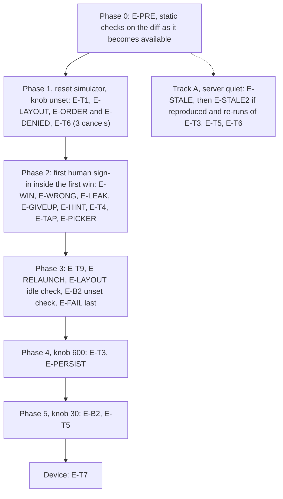

# Elephant (E-D), round 2: verbatim output

# Exhibit E-D v2: End-to-End Validation Plan for Project 2 (full plan)

Built on E-D v1. Nothing was written, edited or run; I only read files, and I did not read any third-party library source. Plain English, no code.

**Decisions taken from the coordinator, flagged for the owner**
- B1's isolation proof runs on a **scratch database built from `project2/inputs/db_schema.sql`**. There is no write to the live database.
- No source is edited during validation. The only temporary source edit is the F1a logging, and it lives in the separate frozen baseline build.

---

## 0. Method

**Static items are PENDING.** No code exists, so a static check cannot have a verdict yet. Each row in section 3 gives the obligation, the exact artifact it will be checked against, and a result column (PASS or FAIL) that stays empty until the diff exists. A static check is kept only if it can fail on a wrong diff.

**Static or empirical.** A claim is static when reading a named artifact settles it. A claim is empirical when it depends on a live system, a person, timing, a sensor, or the model's behavior. When a static check rests on an environment fact (a deployed build, a restart, a device), the environment fact is checked empirically.

**Artifacts**

| Tag | Artifact |
|---|---|
| A1 | Diff of `Agent/` (Swift files, `tools/recenter_map.json`, `project.pbxproj`) |
| A2 | Diff of `harnessd/` (must be `handlers.py` only) |
| A3 | Reading of named unchanged baseline code |
| A4 | Token search of the diff, used only for banned legacy tokens. It is never used to prove that a feature is absent. |
| A5 | Read-only queries on the live server database |
| A6 | `db_schema.sql` and `main.py` |

**Observation methods named for empirical tests**
- **Screen recording.** The simulator's video recording at 30 frames per second or better, reviewed frame by frame around the event. A screenshot cannot see sub-second events, so a screenshot is never the evidence for one.
- **Server log.** The server's own log lines, which show the chosen model service and each endpoint hit.
- **Database read.** Read-only queries on the server database. Ground truth for the hidden city is the first turn's stored reply, which begins with the marker the phone strips.

**Performers.** Agent means the coding agent drives the simulator and runs read-only queries. Writes to the server and restarts need the owner's go-ahead. Human means a person at the device, which is necessarily so for Google credentials and for Face ID.

**LLM-dependent results are samples.** Report n and the count of passes. Zero failures in n trials only bounds the true failure rate: about 45% for n=5, 26% for n=10, 14% for n=20 (95% confidence).

**Rate-limit rule (free tier).** A request that hits a rate limit or falls through to the fallback service (visible in the server log) voids only its own trial, not the sample. The trial is repeated after a 60 s wait, with at least 20 s between games. If more than 20% of trials in a test are voided, stop and report rather than continue.

---

## 1. Findings against E-C

| # | Finding | Remedy |
|---|---|---|
| P1 | T9 and T10 expect a "brand-new city" and a search for the previous city's name. The model may pick the same city twice (the rules' own example is Paris). | Judge Clear and relaunch by server state only (see E-T9). A different city is an observation. |
| P2 | The hour-long baseline run shares the app ID with every other simulator and test. The new app wipes on every launch. | Schedule it alone (section 6) or ask the owner for a second server instance. |
| P3 | E-C says a token more than 50 s past expiry is rejected. `addagent` also accepts tokens up to 50 s past expiry and computes a zero or negative lifetime, so the server answers 200 with a ticket that is dead on arrival. Status code alone would hide it. | F1a must also log the response's `lifetime`. A fourth outcome, "accepted but dead", is added. |
| P4 | `SigninView`'s `.task` closes the sheet after `getTicket` whatever its result. If the token is stale or rejected the sign-in button is never offered. F1b's "delete the current-user branch" does not remove this. | Plan risk for F1b: its re-run must include a rejected-token case. Question 4. |
| P5 | L14 says the transcript may show tool-call text. In `Rein.swift`, tool calls and results never reach `Chat.content`. | Confirm by reading, then drop the claim. |
| P6 | E-C's keyword searches for features (pin, retry, status, timer, win) hit unrelated code, and absence cannot be proved by a keyword. | Banned legacy tokens stay as token searches. Feature absence is checked by structural reads and by screen tests that fail if the feature is present. |
| P7 | The sign-in button appears only when no Google session exists, so a cancel test (T6) is impossible after any successful sign-in on that simulator. | T6 runs before the first successful sign-in. A cancel leaves no session, so repeated cancels need no reset. |
| P8 | T5 with a 20 s lifetime is tight (the phone expires a ticket 1 s early, and a model round trip sits between `get_auth` and `recenter_map`). | Use 30 s. |
| P9 | "At least 4 of 5" cannot separate a good rate from a 50% rate. | Use the sample sizes in section 4 and report counts. |
| P10 | `ui_requirements.md` says the LLM "invites the user to play again". E-C says "tap Clear". | Static check of the rules text plus an observation of the model's actual closing wording (E-WIN d). Question 3. |
| P11 | Deleting the tools row on Clear may break a staff front end that registers its tools only once. Our client resends them with every prompt. | Question 2. |
| P12 | E-C's T9 expects zero rows for the app after Clear. But `resetGame` sends the rules immediately, so the live database is never empty after Clear. | Live check: old turn IDs absent, new game's rows only. Zero rows is proved on the scratch database (E-B1). |
| P13 | Keychain items and the Google session survive an app reinstall on a simulator. "Fresh install" may not give a clean state. | Reset the simulator or its keychain, and confirm the precondition (sign-in button visible, "No previous Ticket found" advisory). |

---

## 2. Baseline bug register (documented, not fixed)

| ID | Bug | Status |
|---|---|---|
| BB01 | `sendTurn` blanks the error text at start; background tasks set messages the alert may show empty or late. Same defect as L9. | Plan risk: `resetGame` and the launch task change |
| BB02 | `SigninView.swift` line 62 dismisses the sheet unconditionally (P4). | Plan risk: F1b edits this file |
| BB03 | `addagent` can compute a zero or negative lifetime inside the 50 s skew window (P3), and a failed key fetch gives a 500. | Adjacent to B2's line. Document only |
| BB04 | The phone's tool dispatcher turns empty-string arguments into "bad tool arguments JSON", while the server accepts them. A model that sends `""` for the no-argument `get_auth` fails. | Untouched. Watch in E-WIN |
| BB07 | The server replays all calls of one turn as one assistant message (a win has two rounds in one turn). | Untouched. Watch in E-T4 |
| BB09 | `startUpdates` stops on the first error and has no handling for denied permission. | Plan risk: F2 edits it |
| BB10 | Project language mode is Swift 5 (`SWIFT_VERSION = 5.0`) with default main-actor isolation set. Actor mistakes are warnings, not errors. | Note only |
| BB11 | The picker's change handler calls `resetGame` with no busy guard (F5a fixes it). | Fixed by F5a |
| BB12 | When the system draft is whitespace-only and the user draft has text, a whitespace-only system message is sent. | Finding against D5 (see S21) |
| BB13 | `ChatView` shows a role label with the model name and a timestamp, so the hint area shows them too. | Documented |
| BB14 | The stripper only removes an exact-case `[SECRET:` at the very start of a reply. | Drives E-LEAK |
| BB15 | The back end is a hard-coded IP with HTTPS. Certificate trust on a simulator or device is unverified. | First check in section 6 |

---

## 3. Static checks (all PENDING until the diff exists)

Result column is empty on purpose. Reasons and remedies are filled in only if a check fails.

| ID | Item | Obligation on the diff | Artifact | Result |
|---|---|---|---|---|
| S01 | B1 order and dependants | In `llmclear`, the calls delete appears before the turns delete. Schema fact: no foreign key points at the tools table, so the tools delete has no dependants. | A2, A6 | |
| S02 | B1 shape | Exactly three deletes; each takes the app ID as a bound parameter; no statement names the tickets table; no new route. (Behavior is proved in E-B1.) | A2 | |
| S04 | B1 tools-row statement | The tools delete is one separate statement, removable alone. | A2 | |
| S05 | B2 formula | The existing line computing the lifetime (smaller of token life plus 1 and `TICKET_MAX_LIFETIME`) has zero diff lines. The only changes are the constant's assignment, the `os` import and the comment. | A2 | |
| S06 | B2 shape | One assignment, module level, variable name `TICKET_LIFETIME_SECONDS`, default 180, conversion to a whole number, old constant name kept. (That the worker actually receives the variable is E-B2.) | A2 | |
| S07 | B3 | `harnessd` diff lists only `handlers.py`; the route list in `main.py` and `db_schema.sql` are unchanged. | A2, A6 | |
| S10 | F1b (only if F1a reproduces) | The current-user branch is deleted and the existing silent-restore helper is always used; at most one new wrapper, with a written justification. | A1 | |
| S11 | F2 camera writes | Exactly two assignments to the camera value in the whole diff (first-fix writer and `recenter_map` writer); the first-fix writer tests the flag, assigns, and sets the flag with no suspension point between; it ignores updates with no location; later updates only call `setLocation`; `startUpdates` has one call site. The ordering claims are empirical (E-ORDER). | A1 | |
| S13 | F3 tool contract | The schema file lists `ticket`, `latitude`, `longitude` as string parameters, all in `required`, in that order (a missing `required` makes the dispatcher index an empty list and crash); the description says plain decimal numbers with no degree signs or N/S/E/W, mentions that a ticket from `get_auth` is needed, does not copy the weather wording, and never says "game"; the tool is registered in `Toolbox.init` as `recenter_map`. The stored copy is checked in E-B3. | A1 | |
| S14 | F3 guard | The invalid-ticket sentence has one occurrence under `Agent/`; both tool functions call the guard first; the failed-authorization sentence in `getAuth` has zero diff lines; the invalid-ticket branch is verified by this reading only (no debug call). | A1 | |
| S15 | F3 rejection order | After the guard, the function parses both values, then applies the system validity test, then an explicit numeric comparison to zero for the pair (0, 0), and only then moves the camera and sets the flag. No other checks. Whether the validity test rejects NaN is conditional: if the code has no explicit finiteness test, E-NAN decides. | A1 | |
| S17 | F4a rules text | Marker string equals `secretPrefix` in case and punctuation. The twelve points of E-C F4a are present, judged by a reviewer against that list. After a win, a give-up and a denial the rules tell the user to tap Clear. The 20 Questions rules text has zero diff lines. (Whether hints avoid the city name is model behavior: E-LEAK.) | A1 | |
| S18 | Stripper | `Rein.stripSecretMarker` has zero diff lines, or the change is accompanied by a new trace table. The claim being pinned is only code behavior: an exact-case prefix at the start of a reply (leading whitespace allowed) is held and removed up to the first `]`; anything else is released as visible text; a marker never closed within 120 characters is released. | A1, A3 | |
| S19 | F5a layout | The body of `ContentView` reads, top to bottom: picker, map area, hint, one input row (text box, role toggle, Clear, Send). The transcript toggle is in the toolbar. | A1 | |
| S20 | F5a mutual disabling | Send, Clear and the picker are each disabled by a condition that includes the busy flag. Both `sendTurn` and `resetGame` set the flag as their first statement and clear it by `defer`; the flag is never cleared between the wipe and the rules send. Result label if it holds: **pass with accepted race** (one scheduling hop between tap and flag, part of "no locking against races"). | A1 | |
| S21 | F5a Send rule | Send is disabled when the busy flag is set or when both drafts are whitespace-only. **Finding to report:** with one real draft and one whitespace-only draft, Send is enabled (correct per "something to send") but a whitespace-only message is also sent (BB12). Reconciliation with the requirement is left to the owner. | A1 | |
| S22 | F5b map area | The map area has exactly two states (progress indicator until the flag is set, then the map). The map's content closure contains no annotation, marker or overlay items; the only marker-like thing is the system location dot. | A1 | |
| S23 | F5c hint property | The computed property scans from the newest entry, tests the role by prefix "assistant", and skips entries with no non-whitespace character. It reads each visited entry's `content`. The table of expected hints in E-HINT's notes below is the review checklist. | A1 | |
| S24 | F5d | `ConversationView` has zero diff lines; the dismiss-on-tap gesture is attached to the regions other than the map area; the camera lives in the model, not in the swapped view. (Behavior: E-TAP.) | A1 | |
| S25 | F6 launch | The launch task keeps the empty-conversation guard and adds a return if the busy flag is set; it calls the same function as the Clear button. (Behavior: E-RELAUNCH.) | A1 | |
| S26 | F7 | The location permission text is changed in both build configurations (Debug and Release) of `project.pbxproj`; no comment line is deleted without a replacement. | A1 | |
| S27 | F8 legacy tokens | Zero hits on touched lines for: `DispatchQueue`, `Task.sleep`, `Thread.sleep`, `RunLoop`, `ObservableObject`, `@Published`, `@StateObject`, `@ObservedObject`, `@EnvironmentObject`, `@MainActor`, `ZStack`, `GeometryReader`, `foregroundColor`, `cornerRadius`, `do {`, `catch`, and type assertions (`as?`, `as!`, `as` before a type, comment lines ignored). Python: zero hits for `Optional`, `List`, `Dict`, `typing.`, `.format(`, `threading`, `time.sleep`, `get_event_loop`. Added by hand: every new `enum` has cases; at most one new continuation wrapper (F1b); added comments explain why. Whitelisted: the word "retry" in the moved 401 sentence and in rules item 9; "play again" in the 20 Questions rules. Code-level judgments (if/else assignments, naming) are marked reviewer-audited. | A1, A2, A4 | |
| S28 | Do-not-build, structural | (a) The Map's content closure holds no annotation (S22). (b) The new view tree contains exactly these buttons: Clear, Send, role toggle, transcript toggle (plus the existing picker): no Play Again, Give Up, Retry, confirmation. (c) The view tree has exactly the five regions of S19: no status row. (d) The diff adds no new time or timeout API and no loop around a network call. (e) No branch outside `Toolbox.invoke`'s dispatch inspects a tool name or result to change app state, and `Rein.swift` has zero diff lines (no game-over detection). (f) F3's function does only the steps of S15 (no extra plausibility or loop-cap hardening). (g) No new route, format or schema change (S07). Empirical absence checks are in E-LAYOUT. | A1, A2 | |
| S30 | Decision 4 | The camera is built from a distance in metres (about 20,000) around the coordinate, not from a degree span. A screenshot confirms it looks city-level (E-WIN). | A1 | |
| S36 | F1a logging removal | The main tree's diff holds none of the temporary logging (branch, expiry decode, wall-clock time). | A1 | |

**Dropped from v1 as non-failable or out of scope:** the delete-order and partial-failure restatements, the "formula untouched if and only if" proof, the arithmetic proof of ticket expiry (S29; the device-only timezone risk is one observation in E-PERSIST), the actor-isolation proof (S31; BB10 is a note), keyword-based absence checks for the architecture and staff items (S16, S33, S35), and the "no biometric code" proof (the biometric and Secure Enclave wording is "documented, not validated").

**Hint table (review checklist for S23, observed in E-HINT and E-FAIL)**
- Empty conversation: blank.
- First reply holding only whitespace, such as the line break after the stripped marker: blank.
- User guess sent, reply entry empty: the previous hint stays.
- First non-whitespace character of the new reply arrives: it replaces the old hint.
- A win with text before and after the tool round: both appear in one entry.
- Connection error: previous hint stays.
- **Not validated:** a tool round that produces no text (cannot be induced), and a streaming parse failure whose error text becomes the hint (no way to induce it; T12b is dropped).

---

## 4. Empirical tests

### Environments

| Env | Contents |
|---|---|
| ENV-SIM | A named iPhone simulator (record the device and version); simulated location set before launch; location permission granted unless a test says otherwise; internet for map tiles; hardware keyboard disconnected where a test needs the software keyboard; the server's certificate trusted |
| ENV-SRV | Changed `handlers.py` deployed; `harnessd` restarted with only the Groq key set; `TICKET_LIFETIME_SECONDS` varied per phase; read-only database access. (The runners file always keeps the local fallback active, so a fallback request is a possibility the log must rule out.) |
| ENV-DEV | A physical iPhone with Face ID and a passcode |
| ENV-BASE | A dedicated simulator image running only the frozen baseline build |

Server restarts do not end the Google session on the phone or the ticket rows in the database. A phone-side ticket from the previous setting stays valid until its own expiry, so wait it out before the next phase.

### Setup check (first, agent)

**E-PRE. Connectivity, trust, runner** (also covers E-C's B4)
```
Scenario: the app reaches the server it will be tested against
  Given the changed handlers.py is deployed and harnessd restarted
  When one message is sent from the app on the simulator
  Then the server log shows that request and a reply from the Groq service
  And the startup log shows the Groq service active
  And a plain check from the Mac with the server's certificate gets a response from the server
```
Fail line: no request in the log, or a certificate error. Stop until fixed.

### Back end

**E-B1. Clear, on a scratch database** (agent, no live write; replaces v1's E-B1 and the static copy)
```
Scenario: the three deletes remove only this app
  Given a scratch database built from db_schema.sql with foreign keys on,
        two app IDs each with turns, calls (with a tool round) and a tools row, plus some tickets
  When the three delete statements taken verbatim from the diff run for app 1
  Then app 1 has zero rows in turns, calls and tools
  And app 2's rows and every ticket are unchanged
Scenario: negative control for the order
  When the turns delete is run first for app 2
  Then the database refuses it because calls still reference the turns
```
The negative control makes S01's order claim falsifiable.

**E-B2. Live lifetime** (ENV-SRV; first human sign-in doubles as this test)
```
Scenario: knob set to 30
  Given harnessd restarted with TICKET_LIFETIME_SECONDS=30 and a fresh sign-in
  Then the new ticket row's expiration minus creation time is 29 or 30 seconds
Scenario: knob unset
  Given harnessd restarted without the variable
  Then that difference is 179 or 180 seconds
```
This is the only check that the worker process received the variable. n=1 each.

**E-B3. Stored schema** (agent, one read) After a Clear and the first send, the tools row for the app ID contains `recenter_map`, `get_auth` and `get_loc_auth`.

### Launch and screen

**E-T1. Cold start and no default view** (ENV-SIM; agent; screen recording; n=2: first on a reset simulator, second after a permission reset)
```
Scenario: launch
  Given a simulated location and location permission not yet granted
  When the app launches and permission is granted
  Then in the recording no frame shows a map view before the frame where the camera is centered on the simulated location
  And the first map frame has the location dot within the central 20% of the map area
  And the first non-blank hint appears within 60 seconds
  And the database read shows turn 1 has a non-empty reply starting with the marker
  And the hint text on screen equals that reply without the marker
  And no frame in the recording shows "SECRET" or a bracket
```
Observe and record, without a pass line: permission prompt, biometric advisory, any alert (BB01 may show it empty), and whether a system sheet interrupted the stream (L13). If the first reply is empty, apply the D1 contingency.

**E-ORDER and E-DENIED. Camera ordering and permission denied** (agent; n=1 each)
```
Scenario: tool move before the first fix
  Given the simulated location set to none and permission granted
  When a game is won
  Then the map appears centered on the city (location dot absent)
  And when a simulated location is then set, the map does not move
Scenario: permission denied
  Given permission denied
  Then only the progress indicator shows in the map area until a win,
       the hint still appears, and after the win the map shows the city
```
These are the empirical halves of S11. Pass lines are the recordings above.

**E-LAYOUT. Overlap, clipping and absence of banned features** (agent; screenshots, one per condition)
```
Scenario: elements fit and do not overlap
  Given each condition: iPhone 17 Pro portrait, the smallest simulator model available,
        keyboard open, large text size
  Then each of picker, map area, hint, text box, role toggle, Clear and Send
       is fully on screen (no edge cut off),
       no two elements' bounding boxes intersect,
       and the hint's bottom edge is above the text box's top edge
Scenario: no banned feature appears
  Given screenshots after a win, after an error alert is dismissed, and after 2 minutes idle
  Then none shows a pin or annotation (other than the location dot and map-tile labels),
       a Play Again or Give Up button, a status line, a timer or countdown, or a Retry button
Scenario: no timer ends the game
  Given a game left idle for 2 minutes
  When a guess is then sent
  Then a new hint arrives and the game continues
```
Measurement: bounding boxes read from the screenshots, or from the simulator accessibility inspector where available. Landscape is reported but not a pass line until question 5 is answered. The tolerance is zero overlap.

**E-HINT. Live hint** (agent; screen recording; n=5 sends)
```
Scenario: hint replacement
  Given a hint on screen
  When a guess is sent
  Then the old hint stays in every frame until the frame where the new reply's first non-blank character appears
  And the hint then grows with the streamed text
  And exactly one hint is visible in every frame
  And the final hint equals the database's stored reply for that turn (marker removed)
```

**E-TAP and E-PICKER, kept short** (agent; one run each; hardware keyboard disconnected)
```
Scenario: map taps
  Given the keyboard is closed
  When the map is tapped and panned
  Then the keyboard stays closed
  And with the keyboard open, a tap outside the map closes it
Scenario: picker
  Given idle
  When the picker is switched to 20 Questions and one question asked
  Then the server shows one wipe and one new rules message,
       the marker is stripped, and the reply is sensible
```
During a send, the controls are disabled: one screenshot during a streaming reply showing the spinner and disabled Send, Clear and picker (S20 covers the rest).

### Game flow (LLM-dependent)

**E-WIN. Right guess, split checks** (ENV-SIM; agent; first sign-in by a human; n=10 games, 20 s between games)
Setup: the simulated location is open ocean. Ground truth: the hidden city is the marker in turn 1 of each game (database read). A reference table of true city centers is prepared by the agent from public knowledge for each city that appears.
```
Scenario a: order
  Then the calls table for that turn lists get_auth, then recenter_map (in insertion order)
Scenario b: coordinates
  Then recenter_map's stored arguments are two plain decimal numbers
  And each is within 0.25 degrees (about 25 km) of the reference center of the hidden city
  And the same hidden city is named in the reply text
Scenario c: map
  Then the recording shows the camera leaving the ocean location and flying (at least two intermediate frames)
  And ends with the named city's label visible and nothing else marked
  And the view looks city-level (one screenshot, S30)
Scenario d: closing text
  Then the final text mentions tapping Clear
  And whether it also mentions playing again is recorded (P10)
```
Record also unparsable coordinates, empty-string arguments (BB04), and any alert such as "Ticket saved" appearing during the turn. Pass line: for 10 wins, zero failures in a to c; any failure is reported with its count and cause. A misjudged city (wrong or non-city coordinates) is a model failure, counted separately from an app failure.

**E-WRONG. Wrong guess** (agent; n=10 definitely wrong guesses over 5 games; guesses chosen after reading the hidden city from the database)
```
Scenario: wrong guess
  When the user makes a wrong guess or asks for a clue
  Then the reply gives one new hint
  And the calls table has no get_auth and no recenter_map row for that turn
```
Pass line: 0 of 10 calls. Separate, unscored judgment samples: a misspelled right answer, a lowercase right answer, a nearby city.

**E-LEAK. Marker and hint leaks** (agent; screen recording at 30 fps or better; n=20 fresh starts through Clear, plus the recordings from the other tests)
```
Scenario: secrets stay hidden
  Given the hidden city, its alternate spellings and its country, read from the database marker
  When a reply streams
  Then no frame contains "secret", a bracket pair, the city name or an alias before the game ends
```
For every start also read the form of the marker in the database. If it is not an exact-case `[SECRET:` at the start of the reply, a visible leak is predicted and must show in the recording. This turns the stripper's limits (BB14) into a checkable prediction. Report counts and the leak forms. The model-side question (hints naming the city) is judged here, not statically.

**E-GIVEUP** (agent; n=3)
```
Scenario: give up
  Then the reveal equals the database marker, the text mentions Clear, and there is no recenter_map row
```

### Authorization

**E-T6. Cancelled sign-in** (human clicks, agent observes; n=3 consecutive cancels on a simulator with no Google session and no stored ticket; run before any successful sign-in)
```
Scenario: cancel
  When the model calls get_auth and the user cancels Google's sheet
  Then the sheet closes within 5 seconds (recording)
  And the final reply arrives within 60 seconds
  And the calls table has exactly one get_auth for that turn
  And the reply reveals the database's hidden city and mentions Clear
  And an error alert appears at the end of the turn
  And Clear is enabled afterwards
```
The code path is deterministic. The model's wording is the sampled part.

**E-T3. Valid in-memory ticket** (server knob 600; n=3)
```
Scenario: second win within the lifetime
  Given a win that signed in, a Clear, and a new game
  When the user wins again within 150 seconds of the first get_auth
  Then the tickets table has no new row between the two wins
  And no sign-in sheet appears in the recording and the map moves
```
Trials over 150 s are void and repeated.

**E-T5. Expired ticket** (server knob 30; n=2; after F1 closes)
```
Scenario: expired ticket
  Given a win that saved a ticket, then 40 seconds pass
  When the user wins a new game
  Then the tickets table gets a new row after the second get_auth begins
  And the recording shows "Refreshing credentials" and the sheet closing by itself
  And the map moves
```
After the first interactive sign-in these sign-ins are silent, so only the first needs a human.

**E-STALE. Stale token, baseline** (F1a; ENV-BASE; human performs sign-in and waits; agent analyses; server quiet, see section 6)
```
Scenario: the current-user token after an hour
  Given the frozen baseline with only the temporary logging, one Google sign-in, app kept alive over 65 minutes
  When the model is asked something that needs get_auth
  Then the log records the branch used, the token's expiry, the wall-clock time and the response lifetime
  And the outcome is classified as: reproduced (current-user branch, expiry before call time),
      accepted-but-dead (status 200, lifetime zero or negative, P3),
      not reproduced, or inconclusive (branch not used or values missing)
```
**E-STALE2** (only if reproduced): repeat on the fixed build, including a rejected-token case (P4); then re-run E-T3, E-T5 and E-T6. The third artifact the professor asked for, the coding tool's own analysis, is attached by the agent.

### Clear, relaunch, failure

**E-T9. Clear on the live server** (agent; read-only queries; n=3)
```
Scenario: Clear removes the old game
  Given a finished game; record its turn IDs, its marker, and the first 40 characters of each hint
  When Clear is pressed while idle
  Then none of the old turn IDs remains
  And no calls row refers to an old turn ID
  And the tools row was rewritten after the Clear
  And a search of the app's prompt, reasoning, completion and call text finds none of the recorded hints
       (and not the marker, unless the new game picked the same city; then only the hints are searched)
Scenario: the next game can authorize
  Then a win in the next game still calls get_auth and recenter_map
```
The second scenario is satisfied by every game after the first in E-WIN. Zero rows is proved on the scratch database (E-B1), not here (P12).

**E-RELAUNCH** (agent; n=2)
```
Scenario: relaunch mid-game
  Given a game in progress
  When the app is killed and relaunched
  Then the server log shows one clear line and then one prompt request for that launch
  And the app's turns contain exactly one rules message and none from the old game
```

**E-FAIL. Connection failure** (agent; go-ahead; last in its phase; n=1)
```
Scenario: back end stopped
  When a message is sent
  Then an error alert appears, the previous hint stays, no Retry control appears,
       and controls are enabled again once the alert is dismissed
```
T12b (streaming parse failure) is dropped: there is no way to induce it. Reported as untested.

**E-NAN** (only if S15 shows no explicit finiteness test; agent; n=3)
```
Scenario: nan coordinates
  Given a valid ticket
  When the tester sends a system message instructing the model to call recenter_map with latitude "nan"
  Then the tool returns an error sentence and the map does not move
```
If the model will not comply, report as untested. No source is edited.

**E-T4. Two tool rounds** (the 10 wins of E-WIN; no extra runs)
Observation only: the server log has no insert error on the calls table and each win's call ids are distinct. Ten wins cannot show the duplicate-id case, which needs a provider that reuses ids, so this only samples. One post-win user message per game is checked for a coherent reply (BB07).

**E-T7 and E-PERSIST. Device observations** (ENV-DEV; human; n=1 each)
- Face ID cancel at save after a good sign-in: an alert says to sign in again on relaunch, and `recenter_map` still works.
- Server knob 600: a saved ticket is loaded at relaunch with no sign-in sheet on the next win.
- Optional: change the time zone between save and relaunch and note whether the stored expiry is misread (the label is stored in local time).

The Secure Enclave and biometric requirement is **documented, not validated**: it rests on the tutorial's Keychain access control, which includes a passcode fallback. These are observations, not validation, and are untested without a device.

---

## 5. Not validated, stated plainly
- Secure Enclave use and the biometric guard (documented, not validated).
- Streaming parse failure (T12b), a tool round with no text, stalled-stream recovery (L1), and the one-hop busy race.
- The duplicate call-id limit (L5), which E-T4 only samples.
- Landscape (until question 5).

---

## 6. Run order



- **Resets.** Phase 1 needs a clean simulator (P13): erase it or reset its keychain, and confirm the preconditions. A permission reset (not a reinstall) separates the two E-T1 runs and E-DENIED. E-T6 cancels leave no session, so no reset is needed between them. The first successful sign-in happens in Phase 2, after which the Google session persists.
- **Human cost:** one sign-in plus three cancel clicks; nothing else needs a person except the hour-long run and the device observations.
- **Track A scheduling.** Start it right after E-PRE. From its first prompt to its final `get_auth`, no other test, wipe or launch touches the server. Static work and building are free. If the owner prefers parallel work, use a second server instance (question 1).
- **Server restarts** are grouped by knob (unset, 600, 30), and the Google session and ticket rows survive them.

---

## 7. Traceability

| Source | Static | Empirical |
|---|---|---|
| Screen 1, map centered at launch; staff: no default view, no later move | S11, S22 | E-T1, E-ORDER, E-DENIED |
| Screen 2, hints above, overwritten; staff: above not beside | S19, S23 | E-LAYOUT, E-HINT |
| Screen 3, Send enabled only with content, shows progress | S20, S21 | E-LAYOUT, E-T1 |
| Screen 4, Clear wipes everything, mutual disabling | S01, S02, S20, S25 | E-B1, E-T9, E-RELAUNCH |
| Rule 1, model picks city, fixed, hidden | S17, S18 | E-LEAK, E-WIN b |
| Rule 2, correct guess recenters; "invites to play again" (P10) | S13 to S15, S17, S30 | E-WIN, E-NAN |
| Rule 3, ticket, lifetime, Keychain, Secure Enclave, biometric | S05, S06 | E-B2, E-T3, E-T5, E-T6; Secure Enclave and biometric documented, not validated |
| Constraint: no new endpoint, format or schema | S07, S28 g | E-B3 |
| Staff: no pin / Play Again / status row / timer / Retry | S22, S28 | E-LAYOUT absence scenarios, E-FAIL |
| Staff: no game-over detection | S28 e | E-WIN |
| Staff: Clear semantics (and cut-off sentence) | S01, S02, S04 | E-B1, E-T9; P11 |
| Staff: stale token | S10, S36 | E-STALE, E-STALE2 |
| Staff: how the map is recentered | S11, S13, S15, S30 | E-WIN b, c, E-ORDER |
| Staff: legacy patterns | S27 | none (static by nature) |
| Course page: lifetime tunable, schema fed, llmclear adapted | S01 to S06 | E-B1, E-B2 |
| Course page: reuse tutorial tools, no duplication, structure | S13, S14, S28 | none (static) |
| B1 / B2 / B3 / B4 | S01, S02, S04 / S05, S06 / S07 / none | E-B1, E-T9 / E-B2 / E-B3 / E-PRE |
| F1 / F2 / F3 / F4 | S10, S36 / S11 / S13 to S15 / S17, S18 | E-STALE, E-STALE2 / E-ORDER, E-DENIED / E-NAN, E-WIN / E-WIN, E-LEAK |
| F5a / F5b / F5c / F5d | S19 to S21 / S22 / S23 / S24 | E-LAYOUT / E-T1 / E-HINT / E-TAP |
| F6 / F7 / F8 / F9 | S25 / S26 / S27, S28 / n/a | E-RELAUNCH / E-T1 (permission prompt) / none / section 4 |
| T1 / T2 / T3 / T4 / T5 / T6 / T7 | n/a | E-T1 / E-WIN / E-T3 / E-T4 / E-T5 / E-T6 / E-T7 |
| T8 / T9 / T10 / T11 | n/a / S20 / S25 / S20 | E-GIVEUP / E-T9 / E-RELAUNCH / E-PICKER |
| T12a / T12b / T13 | n/a | E-FAIL / dropped, untested / E-LEAK |
| Decisions and defaults | 4: S30; 8: documented only; D5: S21; D6: S26 | 5: E-PRE; 9: E-B1, E-PRE; D1: E-T1 |
| Limits L3, L4, L9, L13 | n/a | E-DENIED, E-LEAK, E-T1 (BB01), E-T1 |
| Limits L1, L2, L5 to L8, L10 to L12, L14, L15 | accepted, not validated (L14 corrected, P5) | none |
| Baseline bugs | BB02: S10; BB11: S20; BB12: S21 | BB01: E-T1, E-FAIL; BB03: E-STALE; BB04, BB07: E-WIN, E-T4; BB09: E-DENIED; BB14: E-LEAK; BB15: E-PRE |

---

## 8. Not adopted from the audit

- **Keyword searches for banned legacy tokens stay.** The audit's objection was to proving that a feature is absent by keyword, which I accept. Legacy tokens (S27) are token-presence rules by definition, and the diff is the complete text, so zero hits is a valid conclusion.
- **E-T6 stays at n=3.** Cancelling leaves no Google session, so repeated cancels cost one extra click each and no reset; there is no saving in reducing n.
- **E-PERSIST and E-T7 stay**, relabelled as observations on a device, not validation. They are the only way to see the saved-ticket path.
- **E-NAN is kept as a conditional run** (via a system message to the model), not dropped, because the audit allowed it to remain conditional and no source edit is permitted.
- **S10 is kept as a conditional check** (only if F1a reproduces), since the diff can fail it.
- **No cut to a second T12 style test:** T12b is dropped as the audit proposed, but T12a (E-FAIL) stays because the absence of Retry needs it.

---

## 9. Questions that still need the owner

1. **Blocking for scheduling E-STALE.** May the hour-long run get exclusive use of the server from its first prompt to its final `get_auth` (default in section 6), or should a second server instance be set up?
2. **Blocking for any test and for B1's final form.** May the implementer deploy, restart and read the database over ssh, and is the server certificate trusted on the simulator and device? Also, does any staff tutorial front end register its tools once and rely on the tools row surviving Clear, and does the professor's cut-off sentence mean the row should be deleted?
3. **Non-blocking.** Is "tap Clear" acceptable in place of "invites the user to play again" (P10), or should the rules say both?
4. **Non-blocking.** If E-STALE reproduces, is F1b limited to deleting the current-user branch, or may it also address the unconditional sheet dismissal (BB02)?
5. **Non-blocking.** Is landscape or the smallest iPhone in scope for the layout check?
6. **Non-blocking.** Does the 20 km span also apply to the launch frame?
7. **Non-blocking.** Is the mixed-draft whitespace message (S21, BB12) acceptable, or should it be changed?
8. **Non-blocking.** Is a real device available (E-T7, E-PERSIST), and who is the human for the Google sign-in and the cancels?
9. **Non-blocking.** The course AGENTS.md is not in the repository. Is CLAUDE.md the authority for the legacy checks?
