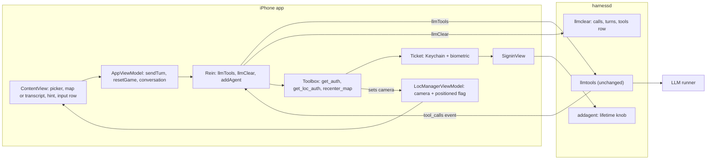
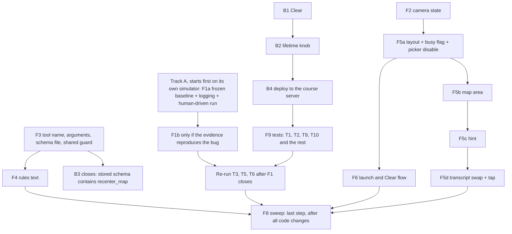
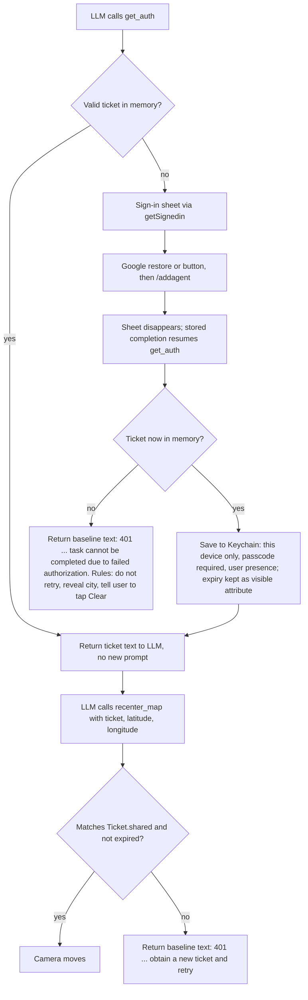
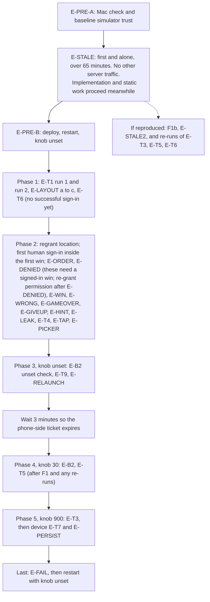

# Project 2 Implementation and Validation Plan

This page combines the final implementation plan (Exhibit E-C) with the final validation plan (Exhibit E-D), which is the clearly marked Validation section below. The course AGENTS.md was not changed; the project's agent instructions file is CLAUDE.md at the repository root (included in the HW2 submission, Section 3).

## Exhibit E-C (final): Project 2 Implementation Plan (full plan, no code)

Plan only. No code, no state changes. I read no third-party library source. I reread our own files, including `AgentApp.swift`, `ContentView.swift`, `ChatView.swift`, `Rein.swift`, `Toolbox.swift`, `runners.py` and `handlers.py`, for the facts below. Claims I cannot support from our call sites, public headers or docs are marked UNVERIFIED. Mermaid diagrams are the only code-like blocks.

## Decisions the implementer must not reopen (flagged for the owner to confirm)

1. Where any input document conflicts with this plan, this plan wins.
   - This plan was written to follow `staff_feedback.md`. If the implementer believes a staff item is violated, it reports that and does not resolve it silently.
2. **The hidden-marker format is reused exactly as the code has it.**
   - The marker is written as `[SECRET: <city>]`: square brackets, the capital word SECRET, a colon, a space, the city.
   - The matching prefix constant `secretPrefix`, which holds `[SECRET:`, is in `Rein.swift`.
   - The rules text that asks for it is `Game.rules`, in `AgentApp.swift`.
3. **Ticket lifetime variable:** `TICKET_LIFETIME_SECONDS`.
   - It is read in `handlers.py`, next to the definition of `TICKET_MAX_LIFETIME`, with default 180.
   - `TICKET_MAX_LIFETIME` keeps its name and is assigned from the variable.
4. **City-level zoom:** a map span of about 20 kilometres.
5. **Test runner:** Groq, `openai/gpt-oss-120b` (the first runner in `runners.toml`), unless it is unavailable.
   - Mechanism: the server picks runners by weighted random order per request, so "first in the file" does not pin anything.
   - To test on one runner, start the test server with only the Groq API key set. The local fallback stays as the last resort and shows in the server log if it is used.
   - Real device availability is unknown.
6. The course AGENTS.md, if supplied, governs both Swift and Python. CLAUDE.md governs otherwise.
7. The repository itself, not only the listed input files, is provided to the implementer.
8. **No biometric code is written.** Face ID behavior comes only from the existing `Ticket` code.
9. **The back end for B1 and B2 tests is the course server, reachable over ssh.**
   - Any write to the live database needs the owner's explicit go-ahead.
   - Deploying `handlers.py` and restarting `harnessd` also need that go-ahead (Q5).

## 0. Rules this plan follows

**Inputs given to the implementer**
- The course AGENTS.md (if supplied) or CLAUDE.md.
- `db_schema.sql`.
- `staff_feedback.md`, `design_specs.md` and `ui_requirements.md`.
- The repository.
- This plan.

**Sources**
- Staff feedback overrides the HW2 design document wherever they conflict.
- Reasoning uses only:
  - our own call sites,
  - public header documentation, and
  - the data we receive, such as a token's own contents.

**Baseline facts the implementer must not contradict**
- The two baseline authorization sentences, in `Toolbox.swift`, differ in their instruction though both begin with "401 Unauthorized":
  - `getLocAuth`, invalid or expired ticket: "401 Unauthorized. Call get_auth to obtain a new ticket and retry. Never reuse an old ticket."
  - `getAuth`, no ticket after the sign-in sheet closes: "401 Unauthorized. Complete the prompt by informing user that task cannot be completed due to failed authorization."
- `SubmitButton` sends the system draft and the user draft together, clears both, and reverts the role to user. Send is enabled when either draft has content.

**Owner decisions (fixed)**
1. Keep the tutorial extras: game picker, 20 Questions, role toggle, full transcript. The only addition is the map.
2. Clear starts a new game immediately: wipe, then re-send the rules.
3. The legacy sweep applies to new and touched lines only, as defined in section 8. Baseline offenders are reported, not fixed.
4. First frame is a plain progress indicator. Then the map appears, already centered on the user, at the first location fix only. There is no cached last-known location of our own.
5. The transcript is a user-opened, in-place swap for the map area. The hint area is the only always-visible text.
6. **Biometric timing is the tutorial behavior:**
   - Face ID happens when the Keychain item is read at launch, and when a ticket is saved.
   - A valid in-memory ticket is reused with no new prompt.
7. **After a win or a give-up, the LLM tells the user to tap Clear for a new game.**
   - A secret marker is written only at the start of a game.
   - There is no per-round marker, no "play another round in chat", and no play-again tests.

**Defaults (please confirm)**
- D1. The first message follows the tutorial: rules sent as the system message with no user message. Only if the test runner fails on it (an empty or odd first reply) do we add a short user message.
- D2. The system-drawn blue location dot is allowed.
- D3. The existing alert is kept for errors.
- D4. The tutorial tools stay registered: `get_loc_auth` on the phone, `get_weather_auth` on the server.
- D5. Send is enabled when either draft has non-whitespace text, because the requirement is "Send enabled only when there is something to send". Everything else about the role toggle is baseline.
- D6. No project-settings changes except the location permission text.

## 1. Departures from the HW2 design document

| # | HW2 said | This plan | Why |
|---|---|---|---|
| 1 | Decision F: full-bleed map, compact bottom panel, floating Clear | Tutorial layout: picker on top, map area, hint, one input row with Clear next to Send | Owner kept the tutorial layout |
| 2 | Rules plus a short "Begin" message | System-only first message (D1) | Follow the tutorial unless the runner fails |
| 3 | Pin, status row, Play Again button, Ended state, Decision C (game over detected from tool calls) | None of them | Staff feedback |
| 4 | 30 second timers and three kinds of Retry (Decision E) | None | Staff feedback |
| 5 | State machine: Starting, Ready, Sending, Error, Ended, Clearing | One busy flag (`isBusy`) in `AppViewModel`, as in the tutorial. Nothing models "ended". | Staff ban game-over detection and the status row |
| 6 | A failure shows one message with one Retry button | The tutorial's alert shows the error. There is no Retry. | Staff feedback |
| 7 | After a win the LLM invites the user to play again, and a Play again button appears. The requirements document also says the LLM "invites the user to play again". | After a win, a give-up or a denial, the LLM tells the user to tap Clear. No button is added. | Owner decision 7. This changes the requirement document's wording; flagged. |
| 8 | Ticket "saved behind Face ID, then read back with Face ID on each win" | Face ID at launch (Keychain read) and at save only. A valid in-memory ticket is reused with no new prompt. | Owner decision 6. This is how the tutorial code works. |
| 9 | Clear asks for confirmation | No confirmation (the baseline has none) | The only addition is the map (Q2) |
| 10 | Server unchanged | Server changes: `llmclear` and the lifetime knob | Staff feedback |
| 11 | Picker, 20 Questions, role toggle, transcript were not part of the HW2 screen | All kept; the transcript sits behind a toolbar swap | Owner decision 1 |
| 12 | Marker written in the first reply | Unchanged: marker only at the start of a game | Same design |
| 13 | A reply replaces the clue | The hint shows the newest non-whitespace assistant text. A reply that includes a tool round accumulates its pre-tool and post-tool text in one entry, so after a win the hint can show both | Tutorial reply handling is reused; no new state |
| 14 | Sending and Clearing blocked each other | The single busy flag also disables the game picker while a send or wipe runs | Changing the picker already wipes the conversation, so it behaves as Clear |

Denial handling is not a departure: the baseline's two 401 sentences already differ.

## 2. Schema facts (already done; not a task for the implementer)

The live schema dump `db_schema.sql` is read.

- **turns:** `turnID` is the primary key. `appID` and `prompt` are required. `reasoning` and `completion` are optional. A `completed` column exists that the code never uses.
  - There is an index on app and turn.
  - A trigger stamps a completion time after the completion is first set. It fires on updates, not deletes.
- **calls:** `id` alone is the primary key. It is not scoped to an app or a turn.
  - There is an ordering index on turn and call position, and a trigger that stamps the result time.
  - A foreign key points at the turns table with no cascade.
  - The server switches foreign keys on at startup (`main.py`).
- **tools:** `appID` is the primary key, with the schema blob and a timestamp.
- **tickets:** its own table, independent of everything above. A readable view of it shows expiration and creation time.
- Other views and a statistics table exist and are irrelevant to Clear.

**What this implies**
1. **Delete order is forced.** Calls go before turns. The existing two deletes are already in that order.
2. **The tools row has no dependants.** Deleting it is safe, and the next send re-upserts it.
3. **Do not touch tickets.**
4. **Risk: duplicate call ids.**
   - `calls.id` is globally unique, so a provider that reuses a call id would make an insert fail and produce an error event.
   - A win involves two tool rounds in one turn.
   - We cannot change the schema. This is sampled in T4 and reported.
5. **"Feed the LLM the current schema"** is read as: give the implementer this dump as the authoritative table definition. This is a guess to confirm (Q3).

## 3. Architecture (changes only)



The view model reaches the clear handler only through `Rein.llmClear`.

## 4. Order of work



- **Track A starts first.** F1a is built from the unmodified baseline plus only the temporary logging, before any other front-end change is installed on that simulator. It then runs for over an hour. All other work proceeds on other simulators without waiting for it.
- **Back end first:** B1 and B2 before anything that needs the server. B3 closes only after F3 exists, because the stored schema must contain the new tool.
- **F3 before F4**, because the rules name the tool, its arguments and the baseline sentences.
- **F2 before F5b**, because the map needs the camera state.
- **F1b lands only after the evidence,** and T3, T5 and T6 (which exercise `SigninView`) are re-run after F1 closes.
- **Tests need the back end deployed first** (B4).
- **F8 is last.**

## 5. Steps

**Step 0** is done (section 2). It is not a task for the implementer.

### Back end

**B1. Clear removes everything for the app ID** (`handlers.llmclear`)
- The app ID comes from the request body, as in the existing handler.
- Three plain deletes, in this order:
  1. the calls, selected by a subquery on this app's turn IDs (as the existing statement does),
  2. the app's turns,
  3. the app's row in the tools table.
- No single transaction. The existing handlers never use explicit transactions (the connection is in autocommit).
- A partial failure heals on the next Clear:
  - If calls are deleted and turns remain, the app is missing tool results until then.
  - If the tools row stays, the next fresh send overwrites it anyway.
- Reuse the existing error and log helpers. Do not touch tickets. No new endpoint or schema change.
- **The tools-row delete rests on a guess.** The professor's cut-off sentence "Clear deletes calls and turns but not stored tool schemas" is read as "Clear must also delete the tools row" (Q3).
  - It is reversible by removing that one statement.
  - The plan still works without it: the next fresh send re-upserts the row, so only T9's check changes, to "the tools row is overwritten, not absent".
- **Done when:**
  - after a game that included tool calls, read-only counts of this app's rows in turns, calls and tools are all zero, while another app's rows and all tickets are unchanged. This needs a second app ID's rows: use another app's existing rows if any, otherwise a test row written under a throwaway test app ID. That is a write to the live database and needs the owner's explicit go-ahead; delete it afterwards;
  - the sequence Clear, then a new send, works (T9).
- **Satisfies:** "adapt llmclear() to remove data cleanly"; the requirement that Clear removes history and prompts (system and user prompts live in the turns' prompt blob).

**B2. Tunable ticket lifetime** (`handlers.TICKET_MAX_LIFETIME`)
- Read the environment variable `TICKET_LIFETIME_SECONDS` once at startup, right where `TICKET_MAX_LIFETIME` is defined, with default 180. This follows the existing `RUNNERS_CONFIG` and `AGENTIC_ROOT` pattern. The variable arrives as text, so convert it to a whole number before the existing "smaller of" comparison.
- The existing rule stays: the lifetime is the smaller of this value and the Google token's remaining life.
- A non-numeric value is not handled. The server fails at startup, which is acceptable (no hardening).
- **Done when**, after a restart with the variable set to 20:
  - after a fresh sign-in (an old Google token would read lower than 20), the new row in the tickets table shows expiration minus creation time of about 20 seconds (read-only query through the readable view). The response body's `lifetime` field (confirmed present in `handlers.py`) is an optional extra check;
  - an unset variable gives 180 on the same check.
- **Satisfies:** "ticket lifetime is tunable".

**B3. Nothing else changes on the back end**
- `recenter_map` is phone-resident. Its schema rides in the existing tools field and is stored by the existing upsert.
- `toolbox.py`, routes and `/llmtools` are untouched.
- **Closes only after F3 exists.**
- **Done when:**
  - the harnessd diff touches only `handlers.py`;
  - after the first send from the new app, a read-only query of the tools row for the app ID shows a stored schema that contains `recenter_map` together with the other phone tools. This is deterministic, unlike waiting for the LLM to emit a tool-call event.
- **Satisfies:** "no change to API, data formats or schema; no new endpoints".

**B4. Deploy for tests (operational; needs the owner's go-ahead, Q5)**
- Server host, login, deploy path and database path are supplied to the implementer separately (they are not part of this exhibit); the database path is also named in the back end's `main.py`. B3's check is closed as part of the F9 tests, because it needs the new app and a deployed server.
- Copy the changed `handlers.py` to the course server over ssh and restart `harnessd`.
- How `harnessd` is started on the server is UNVERIFIED from the repository. The implementer finds out and reports it.
- Start it with `TICKET_LIFETIME_SECONDS` set when a test needs it (20 for T5; unset otherwise).
- For single-runner tests, start it with only the Groq key set (decision 5).
- All database checks are read-only queries on the server.
- The phone's existing back-end address constant in `Rein.swift` is not changed.
- **Done when:** a test send from the phone reaches the changed server and the log shows the chosen runner.

### Front end

**F1. Stale-token evidence FIRST, then a conditional fix** (file: `SigninView.swift` only)
- **F1a, evidence, its own track, before any sign-in code changes.**
  - **Frozen baseline build on its own simulator.**
    - Build the baseline once with only the temporary logging added.
    - Install it on a dedicated simulator that nothing else uses.
    - Do no further builds or runs on that simulator during the hour. Any rebuild replaces the running app and kills the run. All other development uses a different simulator.
  - **Server expiry check (from `handlers.py`):** the server verifies the ID token with the Google library's verifier and a 50 second clock-skew allowance, and answers 401 on failure. A token expired by more than about 50 seconds is rejected, so artifact 2 is informative.
  - **A person drives the run:** an interactive Google sign-in through the button, then keep the app alive for over an hour, then trigger any prompt that makes the baseline LLM call `get_auth` (for example, ask for the weather at the current location, since the baseline's win-free tools also need a ticket) so `get_auth` reaches the sign-in task again.
  - The coding agent supplies the analysis. It cannot perform the sign-in or the wait itself.
  - Read the public header documentation for the Google user's refresh call and for the current-user and restore calls. Quote it.
  - The temporary logging in `SigninView` records:
    1. which branch supplied the token (the current user's token or the silent restore);
    2. the ID token's `exp` claim, decoded from the string we receive;
    3. the wall-clock time just before the token is posted to `/addagent`.
  - Remove the logging afterwards.
- **The result must be able to fail.** The run counts as evidence only if the logs show the branch, the `exp` and the call time. Then:
  - `exp` earlier than the call time with the current-user branch means the bug is reproduced;
  - `exp` later than the call time means it is not reproduced;
  - a run in which the current-user branch was not used, or where values are missing, is inconclusive and must be repeated.
- **F1b, fix, only if F1a reproduces the bug.**
  - Delete the branch that prefers the current user's raw token. Always use the existing silent-restore helper. No new callback wrapper.
  - Whether silent restore itself refreshes an expired token is UNVERIFIED from public docs. Repeat the same frozen-build run after the fix.
  - Only if that run still shows a stale token, call the documented refresh-if-needed, and justify one wrapper in the same style as the existing helpers.
- **Artifacts captured for the professor, exactly:**
  1. the logged branch, `exp` and call time for each sign-in task;
  2. the server's accept or reject (HTTP status from `/addagent` and the server log line);
  3. the coding tool's own analysis of this one bug, which the person includes with the run.
- **Done when:** these three artifacts exist for the old code, and either the same run passes on the fixed code or the evidence shows "not reproduced" with valid logged values. Then T3, T5 and T6 are re-run.
- **Satisfies:** the professor's SigninView item ("show me your coding tool output just for this bug").

**F2. Camera state, first fix only** (`LocManagerViewModel` and `LocManager.startUpdates`, both in `LocManager.swift`)
- Add a map camera position and a single "positioned" flag to `LocManagerViewModel`. This follows the pattern where tool functions already read `LocManagerViewModel.shared`.
- **Two writers:**
  1. The first-fix writer runs only if the flag is unset, then sets it.
  2. The `recenter_map` writer runs on every call and also sets the flag.
- So the first-fix writer fires at most once per launch, and a late first fix can never overwrite a tool move.
- Later location updates change only the stored location that `get_loc_auth` reads.
- The first fix the system delivers may be coarse or cached. That is an accepted limit (L8), with no correction.
- **Prerequisite for any run on the simulator:** set a simulated location in the simulator and grant the permission. Without one, the progress indicator spins forever and nothing else can be tested.
- **Done when:**
  - with simulated location changes after launch, the camera moves once, at the first fix, and never again until a tool call (checked visually, or with a temporary counter that is removed afterwards);
  - with permission denied, only the progress indicator shows until `recenter_map` runs (L3).
- **Satisfies:** "map centered on the user's current location at launch; no default view; no later move".

**F3. The `recenter_map` tool, reusing the tutorial tool machinery** (files: `Toolbox.swift`, a new `tools/recenter_map.json` beside `get_loc_auth.json`)
- **Name:** `recenter_map`. It matches the tutorial's snake_case verb naming.
- **Arguments:** three string arguments in this order: `ticket`, `latitude`, `longitude`. This mirrors `get_weather_auth.json`, so the existing argument-order mechanism in `Toolbox.invoke` works unchanged.
- **Schema file** (the synchronized project group includes it automatically):
  - The description says the tool moves the map to the given coordinates and requires a ticket from `get_auth`.
  - It must say that coordinates are plain decimal numbers, with no degree signs and no N, S, E or W letters.
  - It must not copy the weather wording from `get_weather_auth.json`.
  - It must never mention a game or "game over".
  - The ticket parameter's description may reuse the baseline wording "Authorization ticket obtained from get_auth tool".
- **Shared guard:** a function in `Toolbox.swift`, named `ticketRejection(for:)`.
  - It takes the ticket argument.
  - It returns nothing when the ticket matches the current valid in-memory ticket.
  - Otherwise it returns the baseline invalid-ticket sentence, which moves into it unchanged.
  - `getLocAuth` and the new function both call it, so the sentence exists in one place.
- **Function:** a new phone-side function next to `getLocAuth`, registered in `Toolbox.init`, which does the following in order:
  1. It calls the shared guard and returns its sentence if there is one.
  2. It parses the two numbers. It returns an error sentence to the LLM, without moving the map, when:
     - either is not a number, or is not a finite number (Swift parses the text "nan" and "inf" as numbers, which a range test may not reject; the explicit finiteness test is a correctness check, not hardening),
     - the system's coordinate-validity check rejects the pair, or
     - the pair is exactly latitude 0 and longitude 0. The system check accepts that pair, and a model that omits or zeroes the arguments would send it. This rejection is a correctness check, not hardening, and must be kept.
  3. It sets the camera (a region of about 20 kilometres across, section 6) and the positioned flag.
  4. It returns a short success sentence.
- **Touched lines in `getLocAuth`:** extracting the guard makes the guard lines of `getLocAuth` touched. The sentence moves unchanged. The line returning its latitude and longitude ships unchanged.
- `getAuth` is not touched.
- **No extra plausibility checks** (such as whether the coordinates fit a country). That is hardening (L11).
- **Done when:**
  - a valid ticket makes the map fly to the coordinates;
  - garbage coordinates and (0, 0) return an error and the map stays;
  - the invalid-ticket branch cannot be triggered by a real model on demand. Verify it with a one-off manual tool call (a debug-only call with a wrong ticket string) or by reading the code, and report it as read-only verified if no trigger exists.
- **Satisfies:** "recenter tool needs a token"; "MUST reuse tutorial tools and functions"; no duplication; "the tool only moves the map".

**F4. Rules and secret city**

*F4a. Rules text* (`Game.rules`, the Guess-the-City case, in `AgentApp.swift`; 20 Questions rules are unchanged)

The rules say the following, in plain English. The implementer pastes this in spirit:

1. You are hosting a "Guess the City" game with the user. Choose a well-known city yourself.
2. On your very first reply, before any other text, write the hidden marker in exactly this form: `[SECRET: <the city you chose>]`, for example `[SECRET: Paris]`. It is hidden from the player and is how you remember your choice. Never contradict it. Write it once, at the start of the game, and never again.
3. After the marker, give a short welcome and one hint. Hints never include the city's name.
4. When the user guesses wrong or asks for a clue, give one new hint.
5. When the user guesses the city correctly, first call `get_auth` to obtain a ticket.
6. Then call `recenter_map` with that ticket and the city's latitude and longitude. Give the coordinates as plain decimal numbers (for example 48.8566 and 2.3522), negative for south and west, with no degree signs and no N, S, E or W letters, and never both zero.
7. After `recenter_map` succeeds, congratulate the user and tell them to tap Clear for a new game.
8. If `get_auth` reports that the task cannot be completed due to failed authorization, do not call it again. Tell the user authorization failed, reveal the city, and tell them to tap Clear.
9. If `recenter_map` reports a rejected ticket, follow the instruction in that message. No other retry rule applies.
10. If the user gives up, reveal the city and tell them to tap Clear.
11. After the game has ended, do not start another game. Remind the user to tap Clear.
12. Use only `get_auth` and `recenter_map`. Never call `recenter_map` before a correct guess.

*F4b. Confirm the existing marker stripper handles the marker.* **Yes, no code change is expected.**
- I read `Rein.stripSecretMarker`. It holds back the start of each reply until it either confirms the prefix `[SECRET:` and drops everything up to the first closing bracket, or rules the marker out and releases the text.
- It tolerates leading whitespace and newlines.
- The marker state is created fresh for each request, in `SseAccumulator`, so a later reply is stripped independently.
- A half-arrived marker never flashes, because the reply's visible text is only appended after the stripper releases it.
- It leaves any text after the bracket as it arrives, which can start with a space or newline. The hint computation (F5c) ignores whitespace-only text.
- **Known limit L4:** if the LLM opens a marker but never closes it within 120 characters, the held text is flushed as ordinary text and would be visible.
- The implementer must confirm this by running T13 and the first-hint check in T1, and only change the stripper if those fail. The format in the rules must match `secretPrefix` exactly, including its capital letters and the space after the colon.

- **Done when**, as sample observations of an LLM and not guarantees:
  - over ten fresh starts, the first visible hint never contains marker text, even mid-stream (T13);
  - in five correct-guess games, the observed order is `get_auth`, then `recenter_map`, then closing text that tells the user to tap Clear (T2);
  - a wrong guess leads to no tool call in at least 4 of 5 wrong guesses.
- **Satisfies:** "app sends rules; LLM picks the city; city fixed and secret"; owner decision 7.
- No game-state detection anywhere.

**F5. The screen.** The files and types:
- `ContentView.swift` holds `SubmitButton`, `RoleToggleButton`, `ClearButton` and `ContentView`. `ContentView` holds the game picker and its change handler that calls `resetGame`.
- `AgentApp.swift` holds `Game` (with `rules`), `AppViewModel` (with `isBusy`, `conversation`, `sendTurn`, `resetGame`) and `AgentApp`.
- `ChatView.swift` holds `Chat`, `ChatView` and `ConversationView`. All of these already exist and are reused.
- `LocManager.swift` holds `LocManagerViewModel`.

*F5a. Layout and the busy flag* (`ContentView.swift`)
- Restructure `ContentView`'s body into a plain vertical stack, top to bottom:
  1. the game picker,
  2. the map area, taking the remaining space,
  3. the hint area,
  4. one input row (text box, role toggle, Clear, Send).
- Disable the picker while `isBusy` is set.
- **Type changes:** `ContentView` (layout, picker disabled), and `SubmitButton` (its content test becomes whitespace-aware, D5).
- **Unchanged:** `ClearButton` (it is already disabled while busy and shows the same spinner) and `RoleToggleButton`.
- Both buttons show the spinner while busy, as the tutorial does today. The app does not know which button was tapped.
- **Done when:** during a send, the picker, Send and Clear are all disabled; a whitespace-only draft does not enable Send.

*F5b. Map area* (a small new view type in `ContentView.swift`, in the same style as `SubmitButton`; `LocManager.swift` from F2)
- Until the positioned flag is set: a progress indicator.
- After that: the system MapKit view (SwiftUI `Map`) bound to the camera in `LocManagerViewModel`, with the system location dot.
- **Done when:** with a simulated location, launch shows the progress indicator and then the map on that spot.

*F5c. Hint* (`AgentApp.swift` for the computed value, `ContentView.swift` for the display)
- A computed property on `AppViewModel`, with no new stored variable, returns the newest entry in `conversation` whose role begins with "assistant" and whose text contains a non-whitespace character. A whitespace-only entry, or a newline left over after the stripped marker, does not count.
- The role is a plain string in the baseline (it becomes "assistant (model)" after the first token), so compare by its prefix.
- The hint area displays that entry with the existing `ChatView`. Because `Chat` is observable, the text updates as it streams.
- Behavior:
  - Because `sendTurn` appends an empty reply entry before streaming, the previous hint stays visible until the new reply's first non-whitespace character arrives. Then the new reply replaces it.
  - Entries from the user or system roles are never shown, so a user message at the end of the list changes nothing.
  - Tool results are not in `conversation` at all. A tool round appends text to the same reply entry, so pre-tool and post-tool text accumulate there. If a tool round produces no text, the hint stays.
  - A connection error goes to the existing alert, and the previous hint remains.
  - A streaming parse failure makes the tutorial append its error text to the reply, and that becomes the shown hint.
  - After Clear, `conversation` is empty, so the hint is blank until the new rules reply arrives.
  - The hint area has a capped, scrollable height so a long reply cannot push the text box off screen.
- **Done when:** the hint sits directly above the text box with nothing overlapping, on a named phone-size simulator (for example an iPhone 17 Pro; record the device actually used).

*F5d. Transcript swap and tap behavior* (`ContentView.swift`)
- A toolbar button in the existing navigation bar toggles local view state that swaps the map area, in place, with `ConversationView`, and back. `ConversationView` is unchanged.
- The camera is kept in the model, so a recenter during the transcript view is not lost.
- The root tap currently toggles keyboard focus. Change it to dismiss only, and attach it to the parts other than the map area, so a map tap never pops the keyboard open.
- **Done when:** the transcript is reachable but never shown with the map, and a map tap does not open the keyboard.

- **Satisfies (F5 overall):** all four screen requirements; "hints above, not side by side"; owner decisions 1 and 5.

**F6. Launch and Clear flow** (`AppViewModel.resetGame`, the launch task on the root view in `ContentView.swift`)
- Launch calls the same function as the Clear button: wipe on the server (through `Rein.llmClear`), then send the rules.
- **Once per launch,** through the existing launch task:
  - it keeps the baseline guard that the conversation is empty;
  - it adds a check that the busy flag is not set. If the flag is set, the task returns silently, with no message and no alert;
  - both are needed, because during the wipe the conversation is still empty, so a rebuilt view could otherwise start a second wipe and a second set of rules;
  - the in-place transcript swap does not rebuild the root view.
- **Why launch changes from the baseline (not cut):** without the wipe, a relaunch stacks new rules on the previous game's history and its marker, so "the city stays fixed" breaks. This reuses `resetGame` and adds no new code.
- Clear's behavior is otherwise the baseline's `resetGame`: the wipe, empty the conversation, send the rules. The map and the Keychain ticket stay.
- There is **no Retry feature**: no button, no automatic retry, and no stored-state resume.
- **Baseline issue surfaced, not fixed.** If the wipe fails, `resetGame` still empties the screen and sends the rules, and `sendTurn` then blanks the error text, so the alert can show an empty message. Because the launch wipe is the first server call, it is the most likely place to see this (L9).
- **Done when:** relaunching mid-game gives a brand-new city with the previous game gone from the server (T10).
- **Satisfies:** owner decision 2 and the Clear requirement.

**F7. Housekeeping**
- Update the location permission text to say the app centers the map on the user.
- **Comment rule:** a comment that my change makes false is rewritten in place. No comment line is deleted unless it is replaced. Comments for removed code stay, as the project rules say.
- The Keychain item keeps its tutorial behavior of storing the ticket's expiry as a visible attribute. Nothing in this plan changes that.

**F8. Legacy sweep: the final step, performed by the implementer on its own diff**
- After every code change, including F1b, the implementer greps its own diff with every check in section 8 (Swift and Python), and the do-not-build list in section 9.
- For each check it records the search term used and the number of hits, and for each hit whether it sits on a touched line.
- The output is attached to the hand-off, together with the list of baseline offenders it saw and did not fix.
- **Done when:** every check shows zero hits on touched lines, or an explained exception.

**F9. Verification** (the Groq runner plus a named simulator; a real device only if available)

How the back end is run: B4 (the course server, changed `handlers.py` deployed, restarted with only the Groq key set, `TICKET_LIFETIME_SECONDS` set when a test needs it). All database checks are read-only queries on the server.

All LLM behavior below is a **sample observation of a model, not a guarantee**. Record the number of runs and the count of passes.

**Must-run: T1, T2, T9, T10, T6, T3.** T3 and T6 exercise `SigninView`, so they run after F1 closes.
**Nice-to-have: T4, T7, T11, T12b, T13, T5 if time, T8, T12a.** T5 also exercises `SigninView` and runs after F1 closes.

- **T1. Cold start (must-run).**
  - Prerequisites: simulated location set; fresh install; the back end is running (a stopped back end shows the blank-alert limit L9 instead).
  - Pass condition: the first hint arrives (a silent empty first reply is a failure). If the first reply is empty or odd on the chosen runner, apply the D1 contingency (add a short user message).
  - Observe together: the location permission prompt, a possible Face ID prompt or the launch advisory from the Keychain read, and any error alert (for example "No previous Ticket found" on a first run). Then the progress indicator, then the map on the simulated location. Any stream interruption by these system sheets is recorded (L13).
- **T2. Wrong guess, then right guess (must-run, 5 games).**
  - Set the simulated user location somewhere no well-known city sits, for example the middle of an ocean, so any move is visible.
  - Check that the destination matches the city the LLM named; "the map moved" alone passes a wrong place (L11).
  - Expected sample: the map flies away from the user to the city, and the closing text tells the user to tap Clear.
  - The case where the city equals the current view cannot be judged and is excluded.
- **T3. Right guess with a valid in-memory ticket (must-run, after F1 closes).** Sequence: win once, press Clear, then win a second game within the ticket lifetime (default 180 seconds). On the simulator, the only observable fact is that no sign-in sheet appears and the map moves. Whether a Face ID prompt would appear is not observable there.
- **T4. Two tool rounds in one turn (nice-to-have, 5 wins):** no server error event about duplicate call ids on this runner (read the back end's own log output on the server).
- **T5. Expired ticket, with the short B2 lifetime (nice-to-have, after F1 closes):**
  0. restart the back end with the short setting first;
  1. play a game and win, so the first sign-in saves a ticket;
  2. wait past the short lifetime;
  3. press Clear and play a new game;
  4. win a second time, so `get_auth` meets an expired ticket and runs the sign-in task again;
  5. the map moves.
  - It also checks the saved outcome. After the first run a Keychain item exists, so the later save is a replacement. Whether a prompt appears at that save is platform behavior to be OBSERVED and recorded, not assumed. Any error alert is recorded.
- **T6. Cancelled sign-in (must-run, after F1 closes, 3 runs).**
  - At the sign-in sheet, use Google's Cancel. The sheet cannot be swiped away (the baseline disables that).
  - Verified in `SigninView.swift`: when the sheet disappears, a stored completion resumes the waiting `get_auth` call. Every dismissal path (success, failure, cancel) sets the sheet off and so resumes it.
  - Expected sample: no hang; the LLM receives the failed-authorization sentence, does not call `get_auth` again, reveals the city and tells the user to tap Clear.
- **T7. Face ID cancelled or failed at save time after a successful sign-in (nice-to-have, device only).** The ticket is still usable in memory and `recenter_map` works (section 7). Without a device, report it as untested.
- **T8. Give-up text (nice-to-have, 3 runs):** the city is revealed and the user is told to tap Clear.
- **T9. Clear (must-run).**
  - During a send, Clear is disabled. Idle, Clear works.
  - After Clear, read-only counts show zero rows for the app in turns and calls, and zero in tools (or an overwritten row, if the tools delete was reverted, see B1).
  - After the first new send, the tools row exists again, and the LLM can call `get_auth` in that very first new game.
  - After Clear and a new send, no turn row for the app contains the previous game's city name (a read-only search of the stored text). In addition, ask the new game "what was the previous city?" as a sample observation.
- **T10. Relaunch mid-game (must-run):** a new city and a clean server state, with one wipe and one set of rules (not two).
- **T11. Picker (nice-to-have).**
  - While a send is in flight, assert that the picker, Send and Clear are all disabled.
  - Idle, switch the picker: the wipe runs, the conversation empties, and the new game's rules are sent.
  - Transcript swap: open and close it during a send, and confirm the hint area and the busy state are unaffected.
- **T12a. Connection failure (nice-to-have; for example, stop the back end):** an alert shows the error, and the previous hint stays.
- **T12b. Streaming parse failure (nice-to-have):** the tutorial appends its error text to the reply, so that text becomes the shown hint, and the alert shows. This needs a stub that returns a malformed stream line. If it cannot be induced, report it as untested.
- **T13. Ten fresh starts (nice-to-have; each through Clear):** count the starts in which any marker text is visible, including mid-stream. Report the count.
- **Done when:** every must-run test behaves as described, the sample counts are recorded, and a text search of the diff finds nothing from the do-not-build list. The launch-time mutual-disable check is observed with a slow or stopped back end so the state lasts long enough to see.

## 6. How the map actually moves

- The Map is the system MapKit view, SwiftUI's `Map`, bound two-way to a camera position value held in `LocManagerViewModel`.
- Moving the map means assigning that value a new camera centered on the given latitude and longitude, with a span of about 20 kilometres (decision 4), inside an animation so it visibly flies. User panning also updates the value, so the next assignment still wins.
- **Writers:**
  1. the first-fix writer, which fires at most once per launch;
  2. `recenter_map`, which fires on every successful call.
- **Rejected:**
  - MapKit's "follow user" camera (it follows continuously and needs a fallback view, which is a default view);
  - a wrapped UIKit map;
  - any marker, pin or annotation that we add for the city. The system-drawn location dot (D2) is the only marker-like item and is allowed.
- **Concurrency:** the project setting `SWIFT_DEFAULT_ACTOR_ISOLATION = MainActor` is set in both build configurations of `project.pbxproj`, together with `SWIFT_APPROACHABLE_CONCURRENCY = YES`.
  - Under that setting the tool function should be able to write the state with no explicit main-actor attribute and no dispatch queue.
  - That consequence comes from the Swift compiler's documented behavior. It is UNVERIFIED until the project builds. Confirm with a clean build.
- **Edge cases:**
  - Assigning an equal value does nothing, which is harmless and not judged in tests.
  - If the transcript is showing, the move still happens.

## 7. How the LLM obtains the token



**Biometric behavior (owner decision 6, decision 8), per the tutorial's real code. No biometric code is written.**
- **At launch,** `Ticket.open` reads the Keychain item.
  - On the simulator, it first runs a simulated biometric check.
  - If that check fails, the user sees an advisory ("Will acquire on sign in"), and the ticket is not loaded.
  - On a device, if the read itself fails or is cancelled, the user sees the error alert and the ticket is not loaded.
  - Either way, the next `get_auth` falls back to Google sign-in. It is not a denial.
- **A still-valid ticket in memory is reused with no new prompt.**
- **If Face ID is cancelled or fails at save time after a successful Google sign-in:**
  - The server ticket is already placed in memory before the save is attempted.
  - A save failure shows the error alert ("You will need to sign in again on relaunch").
  - The ticket stays usable in memory for its lifetime, so the sheet closes, `get_auth` returns the ticket, and `recenter_map` succeeds.
  - It is **not** a denial. Only the persistence to the Keychain is lost, so the next launch needs a new sign-in.
- **Replacement saves.** After the first run a Keychain item already exists, so later saves replace it rather than add one. Whether a given add or replacement prompts is platform behavior I cannot verify from our call sites. It is OBSERVED in T5 and T7, not assumed.
- The recenter check compares against the phone's own copy of the ticket. The server's tickets table is used only by `get_weather_auth`.
- The Secure Enclave wording is satisfied only through the tutorial's Keychain access control. No explicit Secure Enclave key is created.

## 8. Legacy-pattern checklist

**"Touched lines only", defined.**
- A line is touched if it is added, if its text changes, or if it moves into a different statement.
- Pure re-indentation, or reordering of unchanged statements, does not make a line touched.
- **One rule is chosen: the line, not the enclosing function.** Every check below applies to touched lines only.
- **Consequence for what legacy code ships:** a touched function can still contain a baseline offender on lines we do not change. Examples that ship unchanged:
  - `LocManager.startUpdates` keeps its `do/catch` and `print` (we change only the line that stores the location);
  - `getAuth` is not touched and keeps its continuation call;
  - `getLocAuth`: only the guard lines are touched (they move into the shared guard, the sentence unchanged); its return line ships unchanged;
  - the `ContentView` buttons keep their `foregroundColor` and `cornerRadius` lines unless the line itself changes;
  - `SigninView` keeps its two continuation helpers.
- So the legacy count after this project is about the baseline's. The guarantee is only that added and edited lines are clean.
- **Risk note.** The staff wording is "presence of these legacy patterns in your code will lead to automatic point deductions". It may be applied to the whole code base, not just our changes, so baseline offenders may still cost points. This is the owner's accepted scope.
- The alternative, "enclosing function", would fix more offenders but enlarge the diff beyond the request.

**Swift checks, run on touched lines (the F8 sweep)**
1. Search for `DispatchQueue`, `Task.sleep`, `Thread.sleep` and `RunLoop`: zero hits.
2. Search for `ObservableObject`, `@Published`, `@StateObject`, `@ObservedObject` and `@EnvironmentObject`: zero hits. `@Observable`, `@Environment` and `@Binding` are fine.
3. Search for `@MainActor`: zero hits.
4. Search for `ZStack` and `GeometryReader`: zero hits.
5. Search for `as?`, `as!` and `as `: zero new hits. Parse coordinates with a failable number conversion and validate with the system's coordinate-validity function.
6. Check every new `enum`: it must have cases.
7. Search for `do {` and `catch`: zero in new code. Use `Result`.
8. Review every new if/else that assigns a value: convert to an expression.
9. Touched views: use `foregroundStyle` and `clipShape`, not `foregroundColor` and `cornerRadius`, on touched lines.
10. Count new callback or continuation wrappers: zero, unless F1b is forced to add exactly one with its justification.
11. **Comments:** in the diff, count comment lines that are deleted without a replacement: zero. A comment made false is rewritten in place (F7).
12. Every new comment explains why, not what.
13. The invalid-ticket sentence appears in exactly one place on the phone, and the failed-authorization sentence is unchanged.
14. Names: every new identifier is a noun or a descriptive phrase for its function.

**Python checks for B1 and B2 (against the course AGENTS.md, or CLAUDE.md)**
1. No new import beyond what the change needs. B2 may need the standard `os` module.
2. No `threading`, `time.sleep`, `asyncio.get_event_loop`, or blocking calls in the handler. B1 uses the same awaited `rwdb` calls as today.
3. B1 contains no delete-then-insert. It is three pure deletes with bound `?` parameters and no string-built SQL.
4. B2 reads the variable once at import as a single expression with a default. No multi-line if/else, no config class, no argument parser.
5. Type hints, if any, use modern forms (`X | None`, built-in `list` and `dict`). Search for `Optional`, `List`, `Dict`, `typing.`: zero in changed lines.
6. Use f-strings only, no `.format(` and no `%` formatting.
7. No new helper function, class or wrapper for single-use code.
8. Errors reuse `_logClientErr`. No new broad exception handling beyond the one the handler already has.
9. The comment above the lifetime constant explains why it is tunable, and the existing "why capped" comment is kept.
10. **Indentation:** match the sibling lines in the same block (the same indentation run), because `handlers.py` mixes tabs and spaces. Do not reformat other lines.
11. No validation of the environment value beyond what the existing code does. That would be hardening.

**Baseline Python offenders, reported not fixed**
- `from __future__ import annotations` on a Python 3.14 project (`pyproject` requires 3.14 or newer).
- Mixed tabs and spaces in `handlers.py`.
- A synchronous `requests` session in `main.py`.
- Broad `except Exception` clauses.

**Baseline Swift offenders, reported not fixed**
- `do/catch`: `Rein.llmTools`, `Rein.processSse`, `Toolbox.jsonToSchema`, `LocManager.startUpdates`.
- Type assertions (`as?`): `Toolbox.invoke`, `Rein.addAgent`, `Rein` response casts (unavoidable), `Ticket`, `SigninView`, and the client-id lookup.
- Continuation helpers: two in `SigninView`, one in `getAuth`.
- Deprecated styling: `foregroundColor` and `cornerRadius` in `ContentView` and `ChatView`.
- `print` in `LocManager`; static mutable `isThinking` in `Rein`.
- Not found: dispatch queues, old property wrappers, layered stacks, geometry readers, caseless enums.

## 9. Do-not-build list

The tutorial extras (picker, 20 Questions, role toggle, transcript) are kept. No Clear confirmation is added (Q2). Still forbidden:
- Pin, marker or annotation that we add on the map.
- Play Again button.
- Give Up button.
- Status row or status line.
- Timers and any time limit.
- A Retry feature in any form (button, automatic retry, or resume from stored tool results).
- Game-over or "Ended" detection, including treating any tool call as a win signal.
- Any new endpoint, or any change to a data format or the SQLite schema.
- Security, scalability or reliability hardening beyond the spec: no tool-call loop cap, no locking against races, no extra coordinate plausibility checks.

## 10. Accepted limits (no hardening)

- **L1. Stalled or interrupted stream.**
  - With no timers (staff-mandated) and the kept mutual-disable rule, a stalled reply stream leaves Send, Clear and the picker disabled until the stream ends or the app is relaunched.
  - The same applies if the app is suspended, or the user switches to another app during sign-in, in the middle of a stream.
  - The tutorial request already carries a 20 minute request timeout (baseline, not added by this plan, so it does not conflict with the no-timer rule), and the server sends keep-alive pings. Whether those pings defeat that timeout is UNVERIFIED.
- **L2. Secrecy rests on LLM obedience.** The marker only hides the city from the screen, not from a model that ignores its rules.
- **L3. No location permission.** The area shows only the progress indicator, a dead screen, until the first `recenter_map`; then the map appears centered on the city. This is the tester-facing result.
- **L4. Unclosed marker.** After 120 characters the held text is shown.
- **L5. Duplicate call ids** from a provider could fail an insert (schema fact 4).
- **L6. Phone-side ticket check.** The recenter check is local, so the server's own ticket table is not consulted.
- **L7. One tester at a time.** The conversation is keyed by the app's bundle ID, so two devices on one back end share and wipe each other's game. Restarting the course server for tests also affects any other user of it.
- **L8. Coarse or cached first fix.** The system may deliver a coarse or cached location as the first fix, and the map then centers there.
- **L9. Launch wipe failure.** If the wipe fails, the screen can show an alert with a blank message (the baseline bug surfaced in F6, not fixed). It is most likely at launch, as the first server call.
- **L10. Wipe racing an unfinished server turn.** Pressing Clear or relaunching while the server still finishes a turn is not locked against.
- **L11. Wrong or oddly formatted coordinates.** A plausible-but-wrong coordinate, or a format that fails to parse (for example "48.85 N"), is accepted or rejected as is. A parse failure returns an error to the LLM, which may or may not recover.
- **L12. Keep chatting after a win.** The rules tell the LLM not to start another game, but nothing in code prevents it.
- **L13. Launch-time system sheets.** On a cold start the location prompt, the Keychain read (Face ID or the simulated check) and the wipe plus rules stream all start together. A system sheet appearing mid-stream can interrupt the stream and leave the controls locked until relaunch. This is the likeliest first-run lock-up and is accepted; T1 observes it.
- **L14. Tool arguments in the transcript.** The transcript view may show tool-call text, including coordinates, if a model calls `recenter_map` before a correct guess. Nothing guards it. The history lives on the server and the app never resends a stripped copy, so the marker stays in the model's context.
- **L15. Tool loop.** A stubborn model that loops on tool calls keeps the controls locked until relaunch. There is no loop cap (staff: no hardening).

## 11. Questions that still need the owner

1. **20 Questions wording (non-blocking, default: leave unchanged).** Its baseline rules still say "invite them to play again" and it never recenters. Owner decision 7 tells the city game to say "tap Clear". Should 20 Questions get the same wording?
2. **Clear confirmation (non-blocking, default: none).** The baseline has none. HW2 specified one, and the owner said to keep the extras. Adding one is a new feature and conflicts with "tapping it clears".
3. **The professor's cut-off sentence (non-blocking, but confirm before submission).** B1 reads it as "Clear must also delete the tools row", and reads "feed the LLM the current schema" as handing the implementer db_schema.sql. Both are guesses. B1's tools-row delete is reversible by removing one statement. Can you check them with the professor?
4. **Person for the stale-token run (blocking only for closing F1).** A person must do the interactive Google sign-in on a dedicated simulator and keep the app alive for over an hour. Who and when?
5. **Go-ahead for the course server (blocking for any test run, not for coding).** May the implementer deploy `handlers.py`, restart `harnessd` (with `TICKET_LIFETIME_SECONDS` set and only the Groq key set), and write one throwaway row under a test app ID for B1's check (deleted afterwards)? Restarting affects any other user of the server (L7).
6. **Real device (non-blocking).** Is one available? T7 (Face ID at save) cannot run without one.

# Validation section (Exhibit E-D)

## Exhibit E-D (final): End-to-End Validation Plan for Project 2 (full plan)

Built on E-D v2. Nothing was written, edited or run; I only read files, and I did not read any third-party library source. Plain English, no code.

**Decisions from the coordinator**
- Static verdicts stay PENDING until the diff exists.
- B1 isolation is proved on a scratch database built from `project2/inputs/db_schema.sql`, with no write to the live database.
- No source is edited during validation. The only temporary source edit is the F1a logging in the separate frozen baseline build.
- The hour-long stale-token investigation (E-STALE) runs first and alone. No second server instance.
- Non-finite coordinates are a static obligation (S15), not a runtime test.
- The idle "no timer" runtime scenario is removed. Absence of timers is a static judgment (S28d).

---

## 0. Method

**Static items.** No code exists yet, so each static row gives an obligation, the exact artifact it will be checked against, and an empty Result column (PASS or FAIL) to fill when the diff exists. A static check stays in the plan only if a wrong diff can fail it.

**Empirical items.** Each has Gherkin criteria, an environment, a sample size where a model is involved, and a performer.

**Static or empirical.** A claim is static when reading a named artifact settles it. A claim is empirical when it depends on a live system, a person, timing, a sensor, or model behavior. If a static check rests on an environment fact (deployed build, restart, device), that fact is checked empirically.

**Artifacts**

| Tag | Artifact |
|---|---|
| A1 | Diff of `Agent/` (Swift files, `tools/recenter_map.json`, `project.pbxproj`) |
| A2 | Diff of `harnessd/` (must be `handlers.py` only) |
| A3 | Reading of named unchanged baseline code |
| A4 | Token search of the diff. It proves only that a token is absent from the diff text. It never proves a feature is absent. |
| A5 | Read-only queries on the live server database |
| A6 | `db_schema.sql` and `main.py` |

**Observation methods**
- **Screen recording.** The simulator's video recording at 30 frames per second or better, reviewed frame by frame around the event.
- **Server log.** Lines for each endpoint hit, including the model service chosen.
- **Database read.** Read-only queries. Ground truth for the hidden city is turn 1's stored reply, which begins with the marker the phone strips. Call order is recovered from the calls table's insertion order. The table has a text primary key, so SQLite gives it a hidden row number that increases with insertion (confirmed from `db_schema.sql`). The stored `call_ts` (whole seconds, ties possible) is the cross-check.

**Performers.** Agent means the coding agent drives the simulator and runs read-only queries. Writes to the server and restarts need the owner's go-ahead. Human means a person at the device, which is required for Google credentials and Face ID.

**Samples and budget.**
- LLM results are samples. Report n and counts.
- Zero failures in n trials bounds the true failure rate at about 45% for n=5, 26% for n=10, 14% for n=20 (95% confidence).
- **Rate-limit rule.** A request that hits a rate limit, or falls through to the fallback service (visible in the server log), voids only its own trial. The trial is repeated after a 60 s wait, with at least 20 s between games.
- **One overall budget.** At most 250 model requests in Phase 2 and about 400 for the whole plan. Stop when the budget is spent or when more than 20% of trials in a test are voided, and report what was reached.

**Cleanup between tests on the shared app ID.** Every test starts with a Clear, then confirms an empty conversation: no hint on screen, and the database shows exactly the one new rules turn.

---

## 1. Findings against E-C

| # | Finding | Remedy |
|---|---|---|
| P1 | T9 and T10 expect a "brand-new city". The model may pick the same city twice (the rules' own example is Paris). | Judge Clear and relaunch by server state only (E-T9, E-RELAUNCH). |
| P3 | E-C says a token more than 50 s past expiry is rejected. `addagent` also accepts tokens up to 50 s past expiry and computes a zero or negative lifetime, so the answer is 200 with a ticket dead on arrival. | F1a logs the response's `lifetime` too. Fourth outcome "accepted but dead". |
| P4 | `SigninView`'s `.task` closes the sheet after `getTicket` whatever the result. A stale or rejected token never gets the sign-in button. F1b's "delete the current-user branch" does not remove this. | Plan risk for F1b. Question 4. |
| P5 | L14 says the transcript may show tool-call text. In `Rein.swift`, tool calls and results never reach `Chat.content`. | Confirm by reading, then drop the claim. |
| P6 | Keyword searches cannot prove a feature absent, and bare words like "win" or "status" hit unrelated code. | Banned legacy tokens stay as token searches. Feature absence is a structural read (S22, S28). |
| P7 | The sign-in button appears only when no Google session exists, so cancelling (T6) is impossible after any successful sign-in on that simulator. | T6 runs before the first successful sign-in. A cancel leaves no session. |
| P8 | T5 with a 20 s lifetime is tight (the phone expires a ticket 1 s early, with a model round trip in between). | Use 30 s. |
| P9 | "4 of 5" cannot separate a good rate from a 50% rate. | Sample sizes above. |
| P10 | `ui_requirements.md` says the LLM "invites the user to play again". E-C says "tap Clear". | Static rules check plus a sampled count of the actual closing wording (E-WIN d). Question 3. |
| P11 | Deleting the tools row on Clear may break a staff front end that registers its tools once. Our client resends its tools with every prompt. | Owner question 2, not a test. |
| P12 | E-C's T9 expects zero rows for the app after Clear. But `resetGame` sends the rules at once, so the live database is never empty after Clear. | Zero rows is proved on the scratch database (E-B1). The live check is E-T9. |
| P13 | Keychain items and the Google session survive an app reinstall on a simulator. | Erase the simulator or reset its keychain, and confirm the preconditions. |
| P14 | **Gap in E-C, F3 (implementer must follow).** Step 2 rejects non-numbers, pairs the system validity check rejects, and (0, 0). It does not require a finiteness test. Swift parses the text "nan" or "inf" as a number, and I cannot confirm that a range test rejects it. | Obligation S15: an explicit finiteness test before the camera moves. It is a correctness check, not hardening. |

---

## 2. Baseline bugs (documented, not fixed)

| ID | Bug | Status |
|---|---|---|
| BB01 | `sendTurn` blanks the error text at start; background tasks set messages the alert may show late or empty. Same as L9. | Plan risk (`resetGame` and the launch task change) |
| BB02 | `SigninView.swift` line 62 dismisses the sheet unconditionally (P4). | Plan risk (F1b edits the file) |
| BB03 | `addagent` can compute a zero or negative lifetime inside the skew window (P3). A failed key fetch gives a 500. | Adjacent to B2. Document only |
| BB04 | The phone's dispatcher turns empty-string arguments into "bad tool arguments JSON", while the server accepts them. | Untouched. Watch in E-WIN |
| BB07 | The server replays all calls of one turn as one assistant message. A win has two tool rounds in one turn. | Untouched. Watch in E-T4 |
| BB09 | `startUpdates` stops on its first error and has no handling for denied permission. | Plan risk (F2 edits it) |
| BB10 | Project language mode is Swift 5 with default main-actor isolation. Actor mistakes are warnings, not errors. | Note |
| BB11 | The picker's change handler calls `resetGame` with no busy guard. | Fixed by F5a |
| BB12 | With one whitespace-only draft and one real draft, a whitespace-only message is also sent. | Finding against D5 (S21) |
| BB13 | `ChatView` shows a role label with the model name and a timestamp, so the hint area shows them. | Documented |
| BB14 | The stripper removes only an exact-case `[SECRET:` at the very start of a reply. | Drives E-LEAK |
| BB15 | The back end is a hard-coded IP with HTTPS. Certificate trust per simulator or device is unverified. | E-PRE |

---

## 3. Static checks (all PENDING until the diff exists)

Dropped from v2: S01 (redundant with the E-B1 negative control), S36 (cannot fail), the behavior text of S18 (only the diff check remains), and the S20 "accepted race" label (the race moves to section 5). Remaining IDs are unchanged so v2 references still resolve.

| ID | Item | Obligation on the diff | Artifact | Result |
|---|---|---|---|---|
| S02 | B1 shape | Exactly three delete statements, with the calls delete before the turns delete (tools anywhere); each takes the app ID as a bound parameter; none names the tickets table; no new route. | A2 | |
| S04 | B1 tools statement | Exactly one statement that deletes from the tools table and names no other table; bound by the app ID; placed after the turns delete. | A2 | |
| S05 | B2 formula and bad value | The existing lifetime line (smaller of token life plus 1 and `TICKET_MAX_LIFETIME`) has zero diff lines. The diff either handles a non-numeric or empty `TICKET_LIFETIME_SECONDS`, or states in a comment that a bad value stops startup; a comment alone is PASS only if the scratch load in E-B2 has actually run, otherwise the item is recorded as accepted risk, not PASS. (Behavior: E-B2.) | A2 | |
| S06 | B2 shape | One module-level assignment, name `TICKET_LIFETIME_SECONDS`, default 180, converted to a whole number, old constant name kept. | A2 | |
| S07 | B3 | `harnessd` diff lists only `handlers.py`; the route list in `main.py` and `db_schema.sql` are unchanged. | A2, A6 | |
| S10 | F1b (only if the investigation says so) | The current-user branch is deleted and the existing silent-restore helper is always used; at most one new wrapper, with a written justification. | A1 | |
| S11 | F2 camera writes | Exactly two assignments to the camera value in the diff (first-fix writer, `recenter_map` writer); the first-fix writer tests the flag, assigns, and sets the flag with no suspension point between; it ignores updates with no location; later updates only call `setLocation`; `startUpdates` has one call site. (Ordering: E-ORDER.) | A1 | |
| S13 | F3 tool contract | Mechanical: the schema's `required` list is exactly `ticket`, `latitude`, `longitude`, in that order; all three typed string; the tool is registered in `Toolbox.init` as `recenter_map`; the description contains no "game". Reason for the order check: the dispatcher builds its argument list from `required` in order and fills a blank for a missing name, so a missing name makes `recenter_map` index past the list (A3, `Toolbox.invoke`). Reviewer-audited: the description says plain decimal numbers with no degree signs or N/S/E/W, mentions that a ticket from `get_auth` is needed, and does not copy the weather wording. | A1, A3 | |
| S14 | F3 guard | The invalid-ticket sentence has one occurrence under `Agent/`; both tool functions call the guard first; `getAuth` has zero diff lines. The invalid-ticket branch is verified by reading only (no debug call). It is also exercised incidentally by E-T5 if a ticket expires between the two calls, which is recorded if seen. | A1 | |
| S15 | F3 rejection order | After the guard: parse both values; an explicit finiteness test on both (obligation from P14); the system validity test; a numeric comparison of the pair to (0, 0); only then move the camera and set the flag. No other checks. | A1 | |
| S17 | F4a rules text | Marker string equals `secretPrefix` in case and punctuation (mechanical). The twelve points of E-C F4a are present: **reviewer-audited** against that list. After a win, a give-up and a denial the rules say to tap Clear. The 20 Questions rules have zero diff lines. | A1 | |
| S18 | Stripper | `Rein.stripSecretMarker` has zero diff lines. | A1 | |
| S19 | F5a layout | The body of `ContentView` reads, top to bottom: picker, map area, hint, one input row (text box, role toggle, Clear, Send); the transcript toggle is in the toolbar. | A1 | |
| S20 | F5a busy flag | Send, Clear and the picker are each disabled by a condition that includes the busy flag. `sendTurn` and `resetGame` set the flag as their first statement and clear it with `defer`; it is never cleared between the wipe and the rules send. | A1 | |
| S21 | F5a Send rule | Send is disabled when the busy flag is set or both drafts are whitespace-only. **Finding to report:** one real draft plus one whitespace-only draft enables Send (correct for "something to send") but also sends a whitespace-only message (BB12). Reconciliation is the owner's. | A1 | finding, not a pass/fail row |
| S22 | F5b map area | Two states only (progress indicator until the flag is set, then the map). The map's content closure holds no annotation, marker or overlay; the only marker-like item is the system location dot. | A1 | |
| S23 | F5c hint property | The computed property scans from the newest entry, tests the role by prefix "assistant", skips entries with no non-whitespace character, and reads each visited entry's `content`. | A1 | |
| S24 | F5d | `ConversationView` has zero diff lines; the dismiss-on-tap gesture is attached to the regions other than the map area; the camera lives in the model, not in the swapped view. | A1 | |
| S25 | F6 launch | The launch task keeps the empty-conversation guard, adds a return if the busy flag is set, and calls the same function as the Clear button. | A1 | |
| S26 | F7 | The location permission text is changed in both build configurations; no comment line is deleted without a replacement. | A1 | |
| S27 | F8 legacy tokens | Zero hits on touched lines for the staff-slide list: `DispatchQueue`, `Task.sleep`, `Thread.sleep`, `RunLoop`, `ObservableObject`, `@Published`, `@StateObject`, `@ObservedObject`, `@EnvironmentObject`. **E-C-specific tokens:** `do {`, `catch`, `foregroundColor`, `cornerRadius`; Python: `Optional`, `List`, `Dict`, `typing.`, `.format(`, `threading`, `time.sleep`, `get_event_loop`. Expect noise from comments and strings, so every hit gets a reviewer pass, and whitelisted hits are the word "retry" in the moved 401 sentence and rules item 9 and "play again" in the 20 Questions rules. **Reviewer-judged, not token-searchable:** `@MainActor`, `ZStack`, `GeometryReader`, manual type assertions, caseless enums, if/else assignments, naming, comment purpose. | A1, A2, A4 | |
| S28 | Do-not-build | (a) No annotation in the map's content (S22). (b) The new view tree's buttons are exactly Clear, Send, role toggle and transcript toggle: no Play Again, Give Up, Retry, confirmation. (c) The view tree has exactly the regions of S19: no status row. (d) **Reviewer judgment:** the diff adds no timer or time-limit API and no loop around a network call. The limit: only the diff is read, so a timer in unchanged code is not covered. (e) Outside `Toolbox.invoke`'s dispatch, no branch inspects a tool name or result to change app state, and `Rein.swift` has zero diff lines. (f) F3's function does only the steps of S15. (g) No new route, format or schema change (S07). | A1, A2 | |
| S30 | Decision 4 | The camera is built from a distance in metres (about 20,000) around the coordinate, not from a degree span. Whether the result "looks city-level" is an observation in E-WIN, not a check. | A1 | |

**Hint expectations (review checklist for S23, observed in E-HINT and E-FAIL).** Empty conversation: blank. A reply holding only whitespace after the stripped marker: blank. A user guess sent: the previous hint stays until the new reply's first non-whitespace character. Win with text before and after the tool round: both in one entry. Connection error: previous hint stays. **Not validated:** a tool round with no text, and parse-failure text becoming the hint (neither can be induced).

---

## 4. Empirical tests

### Environments

| Env | Contents |
|---|---|
| ENV-SIM | A named iPhone simulator (record device and version); simulated location set before launch; location permission granted unless a test says otherwise; internet for map tiles; hardware keyboard disconnected for keyboard tests; server certificate trusted on this simulator; Face ID enrolled and matching in the simulator's Features menu (the Keychain access control may otherwise fail on a simulator; if it does, record the Keychain path as untestable there and rely on the device observations) |
| ENV-SRV | Changed `handlers.py` deployed; `harnessd` started with only the Groq key set; `TICKET_LIFETIME_SECONDS` varied per phase; read-only database access. The runners file keeps the fallback active, so the log must show no fallback requests |
| ENV-DEV | A physical iPhone with Face ID and a passcode |
| ENV-BASE | A dedicated simulator image running only the frozen baseline build |

### Setup checks

**E-PRE-A. Before the investigation** (agent; current unchanged server)
```
Scenario: Mac can reach the server
  Then a request from the Mac using the server's certificate is answered
Scenario: the baseline simulator trusts the server
  When the baseline app on ENV-BASE sends its first message
  Then the current server's log shows that request
```
The Mac check says nothing about the simulator. The first app request in the log is the only trust evidence, and it is needed once per simulator or device.

**E-PRE-B. After the investigation** (agent, with go-ahead): deploy the changed `handlers.py`, restart with the Groq key only and the knob unset, then send one message from the development simulator. Pass line: that request appears in the log with a Groq reply, and the startup log shows the Groq service active.

### Investigation, first and alone

**E-STALE. Stale-token investigation (F1a)** (ENV-BASE; human performs the sign-in and waits; agent analyses; runs right after E-PRE-A, against the unchanged server)

*Window rule.* From its first prompt until its final `get_auth`, no other test, wipe or launch touches the server. Implementation, builds and static checks proceed meanwhile. All server-dependent tests start after the investigation ends.

*Procedure.* One interactive Google sign-in via a prompt that makes the model call `get_auth`, then the app is kept alive for more than 65 minutes (this covers the 50 s skew window of P3), then a second prompt that calls `get_auth` again.

*Logged items.* The branch used, the token's expiry, the wall-clock time, the response `lifetime`, the server's HTTP status and log line.

*Decision rule.* Every outcome is informative.

| Outcome | Condition | Action |
|---|---|---|
| Reproduced | Current-user branch, expiry earlier than call time, ticket refused or dead | F1b proceeds |
| Accepted but dead | Status 200, lifetime zero or negative | F1b proceeds; P4 noted |
| Stale via restore | Silent-restore branch supplied a token with expiry earlier than call time | F1b's premise is false; report to the owner |
| Not reproduced | Current-user branch, expiry later than call time | No F1b; report the valid values |
| Inconclusive | Branch not used or values missing | Repeat once in total (the owner decides whether to continue); if still inconclusive, report unresolved |

The coding tool's own analysis of this one bug is attached by the agent as the third artifact. If F1b is made, **E-STALE2** repeats the run on the fixed build including a rejected-token case, and E-T3, E-T5 and E-T6 are re-run afterwards.

### Back end

**E-B1. Clear, on a scratch database** (agent; no live write)
```
Scenario: the three deletes remove only this app
  Given a scratch database built from db_schema.sql with foreign keys on and autocommit,
        two app IDs each with turns, calls (with a tool round) and a tools row, plus some tickets
  When the three delete statements taken verbatim from the diff run for app 1
  Then app 1 has zero rows in turns, calls and tools
  And app 2's rows and every ticket are unchanged
Scenario: negative control
  When the turns delete is run first for app 2
  Then the database refuses it because calls still reference the turns
```
Fact check: `main.py` (lines 22 to 35) opens the connection used by `llmclear` in autocommit mode and then turns foreign keys on, so the scratch setup matches the live one.

**E-B2. Live lifetime** (ENV-SRV; the first human sign-in doubles as this test; agent)
```
Scenario: knob set to 30
  Then the new ticket row's expiration minus creation time is 29 or 30 seconds
Scenario: knob unset
  Then that difference is 179 or 180 seconds
Scenario: bad value (scratch run, not the live server)
  When the handlers module is loaded locally with the variable set to text and to an empty string
  Then startup fails, or the diff's stated behavior (S05) is what happens
```
The scratch bad-value check is reported as untested if the local machine lacks the server's libraries. The live checks are the only evidence that the worker received the variable.

**E-B3. Stored copy of the tool schema** (agent, one read): after a Clear and the first send, the tools row contains `recenter_map` with the same `required` list as the schema file. This validates S13's stored copy.

### Screen

**E-T1. Cold start** (agent; screen recording; two runs with stated preconditions)
- Run 1: simulator erased, permission not yet determined, no Google session, no stored ticket.
- Run 2: same simulator after a location-permission reset, app freshly launched, a Clear just done, no Google session.

For each run, separate checks:
```
Scenario 1: no map before the first fix
  Then no frame shows a map view before the frame in which the camera is centered on the simulated location
Scenario 2: centered
  Then in the first map frame the location dot is within 10% of the map area's width and 10% of its height of the map area's center
Scenario 3: first hint
  Then the first non-blank hint appears within 60 seconds of launch
Scenario 4: stored reply
  Then the database shows turn 1 with a reply starting with the marker and non-empty after it
Scenario 5: hint matches
  Then the hint on screen starts with the first 40 characters of that reply without the marker (surrounding whitespace ignored)
Scenario 6: nothing leaks
  Then no frame shows "SECRET" or a bracket
```
Observations (no pass line): the permission prompt, the biometric advisory, any alert (BB01 may show it empty), and whether a system sheet interrupted the stream (L13). If the first reply is empty, apply the D1 contingency.

**E-ORDER and E-DENIED** (agent; n=2 each)
```
Scenario: tool move before the first fix
  Given the simulated location set to none and permission granted
  When a game is won
  Then within 10 seconds of the recenter the map is centered on the city (no location dot)
  And after a simulated location is then set, the map center moves by less than 1% of the map area's width over the next 10 seconds
Scenario: permission denied
  Then for 60 seconds only the progress indicator shows in the map area while the hint still appears
  And after a win the map shows the city
```
Permission is re-granted before Phase 2.

**E-LAYOUT** (agent; three separate runs, one screenshot each)
- (a) iPhone 17 Pro, portrait, keyboard open.
- (b) The smallest iPhone simulator model available, keyboard open.
- (c) iPhone 17 Pro with a large text size.
```
Scenario: elements fit
  Then the picker, map area, hint, text box, role toggle, Clear and Send each lie fully on screen
  And no two bounding boxes intersect with positive area (touching edges are allowed)
  And the hint's bottom edge is not below the text box's top edge
```
Boxes are measured from the screenshot or from the simulator's accessibility inspector. In run (a) also: **Send is disabled with empty drafts, disabled with whitespace only, and enabled once a letter is typed** (one screenshot each, n=1). Landscape is not a pass line. Absence of pin, Play Again, status row, timer and Retry is settled by S22 and S28; E-WIN screenshots after a win show none of them, and E-FAIL shows no Retry.

**E-HINT** (agent; screen recording; n=5 sends, of which 3 are the first send after a Clear and 2 are mid-game)
```
Scenario: hint replacement
  Then the old hint, where one exists, stays until the frame where the new reply's first non-blank character appears (one frame of tolerance)
  And the hint then grows with the streamed text
  And exactly one hint is visible in every frame
  And the final hint equals the stored reply for that turn without the marker
```
Reuse the sends of E-WIN and E-WRONG where possible.

**E-TAP** (agent; hardware keyboard disconnected; n=2 per condition)
```
Scenario: map taps
  Given the keyboard is closed
  When the map is tapped, and when it is panned
  Then the keyboard stays closed
Scenario: outside tap
  Given the keyboard is open
  When the area outside the map is tapped
  Then the keyboard closes
```

**E-PICKER** (agent; n=2 switches: to 20 Questions and back)
```
Scenario: switch
  When the picker is switched while idle
  Then the server log shows one clear line then one prompt request
  And the app's turns hold exactly the new rules message
  And a 20 Questions question gets a reply (observation only; marker stripping is covered by E-LEAK)
```

### Game flow (LLM-dependent)

**E-WIN. Right guess** (agent; first sign-in by a human; n=10 games; simulated location in open ocean)

*Ground truth.* The hidden city is the marker in turn 1 of each game. A **reference table of at least 15 well-known cities** (name, common alternate names, country, coordinates) is fixed before any run, from a stated public source (for example the coordinates in each city's Wikipedia infobox), prepared by the owner or a human reviewer, not by the judging agent. Any other city is recorded as untabulated and is scored on order and closing text only.
```
Scenario a: order
  Then the calls rows of that turn, in insertion order, list get_auth before recenter_map
Scenario b: coordinates
  Then recenter_map's stored arguments are two plain decimal numbers
  And the great-circle distance from them to the reference coordinates of the hidden city is at most 25 km
  And the reply names the same city as the marker
Scenario c: map
  Then the recording shows the camera center moving from the ocean location to a point within 25 km of the reference coordinates of the hidden city (the pass line; the camera center is read from the screen's visible map position against two known labels, or from the app's own camera value if exposed)
  And, as an observation only, the hidden city's label lies in the central 25% of the map area when the map tile shows it (labels may be hidden at city zoom or shown in another language)
Scenario d: closing text (observation, no pass line)
  Record how many of the 10 closing texts mention tapping Clear and how many mention playing again
```
Pass line: zero failures in a, b and c. Report any failure with its count and cause. Also record, as observations: whether the view looks city-level (read the visible span against two known labels in one screenshot), empty-string tool arguments (BB04), unparsable coordinates, alerts mid-turn ("Ticket saved"), and whether a pin, Play Again, status line or Retry control appears.

**E-GAMEOVER** (n=3, from E-WIN games)
```
Scenario: no game-over state
  Given a won game
  When the tester sends "Thanks"
  Then a reply arrives, the controls match the pre-win list, Send and Clear work, and the map stays on the city
```
This fails if the app had any ended-game state.

**E-WRONG** (agent; n=10 definitely wrong guesses over 5 games, chosen after reading the hidden city from the database)
```
Scenario: wrong guess
  Then the reply gives a new hint (what counts as one hint is a model judgment and is recorded, not scored)
  And the calls table has no get_auth and no recenter_map row for that turn
```
Pass line: 0 of 10 tool calls. Unscored judgment samples: a misspelled right answer, a lowercase right answer, a nearby city.

**E-GIVEUP** (agent; n=3)
```
Scenario: give up
  When the tester sends "I give up. What is the city?"
  Then the reply equals the database marker and has no recenter_map row
  And a further message "Is it Paris?" still gets a reply and the controls stay enabled
```
Record whether the reply mentions Clear.

**E-LEAK** (agent; screen recordings)
Reuse the recordings from E-WIN and E-WRONG, plus at most 10 fresh starts through Clear.
```
Scenario: secrets stay hidden
  Given the alias list: the marker's city text, the city's common alternate names from the reference table, and its country (marker and country only for untabulated cities)
  Then the hint text read from the screen (accessibility text, or sampled recording frames at every streaming step plus the final frame) before the game ends contains "secret", no bracket pair, no city name and no alias
```
For every start also read the marker's form in the database. If it is not an exact-case `[SECRET:` at the start of the reply, a visible leak is predicted and must show in the recording. Report counts and leak forms.

### Authorization

**E-T6. Cancelled sign-in** (human clicks, agent observes; n=3 consecutive cancels, Phase 1, before any successful sign-in; the simulator holds no Google session or stored ticket)
```
Scenario: cancel
  Then the sheet closes within 5 seconds
  And the final reply arrives within 60 seconds
  And the calls table has exactly one get_auth for that turn
  And the reply's reveal of the hidden city and any mention of Clear are recorded as observations (model wording, not an app failure)
  And an error alert appears at the end of the turn
  And Clear is enabled afterwards
```
If a successful sign-in happens by mistake, the retry is: erase the simulator or its keychain, relaunch, regrant location, and repeat from the start of Phase 1's remaining tests.

**E-T3. Valid in-memory ticket** (knob 900; n=3)
Pre-play a short game first. Each trial is a win that signs in, a Clear, and a second win whose `get_auth` starts within 800 s of the first (a larger knob avoids void trials under free-tier waits).
```
Scenario: second win within the lifetime
  Then the tickets table has no new row between the two wins
  And no sign-in sheet shows in the recording
  And the map moves
```

**E-T5. Expired ticket** (knob 30; n=2; after F1 closes)
```
Scenario: expired ticket
  Given a win that saved a ticket, then 40 seconds pass
  When a new game is won
  Then the tickets table has a new row created after the second win's get_auth began
  And the map moves
```
Observation: the recording shows "Refreshing credentials" and the sheet closing by itself.

### Clear, relaunch, failure

**E-T9. Clear on the live server** (agent; n=3)
Before: record the game's turn IDs, its marker, the first 40 characters of every hint shown, and the time of the Clear request in the server log.
```
Scenario: old game gone
  Then none of the old turn IDs remains, and no calls row refers to one
Scenario: tools row rewritten
  Then the tools row's timestamp (whole seconds, set on insert and on upsert) is at or after the Clear request's time
Scenario: no old text
  Then none of the recorded hint prefixes appears in the app's prompt (converted to text), reasoning, completion, or call arguments and results
  And the marker is searched the same way only if the new game's marker differs from the old one
```

**E-RELAUNCH** (agent; n=2)
```
Scenario: relaunch mid-game
  Given a game in progress
  When the app is killed and relaunched
  Then the server log, between the kill and the next test action, shows one clear line followed by the first prompt request of that launch
  And the app's turns hold exactly one rules message and nothing from the old game
```

**E-FAIL. Connection failure** (agent; go-ahead; run last of all tests; n=1)
```
Scenario: back end stopped
  When a message is sent
  Then an error alert appears, the previous hint stays, no Retry control appears,
       and controls are enabled again once the alert is dismissed
```
Afterward the server is restarted with the Phase 3 settings (knob unset, Groq key only). Other users of the shared server are affected (L7).

**E-T4. Two tool rounds** (the 10 wins of E-WIN; no extra runs). Observation only: no insert error in the server log, and each win's call ids are distinct. Ten wins cannot exercise a provider that reuses ids, so this samples. One post-win message per game is checked for a coherent reply (BB07).

### Device observations

**E-T7 and E-PERSIST** (ENV-DEV; human; n=1 each; knob 900). Observations, not validation.
- Face ID cancel at save after a good sign-in: an alert says to sign in again on relaunch, and `recenter_map` still works.
- A saved ticket is loaded at relaunch within its lifetime, with no sign-in sheet on the next win.
- Optional: change the time zone between save and relaunch and note whether the stored expiry is misread.

The Secure Enclave and biometric requirement is **documented, not validated**. It rests on the tutorial's Keychain access control, which includes a passcode fallback. Untested without a device.

---

## 5. Not validated

- Secure Enclave use and the biometric guard.
- Streaming parse failure (T12b), a tool round with no text, and stalled-stream recovery (L1).
- The one-hop busy race (a second tap between the tap and the flag being set).
- A timer anywhere in unchanged code (S28d reads only the diff).
- Accepted limits, listed so a reviewer can see them: **L1, L2, L5 to L8, L10 to L12, L14, L15**.

---

## 6. Run order



- Phase 1 and the E-T6 retry rule are in section 4.
- The 900 s knob comes last among the timing phases, so its long-lived phone-side ticket never leaks into E-T5. Phase 4's tickets expire in 30 s; Phase 3's in 3 minutes, hence the wait.
- Server restarts do not end the Google session on the phone or the ticket rows in the database.
- Free-tier budget and stop rule: section 0.

---

## 7. Traceability

| Source | Static | Empirical |
|---|---|---|
| Screen 1: map at launch; staff: no default view, no later move | S11, S22 | E-T1, E-ORDER, E-DENIED |
| Screen 2: hints above, overwritten; staff: above, not beside | S19, S23 | E-LAYOUT, E-HINT |
| Screen 3: Send enabled only with content, shows progress | S20, S21 | E-LAYOUT (Send screenshots), E-T1 |
| Screen 4: Clear wipes everything; mutual disabling | S02, S04, S20, S25 | E-B1, E-T9, E-RELAUNCH |
| Rule 1: model picks city, fixed, hidden | S17, S18 | E-LEAK, E-WIN b |
| Rule 2: correct guess recenters; "invites to play again" (P10) | S13 to S15, S17, S30 | E-WIN, E-GAMEOVER |
| Rule 3: ticket, lifetime, Keychain, Secure Enclave, biometric | S05, S06 | E-B2, E-T3, E-T5, E-T6; Secure Enclave and biometric: documented, not validated |
| Constraint: no new endpoint, format or schema | S07, S28g | none (static by nature) |
| Staff: no pin / Play Again / status row / timer / Retry | S22, S28 | E-WIN screenshots, E-FAIL (no Retry); a timer in unchanged code is not covered |
| Staff: no game-over detection | S28e | E-GAMEOVER, E-GIVEUP |
| Staff: Clear semantics (and cut-off sentence) | S02, S04 | E-B1, E-T9; P11 is an owner question |
| Staff: stale token | S10 | E-STALE, E-STALE2 |
| Staff: how the map is recentered | S11, S13, S15, S30 | E-WIN b, c, E-ORDER |
| Staff: legacy patterns | S27 | none |
| Course page: lifetime tunable; schema; llmclear adapted | S02 to S06 | E-B1, E-B2 |
| Course page: reuse tutorial tools; structure | S13, S14, S28 | none |
| B1 / B2 / B3 / B4 | S02, S04 / S05, S06 / S07 / none | E-B1, E-T9 / E-B2 / E-B3 / E-PRE-B |
| F1 / F2 / F3 / F4 | S10 / S11 / S13 to S15 / S17, S18 | E-STALE, E-STALE2 / E-ORDER, E-DENIED / E-WIN / E-WIN, E-LEAK |
| F5a / F5b / F5c / F5d | S19 to S21 / S22 / S23 / S24 | E-LAYOUT / E-T1 / E-HINT / E-TAP |
| F6 / F7 / F8 | S25 / S26 / S27, S28 | E-RELAUNCH / E-T1 (permission prompt text) / none |
| F9 | n/a | All of section 4 |
| T1 / T2 / T3 / T4 / T5 / T6 / T7 | n/a | E-T1 / E-WIN / E-T3 / E-T4 / E-T5 / E-T6 / E-T7 |
| T8 / T9 / T10 / T11 | n/a / S20 | E-GIVEUP / E-B1 (zero rows), E-T9 (live) / E-RELAUNCH (S25) / E-PICKER (S20) |
| T12a / T12b / T13 | n/a | E-FAIL / dropped, untested / E-LEAK |
| Decisions and defaults | 4: S30; D5: S21; D6: S26 | 5, 9: E-PRE-B; D1: E-T1 |
| Limits | accepted list in section 5 | L3: E-DENIED; L4: E-LEAK; L9: E-T1 (BB01); L13: E-T1 |
| Baseline bugs | BB02: S10; BB11: S20; BB12: S21 | BB01: E-T1, E-FAIL; BB03: E-STALE; BB04: E-WIN; BB07: E-T4; BB09: E-DENIED; BB14: E-LEAK; BB15: E-PRE |

---

## 8. Not adopted

- **S27 is not cut to the staff-slide list alone.** E-C's F8 and the project's rules also name `do {`/`catch` and `foregroundColor`/`cornerRadius`. They stay, labelled E-C-specific, with a reviewer pass for noise.
- **The scratch bad-value check for B2 is conditional.** It runs only if the local machine has the server's libraries. Otherwise it is reported untested and S05's written obligation stands. I cannot confirm the dependencies are present.
- **The reference city table is not prepared by me or the judging agent.** It is fixed up front by the owner or a human reviewer (question 3). The list's contents are not invented here.

---

## 9. Questions that still need the owner

1. **Blocking.** May the agent have ssh access to deploy the changed `handlers.py` after the investigation, restart `harnessd` between phases (knob unset, 30, 900), read the database, and restart it at the end? Is the server's certificate trusted on each simulator and device? Who is the person for the hour-long Google sign-in, and when?
2. **Blocking for B1's final form.** Does any staff tutorial front end register its tools once and rely on the tools row surviving Clear, and does the professor's cut-off sentence mean the row should be deleted?
3. **Non-blocking, needed before Phase 2.** Who fixes the reference table of at least 15 cities, and from which public source?
4. **Non-blocking.** If the investigation reproduces, is F1b limited to deleting the current-user branch, or may it also address the unconditional sheet dismissal (BB02)?
5. **Non-blocking.** Is "tap Clear" acceptable in place of "invites the user to play again" (P10), or should the rules say both?
6. **Non-blocking.** Which smallest iPhone simulator model counts for E-LAYOUT (b)? Does the 20 km span also apply to the launch frame?
7. **Non-blocking.** Is the mixed-draft whitespace message (S21, BB12) acceptable, or should it be changed?
8. **Non-blocking.** Is a real device available for E-T7 and E-PERSIST, and who is the human for the cancels?
9. **Non-blocking.** The course AGENTS.md is not in the repository. Is CLAUDE.md the authority for the legacy checks?


## 10. Final adjustments after Goldfish 7 round 3 (applied without another Elephant round)

- Phase 1 holds no signed-in win: E-ORDER and E-DENIED moved to Phase 2, after the first human sign-in (E-DENIED needs a ticket in memory or a silent restore).
- Hard pass lines that rest on model wording were changed to recorded observations: E-T6 reveal and Clear mention, E-WRONG "one hint", E-PICKER 20 Questions reply.
- E-LEAK reads the hint text (accessibility text or sampled frames) instead of reviewing every frame.
- S02 states the calls-before-turns order; S05 cannot pass on a comment alone; S21 is a finding and not a pass/fail row.
- The simulator needs Face ID enrolled for the Keychain path; if it still fails the path is recorded as untestable there and the device observations stand.
- The investigation repeats at most once in total; the owner decides whether to continue.
- Added observations, not new tests: toggling the transcript after a win keeps the camera on the city; Send, Clear and the picker stay disabled while the sign-in sheet is open; E-T3's three trials reuse one Google session, so they are not independent; E-WIN's zero failures in 10 is a smoke result and not a failure rate; the app ID must not be used by anyone else during the test window (confirm with the owner, question 1); E-B3 validates only the stored copy of the schema (S13), and S07 is separate.
- Not adopted: dropping E-ORDER's second clause (kept at n=1 as the only runtime evidence for "later updates do not move the camera"), converting E-B3 to static (the server could rewrite the schema), reading frame labels instead of a computed distance for E-WIN c (kept both: label check is an observation, the 25 km camera-center check is the pass line).
