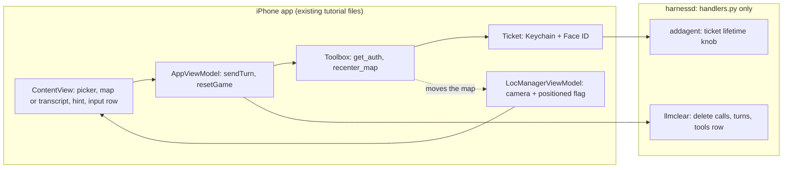
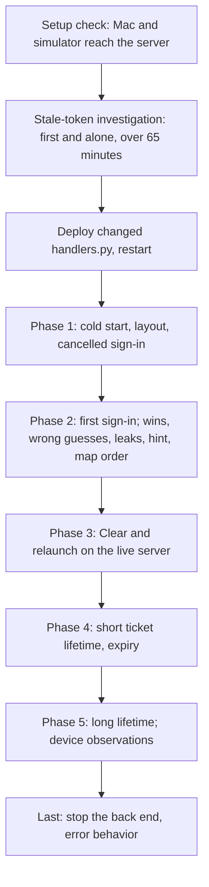
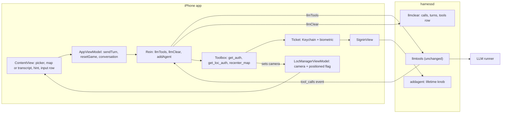
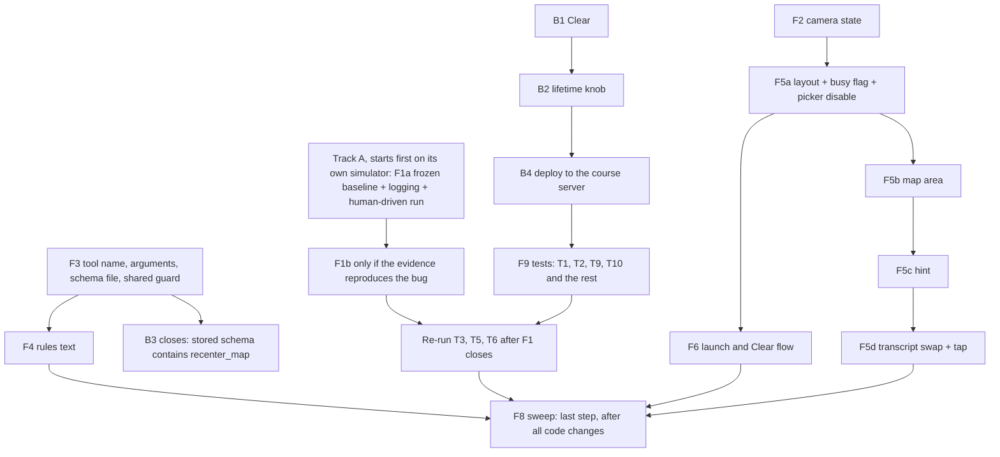
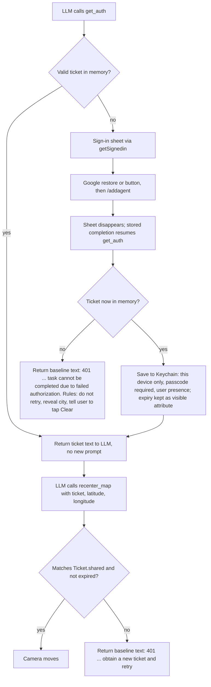
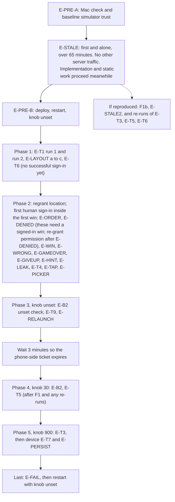

# Project 2 LLM Exhibits

All sessions were run as Claude subagents (Sonnet, medium reasoning effort) with the no-code prompt. Each Goldfish round was a fresh, isolated session that received only the documents listed for its role. Names: G-D = Goldfish 4, G-E = Goldfish 5, G-F = Goldfish 6, G-G = Goldfish 7. Every Goldfish round and its prompt is saved verbatim in the repository under project2/rounds.

## Audit table

Each row summarizes all the criticisms from all versions and rounds of one Goldfish, and only that Goldfish. Goldfish 4, 5 and 6 audited E-C; Goldfish 7 audited E-D. The verbatim critiques are in "Full final exhibits" (G-D = Goldfish 4, G-E = Goldfish 5, G-F = Goldfish 6, G-G = Goldfish 7).

| Exhibit Name | Key Criticisms Identified | Adjustment Made | Final Outcome |
|---|---|---|---|
| E-C, Goldfish 4 (product manager; 3 rounds on drafts v2 to v4) | **R1:** legacy sweep limited to new lines although staff say "your code"; stale-token fix planned before any evidence; unrequested extras (transcript swap, cached location, a database transaction); changes not declared as departures (floating Clear, "Begin" message, Face ID claim); new tool unnamed; hint behavior while sending undefined; denial and invalid ticket thought to share one 401 sentence. **R2:** Face ID reuse departure and the save-time cancel case unsettled; multi-round "play again" design unrequested; extra Clear cleanups and an invalid-ticket retry; departures table incomplete; no Python legacy check; stalled stream locks controls. **R3:** hint accumulation across a tool round, the picker lock and the dead screen without location permission missing from departures; legacy sweep "touched lines" undefined. | Rewrote the plan three times: tool named `recenter_map`; stale-token evidence first, fix conditional; cached location and transaction cut; Face ID and "tap Clear" fixed as owner decisions; departures table grew to 14 rows; "touched lines" defined; Python checks and accepted limits added. | Closed after round 3 (mostly small points); orchestrator edits gave E-C v5. |
| E-C, Goldfish 5 (technical reviewer; 2 rounds on v5 and v6) | **R1:** tests that could not pass or fail (picker switch during a send, Face ID not observable on a simulator, two outcomes under one label); stale-token run must use a frozen build; launch task must run once; comment-edit rule contradicted the sweep; unstated behaviors (hidden draft, keep chatting after a win, Keychain add versus replace); hardening asks (loop cap, wipe race). **R2:** "never jump to 0,0" not enforced by the validity check; done-when items needing a second app's rows or a manual trigger; T3 and T5 sequences; T2 location; "usually" pass lines; launch-time system sheets. | Rewrote tests as sample observations with counts; F1 on a frozen baseline with a result that can fail; (0,0) rejection and a finiteness gap noted; T1 to T5 sequences spelled out; limits L1 to L15 recorded. Hardening asks recorded as limits, not built. Fact check found the baseline already distinguishes denial from an invalid ticket, so a planned code change was removed. | Closed after round 2; orchestrator edits gave E-C v7. |
| E-C, Goldfish 6 (senior engineer; 2 rounds on v7 and v8) | **R1:** no variable name, test runner, zoom level or statement that the plan wins over input documents; F5 too large; ordering (stale-token track first, tool before rules, camera before screen); shared guard and schema wording unnamed; tests untagged. **R2:** mostly nitpicks: wrong "section 7" cross-reference, a circular step arrow, integer conversion of the environment variable, baseline win path assumption, server access details. | v8 added a "must not reopen" decisions block, order of work, F5 split into four sub-steps, test priorities and exact rules text; final edits fixed cross-references and the arrow. | E-C final: ready for a first pass on the code steps. |
| E-D, Goldfish 7 (QA lead; 3 rounds on v1, v2, v3) | **R1:** every "PASS" decided before any code exists; static checks that depend on runtime, people or models; keyword searches cannot prove absence; screenshots cannot see sub-second events; no checks that fail if a pin, Play Again or status row exists; plan too large. **R2:** hour-long stale-token run conflicts with other server use; NaN hole in coordinate checks; no runtime Send-disabled check; free-tier budget; degrees instead of distance. **R3:** E-ORDER and E-DENIED needed a signed-in win before the cancel test; hard pass lines resting on model wording; simulator Face ID precondition; S21 not a pass/fail row. | Static verdicts relabeled PENDING with named artifacts; scratch database for B1; screen recording and server logs as evidence; absence checks added; stale-token run first and alone; finiteness check made a static obligation; reference city table and distance tolerance; phases reordered. | E-D final: size cut by about 30 percent; remaining items listed in its section 10. |

# One-page summaries (chronological)

## Summary of E-C: Implementation Plan

**What it is.** An ordered, no-code plan for a coding agent to build the Mystery City game on the existing tutorial app. It follows the teaching staff's HW2 feedback and overrides the HW2 design where they conflict: the map is already centered on the user at launch (no default view), hints sit above the text box, and there is no pin, Play Again, Give Up, status row, timer, Retry or game-over detection.

**How to read the diagram.** Boxes in the left group are the iPhone app files that change; boxes in the right group are the one back-end file that changes. Arrows show who calls whom. The dashed arrow shows the only path that moves the map.



**What gets built.** Back end: `llmclear` also deletes the app's stored tool row; the ticket lifetime becomes an environment variable (default 180 s). Front end: a MapKit map bound to one camera value, set once at the first location fix and again by a new `recenter_map` tool (ticket, latitude, longitude); the LLM first calls `get_auth` to obtain the ticket (Google sign-in, Keychain, Face ID as in the tutorial); new city-game rules keep the city secret with the existing hidden marker; a hint area above the text box shows the newest assistant text; launch and Clear both wipe the server conversation and send the rules. After a win, a denial or a give-up the LLM tells the user to tap Clear.

**Also in the plan.** A stale-token evidence run on a frozen baseline build before any sign-in code changes; a checklist of legacy patterns to avoid; 14 recorded departures from the HW2 design; 15 accepted limits; ten must-run and nice-to-have tests.

## Summary of G-D: Product Manager critique (Goldfish 4)

Three fresh reviewers compared E-C with the HW2 design and the staff feedback. They found that the plan covered the feedback well but left real gaps: a legacy-pattern sweep scoped narrower than the staff wording, a code fix planned before its evidence, unrequested extras (a cached location, a database transaction, a multi-round "play again" design), several departures from HW2 left undeclared (layout, the first message, Face ID on reuse), an unnamed tool, and undefined hint behavior. After three rounds the remaining points were small, such as listing the hint-accumulation and picker-lock behaviors.

## Summary of G-E: Technical Reviewer critique (Goldfish 5)

Two fresh reviewers read E-C alone. Round 1 found tests that could not pass or fail as written (a picker switch during a send, a Face ID prompt invisible on a simulator, one label covering two outcomes), a stale-token run that any rebuild would kill, a launch task that could run twice, and contradictory comment and sweep rules. Round 2 found that the plan's "never jump to 0,0" claim was not enforced, several done-when items needed setup the plan did not provide, and some pass lines were unrealistic. Hardening requests (a tool-call loop cap, wipe-race locks) were recorded as accepted limits.

## Summary of G-F: Senior Engineer critique (Goldfish 6)

Two fresh reviewers judged whether an implementer could succeed on a first pass. Round 1 found missing decisions (variable name, test runner, zoom level, precedence over input documents), a step too large to implement in one pass, and ordering problems. Round 2 found the plan ready for the code steps, with nitpicks: a wrong cross-reference, one circular arrow, and missing integer conversion for the environment variable.

## Summary of E-D: Validation Plan

**What it is.** A plan to check every feature of E-C, split into two kinds of checks. Static checks are obligations to be settled by reading a named artifact, such as the diff, once code exists (so every verdict starts PENDING). Empirical tests have Gherkin acceptance criteria, a named environment, a sample size where the LLM is involved, and a performer (agent, human, or a real device).

**How to read the diagram.** Boxes are phases in the order they run; the investigation box runs first and alone because it needs the server quiet for over an hour.



**Highlights.** Clear is proved on a scratch database built from the live schema, with a negative control showing deleting turns first is refused. Sub-second events (a hint flashing, a default map frame, a leaked marker) are observed with screen recording and server logs, not screenshots. Absence of a pin, Play Again, status row, timer and Retry is checked by structural reads and by screens that would show them. The win test compares the map's destination with a fixed reference table of at least 15 cities within 25 km. Secure Enclave and biometric behavior is stated as documented, not validated. The plan also lists the accepted limits it does not validate.

## Summary of G-G: Lead QA critique (Goldfish 7)

Three fresh reviewers audited E-D. They found that early static verdicts could not fail because no code existed, that some static checks really depended on the runtime or a model, that keyword searches cannot prove a feature absent, and that screenshots cannot see sub-second events. Later rounds found a scheduling conflict between the hour-long run and other server use, a NaN gap in the coordinate checks, missing runtime checks (Send disabled when empty, a state that would fail if game-over detection existed), a phase-order conflict (a signed-in win needed before the cancel test), and pass lines resting on model wording. The plan shrank by about 30 percent and its static rows became obligations with named artifacts.

# Full final exhibits (chronological)

## Exhibit E-C (final): Project 2 Implementation Plan (full plan, no code)

Plan only. No code, no state changes. I read no third-party library source. I reread our own files, including `AgentApp.swift`, `ContentView.swift`, `ChatView.swift`, `Rein.swift`, `Toolbox.swift`, `runners.py` and `handlers.py`, for the facts below. Claims I cannot support from our call sites, public headers or docs are marked UNVERIFIED. Mermaid diagrams are the only code-like blocks.

## Decisions the implementer must not reopen (flagged for the owner to confirm)

1. Where any input document conflicts with this plan, this plan wins.
   - This plan was written to follow `staff_feedback.md`. If the implementer believes a staff item is violated, it reports that and does not resolve it silently.
2. **The hidden-marker format is reused exactly as the code has it.**
   - The marker is written as `[SECRET: <city>]`: square brackets, the capital word SECRET, a colon, a space, the city.
   - The matching prefix constant `secretPrefix`, which holds `[SECRET:`, is in `Rein.swift`.
   - The rules text that asks for it is `Game.rules`, in `AgentApp.swift`.
3. **Ticket lifetime variable:** `TICKET_LIFETIME_SECONDS`.
   - It is read in `handlers.py`, next to the definition of `TICKET_MAX_LIFETIME`, with default 180.
   - `TICKET_MAX_LIFETIME` keeps its name and is assigned from the variable.
4. **City-level zoom:** a map span of about 20 kilometres.
5. **Test runner:** Groq, `openai/gpt-oss-120b` (the first runner in `runners.toml`), unless it is unavailable.
   - Mechanism: the server picks runners by weighted random order per request, so "first in the file" does not pin anything.
   - To test on one runner, start the test server with only the Groq API key set. The local fallback stays as the last resort and shows in the server log if it is used.
   - Real device availability is unknown.
6. The course AGENTS.md, if supplied, governs both Swift and Python. CLAUDE.md governs otherwise.
7. The repository itself, not only the listed input files, is provided to the implementer.
8. **No biometric code is written.** Face ID behavior comes only from the existing `Ticket` code.
9. **The back end for B1 and B2 tests is the course server, reachable over ssh.**
   - Any write to the live database needs the owner's explicit go-ahead.
   - Deploying `handlers.py` and restarting `harnessd` also need that go-ahead (Q5).

## 0. Rules this plan follows

**Inputs given to the implementer**
- The course AGENTS.md (if supplied) or CLAUDE.md.
- `db_schema.sql`.
- `staff_feedback.md`, `design_specs.md` and `ui_requirements.md`.
- The repository.
- This plan.

**Sources**
- Staff feedback overrides the HW2 design document wherever they conflict.
- Reasoning uses only:
  - our own call sites,
  - public header documentation, and
  - the data we receive, such as a token's own contents.

**Baseline facts the implementer must not contradict**
- The two baseline authorization sentences, in `Toolbox.swift`, differ in their instruction though both begin with "401 Unauthorized":
  - `getLocAuth`, invalid or expired ticket: "401 Unauthorized. Call get_auth to obtain a new ticket and retry. Never reuse an old ticket."
  - `getAuth`, no ticket after the sign-in sheet closes: "401 Unauthorized. Complete the prompt by informing user that task cannot be completed due to failed authorization."
- `SubmitButton` sends the system draft and the user draft together, clears both, and reverts the role to user. Send is enabled when either draft has content.

**Owner decisions (fixed)**
1. Keep the tutorial extras: game picker, 20 Questions, role toggle, full transcript. The only addition is the map.
2. Clear starts a new game immediately: wipe, then re-send the rules.
3. The legacy sweep applies to new and touched lines only, as defined in section 8. Baseline offenders are reported, not fixed.
4. First frame is a plain progress indicator. Then the map appears, already centered on the user, at the first location fix only. There is no cached last-known location of our own.
5. The transcript is a user-opened, in-place swap for the map area. The hint area is the only always-visible text.
6. **Biometric timing is the tutorial behavior:**
   - Face ID happens when the Keychain item is read at launch, and when a ticket is saved.
   - A valid in-memory ticket is reused with no new prompt.
7. **After a win or a give-up, the LLM tells the user to tap Clear for a new game.**
   - A secret marker is written only at the start of a game.
   - There is no per-round marker, no "play another round in chat", and no play-again tests.

**Defaults (please confirm)**
- D1. The first message follows the tutorial: rules sent as the system message with no user message. Only if the test runner fails on it (an empty or odd first reply) do we add a short user message.
- D2. The system-drawn blue location dot is allowed.
- D3. The existing alert is kept for errors.
- D4. The tutorial tools stay registered: `get_loc_auth` on the phone, `get_weather_auth` on the server.
- D5. Send is enabled when either draft has non-whitespace text, because the requirement is "Send enabled only when there is something to send". Everything else about the role toggle is baseline.
- D6. No project-settings changes except the location permission text.

## 1. Departures from the HW2 design document

| # | HW2 said | This plan | Why |
|---|---|---|---|
| 1 | Decision F: full-bleed map, compact bottom panel, floating Clear | Tutorial layout: picker on top, map area, hint, one input row with Clear next to Send | Owner kept the tutorial layout |
| 2 | Rules plus a short "Begin" message | System-only first message (D1) | Follow the tutorial unless the runner fails |
| 3 | Pin, status row, Play Again button, Ended state, Decision C (game over detected from tool calls) | None of them | Staff feedback |
| 4 | 30 second timers and three kinds of Retry (Decision E) | None | Staff feedback |
| 5 | State machine: Starting, Ready, Sending, Error, Ended, Clearing | One busy flag (`isBusy`) in `AppViewModel`, as in the tutorial. Nothing models "ended". | Staff ban game-over detection and the status row |
| 6 | A failure shows one message with one Retry button | The tutorial's alert shows the error. There is no Retry. | Staff feedback |
| 7 | After a win the LLM invites the user to play again, and a Play again button appears. The requirements document also says the LLM "invites the user to play again". | After a win, a give-up or a denial, the LLM tells the user to tap Clear. No button is added. | Owner decision 7. This changes the requirement document's wording; flagged. |
| 8 | Ticket "saved behind Face ID, then read back with Face ID on each win" | Face ID at launch (Keychain read) and at save only. A valid in-memory ticket is reused with no new prompt. | Owner decision 6. This is how the tutorial code works. |
| 9 | Clear asks for confirmation | No confirmation (the baseline has none) | The only addition is the map (Q2) |
| 10 | Server unchanged | Server changes: `llmclear` and the lifetime knob | Staff feedback |
| 11 | Picker, 20 Questions, role toggle, transcript were not part of the HW2 screen | All kept; the transcript sits behind a toolbar swap | Owner decision 1 |
| 12 | Marker written in the first reply | Unchanged: marker only at the start of a game | Same design |
| 13 | A reply replaces the clue | The hint shows the newest non-whitespace assistant text. A reply that includes a tool round accumulates its pre-tool and post-tool text in one entry, so after a win the hint can show both | Tutorial reply handling is reused; no new state |
| 14 | Sending and Clearing blocked each other | The single busy flag also disables the game picker while a send or wipe runs | Changing the picker already wipes the conversation, so it behaves as Clear |

Denial handling is not a departure: the baseline's two 401 sentences already differ.

## 2. Schema facts (already done; not a task for the implementer)

The live schema dump `db_schema.sql` is read.

- **turns:** `turnID` is the primary key. `appID` and `prompt` are required. `reasoning` and `completion` are optional. A `completed` column exists that the code never uses.
  - There is an index on app and turn.
  - A trigger stamps a completion time after the completion is first set. It fires on updates, not deletes.
- **calls:** `id` alone is the primary key. It is not scoped to an app or a turn.
  - There is an ordering index on turn and call position, and a trigger that stamps the result time.
  - A foreign key points at the turns table with no cascade.
  - The server switches foreign keys on at startup (`main.py`).
- **tools:** `appID` is the primary key, with the schema blob and a timestamp.
- **tickets:** its own table, independent of everything above. A readable view of it shows expiration and creation time.
- Other views and a statistics table exist and are irrelevant to Clear.

**What this implies**
1. **Delete order is forced.** Calls go before turns. The existing two deletes are already in that order.
2. **The tools row has no dependants.** Deleting it is safe, and the next send re-upserts it.
3. **Do not touch tickets.**
4. **Risk: duplicate call ids.**
   - `calls.id` is globally unique, so a provider that reuses a call id would make an insert fail and produce an error event.
   - A win involves two tool rounds in one turn.
   - We cannot change the schema. This is sampled in T4 and reported.
5. **"Feed the LLM the current schema"** is read as: give the implementer this dump as the authoritative table definition. This is a guess to confirm (Q3).

## 3. Architecture (changes only)



The view model reaches the clear handler only through `Rein.llmClear`.

## 4. Order of work



- **Track A starts first.** F1a is built from the unmodified baseline plus only the temporary logging, before any other front-end change is installed on that simulator. It then runs for over an hour. All other work proceeds on other simulators without waiting for it.
- **Back end first:** B1 and B2 before anything that needs the server. B3 closes only after F3 exists, because the stored schema must contain the new tool.
- **F3 before F4**, because the rules name the tool, its arguments and the baseline sentences.
- **F2 before F5b**, because the map needs the camera state.
- **F1b lands only after the evidence,** and T3, T5 and T6 (which exercise `SigninView`) are re-run after F1 closes.
- **Tests need the back end deployed first** (B4).
- **F8 is last.**

## 5. Steps

**Step 0** is done (section 2). It is not a task for the implementer.

### Back end

**B1. Clear removes everything for the app ID** (`handlers.llmclear`)
- The app ID comes from the request body, as in the existing handler.
- Three plain deletes, in this order:
  1. the calls, selected by a subquery on this app's turn IDs (as the existing statement does),
  2. the app's turns,
  3. the app's row in the tools table.
- No single transaction. The existing handlers never use explicit transactions (the connection is in autocommit).
- A partial failure heals on the next Clear:
  - If calls are deleted and turns remain, the app is missing tool results until then.
  - If the tools row stays, the next fresh send overwrites it anyway.
- Reuse the existing error and log helpers. Do not touch tickets. No new endpoint or schema change.
- **The tools-row delete rests on a guess.** The professor's cut-off sentence "Clear deletes calls and turns but not stored tool schemas" is read as "Clear must also delete the tools row" (Q3).
  - It is reversible by removing that one statement.
  - The plan still works without it: the next fresh send re-upserts the row, so only T9's check changes, to "the tools row is overwritten, not absent".
- **Done when:**
  - after a game that included tool calls, read-only counts of this app's rows in turns, calls and tools are all zero, while another app's rows and all tickets are unchanged. This needs a second app ID's rows: use another app's existing rows if any, otherwise a test row written under a throwaway test app ID. That is a write to the live database and needs the owner's explicit go-ahead; delete it afterwards;
  - the sequence Clear, then a new send, works (T9).
- **Satisfies:** "adapt llmclear() to remove data cleanly"; the requirement that Clear removes history and prompts (system and user prompts live in the turns' prompt blob).

**B2. Tunable ticket lifetime** (`handlers.TICKET_MAX_LIFETIME`)
- Read the environment variable `TICKET_LIFETIME_SECONDS` once at startup, right where `TICKET_MAX_LIFETIME` is defined, with default 180. This follows the existing `RUNNERS_CONFIG` and `AGENTIC_ROOT` pattern. The variable arrives as text, so convert it to a whole number before the existing "smaller of" comparison.
- The existing rule stays: the lifetime is the smaller of this value and the Google token's remaining life.
- A non-numeric value is not handled. The server fails at startup, which is acceptable (no hardening).
- **Done when**, after a restart with the variable set to 20:
  - after a fresh sign-in (an old Google token would read lower than 20), the new row in the tickets table shows expiration minus creation time of about 20 seconds (read-only query through the readable view). The response body's `lifetime` field (confirmed present in `handlers.py`) is an optional extra check;
  - an unset variable gives 180 on the same check.
- **Satisfies:** "ticket lifetime is tunable".

**B3. Nothing else changes on the back end**
- `recenter_map` is phone-resident. Its schema rides in the existing tools field and is stored by the existing upsert.
- `toolbox.py`, routes and `/llmtools` are untouched.
- **Closes only after F3 exists.**
- **Done when:**
  - the harnessd diff touches only `handlers.py`;
  - after the first send from the new app, a read-only query of the tools row for the app ID shows a stored schema that contains `recenter_map` together with the other phone tools. This is deterministic, unlike waiting for the LLM to emit a tool-call event.
- **Satisfies:** "no change to API, data formats or schema; no new endpoints".

**B4. Deploy for tests (operational; needs the owner's go-ahead, Q5)**
- Server host, login, deploy path and database path are supplied to the implementer separately (they are not part of this exhibit); the database path is also named in the back end's `main.py`. B3's check is closed as part of the F9 tests, because it needs the new app and a deployed server.
- Copy the changed `handlers.py` to the course server over ssh and restart `harnessd`.
- How `harnessd` is started on the server is UNVERIFIED from the repository. The implementer finds out and reports it.
- Start it with `TICKET_LIFETIME_SECONDS` set when a test needs it (20 for T5; unset otherwise).
- For single-runner tests, start it with only the Groq key set (decision 5).
- All database checks are read-only queries on the server.
- The phone's existing back-end address constant in `Rein.swift` is not changed.
- **Done when:** a test send from the phone reaches the changed server and the log shows the chosen runner.

### Front end

**F1. Stale-token evidence FIRST, then a conditional fix** (file: `SigninView.swift` only)
- **F1a, evidence, its own track, before any sign-in code changes.**
  - **Frozen baseline build on its own simulator.**
    - Build the baseline once with only the temporary logging added.
    - Install it on a dedicated simulator that nothing else uses.
    - Do no further builds or runs on that simulator during the hour. Any rebuild replaces the running app and kills the run. All other development uses a different simulator.
  - **Server expiry check (from `handlers.py`):** the server verifies the ID token with the Google library's verifier and a 50 second clock-skew allowance, and answers 401 on failure. A token expired by more than about 50 seconds is rejected, so artifact 2 is informative.
  - **A person drives the run:** an interactive Google sign-in through the button, then keep the app alive for over an hour, then trigger any prompt that makes the baseline LLM call `get_auth` (for example, ask for the weather at the current location, since the baseline's win-free tools also need a ticket) so `get_auth` reaches the sign-in task again.
  - The coding agent supplies the analysis. It cannot perform the sign-in or the wait itself.
  - Read the public header documentation for the Google user's refresh call and for the current-user and restore calls. Quote it.
  - The temporary logging in `SigninView` records:
    1. which branch supplied the token (the current user's token or the silent restore);
    2. the ID token's `exp` claim, decoded from the string we receive;
    3. the wall-clock time just before the token is posted to `/addagent`.
  - Remove the logging afterwards.
- **The result must be able to fail.** The run counts as evidence only if the logs show the branch, the `exp` and the call time. Then:
  - `exp` earlier than the call time with the current-user branch means the bug is reproduced;
  - `exp` later than the call time means it is not reproduced;
  - a run in which the current-user branch was not used, or where values are missing, is inconclusive and must be repeated.
- **F1b, fix, only if F1a reproduces the bug.**
  - Delete the branch that prefers the current user's raw token. Always use the existing silent-restore helper. No new callback wrapper.
  - Whether silent restore itself refreshes an expired token is UNVERIFIED from public docs. Repeat the same frozen-build run after the fix.
  - Only if that run still shows a stale token, call the documented refresh-if-needed, and justify one wrapper in the same style as the existing helpers.
- **Artifacts captured for the professor, exactly:**
  1. the logged branch, `exp` and call time for each sign-in task;
  2. the server's accept or reject (HTTP status from `/addagent` and the server log line);
  3. the coding tool's own analysis of this one bug, which the person includes with the run.
- **Done when:** these three artifacts exist for the old code, and either the same run passes on the fixed code or the evidence shows "not reproduced" with valid logged values. Then T3, T5 and T6 are re-run.
- **Satisfies:** the professor's SigninView item ("show me your coding tool output just for this bug").

**F2. Camera state, first fix only** (`LocManagerViewModel` and `LocManager.startUpdates`, both in `LocManager.swift`)
- Add a map camera position and a single "positioned" flag to `LocManagerViewModel`. This follows the pattern where tool functions already read `LocManagerViewModel.shared`.
- **Two writers:**
  1. The first-fix writer runs only if the flag is unset, then sets it.
  2. The `recenter_map` writer runs on every call and also sets the flag.
- So the first-fix writer fires at most once per launch, and a late first fix can never overwrite a tool move.
- Later location updates change only the stored location that `get_loc_auth` reads.
- The first fix the system delivers may be coarse or cached. That is an accepted limit (L8), with no correction.
- **Prerequisite for any run on the simulator:** set a simulated location in the simulator and grant the permission. Without one, the progress indicator spins forever and nothing else can be tested.
- **Done when:**
  - with simulated location changes after launch, the camera moves once, at the first fix, and never again until a tool call (checked visually, or with a temporary counter that is removed afterwards);
  - with permission denied, only the progress indicator shows until `recenter_map` runs (L3).
- **Satisfies:** "map centered on the user's current location at launch; no default view; no later move".

**F3. The `recenter_map` tool, reusing the tutorial tool machinery** (files: `Toolbox.swift`, a new `tools/recenter_map.json` beside `get_loc_auth.json`)
- **Name:** `recenter_map`. It matches the tutorial's snake_case verb naming.
- **Arguments:** three string arguments in this order: `ticket`, `latitude`, `longitude`. This mirrors `get_weather_auth.json`, so the existing argument-order mechanism in `Toolbox.invoke` works unchanged.
- **Schema file** (the synchronized project group includes it automatically):
  - The description says the tool moves the map to the given coordinates and requires a ticket from `get_auth`.
  - It must say that coordinates are plain decimal numbers, with no degree signs and no N, S, E or W letters.
  - It must not copy the weather wording from `get_weather_auth.json`.
  - It must never mention a game or "game over".
  - The ticket parameter's description may reuse the baseline wording "Authorization ticket obtained from get_auth tool".
- **Shared guard:** a function in `Toolbox.swift`, named `ticketRejection(for:)`.
  - It takes the ticket argument.
  - It returns nothing when the ticket matches the current valid in-memory ticket.
  - Otherwise it returns the baseline invalid-ticket sentence, which moves into it unchanged.
  - `getLocAuth` and the new function both call it, so the sentence exists in one place.
- **Function:** a new phone-side function next to `getLocAuth`, registered in `Toolbox.init`, which does the following in order:
  1. It calls the shared guard and returns its sentence if there is one.
  2. It parses the two numbers. It returns an error sentence to the LLM, without moving the map, when:
     - either is not a number, or is not a finite number (Swift parses the text "nan" and "inf" as numbers, which a range test may not reject; the explicit finiteness test is a correctness check, not hardening),
     - the system's coordinate-validity check rejects the pair, or
     - the pair is exactly latitude 0 and longitude 0. The system check accepts that pair, and a model that omits or zeroes the arguments would send it. This rejection is a correctness check, not hardening, and must be kept.
  3. It sets the camera (a region of about 20 kilometres across, section 6) and the positioned flag.
  4. It returns a short success sentence.
- **Touched lines in `getLocAuth`:** extracting the guard makes the guard lines of `getLocAuth` touched. The sentence moves unchanged. The line returning its latitude and longitude ships unchanged.
- `getAuth` is not touched.
- **No extra plausibility checks** (such as whether the coordinates fit a country). That is hardening (L11).
- **Done when:**
  - a valid ticket makes the map fly to the coordinates;
  - garbage coordinates and (0, 0) return an error and the map stays;
  - the invalid-ticket branch cannot be triggered by a real model on demand. Verify it with a one-off manual tool call (a debug-only call with a wrong ticket string) or by reading the code, and report it as read-only verified if no trigger exists.
- **Satisfies:** "recenter tool needs a token"; "MUST reuse tutorial tools and functions"; no duplication; "the tool only moves the map".

**F4. Rules and secret city**

*F4a. Rules text* (`Game.rules`, the Guess-the-City case, in `AgentApp.swift`; 20 Questions rules are unchanged)

The rules say the following, in plain English. The implementer pastes this in spirit:

1. You are hosting a "Guess the City" game with the user. Choose a well-known city yourself.
2. On your very first reply, before any other text, write the hidden marker in exactly this form: `[SECRET: <the city you chose>]`, for example `[SECRET: Paris]`. It is hidden from the player and is how you remember your choice. Never contradict it. Write it once, at the start of the game, and never again.
3. After the marker, give a short welcome and one hint. Hints never include the city's name.
4. When the user guesses wrong or asks for a clue, give one new hint.
5. When the user guesses the city correctly, first call `get_auth` to obtain a ticket.
6. Then call `recenter_map` with that ticket and the city's latitude and longitude. Give the coordinates as plain decimal numbers (for example 48.8566 and 2.3522), negative for south and west, with no degree signs and no N, S, E or W letters, and never both zero.
7. After `recenter_map` succeeds, congratulate the user and tell them to tap Clear for a new game.
8. If `get_auth` reports that the task cannot be completed due to failed authorization, do not call it again. Tell the user authorization failed, reveal the city, and tell them to tap Clear.
9. If `recenter_map` reports a rejected ticket, follow the instruction in that message. No other retry rule applies.
10. If the user gives up, reveal the city and tell them to tap Clear.
11. After the game has ended, do not start another game. Remind the user to tap Clear.
12. Use only `get_auth` and `recenter_map`. Never call `recenter_map` before a correct guess.

*F4b. Confirm the existing marker stripper handles the marker.* **Yes, no code change is expected.**
- I read `Rein.stripSecretMarker`. It holds back the start of each reply until it either confirms the prefix `[SECRET:` and drops everything up to the first closing bracket, or rules the marker out and releases the text.
- It tolerates leading whitespace and newlines.
- The marker state is created fresh for each request, in `SseAccumulator`, so a later reply is stripped independently.
- A half-arrived marker never flashes, because the reply's visible text is only appended after the stripper releases it.
- It leaves any text after the bracket as it arrives, which can start with a space or newline. The hint computation (F5c) ignores whitespace-only text.
- **Known limit L4:** if the LLM opens a marker but never closes it within 120 characters, the held text is flushed as ordinary text and would be visible.
- The implementer must confirm this by running T13 and the first-hint check in T1, and only change the stripper if those fail. The format in the rules must match `secretPrefix` exactly, including its capital letters and the space after the colon.

- **Done when**, as sample observations of an LLM and not guarantees:
  - over ten fresh starts, the first visible hint never contains marker text, even mid-stream (T13);
  - in five correct-guess games, the observed order is `get_auth`, then `recenter_map`, then closing text that tells the user to tap Clear (T2);
  - a wrong guess leads to no tool call in at least 4 of 5 wrong guesses.
- **Satisfies:** "app sends rules; LLM picks the city; city fixed and secret"; owner decision 7.
- No game-state detection anywhere.

**F5. The screen.** The files and types:
- `ContentView.swift` holds `SubmitButton`, `RoleToggleButton`, `ClearButton` and `ContentView`. `ContentView` holds the game picker and its change handler that calls `resetGame`.
- `AgentApp.swift` holds `Game` (with `rules`), `AppViewModel` (with `isBusy`, `conversation`, `sendTurn`, `resetGame`) and `AgentApp`.
- `ChatView.swift` holds `Chat`, `ChatView` and `ConversationView`. All of these already exist and are reused.
- `LocManager.swift` holds `LocManagerViewModel`.

*F5a. Layout and the busy flag* (`ContentView.swift`)
- Restructure `ContentView`'s body into a plain vertical stack, top to bottom:
  1. the game picker,
  2. the map area, taking the remaining space,
  3. the hint area,
  4. one input row (text box, role toggle, Clear, Send).
- Disable the picker while `isBusy` is set.
- **Type changes:** `ContentView` (layout, picker disabled), and `SubmitButton` (its content test becomes whitespace-aware, D5).
- **Unchanged:** `ClearButton` (it is already disabled while busy and shows the same spinner) and `RoleToggleButton`.
- Both buttons show the spinner while busy, as the tutorial does today. The app does not know which button was tapped.
- **Done when:** during a send, the picker, Send and Clear are all disabled; a whitespace-only draft does not enable Send.

*F5b. Map area* (a small new view type in `ContentView.swift`, in the same style as `SubmitButton`; `LocManager.swift` from F2)
- Until the positioned flag is set: a progress indicator.
- After that: the system MapKit view (SwiftUI `Map`) bound to the camera in `LocManagerViewModel`, with the system location dot.
- **Done when:** with a simulated location, launch shows the progress indicator and then the map on that spot.

*F5c. Hint* (`AgentApp.swift` for the computed value, `ContentView.swift` for the display)
- A computed property on `AppViewModel`, with no new stored variable, returns the newest entry in `conversation` whose role begins with "assistant" and whose text contains a non-whitespace character. A whitespace-only entry, or a newline left over after the stripped marker, does not count.
- The role is a plain string in the baseline (it becomes "assistant (model)" after the first token), so compare by its prefix.
- The hint area displays that entry with the existing `ChatView`. Because `Chat` is observable, the text updates as it streams.
- Behavior:
  - Because `sendTurn` appends an empty reply entry before streaming, the previous hint stays visible until the new reply's first non-whitespace character arrives. Then the new reply replaces it.
  - Entries from the user or system roles are never shown, so a user message at the end of the list changes nothing.
  - Tool results are not in `conversation` at all. A tool round appends text to the same reply entry, so pre-tool and post-tool text accumulate there. If a tool round produces no text, the hint stays.
  - A connection error goes to the existing alert, and the previous hint remains.
  - A streaming parse failure makes the tutorial append its error text to the reply, and that becomes the shown hint.
  - After Clear, `conversation` is empty, so the hint is blank until the new rules reply arrives.
  - The hint area has a capped, scrollable height so a long reply cannot push the text box off screen.
- **Done when:** the hint sits directly above the text box with nothing overlapping, on a named phone-size simulator (for example an iPhone 17 Pro; record the device actually used).

*F5d. Transcript swap and tap behavior* (`ContentView.swift`)
- A toolbar button in the existing navigation bar toggles local view state that swaps the map area, in place, with `ConversationView`, and back. `ConversationView` is unchanged.
- The camera is kept in the model, so a recenter during the transcript view is not lost.
- The root tap currently toggles keyboard focus. Change it to dismiss only, and attach it to the parts other than the map area, so a map tap never pops the keyboard open.
- **Done when:** the transcript is reachable but never shown with the map, and a map tap does not open the keyboard.

- **Satisfies (F5 overall):** all four screen requirements; "hints above, not side by side"; owner decisions 1 and 5.

**F6. Launch and Clear flow** (`AppViewModel.resetGame`, the launch task on the root view in `ContentView.swift`)
- Launch calls the same function as the Clear button: wipe on the server (through `Rein.llmClear`), then send the rules.
- **Once per launch,** through the existing launch task:
  - it keeps the baseline guard that the conversation is empty;
  - it adds a check that the busy flag is not set. If the flag is set, the task returns silently, with no message and no alert;
  - both are needed, because during the wipe the conversation is still empty, so a rebuilt view could otherwise start a second wipe and a second set of rules;
  - the in-place transcript swap does not rebuild the root view.
- **Why launch changes from the baseline (not cut):** without the wipe, a relaunch stacks new rules on the previous game's history and its marker, so "the city stays fixed" breaks. This reuses `resetGame` and adds no new code.
- Clear's behavior is otherwise the baseline's `resetGame`: the wipe, empty the conversation, send the rules. The map and the Keychain ticket stay.
- There is **no Retry feature**: no button, no automatic retry, and no stored-state resume.
- **Baseline issue surfaced, not fixed.** If the wipe fails, `resetGame` still empties the screen and sends the rules, and `sendTurn` then blanks the error text, so the alert can show an empty message. Because the launch wipe is the first server call, it is the most likely place to see this (L9).
- **Done when:** relaunching mid-game gives a brand-new city with the previous game gone from the server (T10).
- **Satisfies:** owner decision 2 and the Clear requirement.

**F7. Housekeeping**
- Update the location permission text to say the app centers the map on the user.
- **Comment rule:** a comment that my change makes false is rewritten in place. No comment line is deleted unless it is replaced. Comments for removed code stay, as the project rules say.
- The Keychain item keeps its tutorial behavior of storing the ticket's expiry as a visible attribute. Nothing in this plan changes that.

**F8. Legacy sweep: the final step, performed by the implementer on its own diff**
- After every code change, including F1b, the implementer greps its own diff with every check in section 8 (Swift and Python), and the do-not-build list in section 9.
- For each check it records the search term used and the number of hits, and for each hit whether it sits on a touched line.
- The output is attached to the hand-off, together with the list of baseline offenders it saw and did not fix.
- **Done when:** every check shows zero hits on touched lines, or an explained exception.

**F9. Verification** (the Groq runner plus a named simulator; a real device only if available)

How the back end is run: B4 (the course server, changed `handlers.py` deployed, restarted with only the Groq key set, `TICKET_LIFETIME_SECONDS` set when a test needs it). All database checks are read-only queries on the server.

All LLM behavior below is a **sample observation of a model, not a guarantee**. Record the number of runs and the count of passes.

**Must-run: T1, T2, T9, T10, T6, T3.** T3 and T6 exercise `SigninView`, so they run after F1 closes.
**Nice-to-have: T4, T7, T11, T12b, T13, T5 if time, T8, T12a.** T5 also exercises `SigninView` and runs after F1 closes.

- **T1. Cold start (must-run).**
  - Prerequisites: simulated location set; fresh install; the back end is running (a stopped back end shows the blank-alert limit L9 instead).
  - Pass condition: the first hint arrives (a silent empty first reply is a failure). If the first reply is empty or odd on the chosen runner, apply the D1 contingency (add a short user message).
  - Observe together: the location permission prompt, a possible Face ID prompt or the launch advisory from the Keychain read, and any error alert (for example "No previous Ticket found" on a first run). Then the progress indicator, then the map on the simulated location. Any stream interruption by these system sheets is recorded (L13).
- **T2. Wrong guess, then right guess (must-run, 5 games).**
  - Set the simulated user location somewhere no well-known city sits, for example the middle of an ocean, so any move is visible.
  - Check that the destination matches the city the LLM named; "the map moved" alone passes a wrong place (L11).
  - Expected sample: the map flies away from the user to the city, and the closing text tells the user to tap Clear.
  - The case where the city equals the current view cannot be judged and is excluded.
- **T3. Right guess with a valid in-memory ticket (must-run, after F1 closes).** Sequence: win once, press Clear, then win a second game within the ticket lifetime (default 180 seconds). On the simulator, the only observable fact is that no sign-in sheet appears and the map moves. Whether a Face ID prompt would appear is not observable there.
- **T4. Two tool rounds in one turn (nice-to-have, 5 wins):** no server error event about duplicate call ids on this runner (read the back end's own log output on the server).
- **T5. Expired ticket, with the short B2 lifetime (nice-to-have, after F1 closes):**
  0. restart the back end with the short setting first;
  1. play a game and win, so the first sign-in saves a ticket;
  2. wait past the short lifetime;
  3. press Clear and play a new game;
  4. win a second time, so `get_auth` meets an expired ticket and runs the sign-in task again;
  5. the map moves.
  - It also checks the saved outcome. After the first run a Keychain item exists, so the later save is a replacement. Whether a prompt appears at that save is platform behavior to be OBSERVED and recorded, not assumed. Any error alert is recorded.
- **T6. Cancelled sign-in (must-run, after F1 closes, 3 runs).**
  - At the sign-in sheet, use Google's Cancel. The sheet cannot be swiped away (the baseline disables that).
  - Verified in `SigninView.swift`: when the sheet disappears, a stored completion resumes the waiting `get_auth` call. Every dismissal path (success, failure, cancel) sets the sheet off and so resumes it.
  - Expected sample: no hang; the LLM receives the failed-authorization sentence, does not call `get_auth` again, reveals the city and tells the user to tap Clear.
- **T7. Face ID cancelled or failed at save time after a successful sign-in (nice-to-have, device only).** The ticket is still usable in memory and `recenter_map` works (section 7). Without a device, report it as untested.
- **T8. Give-up text (nice-to-have, 3 runs):** the city is revealed and the user is told to tap Clear.
- **T9. Clear (must-run).**
  - During a send, Clear is disabled. Idle, Clear works.
  - After Clear, read-only counts show zero rows for the app in turns and calls, and zero in tools (or an overwritten row, if the tools delete was reverted, see B1).
  - After the first new send, the tools row exists again, and the LLM can call `get_auth` in that very first new game.
  - After Clear and a new send, no turn row for the app contains the previous game's city name (a read-only search of the stored text). In addition, ask the new game "what was the previous city?" as a sample observation.
- **T10. Relaunch mid-game (must-run):** a new city and a clean server state, with one wipe and one set of rules (not two).
- **T11. Picker (nice-to-have).**
  - While a send is in flight, assert that the picker, Send and Clear are all disabled.
  - Idle, switch the picker: the wipe runs, the conversation empties, and the new game's rules are sent.
  - Transcript swap: open and close it during a send, and confirm the hint area and the busy state are unaffected.
- **T12a. Connection failure (nice-to-have; for example, stop the back end):** an alert shows the error, and the previous hint stays.
- **T12b. Streaming parse failure (nice-to-have):** the tutorial appends its error text to the reply, so that text becomes the shown hint, and the alert shows. This needs a stub that returns a malformed stream line. If it cannot be induced, report it as untested.
- **T13. Ten fresh starts (nice-to-have; each through Clear):** count the starts in which any marker text is visible, including mid-stream. Report the count.
- **Done when:** every must-run test behaves as described, the sample counts are recorded, and a text search of the diff finds nothing from the do-not-build list. The launch-time mutual-disable check is observed with a slow or stopped back end so the state lasts long enough to see.

## 6. How the map actually moves

- The Map is the system MapKit view, SwiftUI's `Map`, bound two-way to a camera position value held in `LocManagerViewModel`.
- Moving the map means assigning that value a new camera centered on the given latitude and longitude, with a span of about 20 kilometres (decision 4), inside an animation so it visibly flies. User panning also updates the value, so the next assignment still wins.
- **Writers:**
  1. the first-fix writer, which fires at most once per launch;
  2. `recenter_map`, which fires on every successful call.
- **Rejected:**
  - MapKit's "follow user" camera (it follows continuously and needs a fallback view, which is a default view);
  - a wrapped UIKit map;
  - any marker, pin or annotation that we add for the city. The system-drawn location dot (D2) is the only marker-like item and is allowed.
- **Concurrency:** the project setting `SWIFT_DEFAULT_ACTOR_ISOLATION = MainActor` is set in both build configurations of `project.pbxproj`, together with `SWIFT_APPROACHABLE_CONCURRENCY = YES`.
  - Under that setting the tool function should be able to write the state with no explicit main-actor attribute and no dispatch queue.
  - That consequence comes from the Swift compiler's documented behavior. It is UNVERIFIED until the project builds. Confirm with a clean build.
- **Edge cases:**
  - Assigning an equal value does nothing, which is harmless and not judged in tests.
  - If the transcript is showing, the move still happens.

## 7. How the LLM obtains the token



**Biometric behavior (owner decision 6, decision 8), per the tutorial's real code. No biometric code is written.**
- **At launch,** `Ticket.open` reads the Keychain item.
  - On the simulator, it first runs a simulated biometric check.
  - If that check fails, the user sees an advisory ("Will acquire on sign in"), and the ticket is not loaded.
  - On a device, if the read itself fails or is cancelled, the user sees the error alert and the ticket is not loaded.
  - Either way, the next `get_auth` falls back to Google sign-in. It is not a denial.
- **A still-valid ticket in memory is reused with no new prompt.**
- **If Face ID is cancelled or fails at save time after a successful Google sign-in:**
  - The server ticket is already placed in memory before the save is attempted.
  - A save failure shows the error alert ("You will need to sign in again on relaunch").
  - The ticket stays usable in memory for its lifetime, so the sheet closes, `get_auth` returns the ticket, and `recenter_map` succeeds.
  - It is **not** a denial. Only the persistence to the Keychain is lost, so the next launch needs a new sign-in.
- **Replacement saves.** After the first run a Keychain item already exists, so later saves replace it rather than add one. Whether a given add or replacement prompts is platform behavior I cannot verify from our call sites. It is OBSERVED in T5 and T7, not assumed.
- The recenter check compares against the phone's own copy of the ticket. The server's tickets table is used only by `get_weather_auth`.
- The Secure Enclave wording is satisfied only through the tutorial's Keychain access control. No explicit Secure Enclave key is created.

## 8. Legacy-pattern checklist

**"Touched lines only", defined.**
- A line is touched if it is added, if its text changes, or if it moves into a different statement.
- Pure re-indentation, or reordering of unchanged statements, does not make a line touched.
- **One rule is chosen: the line, not the enclosing function.** Every check below applies to touched lines only.
- **Consequence for what legacy code ships:** a touched function can still contain a baseline offender on lines we do not change. Examples that ship unchanged:
  - `LocManager.startUpdates` keeps its `do/catch` and `print` (we change only the line that stores the location);
  - `getAuth` is not touched and keeps its continuation call;
  - `getLocAuth`: only the guard lines are touched (they move into the shared guard, the sentence unchanged); its return line ships unchanged;
  - the `ContentView` buttons keep their `foregroundColor` and `cornerRadius` lines unless the line itself changes;
  - `SigninView` keeps its two continuation helpers.
- So the legacy count after this project is about the baseline's. The guarantee is only that added and edited lines are clean.
- **Risk note.** The staff wording is "presence of these legacy patterns in your code will lead to automatic point deductions". It may be applied to the whole code base, not just our changes, so baseline offenders may still cost points. This is the owner's accepted scope.
- The alternative, "enclosing function", would fix more offenders but enlarge the diff beyond the request.

**Swift checks, run on touched lines (the F8 sweep)**
1. Search for `DispatchQueue`, `Task.sleep`, `Thread.sleep` and `RunLoop`: zero hits.
2. Search for `ObservableObject`, `@Published`, `@StateObject`, `@ObservedObject` and `@EnvironmentObject`: zero hits. `@Observable`, `@Environment` and `@Binding` are fine.
3. Search for `@MainActor`: zero hits.
4. Search for `ZStack` and `GeometryReader`: zero hits.
5. Search for `as?`, `as!` and `as `: zero new hits. Parse coordinates with a failable number conversion and validate with the system's coordinate-validity function.
6. Check every new `enum`: it must have cases.
7. Search for `do {` and `catch`: zero in new code. Use `Result`.
8. Review every new if/else that assigns a value: convert to an expression.
9. Touched views: use `foregroundStyle` and `clipShape`, not `foregroundColor` and `cornerRadius`, on touched lines.
10. Count new callback or continuation wrappers: zero, unless F1b is forced to add exactly one with its justification.
11. **Comments:** in the diff, count comment lines that are deleted without a replacement: zero. A comment made false is rewritten in place (F7).
12. Every new comment explains why, not what.
13. The invalid-ticket sentence appears in exactly one place on the phone, and the failed-authorization sentence is unchanged.
14. Names: every new identifier is a noun or a descriptive phrase for its function.

**Python checks for B1 and B2 (against the course AGENTS.md, or CLAUDE.md)**
1. No new import beyond what the change needs. B2 may need the standard `os` module.
2. No `threading`, `time.sleep`, `asyncio.get_event_loop`, or blocking calls in the handler. B1 uses the same awaited `rwdb` calls as today.
3. B1 contains no delete-then-insert. It is three pure deletes with bound `?` parameters and no string-built SQL.
4. B2 reads the variable once at import as a single expression with a default. No multi-line if/else, no config class, no argument parser.
5. Type hints, if any, use modern forms (`X | None`, built-in `list` and `dict`). Search for `Optional`, `List`, `Dict`, `typing.`: zero in changed lines.
6. Use f-strings only, no `.format(` and no `%` formatting.
7. No new helper function, class or wrapper for single-use code.
8. Errors reuse `_logClientErr`. No new broad exception handling beyond the one the handler already has.
9. The comment above the lifetime constant explains why it is tunable, and the existing "why capped" comment is kept.
10. **Indentation:** match the sibling lines in the same block (the same indentation run), because `handlers.py` mixes tabs and spaces. Do not reformat other lines.
11. No validation of the environment value beyond what the existing code does. That would be hardening.

**Baseline Python offenders, reported not fixed**
- `from __future__ import annotations` on a Python 3.14 project (`pyproject` requires 3.14 or newer).
- Mixed tabs and spaces in `handlers.py`.
- A synchronous `requests` session in `main.py`.
- Broad `except Exception` clauses.

**Baseline Swift offenders, reported not fixed**
- `do/catch`: `Rein.llmTools`, `Rein.processSse`, `Toolbox.jsonToSchema`, `LocManager.startUpdates`.
- Type assertions (`as?`): `Toolbox.invoke`, `Rein.addAgent`, `Rein` response casts (unavoidable), `Ticket`, `SigninView`, and the client-id lookup.
- Continuation helpers: two in `SigninView`, one in `getAuth`.
- Deprecated styling: `foregroundColor` and `cornerRadius` in `ContentView` and `ChatView`.
- `print` in `LocManager`; static mutable `isThinking` in `Rein`.
- Not found: dispatch queues, old property wrappers, layered stacks, geometry readers, caseless enums.

## 9. Do-not-build list

The tutorial extras (picker, 20 Questions, role toggle, transcript) are kept. No Clear confirmation is added (Q2). Still forbidden:
- Pin, marker or annotation that we add on the map.
- Play Again button.
- Give Up button.
- Status row or status line.
- Timers and any time limit.
- A Retry feature in any form (button, automatic retry, or resume from stored tool results).
- Game-over or "Ended" detection, including treating any tool call as a win signal.
- Any new endpoint, or any change to a data format or the SQLite schema.
- Security, scalability or reliability hardening beyond the spec: no tool-call loop cap, no locking against races, no extra coordinate plausibility checks.

## 10. Accepted limits (no hardening)

- **L1. Stalled or interrupted stream.**
  - With no timers (staff-mandated) and the kept mutual-disable rule, a stalled reply stream leaves Send, Clear and the picker disabled until the stream ends or the app is relaunched.
  - The same applies if the app is suspended, or the user switches to another app during sign-in, in the middle of a stream.
  - The tutorial request already carries a 20 minute request timeout (baseline, not added by this plan, so it does not conflict with the no-timer rule), and the server sends keep-alive pings. Whether those pings defeat that timeout is UNVERIFIED.
- **L2. Secrecy rests on LLM obedience.** The marker only hides the city from the screen, not from a model that ignores its rules.
- **L3. No location permission.** The area shows only the progress indicator, a dead screen, until the first `recenter_map`; then the map appears centered on the city. This is the tester-facing result.
- **L4. Unclosed marker.** After 120 characters the held text is shown.
- **L5. Duplicate call ids** from a provider could fail an insert (schema fact 4).
- **L6. Phone-side ticket check.** The recenter check is local, so the server's own ticket table is not consulted.
- **L7. One tester at a time.** The conversation is keyed by the app's bundle ID, so two devices on one back end share and wipe each other's game. Restarting the course server for tests also affects any other user of it.
- **L8. Coarse or cached first fix.** The system may deliver a coarse or cached location as the first fix, and the map then centers there.
- **L9. Launch wipe failure.** If the wipe fails, the screen can show an alert with a blank message (the baseline bug surfaced in F6, not fixed). It is most likely at launch, as the first server call.
- **L10. Wipe racing an unfinished server turn.** Pressing Clear or relaunching while the server still finishes a turn is not locked against.
- **L11. Wrong or oddly formatted coordinates.** A plausible-but-wrong coordinate, or a format that fails to parse (for example "48.85 N"), is accepted or rejected as is. A parse failure returns an error to the LLM, which may or may not recover.
- **L12. Keep chatting after a win.** The rules tell the LLM not to start another game, but nothing in code prevents it.
- **L13. Launch-time system sheets.** On a cold start the location prompt, the Keychain read (Face ID or the simulated check) and the wipe plus rules stream all start together. A system sheet appearing mid-stream can interrupt the stream and leave the controls locked until relaunch. This is the likeliest first-run lock-up and is accepted; T1 observes it.
- **L14. Tool arguments in the transcript.** The transcript view may show tool-call text, including coordinates, if a model calls `recenter_map` before a correct guess. Nothing guards it. The history lives on the server and the app never resends a stripped copy, so the marker stays in the model's context.
- **L15. Tool loop.** A stubborn model that loops on tool calls keeps the controls locked until relaunch. There is no loop cap (staff: no hardening).

## 11. Questions that still need the owner

1. **20 Questions wording (non-blocking, default: leave unchanged).** Its baseline rules still say "invite them to play again" and it never recenters. Owner decision 7 tells the city game to say "tap Clear". Should 20 Questions get the same wording?
2. **Clear confirmation (non-blocking, default: none).** The baseline has none. HW2 specified one, and the owner said to keep the extras. Adding one is a new feature and conflicts with "tapping it clears".
3. **The professor's cut-off sentence (non-blocking, but confirm before submission).** B1 reads it as "Clear must also delete the tools row", and reads "feed the LLM the current schema" as handing the implementer db_schema.sql. Both are guesses. B1's tools-row delete is reversible by removing one statement. Can you check them with the professor?
4. **Person for the stale-token run (blocking only for closing F1).** A person must do the interactive Google sign-in on a dedicated simulator and keep the app alive for over an hour. Who and when?
5. **Go-ahead for the course server (blocking for any test run, not for coding).** May the implementer deploy `handlers.py`, restart `harnessd` (with `TICKET_LIFETIME_SECONDS` set and only the Groq key set), and write one throwaway row under a test app ID for B1's check (deleted afterwards)? Restarting affects any other user of the server (L7).
6. **Real device (non-blocking).** Is one available? T7 (Face ID at save) cannot run without one.

## Full Exhibit G-D: Goldfish 4 critiques, verbatim (3 rounds)

### Goldfish4_round1: verbatim output

E-C v2 PM coverage review. Inputs read: design doc, staff feedback, E-C v2. No code read, no files written. Where E-C claims something about the baseline code, I could not check it, so I mark it as an E-C assertion.

Overall: E-C covers the design as overridden by staff reasonably well. The problems are (a) a legacy-pattern scope decision that likely loses points, (b) a stale-token fix sequenced before any evidence, (c) several unrequested UI extras, and (d) several quiet departures from the design.

## 1. Coverage of the design document

Overrides by staff are marked (S). "Handled correctly" means E-C removes or changes the item the way staff require.

- **One-screen game, map shows where you are.** Fully. F2, F5, D2 (location dot).
- **Floating Clear button, full-bleed map, compact bottom panel (Decision F).** Not covered, and not declared as an override. F5 is a plain vertical stack of picker, map, hint and input row, with Clear inside the input row. Decision F explicitly rejected "Clear beside Send". The owner's "keep tutorial extras" decision explains most of this, but E-C never says it departs from Decision F.
- **Clue panel above the guess box (S: "above, not side by side").** Fully. F5. Handled correctly.
- **Status line (S: removed).** Handled correctly. The do-not-build list (section 7) forbids it, and errors go to the existing alert (D7).
- **Pin (S: removed).** Handled correctly. Section 4 rejects annotations.
- **Map starts at the user's location (S: no default view, no later move).** Mostly. F2 and F5 use a spinner, then the map once, with later updates ignored. Two weaknesses:
  - The "cached last-known location" shortcut can centre the map on a stale location, which is not "current location".
  - The wording is ambiguous about whether the real first fix still moves the camera when a cached one was used. F2 says "moves exactly once"; section 4 says "assigned only twice".
- **Game states Starting, Ready, Sending, Error, Ended, Clearing (S: no Ended).** Handled correctly. No game-state machine is built (F4, section 7).
- **Network loop with 30 s limit and three Retry kinds (S: removed).** Handled correctly. Section 7 forbids both.
  - Wording clash: section 7 forbids "Retry, in any form", while F6 says "Pressing Clear again is the retry".
  - Side effect: a failed guess leaves no Retry and, per F5, the hint is already blank (see section 4, item 8).
- **Starting: wipe, then send rules plus a short "Begin" (Decision H: wipe at launch).** Partly.
  - Wipe at launch: covered (F6).
  - "Begin": reversed. D1 sends system-only rules, with "Begin" only as a contingency (F4, Q5). This is declared as a default, but it does not say it overrides the design.
- **Hidden city marker, stored and replayed by the server, stripped by the app (Decision B).** Partly.
  - F4 covers the rules text and the "no marker in first hint" check.
  - Gap: "the marker stripper in Rein" is named as if it already exists. No step says to build or change it for the streaming case, where a half-arrived marker could flash on screen.
  - Gap: nothing tests markers from a second round (D6).
- **Guessing: reply replaces the clue; give-up is plain text.** Fully. F4 and F5.
- **Winning: get_auth, then recenter_map, then closing text (Decision A).** Mostly.
  - The sequence is covered by F3, F4 and section 5.
  - The tool is never named. The design says `recenter_map`; E-C says "the recenter tool" everywhere. Naming must match tutorial conventions, so this is a real gap.
  - Ticket and coordinate checks are covered by F3, including a range check so the map never jumps to 0,0.
- **Face ID on read-back of the ticket.** Partly, with a quiet change. The design saves behind Face ID and reads back with Face ID each win. D4 does the biometric check "at launch and at ticket save, not on every get_auth" and reuses the in-memory ticket. D4 says this is "as in HW2", which is not accurate.
- **Ticket expiry kept as a visible Keychain attribute (Decision D).** Not mentioned. Likely tutorial behaviour, but E-C should say so.
- **Denial: map does not move, city is revealed in text.** Mostly. Section 5 and F4. The issue is that denial returns the same 401 text as an invalid ticket (see section 4, item 6).
- **Errors: one message.** Covered by D7, the existing alert.
- **Clear: confirmation, wipe, new game, map and ticket stay.** Partly.
  - Wipe, new game, and keeping the map and ticket: covered (B1, F6).
  - Confirmation: dropped (Q2). The reasoning is plausible, but see section 3 on inconsistent standards.
- **Decision C (watch tool calls to detect game over) (S: removed).** Handled correctly. F4 and F3 forbid game-state detection, and the tool description never mentions a game.
- **Decision E (timer and retry) (S: removed).** Handled correctly.
- **Decision G (MapKit).** Implied only. Section 4 says "Map view bound to a camera position" but never names MapKit. Fine in practice.
- **Decision H (no back-end change) (S: llmclear and ticket lifetime must change).** Handled correctly. B1, B2 and B3 limit the diff to `handlers.py` and add no endpoints.
- **Known limits (secret enforced only by LLM obedience, one tester at a time, same few cities).** Not restated, which is harmless.
  - The 3-minute ticket becomes a tunable default of 180 s (B2), which matches the staff feedback.

## 2. Staff feedback, item by item

- **Hints above the text box.** Fully. F5.
- **Map centred at launch, no default view.** Partly. F2 and F5 are right in intent. The cached-location shortcut and the ambiguity in section 1 weaken it.
- **No pin.** Fully. Section 4 and section 7.
- **No Play again.** Fully. Section 7. Note that F4 has the LLM "invite another round" and D6 allows a fresh marker. That is a reasonable natural-language replacement, but it is untested (F9 has no second-round scenario).
- **No status row.** Fully.
- **No timer, Retry or 30 s limit.** Fully.
- **"Clear deletes calls and turns but not stored tool schemas" (sentence cut off).** Partly.
  - B1 deletes calls, turns and the tools row, which is a plausible reading.
  - E-C never states that the professor's sentence is truncated and that its reading is a guess. That should be a question to the owner.
  - The claim "dropping the tools row is safe because the fresh-turn path re-sends and upserts schemas" is an unchecked E-C assertion. F9 does not explicitly test that the first turn after Clear gets its tools back.
- **"Ended after … a timer".** Fully. There is no Ended and no timer.
- **SigninView stale-token claim ("show me your Claude output just for this bug").** Partly.
  - E-C is honest that it cannot prove the claim from public documentation, and it plans an evidence run.
  - F1 still rewrites the code first, and its reasoning rests on the very claim it marks UNVERIFIED. The evidence should come before the fix.
  - The evidence needs a run more than an hour after the last sign-in (Q8) and is not produced yet, so the professor's request is only planned.
  - The possible new wrapper around a callback API adds a legacy-style pattern.
- **"How to recenter the map?"** Fully. Section 4 and F3 explain a single camera value, assigned inside an animation, by the tool.
- **Legacy patterns (automatic deductions).** Partly, and this is the weakest point.
  - The checklist covers the right rules.
  - Decision 3 sweeps only new and touched code and merely reports baseline offenders: `do/catch`, `withUnsafeContinuation` helpers, `foregroundColor` and `cornerRadius`, `print`, a static mutable `isThinking`, many manual type assertions.
  - Staff say "presence of these legacy patterns in your code will lead to automatic point deductions", and the graded submission includes that baseline code.
  - Three checklist rows say only "Check" (multi-line if/else, comments, naming). Those are placeholders, not results.
  - D5 keeps Swift language mode 5.0, which sits awkwardly with "Swift 6.2 default MainActor isolation" and the legacy rules.
- **Backend: feed the LLM the current schema.** Partly. Step 0 and Q7 plan it, but the schema has not been obtained.
  - E-C asserts "the definition is not in the repo" and lists the expected tables as guesses. A schema has to be created somewhere, so this claim should be challenged.
  - Q7 is marked blocking.
- **Backend: adapt llmclear.** Addressed by B1 (see the truncated-sentence caveat above).
- **Backend: ticket lifetime tunable.** Fully. B2.
- **Frontend: how the map is actually recentered.** Fully. Section 4 and F3.
- **Frontend: no Give Up, Play Again, status line or pin.** Fully.
- **No game-over detection; the move-map tool only moves the map.** Fully. F3 and F4.
- **Architecture: match tutorial structure and naming, reuse tutorial tools, avoid duplication.** Mostly.
  - F3 reuses the tool machinery and shares the ticket guard with `getLocAuth`.
  - The new tool's name is unspecified (see section 1).
  - Using the course AGENTS.md is implied by the checklist, not stated as a step.
- **No back-end API, data format or schema change; no new endpoints.** Fully. B3.
- **MRE scope, no hardening.** Mostly. See the items to cut in section 3.

## 3. Additions neither document asks for

Cut or reduce:
- **Transcript toggle in the toolbar, with an in-place swap over the map.**
  - This is the largest unrequested addition: new UI, and new behaviour on every state it touches.
  - It exists only because the tutorial transcript conflicts with "only current hints show" (Q1).
  - The simplest fix is to drop the transcript from the main screen, which Q1 already lists as an alternative.
  - It also drives the whole "avoid a second sheet" discussion.
  - The owner decision "keep extras" explains this, but E-C chose the expensive way to keep them.
- **Cached last-known location for an instant first frame.** This is an optimisation with a correctness risk (stale centre). Cut it.
- **Single database transaction in B1.** This is reliability hardening unless the existing handlers already use transactions. Cut it or justify it as matching existing style.
- **Hint area height cap and scrolling.** It is a small robustness measure. Justified if kept to one line of intent; otherwise cut.
- **Dismiss-only tap and "keep it off the map".** Small, but only needed if the transcript or map interaction conflicts. It follows from keeping a map on screen, so it is acceptable.
- **F9 scenario 10 ("each reachable runner") and real-device testing.** Heavy for an MRE (D10, Q9). Reduce it to one working runner plus the simulator.
- **Section 0 "Opaque Dependencies correction".** It is process history, not plan content. Trim it to the single rule: do not cite library source.

Justified:
- **Step 0 and B1 to B3.** Staff-requested.
- **F1.** Professor-requested, though the sequencing is wrong.
- **F3 coordinate range check.** The design asks the phone to check coordinates.
- **Spinner before the first fix.** It avoids a default view.
- **Keeping the tutorial tools `get_loc_auth` and `get_weather_auth` (D8).** Staff require reuse.
- **Picker and mutual-disable rules.** These come from the UI requirements document, which I did not receive. E-C cites it, so I accept this only on E-C's word.
- **Role-toggle Send gating.** It is a small consequence of keeping the toggle. Acceptable.
- **F7 permission text.** Needed for the permission prompt.
- **D6 fresh marker per round.** It is the natural-language replacement for Play again. Keep it, but add a test.

## 4. Contradictions E-C does not declare

1. **Inconsistent standard on "additions".** E-C refuses a one-line Clear confirmation (design feature) because "the only addition is the map", yet adds a transcript toolbar button, a swap view, a dismiss-only tap, a hint cap and draft-gated Send.
2. **Face ID.** D4 claims the tutorial approach is accepted "as in HW2". HW2 reads the ticket back with Face ID on each win. E-C reads it from memory, and it also adds a biometric prompt at launch, which the design never had.
3. **"Begin".** The design sends "Begin" with the rules. E-C does not, and does not say it overrides the design.
4. **Decision F.** E-C reintroduces "Clear beside Send" in the input row, which the design rejected, without saying so.
5. **"Retry, in any form" is forbidden (section 7), but F6 calls pressing Clear again "the retry".** This is wording, but it will confuse the implementer.
6. **Denial versus invalid ticket.**
   - Section 5 says denial returns the "existing 401 text", the same text as for a wrong ticket.
   - Section 5's diagram says on a 401 "LLM may call get_auth again".
   - The rules say to reveal the city on denial.
   - The LLM cannot tell denial from an invalid ticket, so it may loop on sign-in sheets. The design said `get_auth` reports "denied".
7. **F1.** The plan states it relies on nothing unverified, yet it changes sign-in code to fix a bug it marks UNVERIFIED, and it plans to produce the evidence only afterwards.
8. **F5 hint behaviour.**
   - It says "no new state" and "blank until the first token". That needs a placeholder entry for the new reply, or new state.
   - The hint is blank as soon as the user sends, because the user's message becomes the last entry. If the send then fails, the clue is gone with no Retry.
   - The last entry can also be a tool message during `get_auth`, which leaves the hint undefined.
9. **F5 single busy flag.** It says to "reuse the single busy flag, with the spinner on the button that was tapped". One flag cannot say which button was tapped.
10. **F2 camera.** "Cached location used at launch" and "camera moves exactly once" conflict when a real fix follows.
11. **Section 0 versus F1.** "Nothing below relies on [the withdrawn reading]" is stated, but the bug's reality is assumed by F1's design.
12. **Legacy scope versus staff wording.** Decision 3 reports offenders as "baseline", but staff penalise "your code".

## Verdict

The remaining critique is substantive, not nitpicks. First change: widen the legacy sweep to everything that will be graded, then cut the unrequested UI extras (transcript swap, cached location, transaction), fix the denial signal, and reorder F1 to run the evidence before changing the code.

### Goldfish4_round2: verbatim output

**Scope:** I read only the three input files. I could not check anything E-C cites from outside them (Goldfish 2 and 4 findings, db_schema.sql, the requirement doc, the tutorial code).

## 1. Coverage of the HW2 design document

Fully covered:
- **Rules, secret city, marker, welcome plus one hint (F4, F6):** the wipe then rules order, marker stripping, and give-up as plain text are all there.
- **Two phone tools (F3, F3b, section 6):** `get_auth` then `recenter_map`. The ticket and coordinate checks are included, and the 3-request win is the same as HW2.
- **Keychain ticket with a visible expiry (F7, section 6):** matches Decision D.
- **MapKit map (F5, section 5):** matches Decision G.
- **Clear keeps the map and the Keychain ticket (F6).**
- **Wipe at launch (F6):** matches Decision H, rejected option 3.
- **No back-end change:** E-C says so in B3, but it actually changes the server (row 6).

Overrides by staff feedback, handled correctly:
- **Pin, status row, Play Again, Ended, Decision C (game-over detection):** removed (departure 3, section 8, F4 "no game-state detection").
- **Timer and Retry, Decision E:** removed (departure 4, F6, section 8).
- **Server changes:** B1 and B2 (departure 6).

Partly covered or weakened:
- **Layout (Decision F):** the full-bleed map, compact bottom panel and floating Clear are replaced by the tutorial layout (departure 1). This was fixed by the owner, but the HW2 "map-dominant, only current hints show" intent is now carried by the transcript swap (owner decision 5).
- **Denial (HW2 item 4):** HW2 said cancelled sign-in or Face ID leads to denial. E-C covers sign-in failure (F3b) and says a failed Face ID check at launch is not a denial (section 9).
  - It never says what happens if Face ID is cancelled at save time, after a successful Google sign-in. F3b defines denial as "no ticket after the sheet closes". If the ticket stays in memory, that cancelled Face ID would not be a denial.
- **Face ID on every win:** E-C drops it when a valid ticket is in memory (departure 5). This is the biggest departure that staff did not ask for, and it is only a "default, please confirm".
  - The effect is narrow: with a 3-minute ticket, Face ID is skipped only on reuse within the lifetime.
  - If the original assignment says each retrieval needs biometrics, this is a requirement failure. It should be confirmed before building, not defaulted.
- **After a give-up:** HW2 told the user to tap Clear. F4 says only "reveal the city". Nothing says what the user does next, and T10 tests only the text.

Not covered:
- **HW2 known limits:** one tester at a time, the LLM favouring the same cities, and the secret depending on LLM obedience are not restated. This is harmless.
- **Error recovery in HW2:** "one message, one Retry, Send disabled" is gone. That is correct per staff.

Missing from the section 1 departures table:
- **State machine:** the HW2 states Starting, Ready, Sending, Error and Clearing are replaced by one busy flag. Only "Ended" is listed.
- **Added screen elements:** picker, 20 Questions, role toggle and transcript swap appear only in section 0. Row 1 says only "tutorial layout".
- **Face ID as denial trigger:** this appears only in section 9 and Q4.
- **Give-up wording:** the "tap Clear" instruction was dropped.
- **Per-round fresh markers (D6):** this changes Decision B's "city stays fixed" and is not in the table.
- **Small change (same source):** error display moves to the tutorial alert (D7), replacing the HW2 single message plus Retry.

## 2. Staff feedback, item by item

**Professor's list**
- **Hints above the text box:** fully (F5).
- **Map centered on the user at launch, no default view:** mostly (F2, owner decision 4, which is fixed).
  - The user first sees a progress indicator, not a map.
  - With location permission denied or no fix, there is no map at all until a `recenter_map` call (Q5). That is neither "map upon launch" nor a default view.
- **No pin:** fully (section 5 rejects it, section 8 forbids it). The system location dot (D2) is allowed.
- **No Play Again:** fully (section 8).
- **No status row:** fully. The stale-hint behavior in F5 is not a status row.
- **Timer and Retry:** fully (section 8, F6).
- **"Clear deletes calls and turns but not stored tool schemas" (cut off):** partly (B1, Q3).
  - E-C guesses "also delete the tools row" and asks the owner to check with the professor.
  - The guess is low risk: the tools row is rewritten on each send (T7 checks this), so it is harmless either way.
- **No timer ending the game:** fully.
- **Stale sign-in token:** fully in design (F1a evidence, F1b conditional fix). Two gaps:
  - "Done when" asks for a recorded run, not the coding-tool output the professor asked to see.
  - The run needs a person to do the Google sign-in and wait over an hour.
- **How to recenter the map:** fully (section 5, F3).
- **Legacy patterns:** fully for new and touched Swift code (section 7), with the baseline risk stated. See sections 3 and 4 for gaps.

**Course page**
- **Feed the current schema (Step 0):** partly. The reading is a guess (Q3).
- **Adapt llmclear (B1):** fully.
- **Tunable ticket lifetime (B2):** fully.
- **Map recentered on a given latitude and longitude, separate from the auth path:** fully (section 5 is separate from section 6).
- **Map centered on launch:** see above, mostly.
- **No Give Up, Play Again, status line or pin:** fully.
- **No game-over detection:** fully. F3 says the tool "never mentions a game".
- **Tutorial structure, tool reuse, no duplication, no API, format or schema change, no new endpoints:** fully (F3 shares the invalid-ticket guard, B3).
- **Use the course AGENTS.md:** partly. E-C applies its rules in section 7 but never says the coding agent is given the file.
- **MRE scope:** mostly. See section 3.

## 3. Things E-C adds that nobody asked for

Cut or shrink:
- **D6 plus "invite another round" plus T6 and T8:** this is a new multi-round design.
  - It creates the stacked-marker problem, the call-order tie, and two extra tests.
  - Staff said "interactions are by NLP", which does not require an in-conversation replay.
  - Cut it, or follow the give-up pattern and tell the user to tap Clear.
- **F6 extras:** "removes the baseline's stale-error and half-reset behavior", and Clear also emptying both drafts. This is unrequested bug fixing and breaks the "every changed line traces to the request" rule.
- **F4 "call `get_auth` once and retry on an invalid ticket":** this is reliability hardening. It is cheap, but unrequested. Cut it, or accept the baseline 401 text as it is.
- **Section 10:** ten questions, mostly "non-blocking", plus an option to ask the professor. Q2 and Q8 are out of scope. Trim to the blocking items (Face ID, the cut-off sentence, no-permission behavior).

Keep, but justify:
- **Capped, scrollable hint (F5):** needed so the text box stays on screen. Keep.
- **Picker disabled while busy (F5, "new"):** needed only because the owner kept the picker. Acceptable.
- **Coordinate validation (F3):** HW2 asked for it. Keep.
- **Duplicate call-id risk and test T4 (section 2):** reasonable verification, not hardening.

## 4. Undeclared contradictions

- **Fixed or open:** owner decision 2 (Clear starts immediately) and departure 7 and section 8 treat "no confirmation" as settled. Q1 asks the owner again.
- **"Touched lines only" has no definition.** F2 edits `LocManager.startUpdates`, which E-C lists as a do/catch and print offender. F3b edits `getAuth`, a continuation offender. F5 touches views with deprecated styling. The line-versus-function rule changes how much legacy code ships.
- **Staff's literal legacy list:** it includes type assertions, and E-C reports baseline `as?` in several places and leaves them. The owner fixed this scope, so I am only flagging that the staff wording risks an automatic deduction.
- **No Python legacy check:** the professor warned about "mixed-language" legacy code. Section 7 has Swift checks only, plus one Python delete rule.
- **No timeout, but Send, Clear and the picker are disabled while busy.** A stalled stream leaves Clear disabled, and only a relaunch recovers. This follows from the staff-mandated removal of timers and from the kept mutual-disable rule. E-C does not acknowledge it.
- **Unmarked claim:** "the project defaults to main-actor isolation" (section 5) is not marked UNVERIFIED, though D5 and check 3 rely on it. This breaks E-C's own marking rule.
- **Smaller points:**
  - F1's file list names `Ticket` and `Rein.addAgent`, but the body only edits `SigninView`.
  - The section 3 diagram draws the view model calling the clear handler directly, while the diagram's `Rein` box lists the clear call.
  - Section 5 rejects "any annotation" while D2 keeps the location dot.

## Verdict

Mostly small points. E-C covers the staff feedback and nearly all of the HW2 design. The substantive items are few:
1. The Face ID reuse departure and the unstated save-time cancel case.
2. D6 and the extra F6 cleanups, which are unrequested scope.
3. An incomplete departures table.

Change first: settle the Face ID and denial behavior, then cut D6, T6, T8 and the F6 extras, then finish the section 1 table.

### Goldfish4_round3: verbatim output

PM COVERAGE REVIEW OF E-C v4 (read only the three files; no code)

Short answer: E-C covers the design as overridden by staff feedback, with a handful of real gaps. Five need attention: no stop-gap for the map's first appearance when location is denied (L3 is partly a contradiction), a hint-versus-transcript requirement conflict, the "Clear confirmation" dropped without it being listed in the departures table accurately, the stale-token item (F1) being a plan to gather evidence rather than an answer, and a few places where E-C quietly adds scope.

## 1. Coverage of the design document

How the design reads once staff feedback is applied: one-screen game; LLM picks secret city; hidden marker; guess; win via get_auth then recenter_map; denial path; Clear; known limits.

- One-screen iPhone game, map-dominant, bottom panel: PARTLY. E-C Departure 1 (F5) replaces Decision F's full-bleed map with the tutorial layout (picker on top, map, hint, input row). The map is no longer dominant, and the panel/floating Clear are gone. Declared in section 1, row 1. Acceptable as an owner call, but F5 gives no sizing rule saying the map takes "the remaining space" while a capped hint area is on screen, so "map-dominant" is not guaranteed.
- Map centered on the user at launch, no default view: FULLY via owner decision 4, F2, F5. One gap: with location permission denied, the user sees only a spinner forever (L3). The staff said "no default view", so this is defensible, but the game is then visibly broken before the first win. E-C should say plainly this is a dead screen, not just "limit".
- LLM chooses the city, never the app (Decision B, marker stored and replayed): FULLY (F4, Departure 12). The "Begin" message is dropped (Departure 2, D1) and it is declared. Note D1 is a default, not a decision, and has a fallback "only if a runner fails". That leaves the first-message behavior untested across runners, because D8 tests only one runner.
- Marker stripped before display: FULLY (F4, T13). L4 (unclosed marker after 120 characters shows) is a known leak. Fine for a prototype.
- Guess replaces the hint: PARTLY. Design says the reply replaces the clue. F5's hint area shows the newest non-empty assistant text, and also says tool rounds "append text to the same reply entry, so pre-tool and post-tool text accumulate". So after a win the hint can show welcome-to-closing text mashed together rather than a clean replacement. Not stated as a departure.
- Give-up as plain text: FULLY (F4, T8).
- Win: get_auth then recenter_map with ticket and coordinates (Decision A): FULLY (F3, F4, section 5/6, T2). The design says the phone "checks the ticket and the coordinates"; F3 does both and refuses to jump to 0,0. Good.
- Pin on success: DROPPED, correctly, by staff override (Departure 3). Correct.
- Closing text, then Ended + Play again: DROPPED (staff), replaced by "tap Clear" (owner decision 7, Departure 7). Handled correctly, and E-C flags that this changes the requirement document's wording ("invites the user to play again"). Substantive: the staff said no Play Again button and "interactions are by NLP", but they did not say the LLM may not invite another round in chat. Owner decision 7 forbids even that. That is a tightening beyond the feedback. Fine as an owner decision, but E-C should not present it as feedback-driven.
- Denial path (Decision C, point 4): FULLY and better than the design (F3b, T6). It does add a distinct "denied" string, which is new tool-result wording, justified because the LLM must tell denial from expiry.
- Errors and 30 s timer, three Retry kinds (Decision E): DROPPED by staff (Departure 4, 6). Correct.
- Clear asks for confirmation: DROPPED by owner/E-C (Departure 9). Declared. Reason given ("the only addition is the map") is weak: the design specified it, the staff did not forbid it, and E-C itself says in Q2 it conflicts with "tapping it clears". Leaving it out is probably right, but the table's stated "why" does not match the open Q2.
- Clear wipes through existing /llmclear, starts a new game, map and Keychain ticket stay: FULLY (B1, F6, T9). Extra: the design said server unchanged, E-C changes llmclear (Departure 10, staff-driven). Correct.
- Ticket lasts at most 3 minutes: FULLY, as a tunable (B2), default 180. Staff overrides "fixed value". Correct.
- Face ID on each win (design point 3): OVERRIDDEN by owner decision 6 (Departure 8). Declared, and honestly admits HW2 overstated it. Note, however, that Keychain item is "Face ID or passcode to read" per Decision D; E-C section 6 says the simulator and device behave differently at launch. Consistent.
- Decision D (tutorial Keychain, expiry as visible attribute): FULLY (F7, section 6). Secure Enclave wording is explicitly not met (stated in section 6). Admitted rather than hidden. Good.
- Decision G (MapKit): FULLY (F5, section 5).
- Decision H (no back-end change, one tester at a time, wipe at launch): PARTLY. Wipe at launch is covered (F6). The "no back-end change" part is changed by staff (B1, B2). One-tester-at-a-time is not listed in E-C's accepted limits L1-L6 even though the design listed it. Minor omission.
- "Known limits we accept": the design's limits are mostly reproduced; "LLM tends to choose the same few cities" and "timeout can damage conversation" are not carried over. The second is moot (no timers). Not a real gap.
- "Tools stay registered" (D5): get_loc_auth and get_weather_auth remain. Not in the design; see section 3 below.

Missing from the section 1 departures table:
- The hint replaces/accumulates behaviour (see above).
- Dropping the design's "Sending/Clearing" reflected as disabled buttons: E-C keeps a busy flag and ALSO adds disabling the picker (F5 "new"), which is a behavior the design never had. Not in the table.
- The design's "Send disabled during retry states": gone with Retry, correctly implied by Departure 6.
- Design's "status line": covered under Departure 3.
- Owner decision 5 (transcript swap) is under Departure 11, ok.
So the table is nearly complete; the two not listed are the hint-accumulation behavior and the picker-disable addition.

## 2. Staff feedback, item by item

1. Hints above the text box, not side by side: FULLY (F5 layout: hint directly above input row; done-when says so).
2. Map centered on current location at launch, no default view, no move afterwards: PARTLY. F2/F5 deliver it, but a first frame spinner is not a map "upon launch", and denied permission means no map (L3). Owner decision 4 accepts this. Real conflict: staff wording says "Upon launch shows the map centered on user's location"; a spinner until the first fix is the closest feasible. It is declared. Counts as addressed, with the L3 caveat.
3. No pin: FULLY (do-not-build list, section 5 "Rejected"). The blue system location dot is kept (D2); staff said no "marker/pin" for the city, so this is consistent but is a judgment call and appears only as a default (D2) to confirm.
4. No "Play again": FULLY (Departure 3, 7, do-not-build).
5. No status row: FULLY.
6. No timer/Retry/hardening: FULLY on timers and Retry (Departure 4, 6, do-not-build). PARTLY on "no reliability hardening": see section 3 below (mutual-disable rule, whitespace rule, ticket-lifetime knob validation notes, T4 call-id testing, 120-character flush).
7. Clear sentence (cut off): PARTLY, openly. B1 guesses "must also delete the tools row" and asks the owner to confirm (Q3). It cannot be fully addressed without the professor. E-C is honest about this. Note a risk it half-notes: deleting the tools row is harmless only if the next send re-registers it; T9 tests this.
8. "Ended after a timer": FULLY (no timers, no Ended state).
9. SigninView stale token: PARTLY. F1 is an investigation plan, conditional on a person running an hour-long test (Q4 is blocking for closing F1). The professor's demand is: show your coding tool's output if you are sure. E-C does not claim certainty, which is correct, but the deliverable cannot exist until someone runs it, so this item is not "addressed" in the plan itself, only scheduled. Substantive: F1a also adds temporary logging in the code, then removes it; that is reasonable but the "remove logging afterwards" has to be policed.
10. How to recenter the map: FULLY (section 5, F3). Clear and specific. One UNVERIFIED claim (main-actor behavior) is flagged honestly.
11. Legacy patterns: PARTLY. Section 7 covers new and touched lines only (owner decision 3). The staff wording says presence in "your code" causes automatic deductions, and E-C itself notes baseline offenders will ship (do/catch, as?, continuations, foregroundColor, print, a static mutable isThinking). So the likely deduction risk is acknowledged but left. Owner decision, flagged. Also: a staff-listed rule says caseless enums, MainActor use "must be justified", ZStack/GeometryReader "must be justified"; E-C sets @MainActor and ZStack/GeometryReader to zero hits, which is stricter than "justified" and fine.
12. Backend: feed LLM the schema: FULLY as interpreted (Step 0, section 2), with the guess in Q3 flagged.
13. Backend: adapt llmclear: FULLY (B1).
14. Backend: ticket lifetime tunable: FULLY (B2). E-C picks an environment variable read at startup; staff just say tunable. Fine.
15. Frontend: map recentered on lat/long: FULLY (F3, section 5).
16. No Give Up, Play Again, status line, marker/pin: FULLY.
17. Game-over detection must not be done; recenter tool must only move the map: FULLY (F3 schema text never mentions the game; "no game-state detection anywhere"). One caution: F3b makes `get_auth` return a distinct "denied" string and tells the LLM how to behave. That is not game-over detection in the app, since the LLM, not the app, reacts. Passes.
18. Architecture: reuse tutorial tools, no duplication, no API/schema/endpoint change: FULLY (F3, B3). One possible friction: F3 step 1 refactors the 401 guard so both getLocAuth and recenter_map share it. That edits an existing function to avoid duplication, which is what staff want, but conflicts with the "touched lines" scoping and with "baseline text accepted as is". Small.
19. Naming/structure match tutorials: FULLY (recenter_map naming, schema file beside the others).
20. MRE scope: PARTLY, see section 3.
21. Use the course AGENTS.md: PARTLY. The repo contains only CLAUDE.md; E-C assumes AGENTS.md is supplied. Section 7 uses CLAUDE.md as a stand-in for Python checks. This depends on an input the owner has not confirmed.

## 3. What E-C adds that nobody asked for

Cut or reconsider:
- Disabling the picker while busy (F5, "new"): not in the design or the feedback. Cut it. It also causes the L1 problem (a stalled stream locks the whole screen).
- Whitespace-only text is not sendable (D6) and the "currently shown draft" rule for the role toggle: this is input validation nobody requested. Cut or keep only if the tutorial already does it.
- Capped, scrollable hint area (F5): defensible usability, but it is design the requirement did not ask for. Keep only if the hint is long in practice; otherwise cut.
- Making the root tap "dismiss-only and off the map" (F5): a bug fix for a problem the map introduces. Justified because without it the map tap opens the keyboard. Keep.
- Parsing and validating coordinates, "map must never jump to 0,0" (F3 step 2): lightweight, and tied to the design ("the phone checks the ticket and the coordinates"). Keep, but do not expand.
- F3b distinct "denied" text: justified by the design's denial path.
- F6 launch-time wipe: justified (Decision H, rejected 3). Keep.
- T4 (duplicate call id check), T7 (Face ID on a real device), T11, T12: extra test cases that exist partly to verify hardening-flavored concerns. T4 is justified because staff added tool calls and the schema forbids a second call with the same id. T7 and the "ticket stays usable in memory" analysis are not asked for by anyone; they are explanations of tutorial behavior. Treat as optional.
- F1a's temporary logging and a one-hour manual run: the professor asked for evidence only if sure. Keep, since it is the cheapest way to answer, but keep it clearly separate from the app.
- Sections 6 and 7's very long explanations of biometric behavior and legacy checklists: not wrong, but heavy for an MRE. Section 7's 14 Swift checks and 11 Python checks are process, not product scope. Fine as guidance, but consider trimming.
- Section 10 (Goldfish findings) is review history, not plan content. Remove from the plan the coding agent receives.
- L1-L6 and the baseline-offender lists: reporting is fine, but they are noise in the plan.
- D2 keeps the system blue dot: needed for "shows where you are". Fine.

## 4. Contradictions E-C does not declare

1. L3 versus "no default view": F2 says the area is a spinner until a fix or until recenter_map runs; L3 then says the map "appears centered on the city" after a first win. That means in the denied-permission case the user sees a map that moves to a city while no user location exists, but the plan also says the positioned flag is set by recenter_map. This is consistent but means the map's first-ever appearance can be the answer, which also reveals the city only after a win, so not a leak. Acceptable but the tester-facing result (nothing on screen for the entire game until a win) should be called out as the actual user experience.
2. "A single busy flag disables Send, Clear and the picker" (F5) versus owner decision 2 ("Clear starts a new game immediately"): if Clear is disabled while a send is running and a stalled stream (L1) never ends, the user cannot Clear. E-C accepts this in L1, but it contradicts the point of Clear as the only way out of a stuck game.
3. Hint rule versus "tool rounds append text to the same reply entry": the design's "reply replaces the clue" and the staff's "hints appear above the text box" are served, but the plan says pre-tool and post-tool text accumulate. After a win the hint will show the full closing text, possibly with earlier pre-tool text. Not a contradiction with the requirement, but it contradicts the design sentence and is not in the departures table.
4. Decision 7 versus the requirement doc: E-C quotes the requirement document ("invites the user to play again") and then overrides it (Departure 7). It flags this, so it is declared; but the 20 Questions rules still say "invite them to play again" (Q1), so the two games now behave inconsistently. Declared as a question, defaults to leaving it.
5. D5 keeps `get_weather_auth` and `get_loc_auth` registered, while the "Do-not-build" and "MRE" principles argue for minimum surface. Also the LLM may call those tools in a city game. Not a contradiction with the sources, but it leaves unexplained tool surface in the game prompt. Also F3 step 1 refactors the guard "used by getLocAuth", which means getLocAuth is touched, in tension with D5's "stay registered" as-is and the section 7 touched-line rule.
6. Section 0 says "Reasoning uses only our own call sites, public header documentation..."; yet section 5 states Swift-compiler consequences (main-actor default isolation) and section 6 describes platform Keychain/biometric behavior from "the tutorial's real code". These are partly marked UNVERIFIED, partly stated flatly. The tutorial code itself was not given as an input here; I can only note this as unverified from the three files.
7. Owner decision 6 versus Decision D wording "Face ID or passcode to read" and the design's Keychain "behind Face ID": declared as Departure 8. No undeclared conflict.
8. "No timers" versus the 20-minute request timeout and keep-alive pings (L1): E-C says the tutorial request already carries a 20-minute timeout. That is a timer. It is baseline, not new, but "Timers and any time limit" is on the do-not-build list. Small semantic clash; worth one sentence.
9. Section 0 "inputs given to the coding agent" lists design_specs.md and ui_requirements.md, which the owner's input set for this review does not include; the plan relies on files this review could not see. Cannot check coverage against them.
10. B1 says "No single transaction... harmless partial failure", then the Done-when requires all three row counts zero. If a partial failure happens mid-way, Clear would still report success; that is a reliability argument, but the section 8 list bans hardening, so this is consistent. No contradiction.

## Verdict

Mostly substantive-but-small: the plan covers the design and the feedback well, with the staff overrides handled correctly and honestly declared. The substantive remaining items are (a) F1 and the Clear-sentence guess (Q3, Q4) cannot be closed without the owner or professor, (b) the picker-disable and whitespace-rule additions break the "no unrequested hardening" rule, (c) the hint-accumulation behavior and the L3 dead-screen experience are not listed as departures, and (d) the legacy sweep leaves known baseline offenders against staff wording. Change first: cut the extra disabling and validation behavior (picker lock, whitespace rule), then add the hint and L3 behaviors to the section 1 departures table, then resolve Q3/Q4 with the owner before the coding agent starts.

## Full Exhibit G-E: Goldfish 5 critiques, verbatim (2 rounds)

### Goldfish5_round1: verbatim output

REVIEW OF E-C v5 (plan read only; no other files touched, no code written)

## 1. Missed assumptions

- **The database is assumed to be the only place a conversation lives.** B1 and T9/T10 treat "wipe the tables" as "game gone." If any runner keeps its own session or history (CLI-style runners often do), or the server caches anything per app in memory, a wiped game can still leak into the next one. Consequence: "the city stays fixed" and "fresh game" fail on that runner while the row counts all read zero. Add a check that a new game after Clear cannot recall the old city.
- **The 401 text and the "tools row has no dependants" claim are accepted without being shown.** The plan relies on the baseline invalid-ticket sentence to steer the LLM, but never quotes it. Consequence: if it just says "call get_auth again," a ticket that expires between get_auth and recenter_map (or an LLM that garbles a long ticket string) becomes a get_auth/recenter_map loop. The plan has no loop cap and no retry rule.
- **Nothing is said about whether the tool-call loop has a limit.** Denial, bad coordinates and 401 all depend on the LLM choosing to stop. Consequence: one stubborn model gives an endless sign-in-sheet loop with Send, Clear and the picker all locked (L1), so only a relaunch recovers.
- **The ticket lifetime is 180s, but the plan keeps Face ID at launch.** Almost any ticket saved in the previous session is expired by the next launch. Consequence: every launch shows a biometric prompt (competing with the location prompt and the launch-time wipe/rules request) to load a ticket that is already useless. I am not re-arguing the decision; the issue is that T1 never tests the three prompts together.
- **Add versus update in the Keychain is never examined.** After the first run an item already exists, so every later save is a replace, not a first add. The plan only reasons about the first save. Consequence: "save failed, sign in again on relaunch" alerts may appear on every re-sign-in (T5), and T5 does not check the save outcome.
- **"Face ID at save" is asserted as owner behavior, but an add of a protected item normally does not prompt; the prompt comes on read or update.** The plan admits it cannot verify this. Consequence: decision 6's "prompt at save" may simply not happen on the first save, so T7 may test a path that is never reached.
- **The first location fix may be a stale or coarse one.** The plan says "center at first fix" without noting that iOS often delivers a cached or approximate fix first. Consequence: the map can open on the wrong part of the city or the wrong spot, and it never corrects (by design).
- **All the UNVERIFIED items are left as open claims instead of build-time checks.** Examples: main-actor behavior, silent-restore refreshing tokens, keep-alive pings versus the 20 minute timeout. A coding agent can settle most of these by building and running. Consequence: they stay unresolved. Also, the checklist bans main-actor attributes, so if the concurrency claim turns out false the agent has no sanctioned fix.
- **Two devices on one bundle ID (L7) is tied to the test plan.** D8 uses a simulator and possibly a real device with the same bundle ID. Since launch now wipes, launching on the device wipes the simulator's game. Consequence: confusing test results if both are used in one session.
- **The simulator's default location is "none."** T1 and F2 say "simulated location" but never say it must be set, else the progress indicator spins forever and looks like a bug.

## 2. Edge cases not handled

- **The launch wipe is now the very first thing the app does, so the baseline "empty alert" bug (acknowledged) becomes the most common failure.** Server down or slow at launch: wipe fails, rules still sent, error text blanked, alert shows empty (or a second alert is dropped because one is already up, e.g. the Face ID failure alert). Consequence: the most likely first-run failure gives a blank, unhelpful alert.
- **Wipe racing an in-flight server turn.** Relaunching (or Clear after a force-quit) while the server is still finishing a previous turn can let the old turn insert rows after the deletes, or fail the turn-delete on the foreign key with no cascade. Consequence: orphan rows, or a wipe that errors, then a new game stacked on leftovers. Not covered because "no transaction" reasoning only considers the wipe alone.
- **"Partial failure is harmless" is overstated.** If calls are deleted but turns survive, the next history replay has tool calls with no results, which many providers reject. It heals only because resetGame wipes again. Consequence: a failed wipe followed by the baseline "send rules anyway" can give a confusing second error.
- **Sign-in sheet dismissed by swipe.** F3b assumes "no ticket after the sheet closes" always happens, which needs the waiting call to resume on every dismissal path, not just a Cancel button. If it does not, the tool call hangs forever with the busy flag on. T6 only tests one way of cancelling.
- **Google sign-in app-switching or the app being suspended mid-stream.** The stream drops, the busy flag may stay on, and there is no timer to recover (L1). Worth stating alongside L1 rather than only "stalled stream."
- **Map and the equal-value case.** If the LLM's city happens to be the simulated location (or the user panned back to it), the "assign equal value does nothing" note means no visible move; T2's "map moves" cannot be judged. The tester cannot choose the city.
- **Wrong-but-valid coordinates.** The LLM may swap or sign-flip a city's coordinates; the plan only rejects non-numbers and out-of-range values. Consequence: the map flies somewhere plausible but wrong, and the check "map flew" still passes.
- **Coordinates as strings.** LLMs often add degree signs, "N/S", or "lat, lon" in one field. These return an error, which may start another loop.
- **After a win, the user keeps chatting.** The LLM can start a new city mid-conversation; the marker rule covers only the very first reply, so a new marker appearing later is stripped only if it is at the start of a reply. Mid-text it would show. Probably acceptable for an MRE, but the plan says nothing.
- **Role-toggle drafts.** With a system draft and a user draft held separately, "Send looks only at the shown draft" leaves the other draft untouched and unexplained; the plan does not say whether it is sent, kept or cleared.
- **Several system prompts at once on launch** (Face ID, location permission, error alert) are never sequenced or tested together.
- **Keyboard and the vertical layout.** A text box under a map and a capped hint area will squeeze the map to almost nothing on a small phone with the keyboard up; not mentioned.
- **The launch task may re-run.** If the view that owns it is rebuilt (rotation, scene change, the view swap), the wipe-and-rules start could fire again mid-game and erase it. The plan should require a single run per launch.

## 3. Technical errors or things that will not work as written

- **T11 is impossible as written.** It says "picker switch ... during a send," but section 1 item 14 and F5 disable the picker while a send runs. The test should assert that it is disabled.
- **T3 and T7 cannot be seen on the simulator.** "No new prompt" is invisible there because the simulator does not show Face ID; only "no sign-in sheet" is observable. T7 admits this; T3 does not.
- **F1 is internally inconsistent.** It says to start first because it needs over an hour, but the trigger needs a running game, and any rebuild during that hour kills the run (rebuilding replaces the running app). It must run on a frozen baseline build on its own simulator. Also artifact 3 ("the coding tool's own output for this bug") conflicts with a human driving the run.
- **F1b's fix is chosen before the evidence.** "Delete the branch that prefers the raw token" assumes the cause. If Google's restore call already refreshes, the "not reproduced" result from a single run is weak evidence (an hour-long run that happened to not hit the case).
- **F7 versus checklist item 11 contradict.** F7 says to change comments that become false; item 11 counts removed comment lines as zero. A rewritten comment shows as a removed line in the diff.
- **The shared guard in F3 touches `getLocAuth` lines** ("moves into a different statement" counts as touched under section 7), so the "touched lines only" rule pulls baseline offenders in that function into scope. The plan says what ships unchanged but not that this particular move creates touched lines.
- **Python mixed tabs and spaces:** Python rejects inconsistent mixing within one block, so "match the nearest line" must mean sibling lines in the same block, not just the nearest.
- **B2's done-when assumes the `addagent` response reports the lifetime.** If it reports only an expiry timestamp, the "reports about 20" check needs rewording.
- **"Send enabled only when ..." versus the busy-flag gap.** Between the wipe finishing and the rules send starting, one busy flag may drop briefly, so the mutual-disable rule can flicker open. Nitpick-level, but it contradicts the "holds, including during launch" claim.

## 4. "Done when" statements that cannot be checked as written

- **T6 "LLM does not repeat the same tool call after a denial"** and **T2/T8 "closing text tells the user to tap Clear"**: depend on model obedience; one run proves nothing either way. Define a number of runs and an accepted pass rate, or call them observations.
- **T13 "never visible in ten starts"**: ten samples cannot show "never." Also depends on the model putting the marker first. State it as a sample, not a guarantee.
- **B3 "a manual request ... gets a tool_calls event for it"**: nondeterministic. Check instead that the stored tools row contains the new schema.
- **T12 "previous hint stays and the alert shows"**: passes even if the alert is blank (known baseline issue), and the parse-failure variant says the opposite (error text becomes the hint). Two different outcomes under one label.
- **F5 "hint directly above the text box" and "transcript never shown with the map"**: fine by eye, but with a capped scrolling hint and a keyboard it cannot be confirmed on one screen size; name the device size.
- **F1 "or the report says not reproduced"**: always satisfiable, so the step cannot fail. Require the logged values to show the ticket really outlived the Google token's hour.
- **T5**: does not say that the sign-in must happen once, then 20+ seconds pass, then a second win occurs (which needs a Clear in between). As written, it is unclear how to get an expired ticket in one launch.
- **T4**: proves unique ids on one runner only; it should not be read as covering the schema risk.

## Verdict

The critique is substantive, not nitpicks: the biggest are the unprotected launch-wipe/failure path (empty alert, race with an unfinished turn), the unexplained tool-call loop and 401 text, the F1 sequencing, and test steps that are impossible (T11) or LLM-dependent. Change first: make launch/Clear failures show a real error and lock out re-runs of the launch task, quote the 401 text and add a hard cap on tool rounds, and rewrite F1 as a frozen-build run on its own simulator before fixing T11, T3, T5 and T12 so each can actually pass or fail.

### Goldfish5_round2: verbatim output

REVIEW OF E-C v6 (plan read only; nothing else touched)

1. MISSED ASSUMPTIONS
- The plan assumes the model reliably calls get_auth and then recenter_map with the right city coordinates. Why it matters: the model must supply latitude/longitude for a city it picked many turns earlier, and nothing makes it recall them. Consequence: map flies to a wrong place, which looks like a pass in T2 because "it moved". T2 needs a check that the destination matches the named city.
- The plan assumes the model can keep the city secret and still pass coordinates in a tool call. Those tool-call arguments (and the get_auth/recenter_map calls) are probably shown in the transcript view or visible via the streaming. Consequence: the city leaks in the transcript or in tool-argument text before the guess is correct, if the model ever calls recenter_map early. Nothing guards that, and the plan does not say whether tool-call messages show in the transcript.
- The secret marker is "written at the start of a game" and stripped from the display, but it still lives in the stored history sent back to the model each turn. That is fine for secrecy from the screen, but the plan never says what happens if the marker is stripped from the on-screen copy and the app then re-sends the stripped copy as history. If the stripped text is what gets resent, the model loses its own city record. The plan should state which copy is resent.
- D1 (rules as system message, no user message) assumes the first request works on the chosen runner. Several providers reject or mishandle a conversation with no user turn. The plan has a fallback, but T1 does not list "first reply arrives" as an explicit pass condition, so a silent empty first game could pass.
- The launch wipe assumes the server is reachable at launch and that Clear-then-send is idempotent. If the server is down the user gets an empty-message alert (L9) and a blank game; the plan accepts this, but it is the first thing every tester will hit when the back end is not started.

2. EDGE CASES NOT HANDLED
- Launch race: the Keychain read (Face ID or simulated check) at launch, the location permission prompt, the wipe and the rules send all start together. A system permission or biometric sheet appearing mid-stream can suspend the app or interrupt the stream, and L1 says the controls then stay locked. This is the likeliest real-world lock-up in the prototype, not a corner case, because it happens on every cold start. Consequence: first launch on a real device may hang with Send and Clear disabled.
- Busy flag as the only guard: the sign-in sheet is presented during a tool round, while the busy flag is set. If the sheet's completion never resumes (for example the app is backgrounded for the Google sign-in redirect, or the sheet is dismissed by the system), the awaiting get_auth never returns and everything stays locked. T6 only tests the Cancel button, not system-driven dismissal.
- Tool calls arriving when no ticket check has run: recenter_map's ticket check compares to the in-memory ticket. After a relaunch the ticket is nil until the Keychain read finishes. If the model's earlier ticket text is still in history (wipe prevents this on launch, but not after a failed wipe), the guard returns a 401 and the model is told to get a new ticket, which is the loop L13 describes. A failed wipe makes this reachable.
- Clear while the sign-in sheet is open: the busy flag disables Clear, but the sheet is modal anyway. Fine. The reverse is not covered: a wipe in progress while a late tool_call event from the previous turn arrives (L10 accepts it). Consequence: a stale recenter_map could move the map after Clear and the positioned flag logic would let it, putting the map at the old city for the new game. Cheap fix: ignore tool events when the conversation was cleared since the request began, or just accept and note it.
- Deleting calls "found through its turns": the plan does not say what the delete does if the turns table has many rows or if a call row exists whose turn was already deleted by a partial earlier failure. With foreign keys on and no cascade, an orphaned-calls delete is fine, but a turn delete with surviving calls fails with a constraint error. The plan says a partial failure "heals on next Clear", which is true only if the first delete is again keyed through turns that still exist. If calls survive after turns are gone (not possible in the stated order) it is fine; if turns survive after calls are gone it is fine. OK as written, but the plan should state that error in step 2 or 3 must not be swallowed silently, since L9 shows the baseline swallows it.
- Hint area: "newest assistant entry with non-empty text" means a tool-only assistant entry with whitespace-only text may count as non-empty. Whitespace or the stripped marker's leftover newline would blank the hint. Minor but cheap: say "non-whitespace".
- Map and transcript swap: the first-fix writer sets the flag, but if the user swaps to the transcript before the first fix, the map is not shown and then appears later. Fine. If the Map view is destroyed and recreated by the swap, the bound camera value is kept in the model, but any user pan since is also kept, so returning shows where they panned. Acceptable.
- Location permission "when in use" prompt on a real device can show a reduced-accuracy option; first fix may be approximate (L8). Fine.
- Denied location leads to a spinner forever (L3). Acceptable for the owner, but the simulator "no simulated location set" case is identical, so any tester who forgets the simulator location sees a dead app. The prerequisite is stated; good.

3. TECHNICAL ERRORS OR THINGS THAT MAY NOT WORK AS WRITTEN
- B2 and the tickets table: "expiration minus creation time of about 20 seconds" is checked through a readable view, but the lifetime is the smaller of the knob and the Google token's remaining life. A freshly issued Google token usually has about an hour, so the knob wins; but if the test is run with a token that is old (see F1 stale token), the result will be smaller than 20 and look like a failure. Say "run with a fresh sign-in".
- B2 check via `/addagent` response "lifetime ... inspect with a temporary log": this adds a temporary code change to the app just to read a number the server already stores. The tickets-table query already proves it. Drop the response check or make it optional.
- F1a requires an hour-long unattended run on a frozen build, started by a human, with no rebuild. Simulators sleep/suspend when the Mac sleeps; the app's token expiry is wall-clock, so that part is fine, but a suspended app may be killed and lose the in-memory user. The plan treats "current-user branch not used" as inconclusive, which handles it, but nothing says how likely this is. Consequence: F1 may stay open indefinitely. Also, Google ID tokens expire in about an hour but the plan does not say what the server does: it may check expiry with leeway or not at all, in which case the "bug" would not show as a server rejection and artifact 2 would be uninformative. State the server's expiry check, or say it is unknown.
- F1b: "always use the silent restore helper" is declared the fix before knowing silent restore refreshes the token (admitted UNVERIFIED). The plan has a second-stage fallback, so this is handled, but the first fix attempt might simply be a no-op that costs another hour-long run. Consider going straight to the documented refresh-if-needed call in the first fix.
- F3 argument handling: all three arguments are strings, parsed by the tool. Locale matters: a model may emit "48,85" or include a degree sign; failable parsing handles it (L11). OK.
- F3 "validity check rejects" - the system coordinate-validity function accepts (0,0) as valid. The plan says "The map must never jump to 0,0", but the stated check does not prevent it. A model that omits or zeroes arguments sends 0,0, which passes. Consequence: map jumps to the Gulf of Guinea, contradicting the plan's own claim. Add an explicit zero check or drop the claim.
- F2/Section 5: the camera is a SwiftUI map position value in a shared view model, written from the location callback and the tool function. The plan relies on the main-actor default setting and flags it UNVERIFIED; fine. But "animation so it visibly flies" from a tool function outside any view context needs a transaction/animation wrapper around the assignment; if the assignment happens inside a non-view context the map may jump instead of animating. Minor, and not a pass/fail item since none of the tests checks animation.
- F5 layout: a capped scrollable hint area plus a map "taking remaining space" plus keyboard: on a small phone with the keyboard up, the map can collapse to near zero height. Fine for a prototype, but "nothing overlapping" in the done-when should be tested with the keyboard open.
- Section 6 diagram: the "ticket valid" branch for get_auth and the recenter check both use the in-memory ticket, while D3 makes lifetime 180 seconds by default. A slow game (user thinks for several minutes after the model fetches nothing) is not a problem since get_auth is called only at the win. But a model that calls get_auth, then waits on a long streamed reply before recenter_map, is within seconds. OK.
- Owner decision 6 versus the biometrics text: "Face ID happens when the Keychain item is read at launch, and when a ticket is saved". The save with biometric access control normally does not prompt on add on many platforms but may on replace; the plan says "observe it", which is the honest answer. Consequence: the professor's "Face ID on each win" requirement may be unmet and this is only recorded, not decided. Flag the requirement mismatch clearly to the owner rather than burying it in a table row.
- Python: B1 deletes the app's calls "found through its turns" with bound parameters; the plan also says "no single transaction". With foreign keys enforced and no cascade, a concurrent in-flight turn (L10) inserting a call row between the calls delete and the turns delete makes the turns delete fail on the foreign key. The plan labels L10 accepted, but the failure surfaces as the blank alert (L9) at exactly the moment a user presses Clear mid-stream, which the busy flag is meant to prevent. The busy flag prevents the user path, so only relaunch-during-stream hits it. Acceptable.

4. "DONE WHEN" THAT CANNOT BE CHECKED AS STATED
- B1: "read-only counts ... are all zero while another app's rows and tickets are unchanged" needs a second app's rows to exist. Nothing creates them. Say "seed one dummy row for another app ID first".
- B3: "diff touches only handlers.py" conflicts with B1 and B2 only if they are in the same file, which they are, so it passes trivially; but it also forbids any change to a test script or env file. Fine, but the stronger check is the tools-row query, which is good and deterministic.
- F2: "the camera moves once ... and never again until a tool call" needs a way to observe camera moves; no logging or UI indicator exists. A tester watching a simulator cannot distinguish "moved once" from "moved twice quickly". Add a temporary counter or accept as visual only.
- F3 "a wrong or expired ticket returns the invalid-ticket sentence" cannot be triggered by the real model without engineering it. It needs a manual tool call or a debug hook, which the plan does not supply. Consequence: this branch will be reported as untested or verified by reading code.
- F4: "wrong guess usually leads to no tool call" is not a done criterion (it says "usually"). Either set a count (for example at least 4 of 5) or remove.
- F5: "mutual-disable rule holds, including during the launch-time start" has no stated way to observe the launch-time state, because the wipe and rules send are fast. Use a slow or stopped back end to make it visible.
- T2 requires the user location to be "far from any city the LLM is likely to choose", but the model chooses the city, and well-known cities cluster in a few places. A simulated location in the middle of an ocean or the south Pacific is the practical choice; say so.
- T3: "no sign-in sheet appears and the map moves" - this needs a ticket still valid, so the second win must come within the 180 second lifetime, but the first win in the same game cannot happen twice because the owner decision removes replays. The only way is a Clear and a second game inside 180 seconds, which the plan does not state. Say it.
- T4: "no server error event about duplicate call ids" requires reading the server log; state where.
- T5: "the map moves" after a 20 second lifetime requires restarting the server with the knob, and the first game must be played with the same value. Fine, but the order should say restart first.
- T7 and T12b: both are conditional on a device or stub; the plan already marks them untested if impossible. Acceptable.
- T9 "ask the new game what was the previous city" tests the model, not the app; the SQL text search is the real check. Fine.
- The overall "Done when: every test behaves as described... nothing from the do-not-build list appears" has no stated method for the second half. Use a text search of the diff.

VERDICT: The critique is substantive on a few points, not just nitpicks. Change first: (a) the "never 0,0" claim, which the stated validity check does not enforce; (b) the launch-time stack of permission prompt, Face ID read, wipe and rules stream, which can leave controls locked on the very first run and needs at least a one-line mitigation or an explicit launch test; and (c) the F3 and B1 "done when" items that need a seeded second app or a manual tool trigger, otherwise they will be reported as passing without being checked.

## Full Exhibit G-F: Goldfish 6 critiques, verbatim (2 rounds)

### Goldfish6_round1: verbatim output

Review of E-C_v7.md (read only that file; no code, no other files).

**1. Ambiguities and gaps (question I would ask)**
- Pass/fail for F1 is a person-run, hour-long manual test. Who owns it, and may the coding agent finish the rest without it? (Q4 says it is "blocking only for closing F1", but nothing says the other steps may proceed.)
- B1: how does the handler learn the app ID, and is "the app's calls (found through its turns)" a subquery delete or two passes? Only the order is specified. Fine for an agent to guess, but say "subquery on turn IDs".
- B2: what is the variable's name? The plan gives the pattern but not the name. Test steps ("restart with a 20 second setting") need it. Name it.
- F2/F5: where does the camera type live and what is it exactly? "A map camera position" is vague. Question: is it a SwiftUI map-camera value, and what is the initial value before the first fix (the progress indicator is shown, so presumably none)? Say so.
- F2: how does `startUpdates` know a fix is the "first"? Only the flag is described, but is the camera set from the fix itself with city-level zoom? State the zoom distance (D2 says "city level" but gives no number).
- F3: argument format. Three strings, but the schema file has no stated content for descriptions or "required" fields. Does the model get a hint to pass numbers as plain decimals? L11 hints at the "48.85 N" problem, but the schema description is where to prevent it. Add one sentence.
- F3: the shared guard. What is its name and where does it live (Toolbox or Ticket)? The agent must invent it. Acceptable, but the plan should say it is a function in `Toolbox.swift` returning either the ticket-valid result or the 401 sentence.
- F4: the actual rules text is not given, only its gist. The marker string itself ("hidden marker") is never named. Question: is the marker the baseline one already in the code, and should the new rules reuse it exactly? If the agent writes a different marker, the stripper breaks.
- F4: do the city rules need to give the city's coordinates as degrees to the model? The model is trusted to know them (L11). Confirm that is intended.
- F5: toolbar button icon/label and the transcript's relationship to the existing `ChatView`/`ConversationView` are unclear. Which already exists and which is new? The agent must read code to know whether `ChatView` is replaced.
- F5: "capped height" has no value. Minor, but it is a guess.
- F6: what exactly does the busy check at launch do if the flag is set (skip silently)? Probably yes; say so.
- F1: "the Google user's refresh call" and the restore call are named only descriptively. The agent must find them in the SDK headers. The plan says to read headers but no path is given, and the plan forbids reading third-party source (the section 0 rule). Clarify that headers in the package are allowed.
- Inputs: section 0 says AGENTS.md is "supplied separately" and may not exist. If it is absent the agent falls back to CLAUDE.md (Python checks say so, Swift checks do not). Say which governs Swift.
- The plan says "the input files it lists" include `staff_feedback.md`, `design_specs.md`, `ui_requirements.md`, but the plan cites their content only secondhand. If those files differ from what the plan paraphrases, who wins? Section 0 says staff feedback over HW2, but nothing says plan over staff feedback.

**2. Ordering and dependency problems**
- F1a requires a frozen baseline build with logging, built before any other change on that simulator, but the plan lists it as step F1 after B and mixed with F2-F6. The agent must do this first (or at least before other changes ship). Move F1a to "first, before any other front-end work".
- F1b changes `SigninView.swift`, which T5, T6, T3 all exercise. Tests T3/T5/T6 should run after F1 closes, or the results are not final. The plan does not say so.
- F4 (rules) depends on F3 (tool name and arguments); F5 (hint area) depends on the marker stripper in F4; F6 depends on B1 (`llmclear` must delete correctly before launch-time wipe is useful). The plan's listed order (B1, B2, B3, F1...F6) mostly works, but F3 must come before F4 and this is not stated.
- F2 and F5 both touch map state and the progress indicator; F5 needs F2's flag and camera. State F2 before F5.
- T5 requires B2 deployed on the server and the server restarted; T9 and T10 require B1. Fine, but no test-readiness gate says "back end deployed first". Also the back end is on Ubuntu while dev is local: the plan never says how the back end is run for tests (local or the real host, and whether tests write to the live database; B1 already hints at "live database").
- B3's check ("after the first send from the new app") needs F3's schema file built and a working app, so B3 is not closable in the back-end group; it closes after F3.

**3. Too vague or too large**
- F5 is the biggest: layout, map swap, hint logic, busy flag, picker disable, tap handling, and five view files in one step. Split into: (a) layout and picker/busy disable; (b) map area with progress and camera; (c) hint computation and stripper interplay; (d) transcript swap and tap behavior.
- F1 is a research task plus a conditional fix plus human-run evidence. Treat as a separate track and not part of the first coding pass.
- F4 mixes prompt authoring and a "verify the stripper" task. Split: write rules text; confirm existing stripper handles the marker (no code change expected). The plan never says whether the stripper needs code changes; it reads as no.
- F9 has 13+ tests with sample counts that depend on a live LLM. For an MRE this is heavy. Tag which are must-run (T1, T2, T9, T10) versus nice-to-have (T4, T7, T11, T12b, T13).
- F7/F8 housekeeping and the sweep are post-hoc checks; make the sweep one final step with a checklist output, and say who performs it (the agent greps its own diff).

**4. Easy to misread**
- "Clear starts a new game immediately" versus F6 where launch also wipes: an agent could add wiping to every `ContentView` appearance, causing double wipes on view rebuild. The plan guards this but only in prose; stress "once per launch, via the existing launch task."
- "Touched lines only" sweep versus "do not edit adjacent code": an agent may "clean up" baseline offenders it sees, expanding the diff, or conversely leave new code with `as?`. The rule is stated but depends on a per-line judgment; the extracted guard in `getLocAuth` could tempt a rewrite of the whole function.
- Section 1 row 7 says the requirements document's "play again" wording is changed. An agent may implement a Play Again prompt per the requirements doc. Section 8 forbids it, but the conflict with `ui_requirements.md` (an input) will confuse the agent. Say plainly in the first lines: where inputs conflict with this plan, this plan wins.
- "Hint shows the newest non-empty assistant text": an agent may add a new stored hint variable (the plan says no new stored state). Reinforce it is a computed value.
- D1: "rules as system message with no user message" can fail on some providers; the contingency is test-driven, which could cause back-and-forth. Decide which runner is the test runner up front (Q5 is "non-blocking" but T1 depends on it).
- "Face ID happens at launch": an agent might add explicit biometric calls. The plan says tutorial behavior; make "write no biometric code" explicit.
- "Never mentions a game" in the tool description: easy to violate by copying `get_weather_auth.json` wording.
- 0,0 rejection versus "no extra plausibility checks": the 0,0 check is a plausibility check by another name. Fine, but an agent may remove it as hardening. The plan justifies it; keep.
- Python mixed tabs/spaces: an agent's edit tool may normalize whitespace and make the diff huge. The plan warns; good.

**5. Self-consistency of files and types**
- Mostly consistent. `LocManagerViewModel`, `LocManager.startUpdates`, `Toolbox`, `Rein`, `AppViewModel`, `ContentView`, `SigninView`, `handlers.py` recur coherently.
- Mismatches and loose ends:
  - Section 0 says the agent receives `db_schema.sql`, `staff_feedback.md`, `design_specs.md`, `ui_requirements.md`, but the Swift and Python source files the plan edits are not listed as inputs. "The input files it lists" means the agent has no stated access to the code; confirm the repo is provided.
  - `TICKET_MAX_LIFETIME` is named in B2 as `handlers.TICKET_MAX_LIFETIME`, while the env variable has no name.
  - F5 lists `SubmitButton`, `ClearButton`, `RoleToggleButton`, `ChatView`, `ConversationView` as touched but only describes changes to the busy flag, picker, and tap handling; which of them actually change is unclear.
  - `Game.rules`, `Game` type and picker are mentioned without saying which file holds them.
  - L-numbering skips (L13 after L15) and section 10 references "Goldfish 5 round 1" with no context; harmless noise for an implementer.
  - Section 1 row 5 says one busy flag `isBusy`, F5 says "single busy flag"; consistent.
  - Section 2 point 5 and Q3 call db_schema.sql handling a "guess"; B1's tools-row delete rides on a second guess. Two guesses carry a back-end behavior (deleting the tools row); a wrong guess is cheap but should be reversible by one line. Note it.
  - Step 0 labelled "done" is not a step the agent performs.

**Verdict:** Not quite ready; it is close. Blockers for a clean first pass: no named test runner, no env-var name, no stated precedence over the input docs, and F5 is too big. What I would change first: add a short "decisions the agent must not reopen" header (plan wins over input docs; marker string reused as in baseline; env var name; zoom level), then split F5 and move F1a to the front as its own human-driven track.

### Goldfish6_round2: verbatim output

Review of E-C_v8.md (read only that file; no code written).

**1. Ambiguities and gaps (question I would ask)**
- Where are the files and which Xcode scheme/simulator? Plan names Swift files but never says the project path or which simulator. Question: which device is "the named simulator" and where does the iOS project live?
- Hint area vs. map "remaining space": how tall may the hint be (the "capped, scrollable height")? Question: what cap? Implementer will guess. Minor.
- F5c says the hint uses "the existing ChatView". Does ChatView accept a single entry, or the whole conversation? Question: should the implementer pass one `Chat` item, or must a new small view be written? The plan says "all already exist and are reused" but not their inputs.
- F3 says "the system's coordinate-validity check" and "a region of about 20 km". Fine, but it never says how a span in km becomes the camera value (distance vs. degrees). Question: use a camera distance or a coordinate region? The two differ visibly at high latitudes. Low impact.
- F5d: "a toolbar button in the existing navigation bar". Does a navigation bar exist in the baseline? If not, the implementer must add one. Question: confirm it exists.
- F5d: the tap change. "Attach it to the parts other than the map area" is clear in intent but the baseline tap may sit on the root; the implementer must restructure it. Not stated how Clear/keyboard focus is handled when the transcript is shown.
- B4: how harnessd runs and how Groq-only is set is "UNVERIFIED... implementer finds out". The implementer needs ssh host, user, path and env mechanism. Question: give host, deploy path, restart command, and where the Groq key lives. As written, B4 will stall at the first command.
- B1 "Done when" needs read-only DB access (sqlite path on server). Question: path to the live database and the app ID value.
- The plan refers to `staff_feedback.md`, `design_specs.md`, `ui_requirements.md` and "the course AGENTS.md (if supplied)". Their contents are not summarized except in pieces. Fine if supplied, but the implementer cannot tell which staff items matter beyond what the plan quotes.
- D1 contingency: "an empty or odd first reply" has no threshold. Question: how many empty replies before adding a user message? Minor.
- Section 7 / F4a rule 6: tells the LLM to give coordinates as decimals, but F3 says the tool's three args are strings. Fine, but who guarantees the LLM picks "latitude" before "longitude"? Mild; the schema file must state order. Plan says the schema description "must" cover several points but not the order explicitly.

**2. Ordering and dependency problems**
- Track A (F1a) says the frozen baseline is built "before any other front-end change is installed on that simulator", yet F1a logging and the sign-in flow require a working server and Google sign-in; the baseline also launches with the old `llmclear`/lifetime behaviour. The 180 s default ticket is fine, but the hour-long run's win step needs the baseline rules ("win" triggers get_auth) to work, and the baseline `Game.rules` presumably does not use `recenter_map`. Question: does the baseline trigger `get_auth` on a win? The diagram implies yes; the plan does not state it. If not, Track A cannot reproduce anything.
- Diagram: B3 "closes" after F3, but B4 (deploy) depends on B3. Deploy needs only handlers.py (B1, B2); B3 is a check on the phone's first send, which needs B4 already done. So B3 -> B4 is circular in practice (B3's done-when needs a deployed server and the new app; B4's arrow says B3 comes first). Fix: B4 depends on B1, B2 only; B3's check is part of F9.
- F6 (launch calls resetGame) depends on B1 being deployed to be testable, not just on F5a. The diagram shows only F5a -> F6. Minor.
- F8 depends on F1b only if it happens; the diagram handles that. OK.
- F1b is conditional and can land long after everything else, forcing a re-run of T3/T5/T6 and the F8 sweep. Acceptable, but the plan should say the other work can be submitted without it if Q4 is unanswered.
- Q4 (a human for an hour-plus run) and Q5 (server go-ahead) block closing F1 and all tests; both are listed only at the end. They should be answered before coding starts.

**3. Steps too vague or too large**
- F5 is the largest: five sub-steps across three files, with layout, a new view, the hint, toolbar swap and tap handling. It is split already; I would add a short build-and-look checkpoint after F5a and F5b rather than only at the end.
- F1 is correctly split, but F1a mixes a human process and coding-agent analysis. Sharpen to: (a) agent adds logging and hands over the build, (b) human runs, (c) agent analyzes the logs. Say which artifact the human returns (log file, how captured).
- F8 sweep is heavy for an MRE (14 Swift + 11 Python checks, each with recorded counts). It is detailed enough; consider it a checklist, not a step that blocks. The distinction "touched line" is well defined.
- F9: 6 must-run tests, several needing the live server and a human sign-in. T3/T6 depend on F1, so the "must-run" set cannot finish until Q4 is answered.
- B4 is not really a step an implementer can complete without credentials and permissions.

**4. Things the implementer could misread into a wrong build**
- "Delete the branch that prefers the current user's raw token" (F1b) is meaningful only after the logs; fine. But "Always use the existing silent-restore helper" could be read as removing the interactive button path as well. Clarify that only the preference order changes.
- B2: "assigned from the variable" and "default 180": the variable arrives as a string; the plan says non-numeric fails at startup, but does not say to convert it to a number. An implementer could leave a string and break the "smaller of" comparison. Mention integer conversion.
- B1 order: "calls selected by a subquery on this app's turn IDs" is explicit. But the tools row delete conflicts with the earlier-stated fact that the next send "re-upserts"; if the tools row is missing mid-game and the LLM is mid-turn, tools vanish. Plan accepts this (L10). OK.
- F5c: the hint is "newest assistant entry with non-whitespace". After a win with tool rounds, entries accumulate in one reply, so the hint shows pre-tool text plus the closing text. Plan states this, but it conflicts with the requirement that hints replace clues; a player may see a long concatenation. Accepted but visible.
- F4a rule 2 says write the marker "before any other text". Combined with D1 (system-only first message), a model may produce no output at all or ask a question. The contingency exists. OK.
- F2 "positioned flag" and "camera" are set by two writers, but F5b says the map appears "until the positioned flag is set: progress indicator". With permission denied the flag stays unset; the plan accepts this (L3), but it means the whole app is a spinner until a win. A tester will think it is broken. Accepted limit, but mention in hand-off.
- Decision 5 says the Groq runner is first "in runners.toml" yet then says the order is random; the single-key approach is the real mechanism. Clear enough.
- F6 launch guard: "keeps the baseline guard that the conversation is empty" plus a busy check. An implementer who changes the task to run on every appearance (instead of once) would break it; plan says "once per launch", which is enough.
- T2 says set the simulated location mid-ocean; a simulated location must be a place the Simulator accepts. Fine.

**5. Self-consistency (names, IDs)**
- Step IDs: B1-B4, F1-F9 (F1a/b, F5a-d, F4a/b), T1-T13 with T12a/T12b, L1-L15, D1-D6, Q1-Q6 are used consistently. Q numbering: the "Departures" table cites Q2 (Clear confirmation) and Q3 correctly; the do-not-build list cites Q2 correctly.
- "Satisfies"/section references: F8 refers to "section 7" for the checks, but the checks are in section 8 (section 7 is "How the LLM obtains the token"). Section 0 and owner decision 3 also say "defined in section 7". Wrong cross-reference, appears several times; an implementer could look in the wrong place. Also F8 and section 9 refer to the "do-not-build list in section 9", which is correct.
- F3 mentions "(section 6)" for the span; correct.
- The title says "Exhibit E-C v8" and the diagram shows "F9 tests" while T tests are defined under F9; consistent.
- "Mermaid diagrams are the only code-like blocks": true as far as read.
- Diagram: the F1b/RERUN edges are consistent with text. The B3 -> B4 edge is the one inconsistency with the text (see section 2).
- Test lists: "Must-run: T1, T2, T9, T10, T6, T3" in F9 and the diagram's "T1, T2, T9, T10 and the rest" are consistent. T4 is nice-to-have yet L5 and schema fact 4 say it is "sampled in T4 and reported", fine.
- Decision 3 says the variable is read "next to the definition of TICKET_MAX_LIFETIME"; B2 matches it.

**Overall**
Very detailed and mostly self-consistent; much of it is process and test scaffolding larger than an MRE needs (14+11 sweep checks, 13 tests, 15 accepted limits), but that is thoroughness, not a blocker.

**Verdict:** Ready for a first pass on the code steps (B1, B2, F2 to F7). Blockers are operational, not design: B4 needs server access details and the owner's go-ahead (Q5), and F1/T3/T5/T6 need a person for a one-hour sign-in run (Q4). Remaining critique is mostly nitpicks (wrong "section 7" cross-reference should be section 8, the B3-before-B4 arrow, B2 integer conversion, F5c/F5d input details). The one substantive item is the missing server/DB access details and the unstated assumption that the baseline's win path calls `get_auth` so Track A can reproduce anything.

## Exhibit E-D (final): End-to-End Validation Plan for Project 2 (full plan)

Built on E-D v2. Nothing was written, edited or run; I only read files, and I did not read any third-party library source. Plain English, no code.

**Decisions from the coordinator**
- Static verdicts stay PENDING until the diff exists.
- B1 isolation is proved on a scratch database built from `project2/inputs/db_schema.sql`, with no write to the live database.
- No source is edited during validation. The only temporary source edit is the F1a logging in the separate frozen baseline build.
- The hour-long stale-token investigation (E-STALE) runs first and alone. No second server instance.
- Non-finite coordinates are a static obligation (S15), not a runtime test.
- The idle "no timer" runtime scenario is removed. Absence of timers is a static judgment (S28d).

---

## 0. Method

**Static items.** No code exists yet, so each static row gives an obligation, the exact artifact it will be checked against, and an empty Result column (PASS or FAIL) to fill when the diff exists. A static check stays in the plan only if a wrong diff can fail it.

**Empirical items.** Each has Gherkin criteria, an environment, a sample size where a model is involved, and a performer.

**Static or empirical.** A claim is static when reading a named artifact settles it. A claim is empirical when it depends on a live system, a person, timing, a sensor, or model behavior. If a static check rests on an environment fact (deployed build, restart, device), that fact is checked empirically.

**Artifacts**

| Tag | Artifact |
|---|---|
| A1 | Diff of `Agent/` (Swift files, `tools/recenter_map.json`, `project.pbxproj`) |
| A2 | Diff of `harnessd/` (must be `handlers.py` only) |
| A3 | Reading of named unchanged baseline code |
| A4 | Token search of the diff. It proves only that a token is absent from the diff text. It never proves a feature is absent. |
| A5 | Read-only queries on the live server database |
| A6 | `db_schema.sql` and `main.py` |

**Observation methods**
- **Screen recording.** The simulator's video recording at 30 frames per second or better, reviewed frame by frame around the event.
- **Server log.** Lines for each endpoint hit, including the model service chosen.
- **Database read.** Read-only queries. Ground truth for the hidden city is turn 1's stored reply, which begins with the marker the phone strips. Call order is recovered from the calls table's insertion order. The table has a text primary key, so SQLite gives it a hidden row number that increases with insertion (confirmed from `db_schema.sql`). The stored `call_ts` (whole seconds, ties possible) is the cross-check.

**Performers.** Agent means the coding agent drives the simulator and runs read-only queries. Writes to the server and restarts need the owner's go-ahead. Human means a person at the device, which is required for Google credentials and Face ID.

**Samples and budget.**
- LLM results are samples. Report n and counts.
- Zero failures in n trials bounds the true failure rate at about 45% for n=5, 26% for n=10, 14% for n=20 (95% confidence).
- **Rate-limit rule.** A request that hits a rate limit, or falls through to the fallback service (visible in the server log), voids only its own trial. The trial is repeated after a 60 s wait, with at least 20 s between games.
- **One overall budget.** At most 250 model requests in Phase 2 and about 400 for the whole plan. Stop when the budget is spent or when more than 20% of trials in a test are voided, and report what was reached.

**Cleanup between tests on the shared app ID.** Every test starts with a Clear, then confirms an empty conversation: no hint on screen, and the database shows exactly the one new rules turn.

---

## 1. Findings against E-C

| # | Finding | Remedy |
|---|---|---|
| P1 | T9 and T10 expect a "brand-new city". The model may pick the same city twice (the rules' own example is Paris). | Judge Clear and relaunch by server state only (E-T9, E-RELAUNCH). |
| P3 | E-C says a token more than 50 s past expiry is rejected. `addagent` also accepts tokens up to 50 s past expiry and computes a zero or negative lifetime, so the answer is 200 with a ticket dead on arrival. | F1a logs the response's `lifetime` too. Fourth outcome "accepted but dead". |
| P4 | `SigninView`'s `.task` closes the sheet after `getTicket` whatever the result. A stale or rejected token never gets the sign-in button. F1b's "delete the current-user branch" does not remove this. | Plan risk for F1b. Question 4. |
| P5 | L14 says the transcript may show tool-call text. In `Rein.swift`, tool calls and results never reach `Chat.content`. | Confirm by reading, then drop the claim. |
| P6 | Keyword searches cannot prove a feature absent, and bare words like "win" or "status" hit unrelated code. | Banned legacy tokens stay as token searches. Feature absence is a structural read (S22, S28). |
| P7 | The sign-in button appears only when no Google session exists, so cancelling (T6) is impossible after any successful sign-in on that simulator. | T6 runs before the first successful sign-in. A cancel leaves no session. |
| P8 | T5 with a 20 s lifetime is tight (the phone expires a ticket 1 s early, with a model round trip in between). | Use 30 s. |
| P9 | "4 of 5" cannot separate a good rate from a 50% rate. | Sample sizes above. |
| P10 | `ui_requirements.md` says the LLM "invites the user to play again". E-C says "tap Clear". | Static rules check plus a sampled count of the actual closing wording (E-WIN d). Question 3. |
| P11 | Deleting the tools row on Clear may break a staff front end that registers its tools once. Our client resends its tools with every prompt. | Owner question 2, not a test. |
| P12 | E-C's T9 expects zero rows for the app after Clear. But `resetGame` sends the rules at once, so the live database is never empty after Clear. | Zero rows is proved on the scratch database (E-B1). The live check is E-T9. |
| P13 | Keychain items and the Google session survive an app reinstall on a simulator. | Erase the simulator or reset its keychain, and confirm the preconditions. |
| P14 | **Gap in E-C, F3 (implementer must follow).** Step 2 rejects non-numbers, pairs the system validity check rejects, and (0, 0). It does not require a finiteness test. Swift parses the text "nan" or "inf" as a number, and I cannot confirm that a range test rejects it. | Obligation S15: an explicit finiteness test before the camera moves. It is a correctness check, not hardening. |

---

## 2. Baseline bugs (documented, not fixed)

| ID | Bug | Status |
|---|---|---|
| BB01 | `sendTurn` blanks the error text at start; background tasks set messages the alert may show late or empty. Same as L9. | Plan risk (`resetGame` and the launch task change) |
| BB02 | `SigninView.swift` line 62 dismisses the sheet unconditionally (P4). | Plan risk (F1b edits the file) |
| BB03 | `addagent` can compute a zero or negative lifetime inside the skew window (P3). A failed key fetch gives a 500. | Adjacent to B2. Document only |
| BB04 | The phone's dispatcher turns empty-string arguments into "bad tool arguments JSON", while the server accepts them. | Untouched. Watch in E-WIN |
| BB07 | The server replays all calls of one turn as one assistant message. A win has two tool rounds in one turn. | Untouched. Watch in E-T4 |
| BB09 | `startUpdates` stops on its first error and has no handling for denied permission. | Plan risk (F2 edits it) |
| BB10 | Project language mode is Swift 5 with default main-actor isolation. Actor mistakes are warnings, not errors. | Note |
| BB11 | The picker's change handler calls `resetGame` with no busy guard. | Fixed by F5a |
| BB12 | With one whitespace-only draft and one real draft, a whitespace-only message is also sent. | Finding against D5 (S21) |
| BB13 | `ChatView` shows a role label with the model name and a timestamp, so the hint area shows them. | Documented |
| BB14 | The stripper removes only an exact-case `[SECRET:` at the very start of a reply. | Drives E-LEAK |
| BB15 | The back end is a hard-coded IP with HTTPS. Certificate trust per simulator or device is unverified. | E-PRE |

---

## 3. Static checks (all PENDING until the diff exists)

Dropped from v2: S01 (redundant with the E-B1 negative control), S36 (cannot fail), the behavior text of S18 (only the diff check remains), and the S20 "accepted race" label (the race moves to section 5). Remaining IDs are unchanged so v2 references still resolve.

| ID | Item | Obligation on the diff | Artifact | Result |
|---|---|---|---|---|
| S02 | B1 shape | Exactly three delete statements, with the calls delete before the turns delete (tools anywhere); each takes the app ID as a bound parameter; none names the tickets table; no new route. | A2 | |
| S04 | B1 tools statement | Exactly one statement that deletes from the tools table and names no other table; bound by the app ID; placed after the turns delete. | A2 | |
| S05 | B2 formula and bad value | The existing lifetime line (smaller of token life plus 1 and `TICKET_MAX_LIFETIME`) has zero diff lines. The diff either handles a non-numeric or empty `TICKET_LIFETIME_SECONDS`, or states in a comment that a bad value stops startup; a comment alone is PASS only if the scratch load in E-B2 has actually run, otherwise the item is recorded as accepted risk, not PASS. (Behavior: E-B2.) | A2 | |
| S06 | B2 shape | One module-level assignment, name `TICKET_LIFETIME_SECONDS`, default 180, converted to a whole number, old constant name kept. | A2 | |
| S07 | B3 | `harnessd` diff lists only `handlers.py`; the route list in `main.py` and `db_schema.sql` are unchanged. | A2, A6 | |
| S10 | F1b (only if the investigation says so) | The current-user branch is deleted and the existing silent-restore helper is always used; at most one new wrapper, with a written justification. | A1 | |
| S11 | F2 camera writes | Exactly two assignments to the camera value in the diff (first-fix writer, `recenter_map` writer); the first-fix writer tests the flag, assigns, and sets the flag with no suspension point between; it ignores updates with no location; later updates only call `setLocation`; `startUpdates` has one call site. (Ordering: E-ORDER.) | A1 | |
| S13 | F3 tool contract | Mechanical: the schema's `required` list is exactly `ticket`, `latitude`, `longitude`, in that order; all three typed string; the tool is registered in `Toolbox.init` as `recenter_map`; the description contains no "game". Reason for the order check: the dispatcher builds its argument list from `required` in order and fills a blank for a missing name, so a missing name makes `recenter_map` index past the list (A3, `Toolbox.invoke`). Reviewer-audited: the description says plain decimal numbers with no degree signs or N/S/E/W, mentions that a ticket from `get_auth` is needed, and does not copy the weather wording. | A1, A3 | |
| S14 | F3 guard | The invalid-ticket sentence has one occurrence under `Agent/`; both tool functions call the guard first; `getAuth` has zero diff lines. The invalid-ticket branch is verified by reading only (no debug call). It is also exercised incidentally by E-T5 if a ticket expires between the two calls, which is recorded if seen. | A1 | |
| S15 | F3 rejection order | After the guard: parse both values; an explicit finiteness test on both (obligation from P14); the system validity test; a numeric comparison of the pair to (0, 0); only then move the camera and set the flag. No other checks. | A1 | |
| S17 | F4a rules text | Marker string equals `secretPrefix` in case and punctuation (mechanical). The twelve points of E-C F4a are present: **reviewer-audited** against that list. After a win, a give-up and a denial the rules say to tap Clear. The 20 Questions rules have zero diff lines. | A1 | |
| S18 | Stripper | `Rein.stripSecretMarker` has zero diff lines. | A1 | |
| S19 | F5a layout | The body of `ContentView` reads, top to bottom: picker, map area, hint, one input row (text box, role toggle, Clear, Send); the transcript toggle is in the toolbar. | A1 | |
| S20 | F5a busy flag | Send, Clear and the picker are each disabled by a condition that includes the busy flag. `sendTurn` and `resetGame` set the flag as their first statement and clear it with `defer`; it is never cleared between the wipe and the rules send. | A1 | |
| S21 | F5a Send rule | Send is disabled when the busy flag is set or both drafts are whitespace-only. **Finding to report:** one real draft plus one whitespace-only draft enables Send (correct for "something to send") but also sends a whitespace-only message (BB12). Reconciliation is the owner's. | A1 | finding, not a pass/fail row |
| S22 | F5b map area | Two states only (progress indicator until the flag is set, then the map). The map's content closure holds no annotation, marker or overlay; the only marker-like item is the system location dot. | A1 | |
| S23 | F5c hint property | The computed property scans from the newest entry, tests the role by prefix "assistant", skips entries with no non-whitespace character, and reads each visited entry's `content`. | A1 | |
| S24 | F5d | `ConversationView` has zero diff lines; the dismiss-on-tap gesture is attached to the regions other than the map area; the camera lives in the model, not in the swapped view. | A1 | |
| S25 | F6 launch | The launch task keeps the empty-conversation guard, adds a return if the busy flag is set, and calls the same function as the Clear button. | A1 | |
| S26 | F7 | The location permission text is changed in both build configurations; no comment line is deleted without a replacement. | A1 | |
| S27 | F8 legacy tokens | Zero hits on touched lines for the staff-slide list: `DispatchQueue`, `Task.sleep`, `Thread.sleep`, `RunLoop`, `ObservableObject`, `@Published`, `@StateObject`, `@ObservedObject`, `@EnvironmentObject`. **E-C-specific tokens:** `do {`, `catch`, `foregroundColor`, `cornerRadius`; Python: `Optional`, `List`, `Dict`, `typing.`, `.format(`, `threading`, `time.sleep`, `get_event_loop`. Expect noise from comments and strings, so every hit gets a reviewer pass, and whitelisted hits are the word "retry" in the moved 401 sentence and rules item 9 and "play again" in the 20 Questions rules. **Reviewer-judged, not token-searchable:** `@MainActor`, `ZStack`, `GeometryReader`, manual type assertions, caseless enums, if/else assignments, naming, comment purpose. | A1, A2, A4 | |
| S28 | Do-not-build | (a) No annotation in the map's content (S22). (b) The new view tree's buttons are exactly Clear, Send, role toggle and transcript toggle: no Play Again, Give Up, Retry, confirmation. (c) The view tree has exactly the regions of S19: no status row. (d) **Reviewer judgment:** the diff adds no timer or time-limit API and no loop around a network call. The limit: only the diff is read, so a timer in unchanged code is not covered. (e) Outside `Toolbox.invoke`'s dispatch, no branch inspects a tool name or result to change app state, and `Rein.swift` has zero diff lines. (f) F3's function does only the steps of S15. (g) No new route, format or schema change (S07). | A1, A2 | |
| S30 | Decision 4 | The camera is built from a distance in metres (about 20,000) around the coordinate, not from a degree span. Whether the result "looks city-level" is an observation in E-WIN, not a check. | A1 | |

**Hint expectations (review checklist for S23, observed in E-HINT and E-FAIL).** Empty conversation: blank. A reply holding only whitespace after the stripped marker: blank. A user guess sent: the previous hint stays until the new reply's first non-whitespace character. Win with text before and after the tool round: both in one entry. Connection error: previous hint stays. **Not validated:** a tool round with no text, and parse-failure text becoming the hint (neither can be induced).

---

## 4. Empirical tests

### Environments

| Env | Contents |
|---|---|
| ENV-SIM | A named iPhone simulator (record device and version); simulated location set before launch; location permission granted unless a test says otherwise; internet for map tiles; hardware keyboard disconnected for keyboard tests; server certificate trusted on this simulator; Face ID enrolled and matching in the simulator's Features menu (the Keychain access control may otherwise fail on a simulator; if it does, record the Keychain path as untestable there and rely on the device observations) |
| ENV-SRV | Changed `handlers.py` deployed; `harnessd` started with only the Groq key set; `TICKET_LIFETIME_SECONDS` varied per phase; read-only database access. The runners file keeps the fallback active, so the log must show no fallback requests |
| ENV-DEV | A physical iPhone with Face ID and a passcode |
| ENV-BASE | A dedicated simulator image running only the frozen baseline build |

### Setup checks

**E-PRE-A. Before the investigation** (agent; current unchanged server)
```
Scenario: Mac can reach the server
  Then a request from the Mac using the server's certificate is answered
Scenario: the baseline simulator trusts the server
  When the baseline app on ENV-BASE sends its first message
  Then the current server's log shows that request
```
The Mac check says nothing about the simulator. The first app request in the log is the only trust evidence, and it is needed once per simulator or device.

**E-PRE-B. After the investigation** (agent, with go-ahead): deploy the changed `handlers.py`, restart with the Groq key only and the knob unset, then send one message from the development simulator. Pass line: that request appears in the log with a Groq reply, and the startup log shows the Groq service active.

### Investigation, first and alone

**E-STALE. Stale-token investigation (F1a)** (ENV-BASE; human performs the sign-in and waits; agent analyses; runs right after E-PRE-A, against the unchanged server)

*Window rule.* From its first prompt until its final `get_auth`, no other test, wipe or launch touches the server. Implementation, builds and static checks proceed meanwhile. All server-dependent tests start after the investigation ends.

*Procedure.* One interactive Google sign-in via a prompt that makes the model call `get_auth`, then the app is kept alive for more than 65 minutes (this covers the 50 s skew window of P3), then a second prompt that calls `get_auth` again.

*Logged items.* The branch used, the token's expiry, the wall-clock time, the response `lifetime`, the server's HTTP status and log line.

*Decision rule.* Every outcome is informative.

| Outcome | Condition | Action |
|---|---|---|
| Reproduced | Current-user branch, expiry earlier than call time, ticket refused or dead | F1b proceeds |
| Accepted but dead | Status 200, lifetime zero or negative | F1b proceeds; P4 noted |
| Stale via restore | Silent-restore branch supplied a token with expiry earlier than call time | F1b's premise is false; report to the owner |
| Not reproduced | Current-user branch, expiry later than call time | No F1b; report the valid values |
| Inconclusive | Branch not used or values missing | Repeat once in total (the owner decides whether to continue); if still inconclusive, report unresolved |

The coding tool's own analysis of this one bug is attached by the agent as the third artifact. If F1b is made, **E-STALE2** repeats the run on the fixed build including a rejected-token case, and E-T3, E-T5 and E-T6 are re-run afterwards.

### Back end

**E-B1. Clear, on a scratch database** (agent; no live write)
```
Scenario: the three deletes remove only this app
  Given a scratch database built from db_schema.sql with foreign keys on and autocommit,
        two app IDs each with turns, calls (with a tool round) and a tools row, plus some tickets
  When the three delete statements taken verbatim from the diff run for app 1
  Then app 1 has zero rows in turns, calls and tools
  And app 2's rows and every ticket are unchanged
Scenario: negative control
  When the turns delete is run first for app 2
  Then the database refuses it because calls still reference the turns
```
Fact check: `main.py` (lines 22 to 35) opens the connection used by `llmclear` in autocommit mode and then turns foreign keys on, so the scratch setup matches the live one.

**E-B2. Live lifetime** (ENV-SRV; the first human sign-in doubles as this test; agent)
```
Scenario: knob set to 30
  Then the new ticket row's expiration minus creation time is 29 or 30 seconds
Scenario: knob unset
  Then that difference is 179 or 180 seconds
Scenario: bad value (scratch run, not the live server)
  When the handlers module is loaded locally with the variable set to text and to an empty string
  Then startup fails, or the diff's stated behavior (S05) is what happens
```
The scratch bad-value check is reported as untested if the local machine lacks the server's libraries. The live checks are the only evidence that the worker received the variable.

**E-B3. Stored copy of the tool schema** (agent, one read): after a Clear and the first send, the tools row contains `recenter_map` with the same `required` list as the schema file. This validates S13's stored copy.

### Screen

**E-T1. Cold start** (agent; screen recording; two runs with stated preconditions)
- Run 1: simulator erased, permission not yet determined, no Google session, no stored ticket.
- Run 2: same simulator after a location-permission reset, app freshly launched, a Clear just done, no Google session.

For each run, separate checks:
```
Scenario 1: no map before the first fix
  Then no frame shows a map view before the frame in which the camera is centered on the simulated location
Scenario 2: centered
  Then in the first map frame the location dot is within 10% of the map area's width and 10% of its height of the map area's center
Scenario 3: first hint
  Then the first non-blank hint appears within 60 seconds of launch
Scenario 4: stored reply
  Then the database shows turn 1 with a reply starting with the marker and non-empty after it
Scenario 5: hint matches
  Then the hint on screen starts with the first 40 characters of that reply without the marker (surrounding whitespace ignored)
Scenario 6: nothing leaks
  Then no frame shows "SECRET" or a bracket
```
Observations (no pass line): the permission prompt, the biometric advisory, any alert (BB01 may show it empty), and whether a system sheet interrupted the stream (L13). If the first reply is empty, apply the D1 contingency.

**E-ORDER and E-DENIED** (agent; n=2 each)
```
Scenario: tool move before the first fix
  Given the simulated location set to none and permission granted
  When a game is won
  Then within 10 seconds of the recenter the map is centered on the city (no location dot)
  And after a simulated location is then set, the map center moves by less than 1% of the map area's width over the next 10 seconds
Scenario: permission denied
  Then for 60 seconds only the progress indicator shows in the map area while the hint still appears
  And after a win the map shows the city
```
Permission is re-granted before Phase 2.

**E-LAYOUT** (agent; three separate runs, one screenshot each)
- (a) iPhone 17 Pro, portrait, keyboard open.
- (b) The smallest iPhone simulator model available, keyboard open.
- (c) iPhone 17 Pro with a large text size.
```
Scenario: elements fit
  Then the picker, map area, hint, text box, role toggle, Clear and Send each lie fully on screen
  And no two bounding boxes intersect with positive area (touching edges are allowed)
  And the hint's bottom edge is not below the text box's top edge
```
Boxes are measured from the screenshot or from the simulator's accessibility inspector. In run (a) also: **Send is disabled with empty drafts, disabled with whitespace only, and enabled once a letter is typed** (one screenshot each, n=1). Landscape is not a pass line. Absence of pin, Play Again, status row, timer and Retry is settled by S22 and S28; E-WIN screenshots after a win show none of them, and E-FAIL shows no Retry.

**E-HINT** (agent; screen recording; n=5 sends, of which 3 are the first send after a Clear and 2 are mid-game)
```
Scenario: hint replacement
  Then the old hint, where one exists, stays until the frame where the new reply's first non-blank character appears (one frame of tolerance)
  And the hint then grows with the streamed text
  And exactly one hint is visible in every frame
  And the final hint equals the stored reply for that turn without the marker
```
Reuse the sends of E-WIN and E-WRONG where possible.

**E-TAP** (agent; hardware keyboard disconnected; n=2 per condition)
```
Scenario: map taps
  Given the keyboard is closed
  When the map is tapped, and when it is panned
  Then the keyboard stays closed
Scenario: outside tap
  Given the keyboard is open
  When the area outside the map is tapped
  Then the keyboard closes
```

**E-PICKER** (agent; n=2 switches: to 20 Questions and back)
```
Scenario: switch
  When the picker is switched while idle
  Then the server log shows one clear line then one prompt request
  And the app's turns hold exactly the new rules message
  And a 20 Questions question gets a reply (observation only; marker stripping is covered by E-LEAK)
```

### Game flow (LLM-dependent)

**E-WIN. Right guess** (agent; first sign-in by a human; n=10 games; simulated location in open ocean)

*Ground truth.* The hidden city is the marker in turn 1 of each game. A **reference table of at least 15 well-known cities** (name, common alternate names, country, coordinates) is fixed before any run, from a stated public source (for example the coordinates in each city's Wikipedia infobox), prepared by the owner or a human reviewer, not by the judging agent. Any other city is recorded as untabulated and is scored on order and closing text only.
```
Scenario a: order
  Then the calls rows of that turn, in insertion order, list get_auth before recenter_map
Scenario b: coordinates
  Then recenter_map's stored arguments are two plain decimal numbers
  And the great-circle distance from them to the reference coordinates of the hidden city is at most 25 km
  And the reply names the same city as the marker
Scenario c: map
  Then the recording shows the camera center moving from the ocean location to a point within 25 km of the reference coordinates of the hidden city (the pass line; the camera center is read from the screen's visible map position against two known labels, or from the app's own camera value if exposed)
  And, as an observation only, the hidden city's label lies in the central 25% of the map area when the map tile shows it (labels may be hidden at city zoom or shown in another language)
Scenario d: closing text (observation, no pass line)
  Record how many of the 10 closing texts mention tapping Clear and how many mention playing again
```
Pass line: zero failures in a, b and c. Report any failure with its count and cause. Also record, as observations: whether the view looks city-level (read the visible span against two known labels in one screenshot), empty-string tool arguments (BB04), unparsable coordinates, alerts mid-turn ("Ticket saved"), and whether a pin, Play Again, status line or Retry control appears.

**E-GAMEOVER** (n=3, from E-WIN games)
```
Scenario: no game-over state
  Given a won game
  When the tester sends "Thanks"
  Then a reply arrives, the controls match the pre-win list, Send and Clear work, and the map stays on the city
```
This fails if the app had any ended-game state.

**E-WRONG** (agent; n=10 definitely wrong guesses over 5 games, chosen after reading the hidden city from the database)
```
Scenario: wrong guess
  Then the reply gives a new hint (what counts as one hint is a model judgment and is recorded, not scored)
  And the calls table has no get_auth and no recenter_map row for that turn
```
Pass line: 0 of 10 tool calls. Unscored judgment samples: a misspelled right answer, a lowercase right answer, a nearby city.

**E-GIVEUP** (agent; n=3)
```
Scenario: give up
  When the tester sends "I give up. What is the city?"
  Then the reply equals the database marker and has no recenter_map row
  And a further message "Is it Paris?" still gets a reply and the controls stay enabled
```
Record whether the reply mentions Clear.

**E-LEAK** (agent; screen recordings)
Reuse the recordings from E-WIN and E-WRONG, plus at most 10 fresh starts through Clear.
```
Scenario: secrets stay hidden
  Given the alias list: the marker's city text, the city's common alternate names from the reference table, and its country (marker and country only for untabulated cities)
  Then the hint text read from the screen (accessibility text, or sampled recording frames at every streaming step plus the final frame) before the game ends contains "secret", no bracket pair, no city name and no alias
```
For every start also read the marker's form in the database. If it is not an exact-case `[SECRET:` at the start of the reply, a visible leak is predicted and must show in the recording. Report counts and leak forms.

### Authorization

**E-T6. Cancelled sign-in** (human clicks, agent observes; n=3 consecutive cancels, Phase 1, before any successful sign-in; the simulator holds no Google session or stored ticket)
```
Scenario: cancel
  Then the sheet closes within 5 seconds
  And the final reply arrives within 60 seconds
  And the calls table has exactly one get_auth for that turn
  And the reply's reveal of the hidden city and any mention of Clear are recorded as observations (model wording, not an app failure)
  And an error alert appears at the end of the turn
  And Clear is enabled afterwards
```
If a successful sign-in happens by mistake, the retry is: erase the simulator or its keychain, relaunch, regrant location, and repeat from the start of Phase 1's remaining tests.

**E-T3. Valid in-memory ticket** (knob 900; n=3)
Pre-play a short game first. Each trial is a win that signs in, a Clear, and a second win whose `get_auth` starts within 800 s of the first (a larger knob avoids void trials under free-tier waits).
```
Scenario: second win within the lifetime
  Then the tickets table has no new row between the two wins
  And no sign-in sheet shows in the recording
  And the map moves
```

**E-T5. Expired ticket** (knob 30; n=2; after F1 closes)
```
Scenario: expired ticket
  Given a win that saved a ticket, then 40 seconds pass
  When a new game is won
  Then the tickets table has a new row created after the second win's get_auth began
  And the map moves
```
Observation: the recording shows "Refreshing credentials" and the sheet closing by itself.

### Clear, relaunch, failure

**E-T9. Clear on the live server** (agent; n=3)
Before: record the game's turn IDs, its marker, the first 40 characters of every hint shown, and the time of the Clear request in the server log.
```
Scenario: old game gone
  Then none of the old turn IDs remains, and no calls row refers to one
Scenario: tools row rewritten
  Then the tools row's timestamp (whole seconds, set on insert and on upsert) is at or after the Clear request's time
Scenario: no old text
  Then none of the recorded hint prefixes appears in the app's prompt (converted to text), reasoning, completion, or call arguments and results
  And the marker is searched the same way only if the new game's marker differs from the old one
```

**E-RELAUNCH** (agent; n=2)
```
Scenario: relaunch mid-game
  Given a game in progress
  When the app is killed and relaunched
  Then the server log, between the kill and the next test action, shows one clear line followed by the first prompt request of that launch
  And the app's turns hold exactly one rules message and nothing from the old game
```

**E-FAIL. Connection failure** (agent; go-ahead; run last of all tests; n=1)
```
Scenario: back end stopped
  When a message is sent
  Then an error alert appears, the previous hint stays, no Retry control appears,
       and controls are enabled again once the alert is dismissed
```
Afterward the server is restarted with the Phase 3 settings (knob unset, Groq key only). Other users of the shared server are affected (L7).

**E-T4. Two tool rounds** (the 10 wins of E-WIN; no extra runs). Observation only: no insert error in the server log, and each win's call ids are distinct. Ten wins cannot exercise a provider that reuses ids, so this samples. One post-win message per game is checked for a coherent reply (BB07).

### Device observations

**E-T7 and E-PERSIST** (ENV-DEV; human; n=1 each; knob 900). Observations, not validation.
- Face ID cancel at save after a good sign-in: an alert says to sign in again on relaunch, and `recenter_map` still works.
- A saved ticket is loaded at relaunch within its lifetime, with no sign-in sheet on the next win.
- Optional: change the time zone between save and relaunch and note whether the stored expiry is misread.

The Secure Enclave and biometric requirement is **documented, not validated**. It rests on the tutorial's Keychain access control, which includes a passcode fallback. Untested without a device.

---

## 5. Not validated

- Secure Enclave use and the biometric guard.
- Streaming parse failure (T12b), a tool round with no text, and stalled-stream recovery (L1).
- The one-hop busy race (a second tap between the tap and the flag being set).
- A timer anywhere in unchanged code (S28d reads only the diff).
- Accepted limits, listed so a reviewer can see them: **L1, L2, L5 to L8, L10 to L12, L14, L15**.

---

## 6. Run order



- Phase 1 and the E-T6 retry rule are in section 4.
- The 900 s knob comes last among the timing phases, so its long-lived phone-side ticket never leaks into E-T5. Phase 4's tickets expire in 30 s; Phase 3's in 3 minutes, hence the wait.
- Server restarts do not end the Google session on the phone or the ticket rows in the database.
- Free-tier budget and stop rule: section 0.

---

## 7. Traceability

| Source | Static | Empirical |
|---|---|---|
| Screen 1: map at launch; staff: no default view, no later move | S11, S22 | E-T1, E-ORDER, E-DENIED |
| Screen 2: hints above, overwritten; staff: above, not beside | S19, S23 | E-LAYOUT, E-HINT |
| Screen 3: Send enabled only with content, shows progress | S20, S21 | E-LAYOUT (Send screenshots), E-T1 |
| Screen 4: Clear wipes everything; mutual disabling | S02, S04, S20, S25 | E-B1, E-T9, E-RELAUNCH |
| Rule 1: model picks city, fixed, hidden | S17, S18 | E-LEAK, E-WIN b |
| Rule 2: correct guess recenters; "invites to play again" (P10) | S13 to S15, S17, S30 | E-WIN, E-GAMEOVER |
| Rule 3: ticket, lifetime, Keychain, Secure Enclave, biometric | S05, S06 | E-B2, E-T3, E-T5, E-T6; Secure Enclave and biometric: documented, not validated |
| Constraint: no new endpoint, format or schema | S07, S28g | none (static by nature) |
| Staff: no pin / Play Again / status row / timer / Retry | S22, S28 | E-WIN screenshots, E-FAIL (no Retry); a timer in unchanged code is not covered |
| Staff: no game-over detection | S28e | E-GAMEOVER, E-GIVEUP |
| Staff: Clear semantics (and cut-off sentence) | S02, S04 | E-B1, E-T9; P11 is an owner question |
| Staff: stale token | S10 | E-STALE, E-STALE2 |
| Staff: how the map is recentered | S11, S13, S15, S30 | E-WIN b, c, E-ORDER |
| Staff: legacy patterns | S27 | none |
| Course page: lifetime tunable; schema; llmclear adapted | S02 to S06 | E-B1, E-B2 |
| Course page: reuse tutorial tools; structure | S13, S14, S28 | none |
| B1 / B2 / B3 / B4 | S02, S04 / S05, S06 / S07 / none | E-B1, E-T9 / E-B2 / E-B3 / E-PRE-B |
| F1 / F2 / F3 / F4 | S10 / S11 / S13 to S15 / S17, S18 | E-STALE, E-STALE2 / E-ORDER, E-DENIED / E-WIN / E-WIN, E-LEAK |
| F5a / F5b / F5c / F5d | S19 to S21 / S22 / S23 / S24 | E-LAYOUT / E-T1 / E-HINT / E-TAP |
| F6 / F7 / F8 | S25 / S26 / S27, S28 | E-RELAUNCH / E-T1 (permission prompt text) / none |
| F9 | n/a | All of section 4 |
| T1 / T2 / T3 / T4 / T5 / T6 / T7 | n/a | E-T1 / E-WIN / E-T3 / E-T4 / E-T5 / E-T6 / E-T7 |
| T8 / T9 / T10 / T11 | n/a / S20 | E-GIVEUP / E-B1 (zero rows), E-T9 (live) / E-RELAUNCH (S25) / E-PICKER (S20) |
| T12a / T12b / T13 | n/a | E-FAIL / dropped, untested / E-LEAK |
| Decisions and defaults | 4: S30; D5: S21; D6: S26 | 5, 9: E-PRE-B; D1: E-T1 |
| Limits | accepted list in section 5 | L3: E-DENIED; L4: E-LEAK; L9: E-T1 (BB01); L13: E-T1 |
| Baseline bugs | BB02: S10; BB11: S20; BB12: S21 | BB01: E-T1, E-FAIL; BB03: E-STALE; BB04: E-WIN; BB07: E-T4; BB09: E-DENIED; BB14: E-LEAK; BB15: E-PRE |

---

## 8. Not adopted

- **S27 is not cut to the staff-slide list alone.** E-C's F8 and the project's rules also name `do {`/`catch` and `foregroundColor`/`cornerRadius`. They stay, labelled E-C-specific, with a reviewer pass for noise.
- **The scratch bad-value check for B2 is conditional.** It runs only if the local machine has the server's libraries. Otherwise it is reported untested and S05's written obligation stands. I cannot confirm the dependencies are present.
- **The reference city table is not prepared by me or the judging agent.** It is fixed up front by the owner or a human reviewer (question 3). The list's contents are not invented here.

---

## 9. Questions that still need the owner

1. **Blocking.** May the agent have ssh access to deploy the changed `handlers.py` after the investigation, restart `harnessd` between phases (knob unset, 30, 900), read the database, and restart it at the end? Is the server's certificate trusted on each simulator and device? Who is the person for the hour-long Google sign-in, and when?
2. **Blocking for B1's final form.** Does any staff tutorial front end register its tools once and rely on the tools row surviving Clear, and does the professor's cut-off sentence mean the row should be deleted?
3. **Non-blocking, needed before Phase 2.** Who fixes the reference table of at least 15 cities, and from which public source?
4. **Non-blocking.** If the investigation reproduces, is F1b limited to deleting the current-user branch, or may it also address the unconditional sheet dismissal (BB02)?
5. **Non-blocking.** Is "tap Clear" acceptable in place of "invites the user to play again" (P10), or should the rules say both?
6. **Non-blocking.** Which smallest iPhone simulator model counts for E-LAYOUT (b)? Does the 20 km span also apply to the launch frame?
7. **Non-blocking.** Is the mixed-draft whitespace message (S21, BB12) acceptable, or should it be changed?
8. **Non-blocking.** Is a real device available for E-T7 and E-PERSIST, and who is the human for the cancels?
9. **Non-blocking.** The course AGENTS.md is not in the repository. Is CLAUDE.md the authority for the legacy checks?


## 10. Final adjustments after Goldfish 7 round 3 (applied without another Elephant round)

- Phase 1 holds no signed-in win: E-ORDER and E-DENIED moved to Phase 2, after the first human sign-in (E-DENIED needs a ticket in memory or a silent restore).
- Hard pass lines that rest on model wording were changed to recorded observations: E-T6 reveal and Clear mention, E-WRONG "one hint", E-PICKER 20 Questions reply.
- E-LEAK reads the hint text (accessibility text or sampled frames) instead of reviewing every frame.
- S02 states the calls-before-turns order; S05 cannot pass on a comment alone; S21 is a finding and not a pass/fail row.
- The simulator needs Face ID enrolled for the Keychain path; if it still fails the path is recorded as untestable there and the device observations stand.
- The investigation repeats at most once in total; the owner decides whether to continue.
- Added observations, not new tests: toggling the transcript after a win keeps the camera on the city; Send, Clear and the picker stay disabled while the sign-in sheet is open; E-T3's three trials reuse one Google session, so they are not independent; E-WIN's zero failures in 10 is a smoke result and not a failure rate; the app ID must not be used by anyone else during the test window (confirm with the owner, question 1); E-B3 validates only the stored copy of the schema (S13), and S07 is separate.
- Not adopted: dropping E-ORDER's second clause (kept at n=1 as the only runtime evidence for "later updates do not move the camera"), converting E-B3 to static (the server could rewrite the schema), reading frame labels instead of a computed distance for E-WIN c (kept both: label check is an observation, the 25 km camera-center check is the pass line).

## Full Exhibit G-G: Goldfish 7 critiques, verbatim (3 rounds)

### Goldfish7_round1: verbatim output

QA AUDIT OF E-D_v1.md (plain English, no code)

1. MISCLASSIFICATIONS

Static items that really depend on runtime, a person, or timing:
- S05/S06 (B2 lifetime): the plan itself admits the proof needs "the right file deployed and the restart read the variable". That is runtime. It is half-handled by E-B2, but the S06 premise "worker inherits the parent's environment" is stated as a proved fact. It is an assumption. Move it to empirical only. Keep the "formula line untouched" part static.
- S11/S12 (camera writers "fire at most once, late fix can't overwrite"): this is an event-ordering claim about CoreLocation and a tool call racing. The plan's own caveat (BB10: Swift language mode 5, so isolation errors are only warnings) means the "main actor, no suspension point" premise is not compiler-enforced. Reading code can show intent, not ordering. Keep a static check for "exactly two camera writes", but treat the ordering claim as empirical (E-NODEFAULT does partly cover it; the "tool then fix" order is never induced).
- S14/S15 "PASS": the plan says "nan"/"inf" validity depends on a system function it admits it cannot verify. That is an unproven premise. The conclusion "only valid pairs reach the camera" is therefore not proved. Make it empirical only for that row (the plan does, in E-F3) and downgrade S15's verdict to conditional.
- S18 (stripper trace): the trace of the code is fine statically. But the table's last rows conclude "FAIL of the model, not the code". That is an LLM behavior outcome, correctly pushed to E-LEAK. The "PASS" label should be limited to the code claim only; as written it reads as if the leak requirement passes.
- S23 reactivity proof: relies on how the observation framework treats an "ignored" property. This is third-party framework behavior the plan says it did not read. Premise unproven. Needs a one-time visual check (E-HINT partially covers it, but E-HINT never tests the whitespace-only row).
- S24 "dismiss tap is not an ancestor of the map": view hierarchy gesture behavior is a runtime matter. The plan covers it with E-TAP; fine, but the static "PASS" shouldn't stand alone.
- S29 (ticket arithmetic "regardless of clock differences"): fine in principle, but the Keychain label storing local-time expiry with fractional seconds is a timezone/locale/DST risk that code reading cannot settle. Empirical, on device.
- S30 (20 km zoom): "metre-based construction gives city-level" is a visual judgment. Static check of the construction is fine, but "city-level" needs one screenshot.
- S20 residual window (tap to flag): the plan accepts a race and still labels the item PASS. Timing issue; a static proof cannot cover it. Label it "pass with accepted race".

Empirical items that could be settled statically (cheaper, deterministic):
- E-B1 (delete only touches one app): the plan already has S01/S02 for this, then tests it again on a scratch database. Pure duplication. The foreign key effect on a scratch copy is deterministic and read-only; keep one of them, not both. Cheapest is the scratch run, since the "foreign keys on" claim in S01 is a pragma fact the plan itself says is read from main.py but actually depends on the connection.
- E-B3 (stored schema contains recenter_map): this is a read of a file in the bundle plus a database row. The bundle half is static; only "the first send really stored it" is runtime. Can shrink to one row read.
- E-T9 first scenario (controls disabled while sending): static S20 already proves this. The empirical version needs a stalled backend, which is costly. Make it one screenshot, n=1.
- E-F3 "unparseable text, out-of-range, (0,0)" rows: these are deterministic code paths covered by S15. Only "nan" needs running (the plan says so itself), so remove the rest from E-F3.
- E-LAYOUT "no overlap and ordering": ordering is static (S19). Only overlap/clipping with keyboard and large text needs a screenshot.
- E-20Q: regression with n=2 is deterministic app code; a static "diff does not touch 20 Questions rules" (already in S17) plus one run is enough.
- E-SECURE/E-BIO: the plan says these are "covered" by tests that don't exercise them (see section 3 below). The access-control flags are a static read; do that and stop claiming empirical coverage.

2. WEAK OR INVALID STATIC PROOFS

- "Plan-level PASS" is the central problem. Every verdict is made before any code exists, against the baseline. A proof that cannot see the implementation cannot fail, so the PASS column carries almost no information. Only "obligations the diff must meet" are real; label verdicts PENDING, not PASS, until the diff is read.
- S01: step 7 says "if foreign keys were off the order would still do no harm", which makes the proof independent of its own premise, so it cannot fail. Also, the claim that the delete order is "forced" ignores that the existing handler is unchanged baseline code: the real new claim (tools delete has no dependants) is a single sentence; the rest is padding.
- S02: "no statement names the tickets table" is a text search, not a proof of isolation. The calls delete is described as "a subquery on that app's turn IDs", but that is the existing statement, so the proof reduces to "I didn't change it". Fine, but then it proves nothing about B1's new statement except one line.
- S03: relies on "autocommit" as a premise, never established (no reference given). Conclusion "repaired by one more Clear" ignores a failure between calls and turns that leaves turns with no calls, which breaks the next replay in a way that is not repaired if the replay reads those turns first. Premise 5 (interleaving) is accepted away, contradicting "PASS".
- S05: "if and only if the formula line is untouched" is circular: it just restates the diff. And it explicitly allows zero or negative lifetimes, which contradicts the stated requirement (a usable limited-life ticket). The property "smaller of" does not follow to "works".
- S06: conclusion "PASS" while step 4 says a bad value causes an unbounded respawn loop. That is a failure mode in the very property being proved.
- S10: "present only if F1a reproduces" is a process rule, not a proof. S04 has a "premise is a guess" note yet still says PASS; a guess cannot be a proven premise.
- S13: "ships automatically" is hedged ("only if synchronized folder") and then "confirmed by E-B3". That is a static proof relying on an empirical test. Also the crash-on-missing-`required` claim is an inference from reading Toolbox, not a diff check.
- S16/S33/S35: "no write to busy flag etc." can only be found by search, and the plan's own searches (P6) are admitted noisy. The proof is only as good as the search terms; "no literal coordinates or city names" is not searchable as written (a number is not recognisable as a coordinate).
- S17: "all 12 points present in plain English" and "hints never name the city" are not static facts. The first is a review judgment; the second is an LLM behavior. Move the second to E-LEAK only.
- S19/S22: "no ZStack" does not prove the layout order the plan wants; a vertical stack with hidden/overlay modifiers can still overlap. Cannot fail on the stated test.
- S21: fine, but BB12 shows the stated rule ("at least one draft non-whitespace") still sends a whitespace system message, so "PASS" conflicts with the requirement "enabled only when something to send".
- S27/S28: the text-search lists contain bare terms like `30`, `win`, `status`, `pin`, `drop`, `Marker` that will hit unrelated code (constants, "twin", "pinned", "Marker" in the stripper). The whitelist covers only three items. Result: either always-fail or reviewers skip them. Searching for the absence of a feature by keyword cannot prove absence anyway.
- S28 "Game-over detection: check no branch inspects `recenter_map`" is a good check; the keyword list is not.
- S37 timeline: asserts "t above 3650 returns 401" and the skew number, both premises about Google's and the server's token checks not shown. The conclusion is labeled PASS but is a hypothesis; the plan admits this two paragraphs later.

3. WEAK GHERKIN TESTS

- E-T1: "no map in the first frame" depends on frame timing; "first frame" is not observable to a tester taking screenshots. "No marker text appears at any moment" cannot be observed by sampling (L-level flashes last milliseconds). Needs screen recording, which is not mentioned. n=3 on a fresh install requires reinstall each time; no pass criterion for the permission prompt text.
- E-NODEFAULT: screenshots every second miss a sub-second flash of a default map, so "no frame shows a map" can pass wrongly. Needs a recording. "Simulated location changes twice -> map does not move" also needs the first fix to have happened; Given doesn't say so. Also not independent: reuses launch state from T1.
- E-DENIED: "only the progress indicator is shown" with no pass/fail on duration; "record how it looks" is an observation, not a criterion.
- E-LAYOUT: "do not overlap" has no measurement method and no threshold; "visible" while the keyboard is open on the smallest device is exactly where it can fail, but the pass line is a human glance. No sample size, no performer for the large-text case.
- E-HINT: "previous hint stays until first non-blank character" cannot be observed at screenshot rate; needs a recording or a stalled stream. Pass criteria cannot distinguish "replaced at first character" from "replaced at end".
- E-WRONG: "reply gives one new hint" is subjective (one vs two hints, restating an old hint). Misjudgments are "recorded separately", so there is no pass threshold at all. The check "no get_auth call in log" is good; the semantic part isn't. Also no ground truth for the hidden city except a server query that the Given does not mention.
- E-WIN: strong on the order check, but "the map flies from user's location to the named city" depends on screenshots; the final map center is observable, the flight isn't. "Exclude games where the city equals the current view" is a post-hoc exclusion that can hide failures. Needs open ocean AND a check that coordinates are correct to within a tolerance; none is given, so a wrong-but-valid city location would pass. Also asks one test to check six things, so a failure doesn't localise.
- E-LEAK: "no frame shows" has the same sampling problem. Searching hints for the city name by string will miss alternate spellings, accents, nicknames ("the Big Apple").
- E-GIVEUP: "reveals the city" is judged by a person with no rule; "no recenter_map" is checkable. Fine, but depends on the spec question Q10 which is unanswered.
- E-T3: "Void the trial if more than 150 s elapsed" is sensible but the test cannot fail for the interesting reason: biometric prompt presence is stated as not observable on the simulator, so the key claim (a valid in-memory ticket avoids both sign-in AND biometric) is only half checked. "No sign-in sheet" is observable; fine.
- E-T5: "get_auth meets an expired ticket and runs sign-in again" is not separately observable from the user's view when sign-in is silent; the pass criterion collapses to "map moves", which would also pass if the old ticket were wrongly accepted by the server. Needs the server log (a new ticket row) as evidence.
- E-T6: requires a human cancel on a fresh install three times; the Then bundles five outcomes including model wording. "App is not hung" has no measurable duration.
- E-T7: device only, n=3, human; "Keychain save is cancelled or fails" - no way to induce failure besides cancelling; "ticket still works" is fine.
- E-PERSIST: n not stated; the simulated Face ID path proves the code path, not the secure enclave behavior the requirement names. "Records the prompt" with the default setting is an observation.
- E-T9: three scenarios in one with a long chain of Thens; "no stored text from the previous game remains" has no query definition. The "slow or stopped back end" Given contradicts the second scenario (needs the back end alive).
- E-RELAUNCH: "server shows one wipe then one rules message" - how is that observed? Server log content not guaranteed to record deletes; no query given.
- E-PICKER n=2, E-TAP n=2: fine for deterministic UI, but "keyboard does not open on map tap" cannot be reliably seen on a simulator with a hardware keyboard connected (a very common default). Missing prerequisite.
- E-FAIL: T12b is "report untested if cannot induce"; a test that may not run is not a validation.
- E-T4: "n=10 wins" and the duplicate-id error: the error appears only if the model makes parallel calls with the same ID, which is rare; ten wins may never exercise it, so the test cannot distinguish a correct fix from no coverage. "Coherent reply" is subjective.
- E-STALE: 65 minutes of waiting is for a hypothesis, one occasion; result categories include "inconclusive", so it can end without a verdict.

4. COVERAGE GAPS AND ORPHANS

Gaps (requirement has no real validation):
- Secure Enclave / biometric requirement (Rule 3): traced to E-SECURE and E-BIO, which are explicitly "covered by" other tests. S32 only proves nobody changed Ticket.swift. Nothing tests that the stored item is actually protected (e.g. unreadable without the check). In an MRE this is probably acceptable, but the trace table overstates it; say "documented, not validated".
- "Hints are overwritten, only current shown" is traced to E-HINT, yet the decision table in S23 (tool round with no text, error text becoming hint) has no test. Parse-error-as-hint is covered only by the may-not-run T12b.
- Requirement "Send enabled only when something to send": S21 only; BB12 shows it is violated by a mixed whitespace case and no empirical test covers it.
- "Staff: no timer, no ended-by-timer" traced to E-SLOW, which has no pass line and is "observation only". That is not validation.
- "Staff: no Retry, no hardening" traced to E-FAIL, which tests error display, not absence of retry.
- "Staff: no pin / no Play Again / no status row" traced to E-WIN/E-LAYOUT "(visual)": no criterion in those Gherkin mentions the absence, so a pin would not fail any test.
- Rule 2 "invites the user to play again": the plan says "wording per P10" but E-WIN checks "tap Clear", so the requirement text itself is untested.
- Course page "lifetime tunable": E-B2 tests only 20 and unset; fine.
- Legacy patterns and Do-not-build rows: purely keyword search. Acknowledged, but the search lists are the weak part.

Orphans (validation tracing to nothing real, or redundant):
- E-20Q traces to "reuse tutorial tools / structure and naming match", which is a code-structure requirement; a runtime regression test does not validate naming or duplication. Real validation for that row is S33 only.
- E-SLOW, E-BIO, E-SECURE: no pass criteria; observation items.
- S22/S35 "no initial camera before a fix" is traced to E-NODEFAULT and E-T1; fine. But S31 (default main-actor isolation) traces to nothing in requirements; it is a premise, not a requirement.
- The P1 to P12 and BB01 to BB15 lists are useful findings but several trace to no test (BB05, BB06, BB08 etc. "documented only"). That is fine for an MRE, but it inflates the sense of coverage.

5. FEASIBILITY

- Run order conflicts: Phase 1 puts E-T6 on a fresh install "before any successful sign-in", but Phase 1 also includes E-T1, E-NODEFAULT, E-LAYOUT which would each need fresh installs and permission resets, and E-DENIED needs permission denied (a state that cannot be undone without reinstall). Then Phase 2 requires a first human sign-in. There is no stated reinstall step between them, and T6 is run n=3 "each from a fresh install" (three reinstalls plus a Google account human each time).
- E-B2 requires a human sign-in with a "fresh token" and then restart with unset variable and ANOTHER fresh sign-in; yet later phases (3, 4, 5) each restart the server. Every restart means the next sign-in is again silent only if the Google session persists. Not addressed.
- Destructive shared resource: tests restart the live server, wipe app rows via Clear (E-T9 n=3, E-RELAUNCH, every launch wipes), and run a 65-minute baseline test on the same app ID. P2 is flagged but its remedy is deferred to "question 1" (blocking). Until answered, Track A and the main run cannot both go.
- E-T9 "use a slow or stopped back end" then later "other app IDs' rows unchanged" requires other apps' rows to exist; the plan doesn't set them up on the live server (it moves that to the scratch DB in E-B1 but E-T9's Then clause still asserts it live).
- E-F3 requires "a temporary debug call that is removed afterwards", i.e. editing source during validation; this breaks "validate what you ship" and conflicts with F8's sweep (needs question 15 approved).
- E-STALE needs 65 minutes of simulator uptime with the app alive, a human at start, and a Google account; the simulator can sleep or lose the app. The log analysis depends on temporary logging added to the baseline, which means it isn't strictly the frozen baseline.
- E-T7, E-PERSIST need a physical device the plan doesn't know exists (Q11, non-blocking though it blocks two tests).
- Groq free-tier rate limits: n=20 leak starts plus n=10 wins plus n=10 wrong guesses, each several requests, will likely hit limits; the plan notes it but has no wait strategy. Also, "any request on a non-Groq runner voids the sample" could void most of the data.
- Keyboard test (E-TAP) on simulator: see above.
- Server certificate trust (BB15) is listed as an environment prerequisite but the first test (E-B4) is the first thing that would reveal it; ordering should put a plain connectivity check before B2.
- Static proofs "run first" are all against a diff that doesn't exist yet; the run order puts them before deploy, which is fine, but the plan-level PASS verdicts cannot be rerun on the diff without redoing the whole of section 4.

6. MRE FIT

The plan is heavy for an MRE: about 37 static items, about 28 empirical scenarios, 15 baseline bugs, 12 plan defects and 15 questions. Much of that is documentation of tutorial code the student is told not to fix. Cut BB05/BB06/BB08, S29/S30/S31, E-SLOW/E-BIO/E-SECURE, and most of E-20Q, E-PICKER, E-TAP. Keep the core.

VERDICT: The critique is substantive, not nitpicks: the "plan-level PASS" verdicts cannot fail, several Gherkin tests are unobservable at screenshot speed, and the Track A / shared-app-ID conflict blocks the run. First change: relabel static verdicts PENDING until the diff exists and drop the keyword searches that cannot prove absence; then add screen recording plus server-log evidence as the observation method for E-T1, E-NODEFAULT, E-HINT and E-T5, and resolve the shared app ID (P2) before anything runs.

### Goldfish7_round2: verbatim output

QA AUDIT, ROUND 2 of E-D v2 (read only that file; no code written)

1. MISCLASSIFICATIONS
- S18 (stripper behavior: exact-case prefix, 120-char cap, whitespace) is a claim about runtime string handling over streamed chunks. Reading cannot settle chunk-boundary cases. It already has E-LEAK as backup, but the "stripper has zero diff lines" half is the only static part. Keep the zero-diff check static; drop the behavior description from the static row, since it cannot fail a diff.
- S11's ordering claims ("no suspension point between test and assign") are runtime-scheduling claims. Plan admits this; fine. But S20's "pass with accepted race" is not a verdict a static check can fail: it concedes a race and passes anyway. Move the race to Not Validated and keep only "flag set first, cleared by defer".
- S30 (camera built from ~20,000 m) is static, but its "looks city-level" clause is a human visual judgment in E-WIN c. Fine, but E-WIN c's "view looks city-level (one screenshot)" has no measurable pass line. Make it measurable (e.g. visible span in metres is read from the recording against a known landmark) or call it an observation.
- E-LAYOUT's overlap/clipping/"hint above text box" checks are mostly settleable statically (S19 layout order) plus one screenshot. The three-size matrix with large text is a legitimate runtime case, but the "banned feature" screenshot scenario duplicates S22/S28 (structural, deterministic). Drop the screenshots after "2 minutes idle" for pins/buttons; S28 already settles it more cheaply. Keep only the idle-timeout behavior test.
- E-T3's "no new row in tickets table" and E-B2's lifetime numbers are deterministic server facts, not LLM facts, yet they sit behind LLM-driven wins and human sign-in. Where possible, drive them without the model (single ticket request, read the row). Only E-WIN/E-LEAK/E-HINT genuinely need the model.
- S14 says the invalid-ticket branch is "verified by this reading only". That is a reachable runtime path (stale ticket) left to eyeballing. At minimum it overlaps E-T5; say so, or the claim is unsupported.
- E-B3 (stored tools row contains three names) is a one-row database read after any send. It is fine empirically, but it is really the empirical half of S13; the plan's own traceability links it only to the "no new schema" constraint, which it does not test.

2. WEAK OR INVALID STATIC CHECKS
- S01: "no foreign key points at the tools table" is a fact about the schema, not the diff. A wrong diff cannot fail it. The order claim (calls before turns) is the failable part; E-B1 negative control already proves it, so S01 is redundant with E-B1.
- S02/S04: "each takes the app ID as a bound parameter" is checkable; "exactly three deletes" is fine. "Removable alone" (S04) is vague and cannot fail as written; define it (a single statement that touches only the tools table).
- S05: "zero diff lines on the existing line" is failable, but the stated conclusion (formula unchanged, so lifetime behaves) does not follow if the constant's value changes semantics (e.g. 180 vs old value, or int conversion). E-B2 covers it, but only with 30 and unset; no value above the old max or invalid input (non-numeric env value) is tried. A non-numeric value could crash the worker at import: a real gap, cheap to check statically (what happens on bad input) and not mentioned.
- S06: "default 180" and "old constant name kept" are checkable. Fine.
- S07: "only handlers.py changed" is fine. But S28g repeats it.
- S13: strongest row, but "does not copy the weather wording" and "never says game" are reviewer taste, not mechanical; the "required order" claim rests on an inference about dispatcher behavior (A3 not listed as an artifact for it). Add A3 or the claim is not checkable from A1.
- S15: conditional on "if the code has no explicit finiteness test, E-NAN decides". Conditional checks with an empirical fallback that may end "untested" (E-NAN says report untested if the model refuses) mean NaN handling can end with no verdict at all. That is an open hole, not a pass.
- S17: "twelve points of E-C F4a present, judged by a reviewer" relies on a document (E-C) the reviewer is not given here and a subjective judge. Not independently checkable from this plan. List the points or mark it reviewer-audited.
- S18 as above; S23 relies on a hint "table" that is a review checklist, not an obligation. It can fail, but only by reviewer reading code against prose; ok for MRE.
- S27: token search for `as`-before-a-type, `do {`, `catch`, `Optional`, `List` is noisy (words in comments, strings, valid uses like `List` view or `.catch` in names). Also bans `@MainActor` and `ZStack` outright even though BB10 says default main-actor isolation is on; some bans may contradict the project. This is style trivia relative to the goal (see verdict) and its "whitelist" shows false positives already.
- S28 (e) "no branch outside Toolbox.invoke inspects a tool name" and (d) "no new time API" are negative claims proved by reading a diff; the plan itself said (P6) absence cannot be shown by keywords. A diff read is stronger than a keyword, but (d)'s "no loop around a network call" is a judgment, not a mechanical test.
- S36 ("logging absent from main diff") is valid but trivially satisfied if the logging only exists in the separate baseline. It cannot fail unless someone mixes branches.

3. WEAK GHERKIN TESTS
- E-PRE: "a plain check from the Mac ... gets a response" is not the same as the simulator trusting the certificate. The Mac check can pass while the simulator fails on trust (BB15 itself says trust is unverified). The When step (one message from the app) does cover the simulator, but the Then does not distinguish a trust failure from other causes. Also "the startup log shows Groq service active" and "reply from Groq" is observed from the same log; not independent.
- E-T1: eight Then clauses in one scenario means one failure hides others; "first map frame has location dot within central 20% of the map area" is measurable but the unit (width? area?) is unspecified. "No frame shows a map view before..." is a recording judgment depending on frame-accurate review of long video; n=2 and two different preconditions confound (reset simulator vs permission reset). "First non-blank hint within 60 s" is an LLM latency claim with no stated tolerance for free-tier slowness beyond the voiding rule.
- E-ORDER/E-DENIED: n=1 each, "map does not move" after a simulated location is set has no observation window (how long to wait?). "Only the progress indicator shows until a win" can pass if the hint area is also broken; fine, minor. Both are LLM-driven (need a win) yet n=1 gives no information about reproducibility.
- E-LAYOUT: "iPhone 17 Pro portrait, the smallest simulator model available, keyboard open, large text size" is a list of conditions presented as a single Given; unclear whether it is 1 run or 3. "Bounding boxes read from screenshots" is subjective; the accessibility inspector is "where available". "No two bounding boxes intersect" with zero tolerance will fail on legitimately adjacent elements (touching edges). "Hint's bottom edge above text box's top edge" is fine. The scenario "no timer ends the game" waits 2 minutes then sends a guess: the new hint arriving shows nothing about a timer unless the game has a long timeout (a timer of 5 minutes would pass). The 2-minute wait cannot tell correct behavior from a feature with a longer timeout.
- E-HINT: n=5 sends with five Then clauses, including "exactly one hint visible in every frame" and "old hint stays until the new reply's first non-blank character". The latter requires frame-exact review at 30 fps of a streaming event; feasible but costly, and "stays in every frame" has no tolerance for the 1-frame transition. The final-hint-equals-database check is the only crisp one. Also not independent: all five sends reuse the same game, so a stale state bug appears in all.
- E-TAP/E-PICKER: "keyboard stays closed after map taps and pan" is fine, but picker test says "the reply is sensible" which is not a pass line. "One wipe and one new rules message" is good; "marker is stripped" uses a visual check in a single run, n=1.
- E-WIN: strong overall, but (a) "within 0.25 degrees of reference center" is reasonable for cities, but longitude degrees shrink with latitude, so 0.25 degrees is not 25 km at high latitudes (e.g. Reykjavik, Oslo); say distance, not degrees. (b) The reference table is "prepared by the agent from public knowledge": the same agent that judges, no independent source; pick a fixed list of cities up front. (c) "Flying (at least two intermediate frames)" depends on 30 fps recording and animation duration; if the animation is shorter than 3 frames it fails for a wrong reason. (d) "closing text mentions tapping Clear" is LLM wording, sampled n=10, with the pass line only stated for a to c; d has no threshold. (e) "Scenario a: order" says calls inserted in order get_auth then recenter_map; server replays calls per turn in one message (BB07), so insertion order may not equal call order if ids are tied. Check that insertion order is really recorded.
- E-WRONG: "definitely wrong guesses" chosen after reading the hidden city is fine and fair. Pass line "0 of 10" is a bound of ~26% failure rate (per the plan's own formula), so it cannot detect a 10% false-win bug. Acceptable for MRE; just do not claim more.
- E-LEAK: n=20 with the check "no frame contains secret, a bracket pair, city name or alias" requires frame-by-frame review of 20 recordings; the model's choice of alias is unbounded, so the alias list is whatever the agent thinks of: the check can pass because the agent missed an alias. "Predicted leak must show in the recording" is good design, but the pass criterion is only a count. This is the hardest-to-run test and also the one where the staff cared most.
- E-GIVEUP: n=3, the "reveal equals the database marker" depends on the model understanding "I give up", and nothing tells the performer how to trigger it (what phrase). Also no check that the game then really ends.
- E-T6: "sheet closes within 5 seconds", "reply within 60 s" are arbitrary but fine. It is a human-performed test with the exact precondition that no session exists: and P7 says a successful sign-in is irreversible. If any earlier run signed in, the test is impossible without wiping the simulator; the run order handles this, but a failure at Phase 1 followed by retry is not supported.
- E-T3: depends on "a win that signed in" (human) then a second win within 150 s; the model must win twice within time limits: each game takes minutes with rate limits (the plan's 60 s retry wait and 20 s between games). 150 s may be unachievable; "trials over 150 s are void" could void most trials.
- E-T5: "40 seconds pass" with knob 30 relies on the phone expiring one second early (P8). Pass line includes "the sheet closing by itself": subjective.
- E-STALE: classification output is data collection, not a test with a pass line; any outcome is "fine". It cannot fail. It is fine as an investigation, but call it that.
- E-T9: "the tools row was rewritten after the Clear" requires timestamps the plan has not shown exist; the search for the previous hints' first 40 characters in "prompt, reasoning, completion and call text" is a good test, but the "unless the new game picked the same city" exception makes the marker check optional.
- E-RELAUNCH: "one clear line then one prompt request" is only observable if the log distinguishes the launch task from any other trigger; also n=2.
- E-FAIL: "back end stopped" requires stopping the shared server: destructive to the shared resource (see 5).
- E-NAN: asks the model to send "nan" via a system message; the model may refuse or rewrite the value; the plan accepts "untested". Fine as a bonus, but then the S15 conditional has no real resolution.
- E-T7/E-PERSIST: n=1 on a device, observations only; the plan labels them so. Acceptable.

4. COVERAGE GAPS AND ORPHANS
- Traceability maps "Screen 3, Send enabled only with content, shows progress" to S20/S21 and E-LAYOUT/E-T1, but no empirical test sends with empty drafts and checks Send is disabled; E-LAYOUT only checks layout. The only evidence is a static read plus one screenshot in E-PICKER of a disabled Send during streaming. Gap: Send-disabled-when-empty is untested at runtime (cheap).
- "Staff: no game-over detection" maps to E-WIN, but E-WIN has no scenario that fails if game-over detection exists. Weak trace.
- "Staff: Clear semantics (cut-off sentence)": mapped to E-T9 and P11/Q2, but P11's risk (staff front end registers tools once) is unresolved and has no test; open question rather than a validation.
- B4 maps static "none" and E-PRE; but E-PRE is a setup check, not a requirement validation. B3 maps to E-B3, which checks the stored tool names, not "no new endpoint/format/schema change"; the S07 static check covers that. Trace E-B3 is mislabeled.
- F9 maps to "section 4", i.e. nothing.
- F8 (legacy patterns) has no empirical, fine, but S27 is the only check and it is token-noise; Course page "reuse tutorial tools, no duplication, structure" mapped to S13/S14/S28 which check shape, not duplication.
- Rule 3 "Keychain, Secure Enclave, biometric" is explicitly "documented, not validated"; Keychain storage itself is tested only on a device with n=1 observation. A required behavior with no real validation; the plan is honest about it, but it is a coverage hole against the stated requirement.
- Limits L1, L2, L5 to L8, L10 to L12, L14, L15 are "accepted, not validated" with no list in this document; validations that trace to nothing are not exposed because the limits are not defined here. Reviewer cannot judge; need a one-line list.
- Orphan validations: E-NAN traces to Rule 2 but no requirement mentions NaN; E-T4 (two tool rounds) traces to T4 only; BB07 and BB04 appear as "watch" items with no pass line, so they trace to a bug, not a requirement. Q6 (launch frame span) is unresolved but E-T1 and S30 assume an answer.
- T10/T11 in the traceability map to S25/S20 and E-RELAUNCH/E-PICKER, but the mapping row says "T9 / T10" for statics differently from the earlier row (S20 for T9, S25 for T10); small inconsistency.

5. FEASIBILITY
- E-B1 needs a scratch database "built from db_schema.sql with foreign keys on". If the production database engine differs (e.g. foreign keys off by default in SQLite), the negative control proves nothing about the live setup; the plan does not say the live engine enforces foreign keys. Add that fact check.
- Ordering of phases: knob unset, then 600, then 30, with "phone-side tickets from earlier setting stay valid until expiry, so wait it out". A 600 s ticket from Phase 4 must expire before Phase 5; roughly 10 minutes of dead time with no explicit step for it. E-B2's "unset" check is placed in Phase 3 while "first human sign-in doubles as this test" in Phase 2 occurs before any knob setting is confirmed; the 30 s check is in Phase 5, after the game phases already ran at the default.
- Phase 2 contains E-WIN (10 games), E-WRONG (5 games), E-LEAK (20 fresh starts), E-GIVEUP, E-HINT, all with 20 s minimum between games plus free-tier rate limits and a "stop if more than 20% voided" rule. Total number of model calls is large for a free tier; plausibly hits daily limits. Collapse: reuse E-WIN games for E-LEAK/E-HINT (the plan half does this) and cut E-LEAK to ~10.
- The agent "drives the simulator": the first human sign-in must be inside the first win, but Phase 1 E-T6 requires no sign-in yet, and E-T1 runs twice (reset simulator, then permission reset). Permission reset between runs and E-DENIED need a permission-denied state, which then must be re-granted before Phase 2. Not stated.
- Track A (hour-long baseline) requires "server quiet" for 65+ minutes from first prompt, yet Track A starts after E-PRE and runs in parallel with P1..., which is exactly the period the server is used. The diagram shows a dotted edge from P0 to T, but section 6 says start it right after E-PRE with no other test touching the server; that means Phases 1-3 cannot run for over an hour. Contradiction unless question 1 resolves to a second instance. Also the baseline "frozen build" shares the app ID with the new build (P2); simulators differ, but the server app ID is the same, so even a different simulator collides.
- E-STALE needs the Google token to be a real hour old with a human waiting; the human cost is small but the 65-minute window and Google account test sign-in is a person-dependent step with no backup if it fails (token refresh might happen silently).
- E-FAIL stops the shared back end: harmful if another student or the staff tutorial uses it; plan notes "go-ahead" and "last in phase" but Phase 3 still has E-B2 unset... and E-FAIL is described as last in its phase, but the restart needed to bring the server back changes the knob state. Make sure the knob setting after restart is the intended one.
- E-T3 needs knob 600 and E-T5 needs knob 30; both need the human only for the first sign-in, but the Google session persists, so fine. But E-T5 "after F1 closes" ordering depends on whether F1 reproduces, which Track A decides over an hour later; P5 in the run order precedes this knowledge.
- Writes to live server: E-T9 and E-RELAUNCH wipe the shared app's rows; because many tests are in sequence on one app ID, any failure leaves state that corrupts the next test (e.g., a half-finished game). No cleanup step between tests is stated except Clear.
- "Reset the simulator or its keychain" (P13) is destructive if the same simulator also holds the ENV-BASE baseline or the physical iPhone state; plan separates ENV-BASE, good, but erasing the main simulator also erases location/permission setup; requires re-setup between phases.
- ENV-DEV (E-T7) requires a real iPhone with Face ID; Question 8 asks if one is available; the entire Rule 3 coverage depends on it.

VERDICT: The remaining critique is substantive in a few places, not only nitpicks (the E-LAYOUT 2-minute idle "no timer" test cannot detect a longer timer; the Track A "server quiet" vs the run order contradiction; the unresolved NaN/S15 hole; the missing runtime check for Send-disabled-when-empty). I would change first: resolve the Track A scheduling contradiction (use a second server instance or run it last, alone), then cut the redundant/noisy static rows (S01, S27, S36, parts of S18/S20) and trim E-LEAK/E-LAYOUT sample sizes so the free-tier budget is realistic.

### Goldfish7_round3: verbatim output

Round 3 audit of E-D v3 (new or still-open problems only)

1. Misclassifications
- S11, S20, S25 contain behavior claims that are not really static. "No suspension point between test, assign and set flag" and "flag cleared with defer, never cleared between wipe and rules send" are reasoning about concurrency. A diff reader can check the text, but the ordering guarantee depends on the runtime. Keep the textual part static (defer present, flag set first). Move the "never cleared in between" claim to a short runtime observation: during Clear, Send and picker stay disabled throughout (E-PICKER or E-LAYOUT can carry this). Section 5 already admits the race is not validated, so S20's wording overstates.
- S13's "dispatcher fills a blank for a missing name, so recenter_map indexes past the list" rests on unchanged baseline code (A3). That is a reading of old code, fine, but the same plan says a wrong diff could pass if the order check is satisfied while the schema's types differ. It is static; it is fine. The real problem is the reverse: E-B3 (stored schema equals file) is empirical but is a pure string comparison of two artifacts. It could be settled statically by checking that the tools row is written from the schema file with no transformation. Keep it only if the server rewrites the schema (unknown), else drop it or merge into E-PRE-B.
- E-LAYOUT (box overlaps, "fully on screen") is empirical and correct for large text and small device. But the "Send disabled with empty / whitespace / letter" screenshots are settled by S21 (a predicate on two strings plus the busy flag). A screenshot of enabled/disabled adds only a check that the UI actually binds to that predicate. That is cheap and fine, but it is not a layout test; label it as such or drop two of the three screenshots.
- E-ORDER/E-DENIED "map moves less than 1% afterward" tests S11's "later updates only call setLocation". That claim is static (S11 already asserts it). The runtime test is redundant for the second clause and expensive (needs a location change mid-test). Drop clause two or keep n=1.
- S30 says "city-level look" is an observation, but 20,000 m is a number in the diff; the runtime observation (read span against two labels) is subjective. Make it a fixed check: the span visible in one screenshot is within a stated range, or drop it.
- E-GAMEOVER ("fails if the app had any ended-game state") is partly static: S28b/e already prove no new buttons or branches. The runtime test only shows the model replies after a win, which is LLM behavior, not an app property. As written, "a reply arrives" can pass even if the app does have a hidden ended state that the controls do not reveal, and can fail purely on a Groq outage. Keep as n=1 smoke.

2. Weak or invalid static checks
- S27 token search: the plan itself admits noisy hits and whitelists words. It still cannot fail on a wrong diff for the real rules (caseless enums, if/else assignments, naming), which are "reviewer-judged". Only the token list is mechanical. Fine, but "Zero hits on touched lines" will fail on any touched line containing `List` (Python) inside a docstring or in the name `ListView`; the plan promises a reviewer pass but gives no pass rule. Say hits are PASS if they are in comments or strings.
- S28d "diff adds no timer" and the A4 note are honest, but S28(b)-(c) "exactly Clear, Send, role toggle, transcript toggle" is checked against the diff only. A button in unchanged code (the existing sign-in sheet, Retry in older views) would not appear. State the artifact as the final view tree, not the diff.
- S17: "twelve points of E-C F4a" are checked against a list not included in this file. The reader cannot verify the checklist. Reference it by ID and make sure each point is a separate yes/no row, otherwise one missing point can hide in "reviewer-audited".
- S05: "either handles a bad value or states in a comment that a bad value stops startup" can pass with a comment alone, which makes the check trivially satisfiable and unrelated to behavior. The scratch run in E-B2 is conditional and may be "untested". Net: this item can be PASS with zero evidence. Make the scratch load mandatory (a Python import with an env var set needs no server libraries if handlers imports are the issue; if it truly cannot run, say the item is accepted risk rather than PASS).
- S02/S04 "exactly three deletes, each bound by app ID" is good, but "placed after the turns delete" is about the tools statement; the plan's own concern is that calls must be deleted before turns (foreign key). S02 never states the order of the three (calls, then turns; tools anywhere). E-B1's negative control shows the DB enforces it, but the obligation should include the order or the positive scenario catches it only if foreign keys are on in the live connection, which is claimed from `main.py` lines but not re-verified at deploy.
- S21 is a "Finding to report", not an obligation. It cannot fail. Fine as an owner question, but remove it from the PASS/FAIL table.
- S10: "at most one new wrapper, with written justification" is not checkable (who judges?).
- S19: "reads top to bottom" for a SwiftUI body is order of declaration, but containers and modifiers (overlays, safe-area insets) change actual position; E-LAYOUT covers it, so S19 adds little.

3. Weak Gherkin tests
- E-T1 scenario 2: "dot within 10% of the center" is loose enough to pass with a wrong zoom or after the map has panned; fine for MRE. Scenario 1 "no map before the first fix" at 30 fps cannot see a map that appears under the progress indicator for a frame; acceptable. Scenario 5 requires the whole reply (up to a paragraph) to equal on-screen text; a hint area that truncates or scrolls makes it fail for non-bugs. Say "first 40 characters" as E-T9 does.
- E-T1: both runs use the same simulator and same location; run 2 does not prove "first fix" differently from run 1. Fine, but the "Given" is vague ("same simulator after a location-permission reset"). Add that the cold-launch ordering of permission grant vs. fix is different.
- E-ORDER and E-DENIED: n=2, win is LLM-dependent (needs a correct guess and a signed-in state). The Given for E-ORDER does not say a ticket already exists. E-DENIED "for 60 seconds only the progress indicator shows" can pass if the app is simply broken (never shows a map). It needs the negative to be a failing case: show that the recenter also works with permission denied (it does; "after a win the map shows the city") but the win itself requires sign-in, which Phase 1 forbids (E-T6 runs before any successful sign-in and E-ORDER/E-DENIED are listed in Phase 1). **Conflict:** E-ORDER and E-DENIED need a win, which needs get_auth, which needs a successful sign-in, but Phase 1 must contain no successful sign-in (P7). Either the win in Phase 1 cannot happen or the E-T6 order is broken. Phase 2 says "first human sign-in inside the first win". So E-ORDER's "when a game is won" cannot run in Phase 1. This is a real ordering bug.
- E-WIN b: ground truth is the same model's marker; the 25 km tolerance and 15-city table are good, but "the reply names the same city as the marker" is a judgment the agent makes by eye. Also c: "city label in central 25% of the map area" depends on map tile labels at 20 km span (small towns may hide the label) and on the map area size; many cities have the label hidden at city zoom or labelled in another language. Allow a computed check (the camera center is within the stated distance of the reference) instead of reading labels, if the simulator exposes it; otherwise state the tolerance.
- E-WIN pass line "zero failures in n=10" bounds the failure rate at ~26% (the plan's own figure). It cannot support any "reliably works" claim. Fine for MRE if described as smoke, but the plan says "pass line" with sampling language; state it as "no failures observed in 10", not a rate.
- E-WRONG: "0 of 10 tool calls" and "reply gives one new hint" ("one" is not observable and is LLM-dependent). Drop "one".
- E-LEAK: "no frame before the game ends contains the city or an alias" needs OCR or frame review for hundreds of frames; the method is "reviewed frame by frame" which is not feasible for 20+ recordings without tooling. Say sampled frames at each streaming step plus the final frame, or compare the on-screen hint text read via accessibility to the alias list (cheap and complete).
- E-T3: "no sign-in sheet shows in the recording" plus "no new ticket row" plus "the map moves". The failure mode of interest (reuse of in-memory ticket) is shown by the first two; fine. Independence: trials share the same Google session, so n=3 is really one session reused; trial 2 and 3 would pass even if only the first reused correctly. State that.
- E-T5 "40 seconds pass" with a 30 s knob: the plan's own P8 says phone expires 1 s early and there is a model round trip; ok. But "a new row created after the second win's get_auth began" needs the row time from the same clock as the log (server) and call time (server); fine. Missing: the Given does not say whether the ticket in memory or only on disk (Keychain) is used; Face ID on simulator may prompt. Needs the environment (simulator has no Face ID; keychain access control may fail on the simulator, which contradicts E-T5 running on ENV-SIM).
- E-T6: seven "Then" clauses in one scenario; any one can fail and the sample of 3 consecutive cancels is not independent (same state). "Reveals the database's hidden city and mentions Clear" is LLM behavior, assigned as a hard pass condition; a model not following the rules fails the test without app fault. Move to observation.
- E-FAIL n=1, "controls enabled again once the alert is dismissed" fine. The destructive effect (stopping a shared server, affecting others) is acknowledged.
- E-RELAUNCH: "between the kill and the next test action" gives no time window; log lines from other tests (none) are fine. Add a stated wait.
- E-PICKER: "one question gets a reply with no marker visible" is LLM-dependent and weak because 20 Questions rules are untouched. The marker stripping is also covered by E-LEAK. Reduce to the server-log and database checks.
- E-TAP: n=2 per condition, "keyboard stays closed after a map pan" is observable (simulator shows keyboard). Fine. But the hardware keyboard disconnected requires a menu action each run; OK.
- E-T7/E-PERSIST: n=1 on a device, human performer, "observations" — not tests; fine, but it is the only evidence for Rule 3 (Keychain, Face ID). The traceability row for Rule 3 lists E-T3/E-T5/E-T6 as covering it, but those run on a simulator without biometrics.

4. Coverage gaps and orphans
- Orphan test: E-B3 maps to S07 in the table row "B3", yet S07 is "only handlers.py changed" — B3 in the table seems to be a different thing from what E-B3 tests (tool schema stored copy). The traceability row "B1 / B2 / B3 / B4 → S07 (E-B3 validates S13's stored copy)" confuses two items. Fix the mapping.
- S14 (single occurrence of the invalid-ticket sentence, guard first) has no runtime coverage and the only incidental one is E-T5. Acceptable, but the claim "verified by reading only" for an error branch is the weakest evidence in the plan: a bad guard that returns the wrong text for expired tickets is a likely bug (F1 area) and is untested. One scripted call with an expired ticket is cheap after E-T5 and not LLM-dependent if the tester prompts the call directly.
- S26 (location permission text in both build configs) has traceability "E-T1 (permission prompt text)" but E-T1 only lists the prompt as an observation with no pass line, and E-DENIED never checks the text. Either add a one-line pass or move to static only.
- S24 (ConversationView swap keeps camera) and F5d link only to E-TAP, which tests keyboard dismissal, not that the camera survives switching to the transcript view. No test toggles the transcript view and returns. Add one observation: toggle the transcript after a win and confirm the map is still on the city.
- E-GIVEUP and E-WRONG tell the agent to read the city from the DB; the app does not need game-over detection, but the plan has no test that the model does not call recenter_map on give-up beyond n=3, which is fine.
- Not covered: Send/Clear/picker disabled while sign-in sheet is open; error alert content; the transcript toggle itself (S19 only static).
- Traceability row "Staff: legacy patterns S27 → none" and "Course page structure S13, S14, S28 → none" are acceptable as static-only.
- T12a/T13 mapping: T13 -> E-LEAK is fine.

5. Feasibility
- Phase ordering conflict (see section 3): E-ORDER and E-DENIED need a win and therefore a sign-in, but Phase 1 must precede any successful sign-in because E-T6 needs no Google session. Fix by moving E-ORDER/E-DENIED to Phase 2 after the first sign-in (the permission-denied run just needs a prior valid ticket in memory or silent restore).
- E-STALE: more than 65 minutes with a human present and the simulator awake, plus a baseline build with temporary logging, on a dedicated simulator image. The plan also needs the investigation before E-PRE-B, and says the server must be quiet for the whole time. The only costs are the human's time and the server being unusable; the budget of 400 model requests is not affected. But the "inconclusive twice, report unresolved" fallback could eat 2+ hours. Cap at one repeat total and say who decides.
- E-STALE needs a Google session whose token lifetime is about one hour; if the token refreshes silently on use, "expiry earlier than call time" may never occur (it depends on how the silent-restore helper behaves). The plan's own outcome table has "Stale via restore", so it knows; but the 65-minute wait is chosen to exceed token expiry, which may be longer (Google ID tokens last 1 hour; ok).
- E-T6 requires "erase simulator" retry if a sign-in happens by mistake; with a human clicking, a single wrong tap costs the whole Phase 1 re-run.
- Face ID: E-T3/E-T5/E-T6 on simulator, where Face ID can be simulated (Features > Face ID) but the plan's ENV-SIM does not list it enrolled. Keychain with biometric access control may fail on simulator. Add "Face ID enrolled and matching" or say the Keychain path is skipped on simulator.
- Budget: Phase 2 alone: 10 wins (each 2-3 requests with tool round, plus a post-win message, GAMEOVER/GIVEUP, HINT, TAP, PICKER), 10 wrong guesses, 3 giveups, 10 fresh starts for LEAK, plus Phase 3/4/5 wins. Count is plausible within 250 but with free-tier rate limits (20 s between games, 60 s waits on voids), the Phase 2 wall clock is easily 2-3 hours. Not stated. The 10 fresh starts in E-LEAK plus 20 s spacing is not a big issue.
- E-T3 requires a win, Clear, a second win within 800 s; a model that fails to pick a guessable city or refuses to give a hint can void; with free-tier waits it is feasible but the human has to be present only at the first sign-in; later runs reuse the session. Phase 5 follows Phase 4, so the Google session must still be valid (it is).
- Wait step "3 minutes so the phone-side ticket expires" and E-T5 "40 s pass" are fine.
- Shared-resource effects: Clear before each test deletes data for the shared app ID; if other students use the same app ID on the shared server, wipes destroy their state. The plan treats the app ID as shared ("Cleanup between tests on the shared app ID") and E-FAIL stops the server, but never says what else writes with this app ID. State once that the app ID is not used by anyone else during the window, or ask.
- Restarts of the server between phases (knob unset, 30, 900) each interrupt any other user, and need the owner's go-ahead (Q1 is blocking, which is right).
- E-B1 scratch database needs the schema and an SQLite with foreign keys; trivial. E-B2's bad-value check is conditional; fine.

Verdict: the remaining critique is mostly small, but two items are substantive and should be fixed before running: (1) the Phase 1 ordering conflict, where E-ORDER and E-DENIED need a signed-in win before E-T6, and (2) hard pass lines that depend on LLM wording (E-T6 "reveals city and mentions Clear", E-WRONG "one new hint", E-PICKER) plus the simulator Face ID/Keychain precondition for E-T3, E-T5 and E-T6; change the Phase 1 ordering first.

