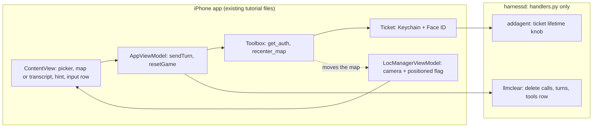
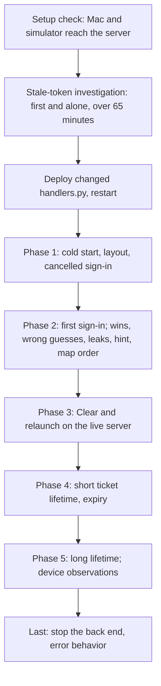

# One-page summaries (chronological)

## Summary of E-C: Implementation Plan

**What it is.** An ordered, no-code plan for a coding agent to build the Mystery City game on the existing tutorial app. It follows the teaching staff's HW2 feedback and overrides the HW2 design where they conflict: the map is already centered on the user at launch (no default view), hints sit above the text box, and there is no pin, Play Again, Give Up, status row, timer, Retry or game-over detection.

**How to read the diagram.** Boxes in the left group are the iPhone app files that change; boxes in the right group are the one back-end file that changes. Arrows show who calls whom. The dashed arrow shows the only path that moves the map.

**What gets built.** Back end: `llmclear` also deletes the app's stored tool row; the ticket lifetime becomes an environment variable (default 180 s). Front end: a MapKit map bound to one camera value, set once at the first location fix and again by a new `recenter_map` tool (ticket, latitude, longitude); the LLM first calls `get_auth` to obtain the ticket (Google sign-in, Keychain, Face ID as in the tutorial); new city-game rules keep the city secret with the existing hidden marker; a hint area above the text box shows the newest assistant text; launch and Clear both wipe the server conversation and send the rules. After a win, a denial or a give-up the LLM tells the user to tap Clear.

**Also in the plan.** A stale-token evidence run on a frozen baseline build before any sign-in code changes; a checklist of legacy patterns to avoid; 14 recorded departures from the HW2 design; 15 accepted limits; ten must-run and nice-to-have tests.

## Summary of G-D: Product Manager critique (Goldfish 4)

Three fresh reviewers compared E-C with the HW2 design and the staff feedback. They found that the plan covered the feedback well but left real gaps: a legacy-pattern sweep scoped narrower than the staff wording, a code fix planned before its evidence, unrequested extras (a cached location, a database transaction, a multi-round "play again" design), several departures from HW2 left undeclared (layout, the first message, Face ID on reuse), an unnamed tool, and undefined hint behavior. After three rounds the remaining points were small, such as listing the hint-accumulation and picker-lock behaviors.

## Summary of G-E: Technical Reviewer critique (Goldfish 5)

Two fresh reviewers read E-C alone. Round 1 found tests that could not pass or fail as written (a picker switch during a send, a Face ID prompt invisible on a simulator, one label covering two outcomes), a stale-token run that any rebuild would kill, a launch task that could run twice, and contradictory comment and sweep rules. Round 2 found that the plan's "never jump to 0,0" claim was not enforced, several done-when items needed setup the plan did not provide, and some pass lines were unrealistic. Hardening requests (a tool-call loop cap, wipe-race locks) were recorded as accepted limits.

## Summary of G-F: Senior Engineer critique (Goldfish 6)

Two fresh reviewers judged whether an implementer could succeed on a first pass. Round 1 found missing decisions (variable name, test runner, zoom level, precedence over input documents), a step too large to implement in one pass, and ordering problems. Round 2 found the plan ready for the code steps, with nitpicks: a wrong cross-reference, one circular arrow, and missing integer conversion for the environment variable.

## Summary of E-D: Validation Plan

**What it is.** A plan to check every feature of E-C, split into two kinds of checks. Static checks are obligations to be settled by reading a named artifact, such as the diff, once code exists (so every verdict starts PENDING). Empirical tests have Gherkin acceptance criteria, a named environment, a sample size where the LLM is involved, and a performer (agent, human, or a real device).

**How to read the diagram.** Boxes are phases in the order they run; the investigation box runs first and alone because it needs the server quiet for over an hour.

**Highlights.** Clear is proved on a scratch database built from the live schema, with a negative control showing deleting turns first is refused. Sub-second events (a hint flashing, a default map frame, a leaked marker) are observed with screen recording and server logs, not screenshots. Absence of a pin, Play Again, status row, timer and Retry is checked by structural reads and by screens that would show them. The win test compares the map's destination with a fixed reference table of at least 15 cities within 25 km. Secure Enclave and biometric behavior is stated as documented, not validated. The plan also lists the accepted limits it does not validate.

## Summary of G-G: Lead QA critique (Goldfish 7)

Three fresh reviewers audited E-D. They found that early static verdicts could not fail because no code existed, that some static checks really depended on the runtime or a model, that keyword searches cannot prove a feature absent, and that screenshots cannot see sub-second events. Later rounds found a scheduling conflict between the hour-long run and other server use, a NaN gap in the coordinate checks, missing runtime checks (Send disabled when empty, a state that would fail if game-over detection existed), a phase-order conflict (a signed-in win needed before the cancel test), and pass lines resting on model wording. The plan shrank by about 30 percent and its static rows became obligations with named artifacts.
